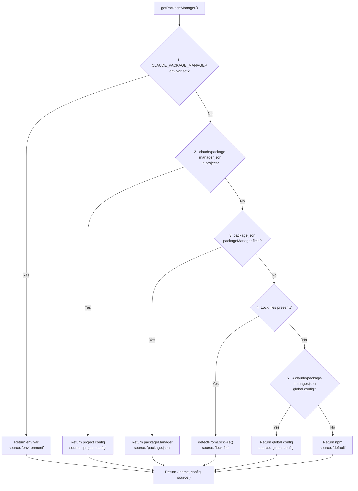
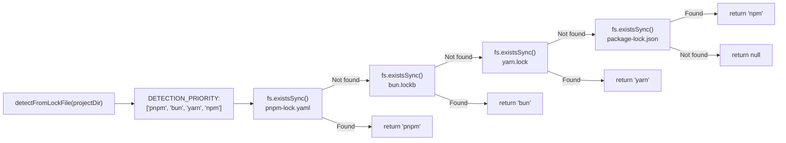
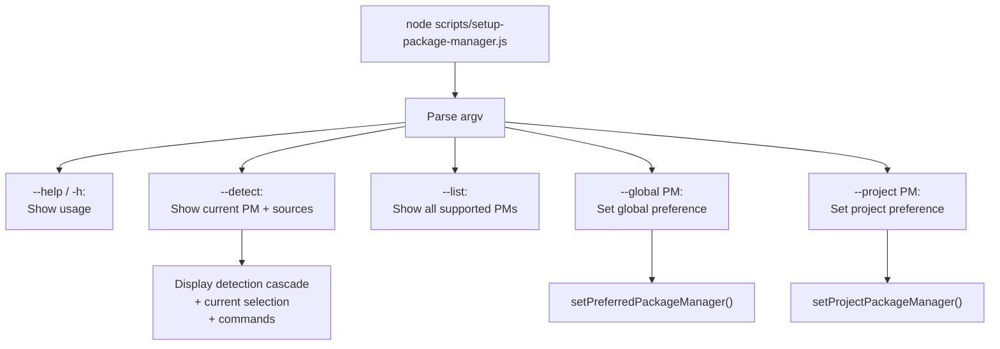

<!-- source: DeepWiki mcp.deepwiki.com · repo affaan-m/everything-claude-code · page 11.5 Package Manager System · fetched 2026-10-26 -->

# Package Manager System

<details>
<summary>Relevant source files</summary>

The following files were used as context for generating this wiki page:

- [.yarnrc.yml](.yarnrc.yml)
- [commands/loop-status.md](commands/loop-status.md)
- [package-lock.json](package-lock.json)
- [package.json](package.json)
- [scripts/build-opencode.js](scripts/build-opencode.js)
- [scripts/consult.js](scripts/consult.js)
- [scripts/ecc.js](scripts/ecc.js)
- [scripts/hooks/session-end.js](scripts/hooks/session-end.js)
- [scripts/hooks/session-start.js](scripts/hooks/session-start.js)
- [scripts/hooks/suggest-compact.js](scripts/hooks/suggest-compact.js)
- [scripts/lib/package-manager.js](scripts/lib/package-manager.js)
- [scripts/lib/session-aliases.js](scripts/lib/session-aliases.js)
- [scripts/lib/session-manager.js](scripts/lib/session-manager.js)
- [scripts/lib/utils.js](scripts/lib/utils.js)
- [scripts/loop-status.js](scripts/loop-status.js)
- [tests/ci/validators.test.js](tests/ci/validators.test.js)
- [tests/hooks/hooks.test.js](tests/hooks/hooks.test.js)
- [tests/integration/hooks.test.js](tests/integration/hooks.test.js)
- [tests/lib/package-manager.test.js](tests/lib/package-manager.test.js)
- [tests/lib/session-aliases.test.js](tests/lib/session-aliases.test.js)
- [tests/lib/session-manager.test.js](tests/lib/session-manager.test.js)
- [tests/lib/utils.test.js](tests/lib/utils.test.js)
- [tests/scripts/consult.test.js](tests/scripts/consult.test.js)
- [tests/scripts/ecc.test.js](tests/scripts/ecc.test.js)
- [tests/scripts/loop-status.test.js](tests/scripts/loop-status.test.js)
- [tests/scripts/npm-publish-surface.test.js](tests/scripts/npm-publish-surface.test.js)
- [yarn.lock](yarn.lock)

</details>


## Purpose and Scope

The Package Manager System provides automatic detection and consistent command generation for JavaScript package managers (npm, pnpm, yarn, bun) across Windows, macOS, and Linux platforms. This system resolves the cross-platform package manager fragmentation problem by implementing a priority-based detection cascade and generating platform-specific commands on demand.

This document covers the detection algorithm, configuration methods, command generation, and security model. For project detection (languages and frameworks), see [Project Detection System](). For usage in session initialization, see [Session Lifecycle & Persistence]().

**Sources:** [scripts/lib/package-manager.js:1-432]()

---

## Architecture Overview

### Detection Priority Cascade

The package manager resolution follows a 6-level cascade to balance explicit configuration with automatic detection. This cascade is implemented in the `getPackageManager` function [scripts/lib/package-manager.js:163-236]().

**Detection Priority Cascade Diagram**



**Sources:** [scripts/lib/package-manager.js:163-236]()

### Lock File Detection Priority

When detecting from lock files via `detectFromLockFile()` [scripts/lib/package-manager.js:92-102](), the system uses a priority order defined in `DETECTION_PRIORITY` [scripts/lib/package-manager.js:57]() to prefer more specific package managers:



**Sources:** [scripts/lib/package-manager.js:92-102](), [scripts/lib/package-manager.js:57]()

---

## Package Manager Definitions

### Supported Package Managers

The system defines four package managers in the `PACKAGE_MANAGERS` constant [scripts/lib/package-manager.js:13-54]() with their lock files and command structures:

| Package Manager | Lock File | Install | Run Script | Execute Binary | Test | Build | Dev |
|----------------|-----------|---------|------------|----------------|------|-------|-----|
| **npm** | `package-lock.json` | `npm install` | `npm run` | `npx` | `npm test` | `npm run build` | `npm run dev` |
| **pnpm** | `pnpm-lock.yaml` | `pnpm install` | `pnpm` | `pnpm dlx` | `pnpm test` | `pnpm build` | `pnpm dev` |
| **yarn** | `yarn.lock` | `yarn` | `yarn` | `yarn dlx` | `yarn test` | `yarn build` | `yarn dev` |
| **bun** | `bun.lockb` | `bun install` | `bun run` | `bunx` | `bun test` | `bun run build` | `bun run dev` |

**Sources:** [scripts/lib/package-manager.js:13-54]()

### PACKAGE_MANAGERS Object Structure

The configuration for each manager follows a standardized schema used for command generation:

```javascript
// Structure of each package manager definition in scripts/lib/package-manager.js
{
  name: string,          // Package manager identifier
  lockFile: string,      // Lock file name for detection
  installCmd: string,    // Installation command
  runCmd: string,        // Script execution prefix
  execCmd: string,       // Binary execution command (npx/dlx/bunx)
  testCmd: string,       // Test command
  buildCmd: string,      // Build command
  devCmd: string         // Development server command
}
```

**Sources:** [scripts/lib/package-manager.js:13-54]()

---

## Detection Implementation

### getPackageManager() Function

The core detection function [scripts/lib/package-manager.js:163-236]() returns a result object with metadata:

```javascript
// Return type
{
  name: string,        // 'npm' | 'pnpm' | 'yarn' | 'bun'
  config: object,      // Full PACKAGE_MANAGERS[name] definition
  source: string       // Detection source identifier
}

// Source values (in priority order)
'environment'      // CLAUDE_PACKAGE_MANAGER env var
'project-config'   // .claude/package-manager.json in project
'package.json'     // packageManager field
'lock-file'        // Lock file detection
'global-config'    // ~/.claude/package-manager.json
'default'          // npm fallback
```

**Sources:** [scripts/lib/package-manager.js:163-236]()

### detectFromPackageJson() Function

Parses the `packageManager` field from `package.json` [scripts/lib/package-manager.js:107-126]():

```javascript
// Supported formats in package.json:
"packageManager": "pnpm@8.6.0"  // With version
"packageManager": "pnpm"        // Without version

// Implementation extracts PM name before '@'
const pmName = pkg.packageManager.split('@')[0];
```

**Sources:** [scripts/lib/package-manager.js:107-126]()

### Critical Performance Note

The `getAvailablePackageManagers()` function [scripts/lib/package-manager.js:136-146]() spawns child processes (`where.exe` on Windows, `which` on Unix) to check command availability. This function **must not** be called during session startup hooks to avoid exceeding process limits on Windows [scripts/lib/package-manager.js:131-135]().

```javascript
/**
 * WARNING: This spawns child processes (where.exe on Windows, which on Unix)
 * for each package manager. Do NOT call this during session startup hooks —
 * it can exceed Bun's spawn limit on Windows and freeze the plugin.
 * Use detectFromLockFile() or detectFromPackageJson() for hot paths.
 */
function getAvailablePackageManagers() { ... }
```

**Sources:** [scripts/lib/package-manager.js:136-146](), [scripts/lib/package-manager.js:224-230]()

---

## Command Generation

### Function Mapping

The system provides three command generation functions to ensure consistency across managers:

```mermaid
graph TB
    subgraph "Command Generation API"
        GetRun["getRunCommand(script, options)"]
        GetExec["getExecCommand(binary, args, options)"]
        GetPM["getPackageManager(options)"]
    end
    
    subgraph "Input Validation"
        ValidateScript["SAFE_NAME_REGEX:<br/>/^[@a-zA-Z0-9_./-]+$/"]
        ValidateArgs["SAFE_ARGS_REGEX:<br/>/^[@a-zA-Z0-9\s_./:=,'\"*+-]+$/"]
    end
    
    subgraph "Output Commands"
        InstallCmd["pm.config.installCmd"]
        TestCmd["pm.config.testCmd"]
        BuildCmd["pm.config.buildCmd"]
        DevCmd["pm.config.devCmd"]
        GenericRun["pm.config.runCmd + script"]
        ExecBinary["pm.config.execCmd + binary + args"]
    end
    
    GetRun --> ValidateScript
    GetExec --> ValidateScript
    GetExec --> ValidateArgs
    
    GetRun --> GetPM
    GetExec --> GetPM
    
    ValidateScript --> InstallCmd
    ValidateScript --> TestCmd
    ValidateScript --> BuildCmd
    ValidateScript --> DevCmd
    ValidateScript --> GenericRun
    
    ValidateArgs --> ExecBinary
```

**Sources:** [scripts/lib/package-manager.js:288-315](), [scripts/lib/package-manager.js:327-340](), [scripts/lib/package-manager.js:285-286](), [scripts/lib/package-manager.js:319-320]()

### getRunCommand() Examples

The `getRunCommand` function [scripts/lib/package-manager.js:288-315]() handles both standard scripts and recognized patterns:

```javascript
// Special script names (recognized patterns)
getRunCommand('install')  // → 'npm install' | 'pnpm install' | 'yarn' | 'bun install'
getRunCommand('test')     // → 'npm test' | 'pnpm test' | 'yarn test' | 'bun test'
getRunCommand('build')    // → 'npm run build' | 'pnpm build' | 'yarn build' | 'bun run build'
getRunCommand('dev')      // → 'npm run dev' | 'pnpm dev' | 'yarn dev' | 'bun run dev'

// Generic script names
getRunCommand('lint')     // → 'npm run lint' | 'pnpm lint' | 'yarn lint' | 'bun run lint'
```

**Sources:** [scripts/lib/package-manager.js:303-315]()

---

## Configuration Methods

### Environment Variable Configuration

Highest priority configuration method checked in `getPackageManager` [scripts/lib/package-manager.js:167-174]():

```bash
# Set globally for all sessions
export CLAUDE_PACKAGE_MANAGER=pnpm

# Set for single session
CLAUDE_PACKAGE_MANAGER=yarn claude -p "add express"
```

### Project-Specific Configuration

Second priority after environment variable [scripts/lib/package-manager.js:177-192]():

**File:** `.claude/package-manager.json` in project root

```json
{
  "packageManager": "pnpm",
  "setAt": "2025-01-15T10:30:00Z"
}
```

### Global User Configuration

Fifth priority (after env var, project config, package.json, lock files) [scripts/lib/package-manager.js:215-222]():

**File:** `~/.claude/package-manager.json` (path generated by `getConfigPath()` [scripts/lib/package-manager.js:60-62]())

```json
{
  "packageManager": "pnpm",
  "setAt": "2025-01-15T10:30:00Z"
}
```

**Sources:** [scripts/lib/package-manager.js:163-236](), [scripts/lib/package-manager.js:60-62]()

---

## Security Model

### Command Injection Prevention

The system validates all user-provided script names and arguments using regex constants to prevent shell injection:

```javascript
// Script names: alphanumeric, dash, underscore, dot, slash, @
const SAFE_NAME_REGEX = /^[@a-zA-Z0-9_./-]+$/;

// Arguments: blocks dangerous metacharacters like ; | & ` $
const SAFE_ARGS_REGEX = /^[@a-zA-Z0-9\s_./:=,'"*+-]+$/;
```

**Validation Logic Examples:**
- `getRunCommand` throws if the script name fails `SAFE_NAME_REGEX` [scripts/lib/package-manager.js:296-298]().
- `getExecCommand` throws if the binary name fails `SAFE_NAME_REGEX` or if args fail `SAFE_ARGS_REGEX` [scripts/lib/package-manager.js:331-337]().

**Sources:** [scripts/lib/package-manager.js:285-286](), [scripts/lib/package-manager.js:319-320](), [scripts/lib/package-manager.js:296-298](), [scripts/lib/package-manager.js:331-337]()

---

## CLI Interface

### setup-package-manager.js CLI

The CLI tool provides interactive configuration management for the system via the `scripts/setup-package-manager.js` script.

**CLI Operation Flow**



**Sources:** [scripts/lib/package-manager.js:238-278](), [scripts/lib/package-manager.js:342-416](), [tests/lib/package-manager.test.js:1-234]()

---

## Module API Reference

### Exported Functions

The `scripts/lib/package-manager.js` module exports the following [scripts/lib/package-manager.js:418-431]():

- `PACKAGE_MANAGERS`: The configuration object for all managers.
- `DETECTION_PRIORITY`: The order used for lock file detection.
- `getPackageManager`: Resolves the manager for the current project.
- `detectFromLockFile`: Checks for existence of specific lock files.
- `detectFromPackageJson`: Reads `packageManager` field from `package.json`.
- `getRunCommand`: Generates a `run` command for a script.
- `getExecCommand`: Generates an execution command (e.g., `npx`) for a binary.
- `setPreferredPackageManager`: Saves a global preference to `~/.claude/`.
- `setProjectPackageManager`: Saves a project preference to `.claude/`.
- `getCommandPattern`: Generates a regex pattern to match equivalent commands across all managers.

**Sources:** [scripts/lib/package-manager.js:418-431]()

---

