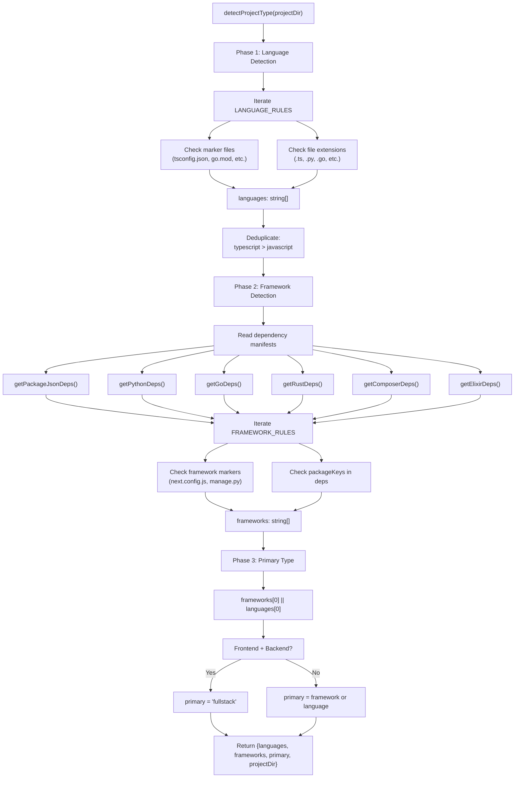
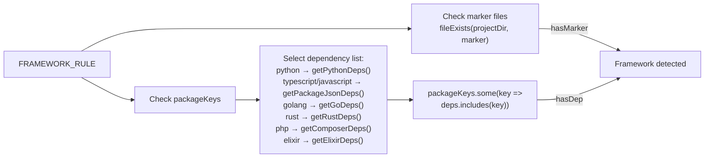

<!-- source: DeepWiki mcp.deepwiki.com · repo affaan-m/everything-claude-code · page 11.6 Project Detection System · fetched 2026-10-26 -->

# Project Detection System

Relevant source files

The following files were used as context for generating this wiki page:

- [commands/projects.md](commands/projects.md)
- [commands/promote.md](commands/promote.md)
- [scripts/hooks/doc-file-warning.js](scripts/hooks/doc-file-warning.js)
- [scripts/lib/project-detect.js](scripts/lib/project-detect.js)
- [skills/continuous-learning-v2/agents/observer.md](skills/continuous-learning-v2/agents/observer.md)
- [skills/continuous-learning-v2/config.json](skills/continuous-learning-v2/config.json)
- [skills/continuous-learning-v2/scripts/instinct-cli.py](skills/continuous-learning-v2/scripts/instinct-cli.py)
- [skills/continuous-learning-v2/scripts/test_parse_instinct.py](skills/continuous-learning-v2/scripts/test_parse_instinct.py)
- [tests/hooks/doc-file-warning.test.js](tests/hooks/doc-file-warning.test.js)
- [tests/lib/project-detect.test.js](tests/lib/project-detect.test.js)

The Project Detection System automatically identifies programming languages and frameworks used in a project by inspecting marker files, file extensions, and dependency manifests. This information is injected into each session's context via the `SessionStart` hook, enabling Claude to provide language-specific and framework-specific guidance without explicit user configuration.

**Scope**: This page documents the detection algorithms, rule definitions, dependency readers, and project-scoped identification used by the Continuous Learning system. For package manager detection, see [Package Manager System](). For session lifecycle management, see [Session Lifecycle & Persistence]().

---

## Detection Architecture

The project detection system operates in three phases: language detection (marker files + extensions), framework detection (marker files + dependencies), and primary type determination (including fullstack detection).

### Detection Flow Diagram

**Sources**: [scripts/lib/project-detect.js:320-415]()

---

## Language Detection Rules

Language detection uses a two-pronged approach: checking for marker files (e.g., `tsconfig.json`, `go.mod`) and checking for file extensions in the project root via `hasFileWithExtension` [scripts/lib/project-detect.js:150-161]().

### LANGUAGE_RULES Structure

| Language | Markers | Extensions |
| :--- | :--- | :--- |
| **Python** | `requirements.txt`, `pyproject.toml`, `setup.py`, `setup.cfg`, `Pipfile`, `poetry.lock` | `.py` |
| **TypeScript** | `tsconfig.json`, `tsconfig.build.json` | `.ts`, `.tsx` |
| **JavaScript** | `package.json`, `jsconfig.json` | `.js`, `.jsx`, `.mjs` |
| **Go** | `go.mod`, `go.sum` | `.go` |
| **Rust** | `Cargo.toml`, `Cargo.lock` | `.rs` |
| **Ruby** | `Gemfile`, `Gemfile.lock`, `Rakefile` | `.rb` |
| **Java** | `pom.xml`, `build.gradle`, `build.gradle.kts` | `.java` |
| **Swift** | `Package.swift` | `.swift` |
| **PHP** | `composer.json`, `composer.lock` | `.php` |

### Deduplication Logic

If both `typescript` and `javascript` are detected, JavaScript is removed from the languages array to avoid redundancy, as TypeScript projects inherently contain JavaScript context [scripts/lib/project-detect.js:340-344]().

**Sources**: [scripts/lib/project-detect.js:17-83](), [scripts/lib/project-detect.js:330-344]()

---

## Framework Detection Rules

Frameworks are detected by checking marker files (config files like `next.config.js`, `angular.json`) and by parsing dependency manifests (package.json, requirements.txt, etc.) using `packageKeys` [scripts/lib/project-detect.js:89-128]().

### Framework Detection Algorithm

**Sources**: [scripts/lib/project-detect.js:89-128](), [scripts/lib/project-detect.js:346-389]()

---

## Dependency Readers

Each language ecosystem has a dedicated dependency reader that parses manifest files and extracts dependency names to support framework detection.

### Dependency Reader Functions

- **package.json**: Reads both `dependencies` and `devDependencies` fields [scripts/lib/project-detect.js:168-177]().
- **Python**: Parses `requirements.txt` (ignoring comments/constraints) and `pyproject.toml` (extracts dependency array via regex) [scripts/lib/project-detect.js:184-225]().
- **Go**: Parses `go.mod` `require` blocks to extract module paths [scripts/lib/project-detect.js:227-252]().
- **Rust**: Parses `Cargo.toml` `[dependencies]` and `[dev-dependencies]` sections [scripts/lib/project-detect.js:254-281]().
- **PHP**: Parses `composer.json` `require` and `require-dev` fields [scripts/lib/project-detect.js:283-297]().

**Sources**: [scripts/lib/project-detect.js:163-318]()

---

## Project-Scoped Identification

For the Continuous Learning system, project detection is used to create unique identities for codebases, ensuring that learned "instincts" (patterns) are scoped correctly.

### detect_project (Python Implementation)

Used by the `instinct-cli.py` tool, this implementation establishes the project context for managing learned behaviors [skills/continuous-learning-v2/scripts/instinct-cli.py:128-204]().

1.  **Priority**:
    - `CLAUDE_PROJECT_DIR` environment variable [skills/continuous-learning-v2/scripts/instinct-cli.py:133-135]().
    - Git repository root via `git rev-parse --show-toplevel` [skills/continuous-learning-v2/scripts/instinct-cli.py:138-147]().
    - Global fallback if no project is detected [skills/continuous-learning-v2/scripts/instinct-cli.py:154-163]().
2.  **Project ID Generation**: Derived from a SHA-256 hash of the git remote origin URL (portable) or the local path (machine-specific) [skills/continuous-learning-v2/scripts/instinct-cli.py:169-181]().
3.  **Directory Structure**: Ensures the existence of project-specific directories for instincts, observations, and evolved skills under `~/.claude/homunculus/projects/<project_id>/` [skills/continuous-learning-v2/scripts/instinct-cli.py:186-194]().

**Sources**: [skills/continuous-learning-v2/scripts/instinct-cli.py:128-204]()

---

## Primary Type Determination

The system determines a "primary" project type to simplify tool configuration.

1.  If frameworks are detected, the first framework in the list becomes the primary type [scripts/lib/project-detect.js:391-393]().
2.  If no frameworks exist but languages are detected, the first language becomes the primary [scripts/lib/project-detect.js:394-396]().
3.  **Fullstack Detection**: If the system detects both a frontend framework (e.g., `react`, `nextjs`) and a backend framework (e.g., `express`, `django`), the primary type is set to `fullstack` [scripts/lib/project-detect.js:402-407]().

**Sources**: [scripts/lib/project-detect.js:391-415]()

---

## Edge Case: Documentation Detection

The project detection system also includes rules for identifying ad-hoc documentation files that should be moved to structured directories.

### doc-file-warning.js

This hook uses a denylist approach to identify "suspicious" documentation files in the project root [scripts/hooks/doc-file-warning.js:5-12]().

-   **Ad-hoc Pattern**: Matches files like `NOTES.md`, `TODO.txt`, `SCRATCH.md`, `TEMP.md`, `DRAFT.md`, `BRAINSTORM.md`, `SPIKE.md`, `DEBUG.md`, or `WIP.md` [scripts/hooks/doc-file-warning.js:22-22]().
-   **Structured Directory Exclusion**: If these files are located within directories like `docs/`, `.claude/`, `skills/`, `.github/`, `benchmarks/`, or `templates/`, they are considered intentional and do not trigger a warning [scripts/hooks/doc-file-warning.js:25-25]().

**Sources**: [scripts/hooks/doc-file-warning.js:14-41]()

---

