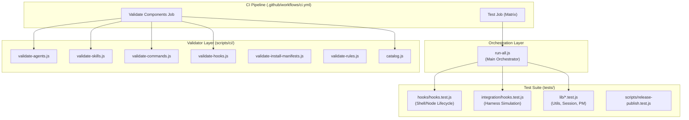
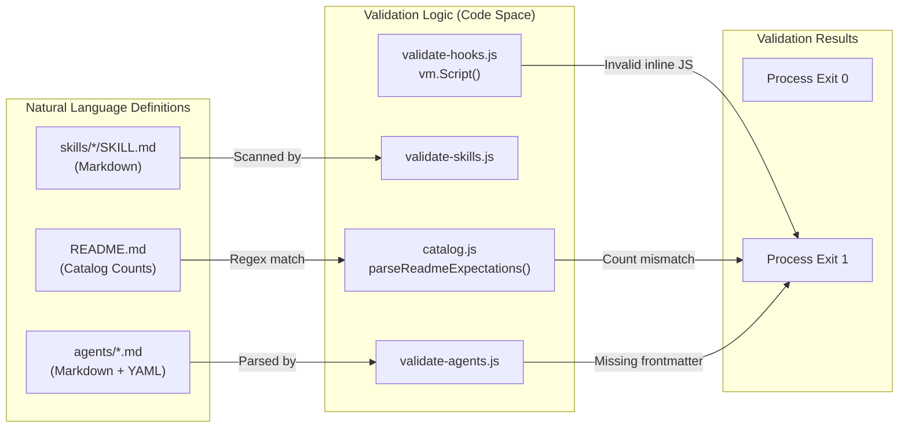
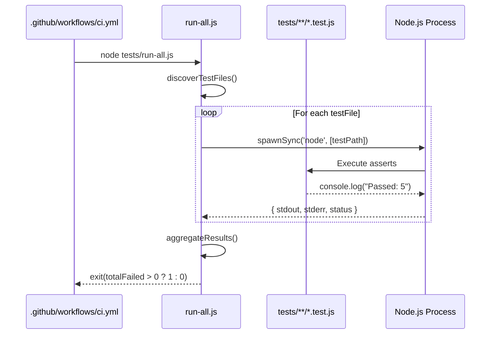

<!-- source: DeepWiki mcp.deepwiki.com · repo affaan-m/everything-claude-code · page 11.7 Testing Infrastructure · fetched 2026-10-26 -->

# Testing Infrastructure

Relevant source files

The following files were used as context for generating this wiki page:

- [.github/workflows/ci.yml](.github/workflows/ci.yml)
- [.github/workflows/maintenance.yml](.github/workflows/maintenance.yml)
- [.github/workflows/release.yml](.github/workflows/release.yml)
- [.github/workflows/reusable-release.yml](.github/workflows/reusable-release.yml)
- [.github/workflows/reusable-test.yml](.github/workflows/reusable-test.yml)
- [.github/workflows/reusable-validate.yml](.github/workflows/reusable-validate.yml)
- [CLAUDE.md](CLAUDE.md)
- [commitlint.config.js](commitlint.config.js)
- [schemas/hooks.schema.json](schemas/hooks.schema.json)
- [scripts/ci/catalog.js](scripts/ci/catalog.js)
- [scripts/ci/validate-hooks.js](scripts/ci/validate-hooks.js)
- [scripts/ci/validate-workflow-security.js](scripts/ci/validate-workflow-security.js)
- [scripts/release.sh](scripts/release.sh)
- [tests/ci/catalog.test.js](tests/ci/catalog.test.js)
- [tests/ci/validate-workflow-security.test.js](tests/ci/validate-workflow-security.test.js)
- [tests/run-all.js](tests/run-all.js)
- [tests/scripts/release-publish.test.js](tests/scripts/release-publish.test.js)

The Everything Claude Code (ECC) testing infrastructure is a multi-layered system designed to ensure the reliability of its agents, skills, and core utility libraries. It employs a centralized orchestrator, specialized validation scripts for CI/CD, and a robust suite of unit and integration tests across multiple operating systems and package managers.

## Architecture Overview

The testing suite is organized into three primary domains: **Core Logic Tests** (unit/integration), **Component Validators** (structural/schema), and **Hook Lifecycle Tests** (functional).

### Testing System Components

Sources: [.github/workflows/ci.yml:19-155](), [.github/workflows/ci.yml:170-215](), [tests/run-all.js:12-14](), [scripts/ci/catalog.js:48-60]()

## Core Orchestrator: `run-all.js`

The `run-all.js` script serves as the primary test runner for the `tests/` directory. It dynamically discovers and executes all files matching the `tests/**/*.test.js` glob pattern [tests/run-all.js:14-15]().

### Execution Logic
1.  **Discovery**: Recursively walks the `tests/` directory using `walkFiles` to find `.test.js` files [tests/run-all.js:25-36](), [tests/run-all.js:38-44]().
2.  **Isolation**: Executes each test file in a separate Node.js subprocess using `spawnSync` with piped I/O [tests/run-all.js:76-79]().
3.  **Reporting**: Parses `stdout` and `stderr` for "Passed: X" and "Failed: Y" regex matches to aggregate final results [tests/run-all.js:89-94]().
4.  **Exit Codes**: Returns exit code `1` if any test file fails or exits with a non-zero status [tests/run-all.js:118-118]().

Sources: [tests/run-all.js:1-119]()

## Component Validation (CI)

Validation scripts in `scripts/ci/` perform static and structural analysis on ECC components to ensure they meet the required schemas and documentation standards. These are executed during the `validate` job of the CI pipeline [.github/workflows/ci.yml:170-215]().

| Validator | Target | Logic |
|-----------|--------|-------|
| `validate-agents.js` | `agents/*.md` | Checks for YAML frontmatter and validates agent configurations [.github/workflows/ci.yml:187-189](). |
| `validate-skills.js` | `skills/` | Ensures skill metadata and directory structure are valid [.github/workflows/ci.yml:199-201](). |
| `validate-commands.js` | `commands/*.md` | Validates markdown readability and ensures cross-references to agents and skills exist [.github/workflows/ci.yml:195-197](). |
| `validate-hooks.js` | `hooks/hooks.json` | Validates the hook registry against `schemas/hooks.schema.json` using `Ajv` and checks inline JS syntax in command hooks using `vm.Script` [scripts/ci/validate-hooks.js:76-85](), [scripts/ci/validate-hooks.js:141-153](). |
| `validate-rules.js` | `rules/` | Verifies structural integrity of global and language-specific rules [.github/workflows/ci.yml:211-213](). |
| `validate-install-manifests.js` | `install-*.json` | Validates the manifests used by the selective install system [.github/workflows/ci.yml:203-205](). |
| `catalog.js` | `README.md`, `AGENTS.md` | Verifies that the counts of agents, skills, and commands mentioned in documentation match the actual files in the repo [scripts/ci/catalog.js:48-60](), [scripts/ci/catalog.js:86-155](). |

Sources: [scripts/ci/validate-hooks.js:1-202](), [.github/workflows/ci.yml:170-215](), [scripts/ci/catalog.js:1-155]()

## Hook Testing Infrastructure

Testing hooks requires simulating the Claude Code environment, which involves passing JSON payloads via `stdin` and capturing `stdout`/`stderr`.

### Integration Helpers
The system provides helpers to facilitate these tests:

- **`validateHookEntry`**: Used in `scripts/ci/validate-hooks.js` to ensure every hook in `hooks.json` has a valid `type` (command, http, prompt, agent) and that inline JavaScript commands are syntactically correct [scripts/ci/validate-hooks.js:50-125]().
- **Inline JS Validation**: Specifically targets `node -e` commands within `hooks.json` to catch syntax errors before deployment [scripts/ci/validate-hooks.js:76-85]().
- **Schema Enforcement**: Uses `Ajv` to validate the entire `hooks.json` structure against `schemas/hooks.schema.json` [scripts/ci/validate-hooks.js:141-153]().

Sources: [scripts/ci/validate-hooks.js:50-153](), [schemas/hooks.schema.json:1-197]()

## CI Pipeline & Matrix Testing

ECC uses GitHub Actions to run tests across a broad matrix of environments to ensure cross-platform compatibility [.github/workflows/ci.yml:19-34]().

- **OS Matrix**: `ubuntu-latest`, `windows-latest`, `macos-latest` [.github/workflows/ci.yml:28]().
- **Node Matrix**: `18.x`, `20.x`, `22.x` [.github/workflows/ci.yml:29]().
- **Package Manager Matrix**: `npm`, `pnpm`, `yarn`, `bun` [.github/workflows/ci.yml:30]().

The pipeline utilizes reusable workflows for testing, validation, and release processes to maintain consistency [.github/workflows/reusable-test.yml:1-156](), [.github/workflows/reusable-release.yml:1-122]().

Sources: [.github/workflows/ci.yml:1-215](), [.github/workflows/reusable-test.yml:1-156]()

## Hook Schema Enforcement

The `validate-hooks.js` script enforces strict requirements on `hooks.json`. It supports multiple hook types and validates them against a list of `VALID_EVENTS` including `SessionStart`, `PreToolUse`, and `PostToolUse` [scripts/ci/validate-hooks.js:13-32]().

- **`command`**: Validates `command` field exists and checks inline JS syntax [scripts/ci/validate-hooks.js:66-85]().
- **`http`**: Validates `url` and optional `headers` or `allowedEnvVars` [scripts/ci/validate-hooks.js:95-111]().
- **`prompt` / `agent`**: Validates required `prompt` field [scripts/ci/validate-hooks.js:114-123]().

The script uses `Ajv` to compile and validate against the JSON schema located at `schemas/hooks.schema.json` [scripts/ci/validate-hooks.js:141-153]().

Sources: [scripts/ci/validate-hooks.js:1-202](), [.github/workflows/ci.yml:191-193]()

## Release Verification

Before a release is published, the infrastructure performs critical metadata checks to ensure the package and plugin ecosystems remain in sync.

- **`plugin-manifest.test.js`**: Verifies that version strings in `plugin.json` match `package.json` [.github/workflows/release.yml:55-56]().
- **`build-opencode.test.js`**: Specifically validates the payload for OpenCode package distribution [.github/workflows/release.yml:31-32]().
- **`release-publish.test.js`**: Checks the GitHub Actions workflow files themselves to ensure they grant `id-token: write` permissions for npm provenance and verify the release sequence [tests/scripts/release-publish.test.js:36-64]().

Sources: [.github/workflows/release.yml:31-56](), [tests/scripts/release-publish.test.js:1-73]()

## Data Flow: Component Validation

This diagram bridges the "Natural Language Space" (Markdown definitions) to the "Code Entity Space" (Validator logic).

Sources: [scripts/ci/validate-hooks.js:76-85](), [scripts/ci/catalog.js:86-155](), [.github/workflows/ci.yml:187-215]()

## Test Execution Sequence

The following diagram illustrates how the `run-all.js` orchestrator interacts with individual test files and the CI environment.

Sources: [tests/run-all.js:38-44](), [tests/run-all.js:65-106](), [.github/workflows/ci.yml:155-159]()

---

