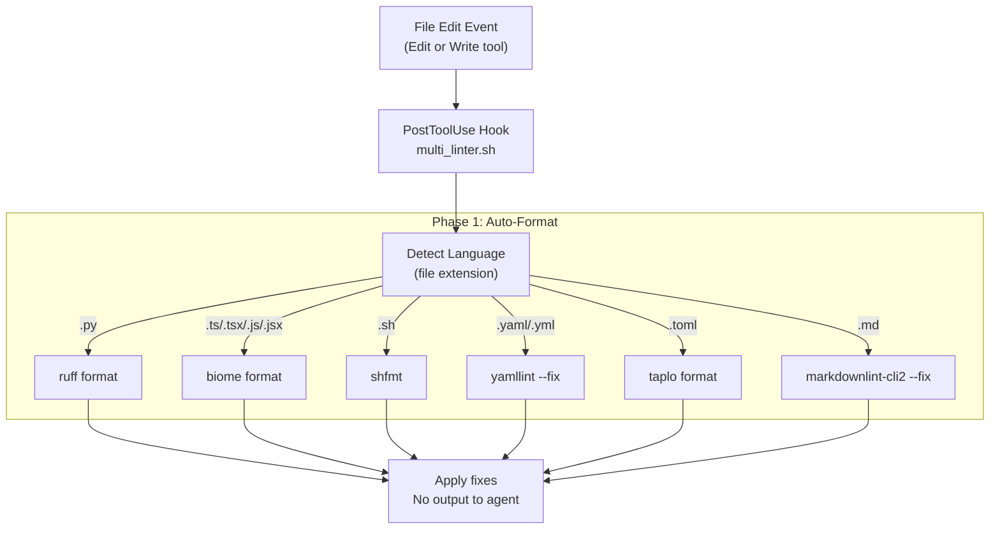
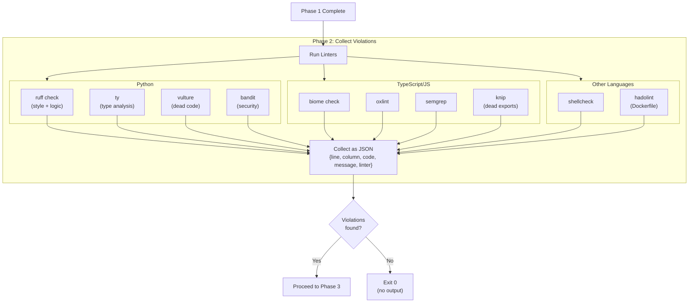
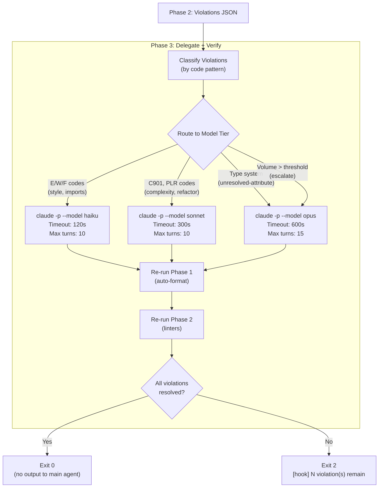

<!-- source: DeepWiki mcp.deepwiki.com · repo affaan-m/everything-claude-code · page 11.8 Plankton Code Quality System · fetched 2026-10-26 -->

# Plankton Code Quality System

Relevant source files

The following files were used as context for generating this wiki page:

- [.opencode/commands/harness-audit.md](.opencode/commands/harness-audit.md)
- [commands/harness-audit.md](commands/harness-audit.md)
- [commands/loop-start.md](commands/loop-start.md)
- [commands/model-route.md](commands/model-route.md)
- [commands/quality-gate.md](commands/quality-gate.md)
- [hooks/README.md](hooks/README.md)
- [hooks/hooks.json](hooks/hooks.json)
- [scripts/harness-audit.js](scripts/harness-audit.js)
- [scripts/hooks/desktop-notify.js](scripts/hooks/desktop-notify.js)
- [scripts/hooks/gateguard-fact-force.js](scripts/hooks/gateguard-fact-force.js)
- [skills/agent-eval/SKILL.md](skills/agent-eval/SKILL.md)
- [skills/autonomous-loops/SKILL.md](skills/autonomous-loops/SKILL.md)
- [skills/gateguard/SKILL.md](skills/gateguard/SKILL.md)
- [skills/plankton-code-quality/SKILL.md](skills/plankton-code-quality/SKILL.md)
- [tests/hooks/gateguard-fact-force.test.js](tests/hooks/gateguard-fact-force.test.js)
- [tests/scripts/harness-audit.test.js](tests/scripts/harness-audit.test.js)

This page documents the Plankton code quality enforcement system, a write-time quality assurance architecture that runs formatters and linters on every file edit via PostToolUse hooks. Plankton implements a three-phase pipeline: silent auto-formatting, violation collection, and Claude-powered remediation with tiered model routing.

For session-level quality checks and verification loops, see [10.5 Checkpoint & Verification Workflow](). For security scanning, see [10.4 Code Review & Security Workflow](). For hook system fundamentals, see [6. Hooks System]().

**Scope:** This page covers Plankton's architecture (phases, model routing, subprocess delegation), config protection mechanisms, integration with ECC hooks, and configuration reference.

---

## System Architecture

Plankton operates as a PostToolUse hook that intercepts every file edit or write operation. The system enforces quality standards through a three-phase pipeline that progressively escalates from automatic fixes to Claude-powered remediation [skills/plankton-code-quality/SKILL.md:22-43]().

### Three-Phase Pipeline

**Phase 1: Auto-Format (Silent Fixes)**

The first phase runs formatters on the modified file and automatically fixes style issues without reporting to the main agent. This phase handles 40-50% of quality issues transparently [skills/plankton-code-quality/SKILL.md:25-28]().

Title: Plankton Phase 1 Flow

**Sources:** [skills/plankton-code-quality/SKILL.md:22-29]()

**Phase 2: Collect Violations (Structured Data)**

After auto-formatting, the second phase runs linters and collects unfixable violations as structured JSON: `{line, column, code, message, linter}` [skills/plankton-code-quality/SKILL.md:30-33]().

Title: Plankton Phase 2 Violation Collection

**Sources:** [skills/plankton-code-quality/SKILL.md:31-35](), [skills/plankton-code-quality/SKILL.md:104-113]()

**Phase 3: Delegate and Verify**

The third phase spawns a `claude -p` subprocess with the violations JSON and routes to the appropriate model tier (Haiku, Sonnet, or Opus) based on violation complexity [skills/plankton-code-quality/SKILL.md:37-40]().

Title: Plankton Phase 3 Remediation Loop

**Sources:** [skills/plankton-code-quality/SKILL.md:37-43](), [skills/plankton-code-quality/SKILL.md:168-176]()

---

## GateGuard: Fact-Forcing Quality Gate

A critical component of the quality system is the `gateguard-fact-force.js` hook. This `PreToolUse` gate prevents "lazy" edits by forcing the agent to investigate context before applying changes [scripts/hooks/gateguard-fact-force.js:5-9]().

### Gate Logic and State Management
The hook maintains session-scoped state in `~/.gateguard/` to track which files have been investigated [scripts/hooks/gateguard-fact-force.js:29-31]().

1. **Deny:** On the first `Edit` or `Write` to a file in a session, the hook returns a `deny` decision [scripts/hooks/gateguard-fact-force.js:151-154]().
2. **Demand Facts:** The agent is instructed to gather specific facts: importers, affected APIs, and data schemas [skills/gateguard/SKILL.md:24-30]().
3. **Allow:** Once the agent performs the investigation and retries, the hook checks the session state and allows the tool to proceed [scripts/hooks/gateguard-fact-force.js:211-213]().

### Destructive Command Protection
GateGuard also intercepts destructive Bash commands like `rm -rf`, `git reset --hard`, or `drop table` [scripts/hooks/gateguard-fact-force.js:45](). It demands a rollback plan and a list of affected files before permitting execution [skills/gateguard/SKILL.md:79-82]().

**Sources:** [scripts/hooks/gateguard-fact-force.js:1-104](), [skills/gateguard/SKILL.md:1-91]()

---

## Model Routing and Subprocess Delegation

Plankton routes violations to Claude model tiers based on violation code patterns and volume thresholds. This ensures cost-effective remediation while maintaining quality [skills/plankton-code-quality/SKILL.md:167-174]().

### Model Tier Characteristics

| Tier | Violation Types | Timeout | Max Turns | Cost Tradeoff |
|------|----------------|---------|-----------|---------------|
| **Haiku** | Style (E\*), imports (W\*), formatting (F\*) | 120s | 10 | Fastest, cheapest for simple fixes |
| **Sonnet** | Complexity (C901), refactoring (PLR\*), logic errors | 300s | 10 | Balanced for moderate complexity |
| **Opus** | Type system, volume > threshold (default: 5), deep reasoning | 600s | 15 | Most thorough, handles complex cases |

**Sources:** [skills/plankton-code-quality/SKILL.md:37-42](), [skills/plankton-code-quality/SKILL.md:168-176]()

---

## Hook Lifecycle and Integration

Plankton integrates with Claude Code's hook system through three hook types: `PreToolUse` (config protection), `PostToolUse` (quality enforcement), and `Stop` (config verification) [skills/plankton-code-quality/SKILL.md:57-66]().

### Main Agent Visibility Matrix

| Scenario | Agent Sees | Hook Exit Code | Hook Output |
|----------|-----------|----------------|-------------|
| No violations after Phase 1 | Nothing | 0 | (silent) |
| All fixed by subprocess | Nothing | 0 | (silent) |
| Violations remain after subprocess | Error message | 2 | `[hook] N violation(s) remain` |
| Advisory message (duplicates, old tooling) | Warning | 0 | `[hook:advisory] ...` |
| Config edit blocked (PreToolUse) | Error message | 2 | `[hook] Config modification blocked` |
| Config modified detected (Stop) | Warning | 0 | `[hook] WARNING: Config file modified` |

**Sources:** [skills/plankton-code-quality/SKILL.md:45-55]()

---

## Config Protection Architecture

Plankton implements three layers of defense against LLM attempts to modify linter configurations instead of fixing code violations [skills/plankton-code-quality/SKILL.md:56-66]().

1. **PreToolUse Hook:** `protect_linter_configs.sh` blocks edits to protected files (e.g., `.ruff.toml`, `biome.json`) [skills/plankton-code-quality/SKILL.md:60]().
2. **Stop Hook:** `stop_config_guardian.sh` detects changes via `git diff` at session end [skills/plankton-code-quality/SKILL.md:61]().
3. **Protected Files List:** Hardcoded list including `.shellcheckrc`, `.yamllint`, `.hadolint.yaml`, etc [skills/plankton-code-quality/SKILL.md:63]().

### Package Manager Enforcement
Plankton blocks legacy package managers via a PreToolUse hook on Bash:
- Blocks `pip`, `pip3`, `poetry`, `pipenv` (recommends `uv`) [skills/plankton-code-quality/SKILL.md:67]().
- Blocks `npm`, `yarn`, `pnpm` (recommends `bun`), with exceptions for `audit`, `view`, and `publish` [skills/plankton-code-quality/SKILL.md:68-69]().

**Sources:** [skills/plankton-code-quality/SKILL.md:57-70]()

---

## Configuration Reference

Plankton's behavior is controlled by `.claude/hooks/config.json` [skills/plankton-code-quality/SKILL.md:141-143]().

### Key Configuration Options

| Setting | Type | Default | Purpose |
|---------|------|---------|---------|
| `phases.auto_format` | boolean | `true` | Enable Phase 1 (silent formatting) |
| `phases.subprocess_delegation` | boolean | `true` | Enable Phase 3 (Claude subprocess fixes) |
| `subprocess.volume_threshold` | integer | `5` | Violations > threshold auto-escalate to higher tier |
| `languages.{lang}` | boolean | varies | Enable/disable language support |

**Sources:** [skills/plankton-code-quality/SKILL.md:144-183]()

### Environment Variable Overrides

| Variable | Purpose |
|----------|---------|
| `HOOK_SKIP_SUBPROCESS=1` | Skip Phase 3 entirely, report violations directly [skills/plankton-code-quality/SKILL.md:187]() |
| `HOOK_SUBPROCESS_TIMEOUT=N` | Override tier timeout (seconds) [skills/plankton-code-quality/SKILL.md:188]() |
| `HOOK_DEBUG_MODEL=1` | Log model selection decisions to stderr [skills/plankton-code-quality/SKILL.md:189]() |
| `ECC_GATEGUARD=off` | Disable GateGuard fact-forcing gate [skills/gateguard/SKILL.md:98]() |

**Sources:** [skills/plankton-code-quality/SKILL.md:184-192](), [skills/gateguard/SKILL.md:97-100]()

---

