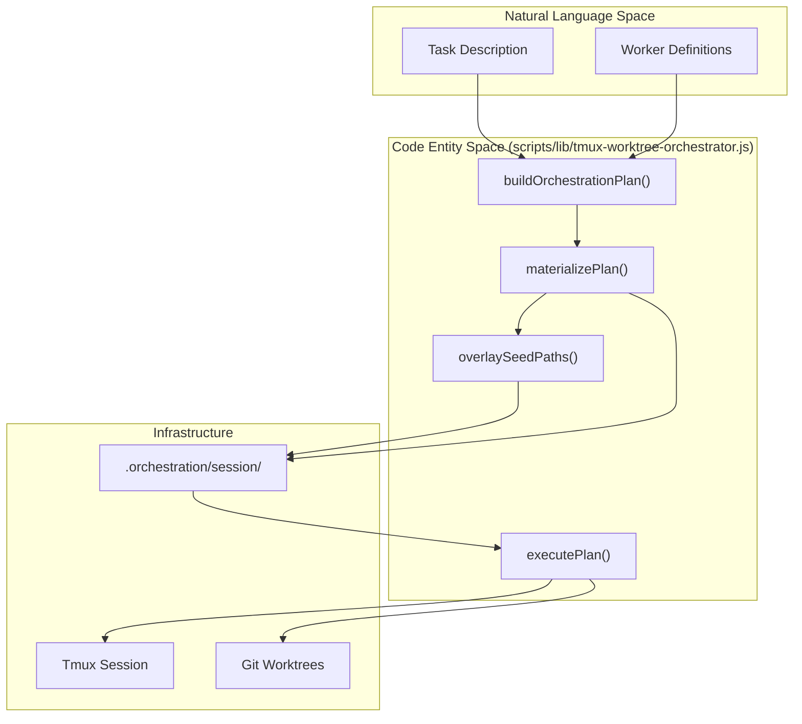
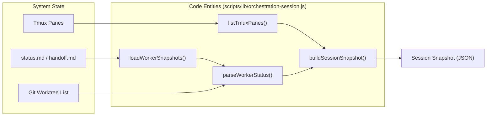

<!-- source: DeepWiki mcp.deepwiki.com · repo affaan-m/everything-claude-code · page 11.9 Tmux Worktree Orchestration · fetched 2026-10-26 -->

# Tmux Worktree Orchestration

Relevant source files

The following files were used as context for generating this wiki page:

- [.agents/skills/crosspost/SKILL.md](.agents/skills/crosspost/SKILL.md)
- [.agents/skills/exa-search/SKILL.md](.agents/skills/exa-search/SKILL.md)
- [.agents/skills/x-api/SKILL.md](.agents/skills/x-api/SKILL.md)
- [scripts/lib/orchestration-session.js](scripts/lib/orchestration-session.js)
- [scripts/lib/tmux-worktree-orchestrator.js](scripts/lib/tmux-worktree-orchestrator.js)
- [scripts/orchestrate-codex-worker.sh](scripts/orchestrate-codex-worker.sh)
- [scripts/orchestrate-worktrees.js](scripts/orchestrate-worktrees.js)
- [scripts/orchestration-status.js](scripts/orchestration-status.js)
- [skills/crosspost/SKILL.md](skills/crosspost/SKILL.md)
- [skills/dmux-workflows/SKILL.md](skills/dmux-workflows/SKILL.md)
- [skills/exa-search/SKILL.md](skills/exa-search/SKILL.md)
- [skills/fal-ai-media/SKILL.md](skills/fal-ai-media/SKILL.md)
- [skills/x-api/SKILL.md](skills/x-api/SKILL.md)
- [tests/lib/orchestration-session.test.js](tests/lib/orchestration-session.test.js)
- [tests/lib/tmux-worktree-orchestrator.test.js](tests/lib/tmux-worktree-orchestrator.test.js)

The Tmux Worktree Orchestration system provides a robust framework for managing "worker swarms"—multiple AI agents operating in parallel across isolated Git worktrees, coordinated via a centralized directory and a `tmux` session. This system allows Everything Claude Code (ECC) to scale complex tasks (like large-scale refactors or multi-module audits) by distributing them across independent execution environments while maintaining a unified control plane.

## Overview

The orchestration system is built on three pillars:
1.  **Isolation**: Each worker operates in its own `git worktree` with a dedicated branch, preventing file-system conflicts [scripts/lib/tmux-worktree-orchestrator.js:207-208]().
2.  **Coordination**: A centralized `.orchestration/[session-name]` directory holds the "Source of Truth" for every worker, including their tasks, real-time status, and final handoffs [scripts/lib/tmux-worktree-orchestrator.js:182-185]().
3.  **Visibility**: A `tmux` session tiles all worker panes, allowing a human operator or a "Chief of Staff" agent to monitor the swarm's progress [scripts/lib/tmux-worktree-orchestrator.js:239-242]().

### Coordination Directory Structure
Each worker in a session has a dedicated subdirectory containing three critical Markdown files:
-   `task.md`: The objective and constraints for the worker [scripts/lib/tmux-worktree-orchestrator.js:121-142]().
-   `status.md`: Live state tracking (e.g., `running`, `completed`, `failed`) [scripts/lib/tmux-worktree-orchestrator.js:162-170]().
-   `handoff.md`: The final results, including summaries and changed files [scripts/lib/tmux-worktree-orchestrator.js:144-160]().

**Sources:** [scripts/lib/tmux-worktree-orchestrator.js:108-173](), [skills/dmux-workflows/SKILL.md:141-168]()

---

## Orchestration Lifecycle

The system follows a strict "Plan -> Materialize -> Execute" lifecycle.

### 1. Plan Generation (`buildOrchestrationPlan`)
The `buildOrchestrationPlan` function consumes a configuration object and generates a complete blueprint for the swarm. It validates worker uniqueness, generates branch names using `slugify`, and constructs the necessary `git` and `tmux` command sequences [scripts/lib/tmux-worktree-orchestrator.js:175-245]().

### 2. Materialization (`materializePlan`)
This phase creates the physical infrastructure:
-   Creates the coordination directories [scripts/lib/tmux-worktree-orchestrator.js:118-120]().
-   Writes the initial `task.md`, `status.md`, and `handoff.md` files [scripts/lib/tmux-worktree-orchestrator.js:119-171]().
-   **Seeded Overlays**: Uses `overlaySeedPaths` to copy specific local files (like uncommitted scripts or plans) from the repo root into the worker worktrees, bypassing the need for git commits [scripts/lib/tmux-worktree-orchestrator.js:86-106]().

### 3. Execution (`executePlan`)
The execution engine performs the following:
-   Runs `git worktree add` for each worker [scripts/lib/tmux-worktree-orchestrator.js:219-221]().
-   Initializes a `tmux` session [scripts/lib/tmux-worktree-orchestrator.js:231-233]().
-   Splits the `tmux` window into a tiled layout and launches the `launcherCommand` in each pane [scripts/lib/tmux-worktree-orchestrator.js:239-244]().

### Worktree Swarm Data Flow
This diagram maps the relationship between the orchestration logic and the file-system entities it manages.

**Sources:** [scripts/lib/tmux-worktree-orchestrator.js:175-245](), [scripts/lib/tmux-worktree-orchestrator.js:86-106](), [tests/lib/tmux-worktree-orchestrator.test.js:55-105]()

---

## The Worker Launcher

Workers are typically executed via `scripts/orchestrate-codex-worker.sh`. This script acts as a wrapper that:
1.  **Updates Status**: Marks the worker as `running` in `status.md` [scripts/orchestrate-codex-worker.sh:49]().
2.  **Prepares Prompt**: Injects the contents of `task.md` into a system prompt that enforces worktree boundaries and ECC rules [scripts/orchestrate-codex-worker.sh:58-78]().
3.  **Invokes Agent**: Runs the primary agent (e.g., `codex exec`) within the worktree [scripts/orchestrate-codex-worker.sh:80]().
4.  **Captures Handoff**: Automatically writes the agent's output and `git status --short` to `handoff.md` upon completion [scripts/orchestrate-codex-worker.sh:81-94]().

**Sources:** [scripts/orchestrate-codex-worker.sh:1-107]()

---

## Monitoring and Rollback

### Orchestration Status CLI
The `orchestration-status.js` CLI (often invoked via `node scripts/orchestration-status.js`) provides a unified view of a live swarm. It merges data from three sources:
1.  **Tmux**: Uses `listTmuxPanes` to check if worker processes are still alive [scripts/lib/orchestration-session.js:157-216]().
2.  **File System**: Parses the `status.md` and `handoff.md` files via `loadWorkerSnapshots` [scripts/lib/orchestration-session.js:131-155]().
3.  **Git**: Verifies the current branch and worktree path for each worker via `parseWorkerStatus` [scripts/lib/orchestration-session.js:58-90]().

### Rollback Strategy
The system supports a cleanup phase to prevent "worktree rot":
-   **Success**: The operator merges the worker branches and deletes the worktrees.
-   **Failure/Abort**: The `executePlan` function includes error handling to prevent partial session launches [scripts/lib/tmux-worktree-orchestrator.js:247-251](). Manual cleanup involves `git worktree remove` and `tmux kill-session`.

### Entity Mapping: Monitoring System
This diagram shows how the status library bridges live system state to structured data.

**Sources:** [scripts/lib/orchestration-session.js:226-245](), [tests/lib/orchestration-session.test.js:152-188](), [scripts/lib/orchestration-session.js:58-90]()

---

## Key Functions Reference

| Function | File | Description |
| :--- | :--- | :--- |
| `buildOrchestrationPlan` | `scripts/lib/tmux-worktree-orchestrator.js` | Generates the JSON blueprint for the swarm [scripts/lib/tmux-worktree-orchestrator.js:175](). |
| `executePlan` | `scripts/lib/tmux-worktree-orchestrator.js` | Performs the `git` and `tmux` side-effects [scripts/lib/tmux-worktree-orchestrator.js:214](). |
| `overlaySeedPaths` | `scripts/lib/tmux-worktree-orchestrator.js` | Syncs uncommitted local files into workers [scripts/lib/tmux-worktree-orchestrator.js:86](). |
| `buildSessionSnapshot` | `scripts/lib/orchestration-session.js` | Aggregates live swarm state into a single object [scripts/lib/orchestration-session.js:226](). |
| `parseWorkerHandoff` | `scripts/lib/orchestration-session.js` | Extracts summary and validation from Markdown handoffs [scripts/lib/orchestration-session.js:99](). |
| `resolveSnapshotTarget` | `scripts/lib/orchestration-session.js` | Resolves a plan file or session name to a coordination directory [scripts/lib/orchestration-session.js:247](). |
| `parseWorkerStatus` | `scripts/lib/orchestration-session.js` | Parses the `status.md` file into a structured object [scripts/lib/orchestration-session.js:58](). |
| `loadWorkerSnapshots` | `scripts/lib/orchestration-session.js` | Reads all worker directories in a coordination root [scripts/lib/orchestration-session.js:131](). |

**Sources:** [scripts/lib/tmux-worktree-orchestrator.js:1-255](), [scripts/lib/orchestration-session.js:1-245]()

---

