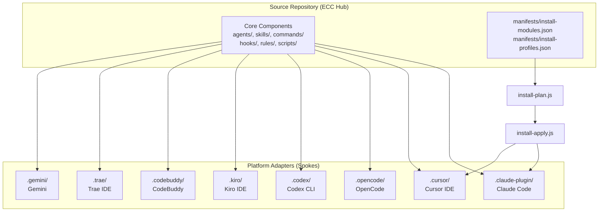
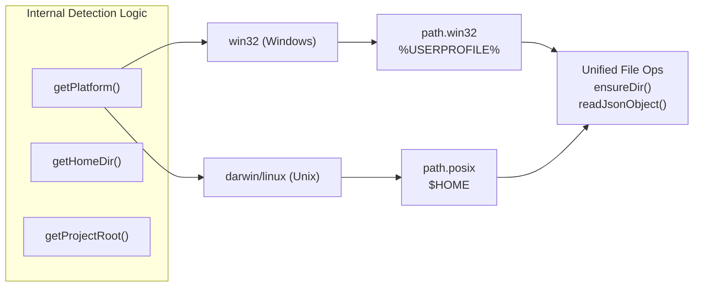
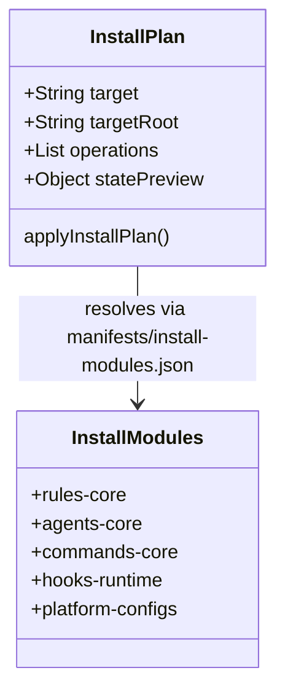

<!-- source: DeepWiki mcp.deepwiki.com · repo affaan-m/everything-claude-code · page 12 Cross-Platform Support · fetched 2026-10-26 -->

# 12. Cross-Platform Support

Relevant source files

The following files were used as context for generating this wiki page:

- [.agents/plugins/marketplace.json](.agents/plugins/marketplace.json)
- [.claude-plugin/PLUGIN_SCHEMA_NOTES.md](.claude-plugin/PLUGIN_SCHEMA_NOTES.md)
- [.claude-plugin/README.md](.claude-plugin/README.md)
- [.claude-plugin/marketplace.json](.claude-plugin/marketplace.json)
- [.claude-plugin/plugin.json](.claude-plugin/plugin.json)
- [.codex-plugin/README.md](.codex-plugin/README.md)
- [.codex-plugin/plugin.json](.codex-plugin/plugin.json)
- [.mcp.json](.mcp.json)
- [AGENTS.md](AGENTS.md)
- [README.md](README.md)
- [README.zh-CN.md](README.zh-CN.md)
- [WORKING-CONTEXT.md](WORKING-CONTEXT.md)
- [agent.yaml](agent.yaml)
- [commands/auto-update.md](commands/auto-update.md)
- [commands/jira.md](commands/jira.md)
- [docs/zh-CN/AGENTS.md](docs/zh-CN/AGENTS.md)
- [docs/zh-CN/README.md](docs/zh-CN/README.md)
- [manifests/install-modules.json](manifests/install-modules.json)
- [schemas/package-manager.schema.json](schemas/package-manager.schema.json)
- [schemas/plugin.schema.json](schemas/plugin.schema.json)
- [scripts/auto-update.js](scripts/auto-update.js)
- [skills/jira-integration/SKILL.md](skills/jira-integration/SKILL.md)
- [tests/ci/agent-yaml-surface.test.js](tests/ci/agent-yaml-surface.test.js)
- [tests/plugin-manifest.test.js](tests/plugin-manifest.test.js)
- [tests/scripts/auto-update.test.js](tests/scripts/auto-update.test.js)

This page documents ECC's integration with multiple AI agent harnesses and operating systems. ECC maintains a single source of truth in the main repository while providing platform-specific adapters and configurations for Claude Code, Cursor IDE, OpenCode, Codex CLI, Kiro, CodeBuddy, Trae, and Gemini.

As of v2.0.0-rc.1, the system has evolved into a comprehensive "performance optimization system for AI agent harnesses" [README.md:35-37](), supporting 48 agents, 68 legacy command shims, and 182 skills across the ecosystem [README.md:92-93]().

---

## Platform Architecture Overview

ECC uses a hub-and-spoke distribution model where the main repository serves as the canonical source, with platform-specific directories containing adapted configurations. The selective install architecture uses a manifest-driven pipeline to target specific harnesses [README.md:101-102]().

### ECC Distribution Hub

**Sources:** [README.md:87-106](), [manifests/install-modules.json:1-109](), [.claude-plugin/plugin.json:1-28]()

---

## Operating System Compatibility

All hooks and scripts are implemented in Node.js to ensure maximum compatibility across Windows, macOS, and Linux [README.zh-CN.md:183-188](). ECC provides both `install.sh` for Unix-like systems and `install.ps1` for Windows environments [README.zh-CN.md:132-146]().

### Platform Detection System

The `scripts/lib/utils.js` module (and associated installation logic) provides cross-platform primitives for directory resolution and environment handling.

**Sources:** [README.zh-CN.md:183-188](), [manifests/install-modules.json:83-109]()

---

## Package Manager Detection

ECC automatically detects the preferred package manager (npm, pnpm, yarn, or bun) using a 6-level priority cascade [README.zh-CN.md:185-194]().

| Priority | Source | Mechanism |
|----------|--------|-----------|
| 1 | Environment | `CLAUDE_PACKAGE_MANAGER` |
| 2 | Project Config | `.claude/package-manager.json` |
| 3 | `package.json` | `packageManager` field |
| 4 | Lock Files | `detectFromLockFile()` (pnpm > bun > yarn > npm) |
| 5 | Global Config | `~/.claude/package-manager.json` |
| 6 | Fallback | First available runtime |

**Sources:** [README.zh-CN.md:185-194](), [manifests/install-modules.json:94-94]()

---

## Core Platform Integrations

### Claude Code Integration
The primary integration target. Supports full feature parity including 48 specialized agents, 68 legacy command shims, and 182 skills [README.md:92-93](). It utilizes a sophisticated hook system with events like `PreToolUse` and `PostToolUse` [manifests/install-modules.json:63-81]().
For details, see [Claude Code Integration](#12.1).

### Cursor IDE Integration
Adapted via the `.cursor/` directory. It supports model ID expansion and YAML frontmatter rules [manifests/install-modules.json:83-108]().
For details, see [Cursor IDE Integration](#12.2).

### OpenCode Integration
Integrates via `.opencode/` with support for native custom tools like `run-tests` and `security-audit`. ECC includes a specific build script to ensure the `.opencode/dist/index.js` payload is included in releases [WORKING-CONTEXT.md:95-95]().
For details, see [OpenCode Integration](#12.3).

### Codex CLI Integration
Uses a `.codex/` configuration and `AGENTS.md` supplement [manifests/install-modules.json:83-108](). It includes specialized logic for Codex Context7 key extraction [WORKING-CONTEXT.md:71-71]().
For details, see [Codex CLI Integration](#12.4).

### Kiro IDE Integration
Uses a `.kiro/` directory structure with dual-format agents and steering file inclusion modes [manifests/install-modules.json:83-108]().
For details, see [Kiro IDE Integration](#12.6).

### CodeBuddy & Trae Integration
CodeBuddy utilizes a flattened rules structure in `.codebuddy/`, while Trae supports environment-specific outputs (e.g., `TRAE_ENV=cn`) in `.trae/` [manifests/install-modules.json:1-109]().
For details, see [CodeBuddy & Trae Integration](#12.7).

---

## Selective Install System

ECC uses a manifest-driven installation pipeline (`install-plan.js` and `install-apply.js`) for targeted component installation. The state store tracks installations to enable incremental updates [README.md:101-102]().

### Installation Target Resolution

**Sources:** [manifests/install-modules.json:1-109](), [README.md:101-102]()

---

## Platform Feature Comparison

For a side-by-side breakdown of support for agents, commands, and hooks across all platforms, see [Platform Feature Comparison](#12.5).

| Feature | Claude Code | Cursor | OpenCode | Codex | Kiro |
|---------|-------------|--------|----------|-------|------|
| Agents | 48 | 48 | 12 | 48 | 48 |
| Commands | 68 Shims | 68 Shims | 24 | Prompts | 68 Shims |
| Hooks | 8 Events | No | 20+ Events | Git-only | `.kiro.hook` |
| Rules | `~/.claude/rules` | `.cursor/rules` | Plugin | Instructions | Steering |

**Sources:** [README.md:87-106](), [WORKING-CONTEXT.md:12-14](), [AGENTS.md:1-45](), [manifests/install-modules.json:1-109]()

---

