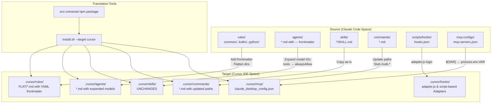
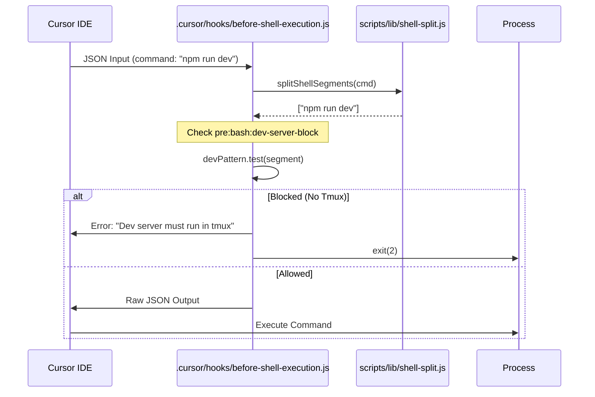

<!-- source: DeepWiki mcp.deepwiki.com · repo affaan-m/everything-claude-code · page 12.2 Cursor IDE Integration · fetched 2026-10-26 -->

# Cursor IDE Integration

Relevant source files

The following files were used as context for generating this wiki page:

- [.cursor/hooks.json](.cursor/hooks.json)
- [.cursor/hooks/adapter.js](.cursor/hooks/adapter.js)
- [.cursor/hooks/after-shell-execution.js](.cursor/hooks/after-shell-execution.js)
- [.cursor/hooks/before-shell-execution.js](.cursor/hooks/before-shell-execution.js)
- [.cursor/hooks/session-end.js](.cursor/hooks/session-end.js)
- [.cursor/hooks/session-start.js](.cursor/hooks/session-start.js)
- [.cursor/hooks/stop.js](.cursor/hooks/stop.js)
- [scripts/hooks/mcp-health-check.js](scripts/hooks/mcp-health-check.js)
- [scripts/hooks/pre-bash-dev-server-block.js](scripts/hooks/pre-bash-dev-server-block.js)
- [scripts/hooks/run-with-flags-shell.sh](scripts/hooks/run-with-flags-shell.sh)
- [scripts/lib/shell-split.js](scripts/lib/shell-split.js)
- [tests/hooks/mcp-health-check.test.js](tests/hooks/mcp-health-check.test.js)
- [tests/lib/shell-split.test.js](tests/lib/shell-split.test.js)

This page documents the adaptation layer that enables Everything Claude Code (ECC) components to run in [Cursor IDE](https://cursor.com). Cursor uses a different configuration format and lacks certain native Claude Code features (notably hooks), requiring extensive translation and specialized adapter scripts.

For native Claude Code integration, see [Claude Code Integration](#12.1). For other platforms, see [OpenCode Integration](#12.3) and [Codex CLI Integration](#12.4). For feature comparison across platforms, see [Platform Feature Comparison](#12.5).

---

## Overview

Cursor IDE requires pre-translation of all components due to fundamental differences in configuration syntax and capabilities. The `.cursor/` directory contains adapted versions of agents, skills, commands, rules, and MCP configurations. The translation process handles:

- **Rules**: Adding YAML frontmatter, flattening directory structure, and mapping language-specific globs.
- **Agents**: Expanding model IDs (e.g., `sonnet` to full version strings), converting tool permissions to `alwaysAllow` flags.
- **Skills**: Minimal translation (identical markdown format, but relocated to `.cursor/skills/`).
- **Commands**: Updating path references, stubbing unsupported multi-agent commands.
- **MCP Config**: Translating environment variable interpolation syntax.
- **Hooks**: No native equivalent in Cursor; replaced by specialized scripts in `.cursor/hooks/` and manual alternatives.

**Sources**: [.cursor/hooks/adapter.js:1-6](), [.cursor/hooks.json:1-115]()

---

## Directory Structure

### Translation Flow: Source to Cursor

The `.cursor/` directory mirrors the structure of Claude Code's `~/.claude/` but with platform-specific adaptations. Rules are flattened from hierarchical directories into a single level. Hooks are managed via a central `.cursor/hooks.json` manifest that maps events to specific adapter scripts.

**Sources**: [.cursor/hooks/adapter.js:1-10](), [.cursor/hooks.json:1-115](), [.cursor/hooks/before-shell-execution.js:1-5]()

---

## Hook Adaptation System

While Cursor lacks a native hook lifecycle, ECC provides a set of adapter scripts in `.cursor/hooks/` that emulate certain behaviors by wrapping shell executions or session lifecycle events.

### The Adapter Layer (`adapter.js`)

The `adapter.js` acts as the bridge between Cursor's input format and the expected Claude Code hook format. It handles stdin reading, input transformation, and delegation to existing scripts in `scripts/hooks/`.

| Function | Purpose |
|----------|---------|
| `readStdin()` | Reads raw input from process stdin up to 1MB limit. [adapter.js:13-22]() |
| `transformToClaude()` | Maps Cursor JSON keys (e.g., `path`, `result`) to Claude format (`file_path`, `tool_output`). [adapter.js:28-47]() |
| `runExistingHook()` | Executes a script from `scripts/hooks/` using `execFileSync` with transformed stdin. [adapter.js:49-61]() |
| `hookEnabled()` | Checks `ECC_HOOK_PROFILE` and `ECC_DISABLED_HOOKS` environment variables. [adapter.js:63-79]() |

**Sources**: [.cursor/hooks/adapter.js:1-82]()

### Shell Execution Interception

The `before-shell-execution.js` script emulates `PreToolUse` behavior for shell commands. It parses the command using `splitShellSegments` and applies blocking logic, such as preventing dev servers from running outside of tmux.

The `splitShellSegments` function is critical for parsing compound commands (e.g., `echo hi && npm run dev`) to ensure security and quality hooks are applied to each segment.

**Sources**: [.cursor/hooks/before-shell-execution.js:1-21](), [scripts/lib/shell-split.js:8-84](), [scripts/hooks/pre-bash-dev-server-block.js:162-181]()

---

## Event Mapping and Manifest

The `.cursor/hooks.json` file defines the event-to-script mapping. This allows Cursor to trigger ECC logic during various IDE activities.

| Cursor Event | ECC Adapter Script | Description |
|--------------|--------------------|-------------|
| `sessionStart` | `session-start.js` | Load context and detect environment. [.cursor/hooks.json:4-9]() |
| `beforeShellExecution` | `before-shell-execution.js` | Block dev-servers, git push reminders. [.cursor/hooks.json:18-29]() |
| `afterFileEdit` | `after-file-edit.js` | Auto-format, TS check, console.log warnings. [.cursor/hooks.json:37-43]() |
| `beforeReadFile` | `before-read-file.js` | Sensitive file warnings (.env, .key). [.cursor/hooks.json:58-64]() |
| `preCompact` | `pre-compact.js` | Save state before context compaction. [.cursor/hooks.json:100-106]() |
| `stop` | `stop.js` | Console.log audit on modified files. [.cursor/hooks.json:107-113]() |

**Sources**: [.cursor/hooks.json:1-115]()

---

## Feature Parity Matrix

| Component | Claude Code | Cursor | Implementation Detail |
|-----------|-------------|--------|-----------------------|
| **Rules** | Hierarchical | Flat + YAML | Flattened during install with `globs` |
| **Agents** | Short model IDs | Full model IDs | Expanded in YAML frontmatter (e.g., `sonnet`) |
| **Skills** | `skills/` | `.cursor/skills/` | Identical markdown files |
| **Hooks** | 8 event types | Script Adapters | Parity via `adapter.js` and `hooks.json` manifest. [.cursor/hooks.json:1-115]() |
| **Tmux Block** | Native Hook | `before-shell-execution.js` | Uses `shell-split.js` library. [.cursor/hooks/before-shell-execution.js:1-21]() |

**Sources**: [.cursor/hooks/adapter.js:1-10](), [.cursor/hooks/before-shell-execution.js:1-41](), [scripts/lib/shell-split.js:8-84](), [.cursor/hooks.json:1-115]()

---

