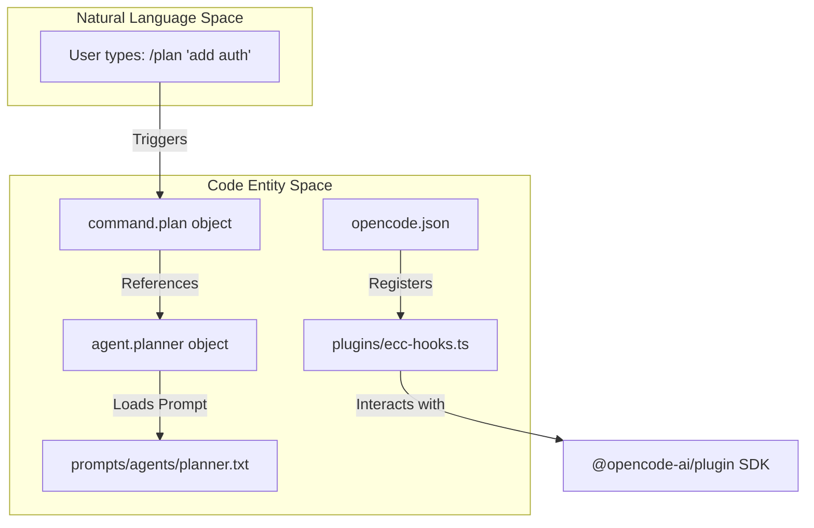
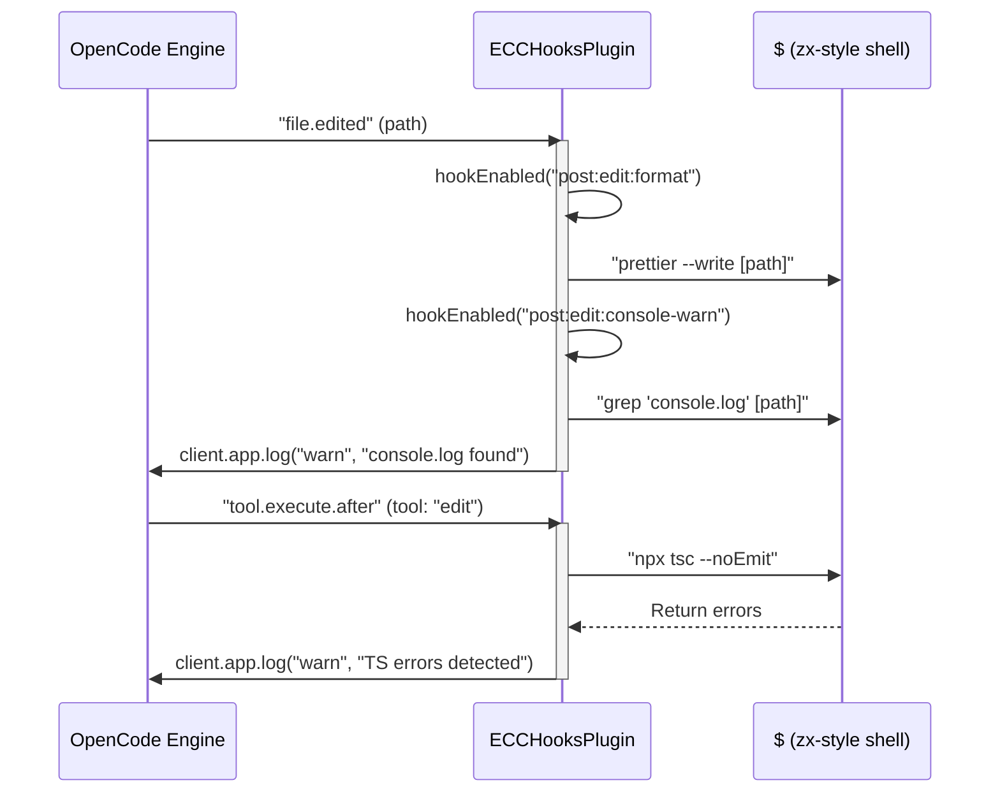
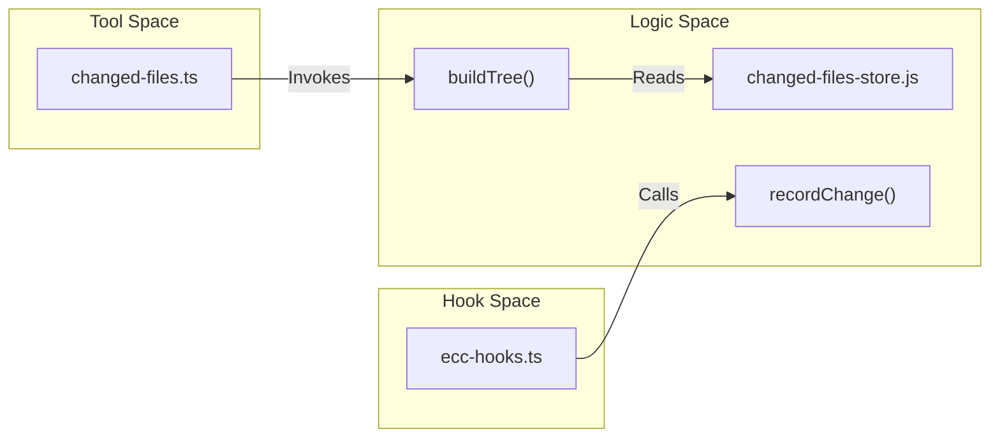

<!-- source: DeepWiki mcp.deepwiki.com · repo affaan-m/everything-claude-code · page 12.3 OpenCode Integration · fetched 2026-10-26 -->

# OpenCode Integration

<details>
<summary>Relevant source files</summary>

The following files were used as context for generating this wiki page:

- [.opencode/MIGRATION.md](.opencode/MIGRATION.md)
- [.opencode/README.md](.opencode/README.md)
- [.opencode/index.ts](.opencode/index.ts)
- [.opencode/opencode.json](.opencode/opencode.json)
- [.opencode/package-lock.json](.opencode/package-lock.json)
- [.opencode/package.json](.opencode/package.json)
- [.opencode/plugins/ecc-hooks.ts](.opencode/plugins/ecc-hooks.ts)
- [.opencode/plugins/index.ts](.opencode/plugins/index.ts)
- [.opencode/plugins/lib/changed-files-store.ts](.opencode/plugins/lib/changed-files-store.ts)
- [.opencode/tools/changed-files.ts](.opencode/tools/changed-files.ts)
- [.opencode/tools/check-coverage.ts](.opencode/tools/check-coverage.ts)
- [.opencode/tools/format-code.ts](.opencode/tools/format-code.ts)
- [.opencode/tools/git-summary.ts](.opencode/tools/git-summary.ts)
- [.opencode/tools/index.ts](.opencode/tools/index.ts)
- [.opencode/tools/lint-check.ts](.opencode/tools/lint-check.ts)
- [.opencode/tools/run-tests.ts](.opencode/tools/run-tests.ts)
- [.opencode/tools/security-audit.ts](.opencode/tools/security-audit.ts)
- [CHANGELOG.md](CHANGELOG.md)
- [ecc2/Cargo.lock](ecc2/Cargo.lock)
- [ecc2/Cargo.toml](ecc2/Cargo.toml)
- [tests/opencode-plugin-hooks.test.js](tests/opencode-plugin-hooks.test.js)
- [the-security-guide.md](the-security-guide.md)

</details>


**Purpose**: This page documents the integration of Everything Claude Code (ECC) with the OpenCode platform. It covers the `.opencode/` directory structure, the advanced plugin system with 20+ event types, native custom tools, and the specific feature set optimized for OpenCode (13 agents, 31 commands, 37 skills).

---

## OpenCode Platform Overview

OpenCode is an AI-assisted development CLI that serves as a highly extensible alternative to Claude Code. While maintaining full parity for core features like Agents and MCP, it introduces a superior plugin architecture based on a `.opencode/` directory structure [[.opencode/MIGRATION.md:1-10]]().

**Key Implementation Differences**:

| Feature | Claude Code | OpenCode | File Reference |
|---------|-------------|----------|----------------|
| **Configuration** | `CLAUDE.md`, `plugin.json` | `opencode.json` | [[.opencode/MIGRATION.md:13]]() |
| **Agents** | Markdown frontmatter | JSON object in config | [[.opencode/MIGRATION.md:14]]() |
| **Commands** | `commands/*.md` | `command` object or `.md` | [[.opencode/MIGRATION.md:15]]() |
| **Hooks** | `hooks.json` (3 phases) | **Plugin system (20+ events)** | [[.opencode/MIGRATION.md:17]]() |
| **Custom Tools** | N/A (MCP only) | **Native JS/TS Tools** | [[.opencode/README.md:125-132]]() |

**Sources**: [[.opencode/README.md:1-115]](), [[.opencode/MIGRATION.md:1-40]]()

---

## Plugin Architecture & Structure

The ECC integration for OpenCode is encapsulated within the `.opencode/` directory. This structure allows the plugin to be distributed via npm as `ecc-universal` or used directly by running OpenCode within the repository root [[.opencode/README.md:14-58]]().

### Directory Layout
```text
.opencode/
├── opencode.json          # Main manifest (Agents, Commands, Skills) [[.opencode/opencode.json:1-21]]()
├── plugins/               # Hook implementations (translated from hooks.json)
│   ├── ecc-hooks.ts       # Logic for 20+ event types [[.opencode/plugins/ecc-hooks.ts:1-15]]()
│   └── index.ts           # Plugin entry point [[.opencode/index.ts:38]]()
├── tools/                 # Native custom tools (TypeScript)
│   ├── run-tests.ts       # Test execution with auto-detection
│   ├── changed-files.ts   # Session change tracking [[.opencode/index.ts:77]]()
│   └── security-audit.ts  # Secret scanning & dependency audit [[.opencode/tools/security-audit.ts:15]]()
├── commands/              # Command templates (31 available) [[.opencode/README.md:79]]()
├── prompts/               # Agent system prompts (13 available) [[.opencode/opencode.json:25]]()
└── instructions/          # Consolidated rules (INSTRUCTIONS.md) [[.opencode/opencode.json:9]]()
```
**Sources**: [[.opencode/README.md:60-115]](), [[.opencode/MIGRATION.md:92-116]](), [[.opencode/opencode.json:1-25]](), [[.opencode/index.ts:47-80]]()

### Configuration Data Flow
The `opencode.json` file acts as the central registry, mapping human-readable commands to specific agents and templates.

**Natural Language to Code Entity Mapping**

**Sources**: [[.opencode/opencode.json:1-188]](), [[.opencode/MIGRATION.md:143-180]]()

---

## Hook System & Event Mapping

OpenCode's plugin system is significantly more granular than Claude Code. The `ECCHooksPlugin` function in [[.opencode/plugins/ecc-hooks.ts:28]]() translates standard ECC hooks into these native events.

### Hook Event Mapping
| Claude Code Hook | OpenCode Plugin Event | ECC Implementation |
|-------------------|-----------------------|--------------------|
| `PreToolUse` | `tool.execute.before` | Security checks, secret warnings [[.opencode/plugins/ecc-hooks.ts:195]]() |
| `PostToolUse` | `tool.execute.after` | TypeScript type-checking, PR logging [[.opencode/plugins/ecc-hooks.ts:139]]() |
| `Stop` | `session.idle` | Desktop notifications, status updates [[.opencode/MIGRATION.md:31]]() |
| `SessionStart` | `session.created` | Store initialization [[.opencode/MIGRATION.md:32]]() |
| `SessionEnd` | `session.deleted` | Cleanup operations [[.opencode/MIGRATION.md:33]]() |
| *N/A* | `file.edited` | **Auto-format (Prettier)**, console.log audit [[.opencode/plugins/ecc-hooks.ts:101]]() |

### Hook Execution Flow
The following diagram illustrates how the `ECCHooksPlugin` manages the lifecycle of a file edit.

**Hook Lifecycle Diagram**

**Sources**: [[.opencode/plugins/ecc-hooks.ts:18-184]](), [[.opencode/MIGRATION.md:25-39]]()

---

## Native Custom Tools

Unlike Claude Code, which relies on the `bash` tool for external logic, OpenCode allows the definition of native tools using the `@opencode-ai/plugin/tool` SDK [[.opencode/tools/security-audit.ts:11]]().

### Tool Reference
| Tool | File | Functionality |
|------|------|---------------|
| `run-tests` | `run-tests.ts` | Run test suite with auto-detection of PM (npm, pnpm, yarn, bun) [[.opencode/index.ts:71]]() |
| `security-audit` | `security-audit.ts` | Scans for hardcoded secrets and API keys [[.opencode/tools/security-audit.ts:132]]() |
| `check-coverage` | `check-coverage.ts` | Analyze test coverage against thresholds [[.opencode/tools/check-coverage.ts:12]]() |
| `changed-files` | `changed-files.ts` | List files changed in session as a navigable tree [[.opencode/index.ts:77]]() |
| `format-code` | `format-code.ts` | Manual code formatting trigger [[.opencode/index.ts:74]]() |

### Session Tracking Implementation
The `changed-files` tool interacts with a dedicated `changed-files-store.js` to provide a tree view of session modifications [[.opencode/plugins/ecc-hooks.ts:23]]().

**Tool Entity Mapping**

**Sources**: [[.opencode/plugins/ecc-hooks.ts:20-24]](), [[.opencode/plugins/ecc-hooks.ts:143-156]]()

---

## Feature Set (OpenCode Port)

The OpenCode integration supports a curated subset of the full ECC suite to maintain high performance and session stability.

### Agents (13)
- `build`: Primary coding agent (Claude 4.5 Sonnet) [[.opencode/opencode.json:26]]()
- `planner`: Implementation planning (Claude 4.5 Opus) [[.opencode/opencode.json:38]]()
- `architect`: Software architecture specialist [[.opencode/opencode.json:50]]()
- `tdd-guide`: Test-Driven Development specialist [[.opencode/opencode.json:86]]()
- `code-reviewer`: Expert code review specialist [[.opencode/opencode.json:62]]()
- `security-reviewer`: Vulnerability detection specialist [[.opencode/opencode.json:74]]()
- `build-error-resolver`: Fixes build/TS errors [[.opencode/opencode.json:98]]()
- `e2e-runner`: End-to-end testing specialist [[.opencode/opencode.json:110]]()
- `doc-updater`: Documentation and codemap specialist [[.opencode/opencode.json:122]]()
- `refactor-cleaner`: Dead code cleanup specialist [[.opencode/opencode.json:134]]()
- `go-reviewer` / `go-build-resolver`: Specialized Go support [[.opencode/opencode.json:146-158]]()
- `database-reviewer`: PostgreSQL/Supabase specialist [[.opencode/opencode.json:170]]()

### Commands (31)
Includes core development commands like `/plan`, `/tdd`, `/code-review`, and `/security`, as well as advanced lifecycle commands like `/checkpoint`, `/verify`, `/eval`, and the `/loop-start` orchestration suite [[.opencode/README.md:81-113]]().

### Skills (37)
Loaded via the `instructions` array in `opencode.json` [[.opencode/opencode.json:6-21]]().
- `tdd-workflow`
- `security-review`
- `coding-standards`
- `strategic-compact`
- `eval-harness`
- `verification-loop`
- `api-design`

**Sources**: [[.opencode/README.md:62-113]](), [[.opencode/opencode.json:25-208]](), [[.opencode/index.ts:55]]()

---

## Installation & Runtime Controls

### Installation Options
1. **npm Package**: `npm install ecc-universal`. Requires adding `"plugin": ["ecc-universal"]` to `opencode.json` [[.opencode/README.md:25-34]]().
2. **Direct Clone**: Clone the repo and run `opencode` in the root. The config is automatically detected from `.opencode/opencode.json` [[.opencode/README.md:52-58]]().

### Runtime Profiles
The OpenCode plugin respects environment variables for fine-grained control:
- `ECC_HOOK_PROFILE`: `minimal`, `standard` (default), or `strict` [[.opencode/plugins/ecc-hooks.ts:67-72]]().
- `ECC_DISABLED_HOOKS`: Comma-separated list of hook IDs to skip [[.opencode/plugins/ecc-hooks.ts:73-78]]().

**Sources**: [[.opencode/README.md:15-58]](), [[.opencode/plugins/ecc-hooks.ts:33-89]]()

---

