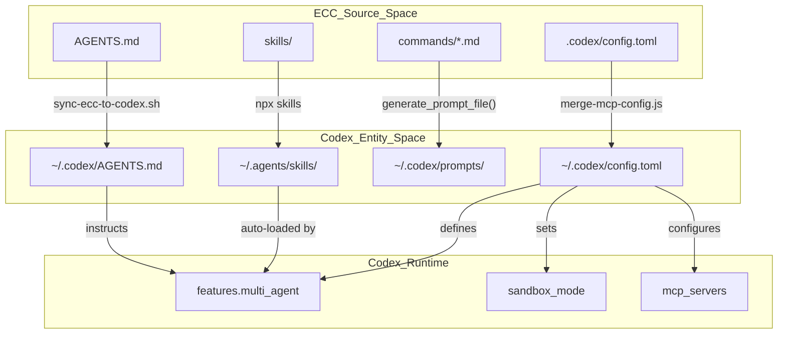
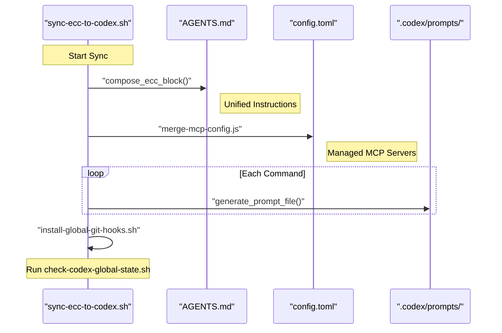

<!-- source: DeepWiki mcp.deepwiki.com · repo affaan-m/everything-claude-code · page 12.4 Codex CLI Integration · fetched 2026-10-26 -->

# Codex CLI Integration

Relevant source files

The following files were used as context for generating this wiki page:

- [.agents/skills/frontend-patterns/SKILL.md](.agents/skills/frontend-patterns/SKILL.md)
- [.codex/AGENTS.md](.codex/AGENTS.md)
- [.codex/agents/docs-researcher.toml](.codex/agents/docs-researcher.toml)
- [.codex/agents/explorer.toml](.codex/agents/explorer.toml)
- [.codex/agents/reviewer.toml](.codex/agents/reviewer.toml)
- [.codex/config.toml](.codex/config.toml)
- [.kiro/skills/search-first/SKILL.md](.kiro/skills/search-first/SKILL.md)
- [commands/learn-eval.md](commands/learn-eval.md)
- [scripts/ci/check-unicode-safety.js](scripts/ci/check-unicode-safety.js)
- [scripts/codex-git-hooks/pre-commit](scripts/codex-git-hooks/pre-commit)
- [scripts/codex-git-hooks/pre-push](scripts/codex-git-hooks/pre-push)
- [scripts/codex/check-codex-global-state.sh](scripts/codex/check-codex-global-state.sh)
- [scripts/codex/install-global-git-hooks.sh](scripts/codex/install-global-git-hooks.sh)
- [scripts/codex/merge-codex-config.js](scripts/codex/merge-codex-config.js)
- [scripts/codex/merge-mcp-config.js](scripts/codex/merge-mcp-config.js)
- [scripts/lib/mcp-config.js](scripts/lib/mcp-config.js)
- [scripts/sync-ecc-to-codex.sh](scripts/sync-ecc-to-codex.sh)
- [skills/autonomous-agent-harness/SKILL.md](skills/autonomous-agent-harness/SKILL.md)
- [skills/defi-amm-security/SKILL.md](skills/defi-amm-security/SKILL.md)
- [tests/ci/agent-instruction-safety.test.js](tests/ci/agent-instruction-safety.test.js)
- [tests/codex-config.test.js](tests/codex-config.test.js)
- [tests/hooks/config-protection.test.js](tests/hooks/config-protection.test.js)
- [tests/lib/mcp-config.test.js](tests/lib/mcp-config.test.js)
- [tests/scripts/codex-hooks.test.js](tests/scripts/codex-hooks.test.js)
- [tests/scripts/sync-ecc-to-codex.test.js](tests/scripts/sync-ecc-to-codex.test.js)

Codex CLI integration provides a secure, permission-gated execution environment for Everything Claude Code (ECC) components with explicit capability controls. While it lacks the automated hook-based quality enforcement found in Claude Code, Codex offers a robust sandbox model and TOML-based configuration suitable for environments requiring strict security boundaries.

## Overview

The Codex integration adapts ECC's core agents, skills, and commands to the Codex CLI environment. It prioritizes configuration-as-code via `.codex/config.toml` and skill distribution through a specialized `.agents/skills/` directory structure.

### Key Characteristics

| Aspect | Implementation |
|--------|----------------|
| **Configuration Format** | TOML (`.codex/config.toml`) [[.codex/config.toml:3-10]]() |
| **Agent Instructions** | `AGENTS.md` + `.codex/AGENTS.md` supplement [[.codex/AGENTS.md:1-3]]() |
| **Skill Distribution** | `.agents/skills/` directory [[.codex/AGENTS.md:16-18]]() |
| **Hook Support** | ❌ Not natively supported (uses Git hooks instead) [[.codex/AGENTS.md:87-87]]() |
| **Permission Model** | ✅ Sandbox with explicit `workspace-write` [[.codex/config.toml:19-19]]() |
| **Multi-Agent** | ✅ Supported via `features.multi_agent` [[.codex/config.toml:91-91]]() |

**Sources**: [[.codex/AGENTS.md:1-103]](), [[.codex/config.toml:1-121]]()

---

## Architecture Overview

The following diagram illustrates how ECC source entities map to Codex-specific configuration files and runtime structures.

### Data Flow: ECC to Codex Entity Mapping

**Sources**: [[scripts/sync-ecc-to-codex.sh:4-12]](), [[scripts/sync-ecc-to-codex.sh:131-146]](), [[.codex/config.toml:88-103]](), [[scripts/codex/check-codex-global-state.sh:22-23]]()

---

## Configuration Structure

### .codex/config.toml

Codex uses TOML for configuration. The ECC reference configuration enables standard features like web search and multi-agent support while pinning security defaults.

**Key Configuration Sections**:
- **Runtime Settings**: Sets `approval_policy = "on-request"` and `sandbox_mode = "workspace-write"` [[.codex/config.toml:18-19]]().
- **MCP Servers**: Configures a lean baseline including `github`, `context7`, `exa`, `memory`, `playwright`, and `sequential-thinking` [[.codex/config.toml:41-69]]().
- **Profiles**: Defines `strict` (read-only) and `yolo` (no approval) profiles for different risk levels [[.codex/config.toml:94-102]]().

### Multi-Agent Configuration

Codex supports multi-agent workflows via the `features.multi_agent` flag [[.codex/config.toml:91-91]](). ECC provides specialized roles defined in the `[agents]` section:

| Role | Description | Config File |
|------|-------------|-------------|
| `explorer` | Read-only codebase explorer [[.codex/config.toml:110-111]]() | `agents/explorer.toml` |
| `reviewer` | PR reviewer focused on correctness [[.codex/config.toml:114-115]]() | `agents/reviewer.toml` |
| `docs_researcher` | Documentation specialist [[.codex/config.toml:118-119]]() | `agents/docs-researcher.toml` |

**Sources**: [[.codex/config.toml:18-121]](), [[scripts/sync-ecc-to-codex.sh:158-159]]()

---

## Agent and Skill Distribution

### Consolidated AGENTS.md

Unlike Claude Code, which reads individual files, Codex uses a consolidated `AGENTS.md`. The `sync-ecc-to-codex.sh` script composes the global `~/.codex/AGENTS.md` by concatenating the ECC root `AGENTS.md` with the Codex-specific supplement found in `.codex/AGENTS.md` [[scripts/sync-ecc-to-codex.sh:180-187]]().

### Skill Loading Mechanism

Skills are auto-loaded from the `.agents/skills/` directory [[.codex/AGENTS.md:16-16]](). Each skill directory must contain:
1. `SKILL.md`: Detailed instructions and workflow [[.codex/AGENTS.md:17-17]]().
2. `agents/openai.yaml`: Metadata for the Codex interface [[.codex/AGENTS.md:18-18]]().

### Component Interaction Diagram

This diagram shows how the `sync-ecc-to-codex.sh` script bridges the natural language requirements of agents to the file-based entity space of Codex.

**Sources**: [[scripts/sync-ecc-to-codex.sh:131-146]](), [[scripts/sync-ecc-to-codex.sh:180-187]](), [[scripts/codex/check-codex-global-state.sh:4-6]](), [[scripts/codex/merge-mcp-config.js:5-11]]()

---

## Security and Sandbox Model

### Permission Grants

Codex enforces security via `sandbox_mode`. ECC recommends `workspace-write` for standard development [[.codex/config.toml:19-19]](). For higher security, the `strict` profile uses `read-only` [[.codex/config.toml:96-96]]().

### Security Without Hooks

Since Codex lacks native hooks, ECC implements security via two mechanisms:
1. **Instruction-based Enforcement**: Agents are instructed to validate inputs, avoid hardcoded secrets, and review diffs manually [[.codex/AGENTS.md:97-103]]().
2. **Git Safety Hooks**: ECC provides standalone bash scripts for `pre-commit` and `pre-push` that are installed globally via `git config --global core.hooksPath` [[scripts/codex/check-codex-global-state.sh:203-212]]().

### ECC Git Safety Hooks

| Hook | Purpose | Logic |
|------|---------|-------|
| `pre-commit` | Secret Detection | Scans staged files for sensitive keys (OpenAI, AWS, Private Keys) [[scripts/codex/install-global-git-hooks.sh:51-53]]() (Logic implemented in hook script). |
| `pre-push` | Verification | Automatically detects package manager and runs `lint`, `typecheck`, `test`, and `build` [[scripts/codex/check-codex-global-state.sh:220-224]](). |

**Sources**: [[scripts/codex/install-global-git-hooks.sh:1-66]](), [[scripts/codex/check-codex-global-state.sh:203-225]](), [[tests/scripts/codex-hooks.test.js:93-112]]()

---

## Command Support

Codex uses "Instruction-based" prompts rather than native slash commands [[.codex/AGENTS.md:90-90]](). The `sync-ecc-to-codex.sh` script converts ECC markdown commands into Codex-ready prompt files:

- **Prompt Generation**: The `generate_prompt_file` function strips YAML frontmatter from ECC commands and wraps them in a standardized prompt format [[scripts/sync-ecc-to-codex.sh:131-146]]().
- **MCP Normalization**: The `merge-mcp-config.js` utility ensures ECC-managed servers like `context7` are named consistently and use the project's detected package manager [[scripts/codex/merge-mcp-config.js:36-43]]().

### Available Skill Workflows

Codex users can trigger ECC workflows by referencing skills in the `.agents/skills/` directory, including:
- `tdd-workflow`: 80%+ coverage enforcement [[.codex/AGENTS.md:21-21]]().
- `verification-loop`: Comprehensive build/test/lint/typecheck cycle [[.codex/AGENTS.md:36-36]]().
- `strategic-compact`: Context management and token optimization [[.codex/AGENTS.md:34-34]]().

**Sources**: [[scripts/sync-ecc-to-codex.sh:131-146]](), [[.codex/AGENTS.md:20-44]](), [[scripts/codex/merge-mcp-config.js:89-103]]()

---

## Installation and Verification

### Sync Process

The `sync-ecc-to-codex.sh` script is the primary entry point for Codex integration. It performs the following:
1. Backs up existing `~/.codex` configuration [[scripts/sync-ecc-to-codex.sh:170-175]]().
2. Composes the unified `AGENTS.md` using markers to preserve user content [[scripts/sync-ecc-to-codex.sh:189-209]]().
3. Merges MCP server configurations using the `merge-mcp-config.js` Node-based TOML utility [[scripts/sync-ecc-to-codex.sh:148-159]]().
4. Generates prompt files from the `commands/` directory [[scripts/sync-ecc-to-codex.sh:32-33]]().
5. Installs global git safety hooks via `install-global-git-hooks.sh` [[scripts/sync-ecc-to-codex.sh:35-35]]().

### Sanity Checking

After synchronization, the `check-codex-global-state.sh` script validates the installation [[scripts/codex/check-codex-global-state.sh:4-6]](). It verifies:
- Presence of ECC root instructions and Codex supplement in `AGENTS.md` [[scripts/codex/check-codex-global-state.sh:83-95]]().
- Correct MCP server sections in `config.toml` [[scripts/codex/check-codex-global-state.sh:110-121]]().
- Availability of required ECC Codex skills in `$SKILLS_DIR` [[scripts/codex/check-codex-global-state.sh:145-162]]().
- Installation and executability of global git hooks [[scripts/codex/check-codex-global-state.sh:203-225]]().

**Sources**: [[scripts/sync-ecc-to-codex.sh:1-209]](), [[scripts/codex/check-codex-global-state.sh:1-245]](), [[tests/scripts/codex-hooks.test.js:114-213]]()

---

