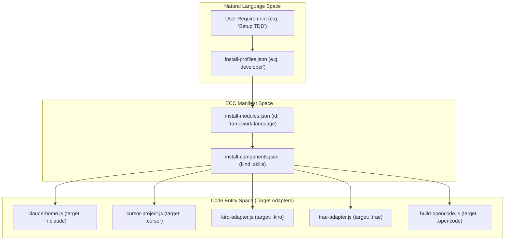
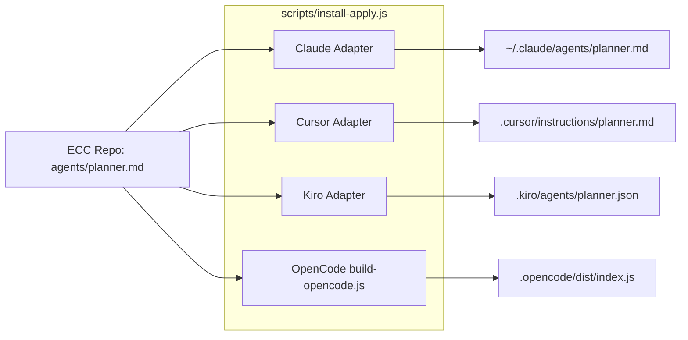

<!-- source: DeepWiki mcp.deepwiki.com · repo affaan-m/everything-claude-code · page 12.5 Platform Feature Comparison · fetched 2026-10-26 -->

# Platform Feature Comparison

Relevant source files

The following files were used as context for generating this wiki page:

- [.agents/plugins/marketplace.json](.agents/plugins/marketplace.json)
- [.claude-plugin/PLUGIN_SCHEMA_NOTES.md](.claude-plugin/PLUGIN_SCHEMA_NOTES.md)
- [.claude-plugin/README.md](.claude-plugin/README.md)
- [.claude-plugin/marketplace.json](.claude-plugin/marketplace.json)
- [.claude-plugin/plugin.json](.claude-plugin/plugin.json)
- [.codex-plugin/README.md](.codex-plugin/README.md)
- [.codex-plugin/plugin.json](.codex-plugin/plugin.json)
- [.mcp.json](.mcp.json)
- [AGENTS.md](AGENTS.md)
- [README.md](README.md)
- [README.zh-CN.md](README.zh-CN.md)
- [WORKING-CONTEXT.md](WORKING-CONTEXT.md)
- [agent.yaml](agent.yaml)
- [commands/auto-update.md](commands/auto-update.md)
- [commands/jira.md](commands/jira.md)
- [docs/zh-CN/AGENTS.md](docs/zh-CN/AGENTS.md)
- [docs/zh-CN/README.md](docs/zh-CN/README.md)
- [manifests/install-modules.json](manifests/install-modules.json)
- [schemas/package-manager.schema.json](schemas/package-manager.schema.json)
- [schemas/plugin.schema.json](schemas/plugin.schema.json)
- [scripts/auto-update.js](scripts/auto-update.js)
- [skills/jira-integration/SKILL.md](skills/jira-integration/SKILL.md)
- [tests/ci/agent-yaml-surface.test.js](tests/ci/agent-yaml-surface.test.js)
- [tests/plugin-manifest.test.js](tests/plugin-manifest.test.js)
- [tests/scripts/auto-update.test.js](tests/scripts/auto-update.test.js)

This page provides a comprehensive feature-by-feature comparison of Everything Claude Code (ECC) across major platforms: Claude Code, Cursor IDE, OpenCode, Codex CLI, Antigravity, Kiro, CodeBuddy, and Trae. Each platform has different architectural capabilities, component support levels, and installation requirements based on its underlying engine and the ECC Selective Install system.

## Component Support Matrix

The following table shows exact component counts and support status across platforms as of v2.0.0-rc.1. ECC utilizes a manifest-driven installation pipeline to target these specific environments, tracking installation state via the SQLite state store.

| Component | Claude Code | Cursor IDE | OpenCode | Codex CLI | Kiro IDE | Trae / CodeBuddy |
|-----------|-------------|------------|----------|-----------|----------|------------------|
| **Agents** | 48 agents | 48 agents | 12 agents | 48 agents | 48 agents | 48 agents |
| **Commands** | 79 commands | 79 commands | 24+ commands | 79 commands | 79 commands | 79 commands |
| **Skills** | 182 skills | 182 skills | 16+ skills | 182 skills | 182 skills | 182 skills |
| **Rules** | 12 ecosystems | 12 (Flat) | 12 ecosystems | 12 (Flat) | Steering Files | 12 (Flat) |
| **Hooks** | 8 event types | ❌ No hooks | 20+ event types | ❌ No hooks | `.kiro.hook` | ❌ No hooks |
| **Custom Tools** | Via hooks | ❌ No support | ✅ Native | ❌ No support | ❌ No support | ❌ No support |
| **Target Dir** | `~/.claude` | `.cursor` | `.opencode` | `.codex` | `.kiro` | `.trae` / `.codebuddy` |
| **Install Method**| `/plugin` / `ecc` | `ecc install` | `npm` / `ecc` | `ecc install` | `install.sh` | `install.js` |

Sources: [README.md:92-93](), [WORKING-CONTEXT.md:12-14](), [AGENTS.md:1-6](), [manifests/install-modules.json:1-109](), [.claude-plugin/plugin.json:3-4]()

---

## Platform Architecture Comparison

The ECC Selective Install system uses `install-modules.json` to map generic ECC entities to platform-specific structures. The `ecc` CLI acts as the primary orchestrator, utilizing the `install-plan.js` and `install-apply.js` pipeline introduced in v1.9.0.

**Diagram: Manifest-to-Platform Mapping**
This diagram shows how the installation logic bridges high-level user profiles (like `developer` or `security`) to concrete file system targets via platform adapters.

Sources: [manifests/install-modules.json:1-42](), [README.md:101-102](), [WORKING-CONTEXT.md:35-36]()

---

## Selective Install Architecture

The release surface aligned at `v1.10.0` and moving into `v2.0.0-rc.1` utilizes a manifest-driven install pipeline. The `install-plan.js` determines the delta between the repository and the target, while `install-apply.js` performs the file operations.

### Target Adapter Behavior

| Adapter | Strategy | Rule Handling | Path Mapping |
|---------|----------|---------------|--------------|
| **Claude** | Native | Preserves hierarchy | `rules/common/` |
| **Cursor** | Flat Namespaced | `common-style.md` | `.cursor/rules/` |
| **Kiro** | Steering/JSON | Dual Format (JSON+MD) | `.kiro/agents/` |
| **Trae** | Manifest-based | Flat filenames | `.trae/` |
| **OpenCode** | Compiled Dist | Plugin/Tool entrypoints | `.opencode/dist/` |

**Diagram: Agent Path Transformation**
Illustrates how the installation scripts use platform-specific logic to adapt the same source file for different IDE constraints, such as OpenCode's requirement for a compiled distribution payload.

Sources: [README.md:101-102](), [WORKING-CONTEXT.md:95-96](), [tests/scripts/build-opencode.test.js:150-155]()

---

## Hook System Capabilities

The hook system is a key differentiator. While Claude Code and OpenCode have native event listeners, other platforms rely on ECC skills to simulate behavior. ECC v2.1+ automatically loads `hooks/hooks.json` by convention in Claude Code, which is why explicit declaration in `plugin.json` is now prohibited to avoid duplication.

| Hook Phase | Claude Code | OpenCode | Kiro IDE | Cursor/Trae |
|------------|-------------|----------|----------|-------------|
| **PreToolUse** | `PreToolUse` | `tool.execute.before` | `.kiro.hook` (Pre) | Manual (Skill-based) |
| **PostToolUse** | `PostToolUse` | `tool.execute.after` | `.kiro.hook` (Post) | Manual (Skill-based) |
| **SessionStart**| `SessionStart` | `session.created` | `init.sh` | Skill initialization |
| **Stop** | `Stop` | `session.idle` | `cleanup.sh` | End-of-task summary |

### Validator Constraints
The Claude Code plugin validator is strict regarding the `hooks` and `agents` fields. Adding them explicitly to `plugin.json` results in `Invalid input` or `Duplicate hooks file` errors.

Sources: [.claude-plugin/PLUGIN_SCHEMA_NOTES.md:58-74](), [.claude-plugin/PLUGIN_SCHEMA_NOTES.md:98-129]()

---

## Language & Framework Support

ECC v2.0.0-rc.1 supports 12 ecosystems. These are categorized into `rules-core` and `framework-language` modules in the install manifest.

| Ecosystem | Agent | Rules Path | Modules Required |
|-----------|-------|------------|------------------|
| **TypeScript** | `typescript-reviewer` | `rules/typescript` | `rules-core`, `framework-language` |
| **Python** | `python-reviewer` | `rules/python` | `rules-core`, `framework-language` |
| **Go** | `go-reviewer` | `rules/golang` | `rules-core`, `framework-language` |
| **Java** | `java-reviewer` | `rules/java` | `rules-core`, `framework-language` |
| **Kotlin** | `kotlin-reviewer` | `rules/kotlin` | `rules-core`, `framework-language` |
| **Rust** | `rust-reviewer` | `rules/rust` | `rules-core`, `framework-language` |
| **C++** | `cpp-reviewer` | `rules/cpp` | `rules-core`, `framework-language` |

Sources: [AGENTS.md:17-45](), [manifests/install-modules.json:110-153](), [README.md:102-103]()

---

## Platform-Specific Implementation Details

### Claude Code
- **Target**: `~/.claude` (Global)
- **Plugin System**: Uses `.claude-plugin/plugin.json` for discovery.
- **Limitation**: Cannot automatically distribute rules; manual copying to `~/.claude/rules/` is required [README.zh-CN.md:111-115]().
- **Convention**: Automatically discovers agents in `agents/` and hooks in `hooks/hooks.json` [.claude-plugin/PLUGIN_SCHEMA_NOTES.md:70-74]().

### Cursor IDE
- **Target**: `.cursor/` (Project-local)
- **Rule Adaptation**: Cursor requires rules to be in a flat directory. The installation logic flattens the hierarchy into `.cursor/rules/`.

### OpenCode
- **Target**: `.opencode/` (Project-local)
- **Build Process**: Relies on compiled plugin/tool entrypoints. `tests/scripts/build-opencode.test.js` asserts the presence of `.opencode/dist/index.js` [WORKING-CONTEXT.md:95-96]().

### Codex CLI
- **Target**: `.codex/` (Project-local)
- **Integration**: Uses `AGENTS.md` as a supplement for agent definitions [manifests/install-modules.json:29]().

### Trae
- **Target**: `.trae/` (Project-local)
- **Environment**: Supports `TRAE_ENV=cn` for specific region configurations, outputting to `.trae-cn/`.

Sources: [.claude-plugin/plugin.json:1-28](), [.claude-plugin/PLUGIN_SCHEMA_NOTES.md:1-216](), [WORKING-CONTEXT.md:95-96]()

---

