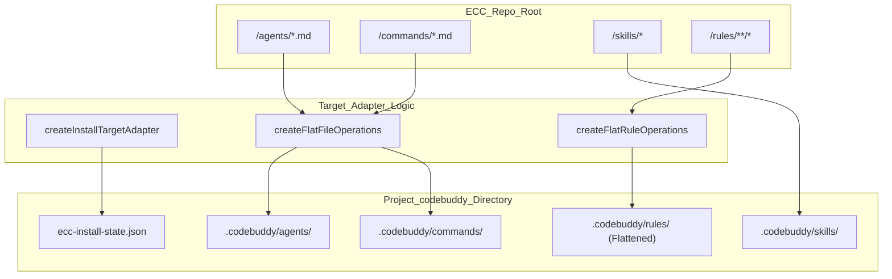
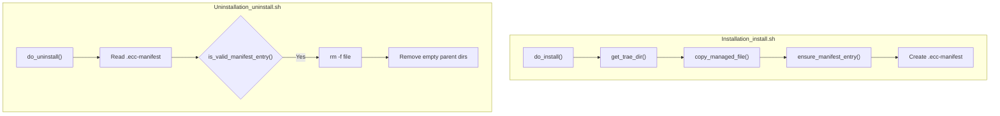

<!-- source: DeepWiki mcp.deepwiki.com · repo affaan-m/everything-claude-code · page 12.7 CodeBuddy & Trae Integration · fetched 2026-10-26 -->

# CodeBuddy & Trae Integration

Relevant source files

The following files were used as context for generating this wiki page:

- [.trae/README.md](.trae/README.md)
- [.trae/README.zh-CN.md](.trae/README.zh-CN.md)
- [.trae/install.sh](.trae/install.sh)
- [.trae/uninstall.sh](.trae/uninstall.sh)
- [docs/SELECTIVE-INSTALL-ARCHITECTURE.md](docs/SELECTIVE-INSTALL-ARCHITECTURE.md)
- [scripts/install-apply.js](scripts/install-apply.js)
- [scripts/lib/cursor-agent-names.js](scripts/lib/cursor-agent-names.js)
- [scripts/lib/install-executor.js](scripts/lib/install-executor.js)
- [scripts/lib/install-targets/claude-home.js](scripts/lib/install-targets/claude-home.js)
- [scripts/lib/install-targets/cursor-project.js](scripts/lib/install-targets/cursor-project.js)
- [scripts/lib/install-targets/helpers.js](scripts/lib/install-targets/helpers.js)
- [scripts/lib/install/apply.js](scripts/lib/install/apply.js)
- [tests/lib/install-executor.test.js](tests/lib/install-executor.test.js)
- [tests/lib/install-targets.test.js](tests/lib/install-targets.test.js)
- [tests/lib/selective-install.test.js](tests/lib/selective-install.test.js)
- [tests/scripts/install-apply.test.js](tests/scripts/install-apply.test.js)
- [tests/scripts/install-readme-clarity.test.js](tests/scripts/install-readme-clarity.test.js)

Everything Claude Code (ECC) provides dedicated integration support for the CodeBuddy and Trae IDEs. These integrations allow developers to leverage ECC's library of agents, skills, and commands within these environments by utilizing specialized directory structures and installation adapters.

## CodeBuddy Integration

CodeBuddy integration is managed through the `.codebuddy/` directory. It is supported by the modern, unified Target Adapter architecture for lifecycle management, allowing CodeBuddy to be targeted via the standard ECC installation pipeline [tests/lib/install-targets.test.js:45]().

### Target Adapter Architecture
The integration is implemented via the `codebuddy-project` adapter. This adapter is registered in the central registry [`tests/lib/install-targets.test.js:45`]() and defines the integration as a `project` kind target.

A key feature of the CodeBuddy adapter is the **Flattened Rules** system. Unlike Claude Code which supports hierarchical rules, CodeBuddy requires rules to be flattened into namespaced files within the `.codebuddy/rules/` directory. The installation logic utilizes `createFlatRuleOperations` to transform nested repository rules (e.g., `rules/typescript/testing.md`) into flattened, namespaced files (e.g., `typescript-testing.md`) during the planning phase [`scripts/lib/install-targets/helpers.js:184-224`]().

### Data Flow: CodeBuddy Installation
The following diagram illustrates how the `codebuddy-project` adapter transforms the ECC repository structure into the target project using the `planOperations` logic.

**CodeBuddy Component Mapping**

Sources: [`scripts/lib/install-targets/helpers.js:184-224`](), [`scripts/lib/install-targets/cursor-project.js:154-162`]() (similar logic used for CodeBuddy flattening).

### Installation & Management
ECC provides a unified Node.js-based system for setup:
*   **Unified System**: Uses `install-apply.js` with the `--target codebuddy` flag [`scripts/install-apply.js:24-33`]().
*   **Planning Phase**: The `createInstallPlanFromRequest` function dispatches to the CodeBuddy adapter to generate a `plan` containing specific file operations [`scripts/install-apply.js:123-127`]().
*   **Execution Phase**: `applyInstallPlan` executes the operations, creates the `.codebuddy/` directory structure, and writes the `ecc-install-state.json` file [`scripts/lib/install/apply.js:118-170`]().
*   **State Tracking**: The installation state is recorded, enabling safe `uninstall` and `doctor` commands via the `ecc` CLI [`scripts/install-apply.js:94-96`]().

Sources: [`scripts/install-apply.js:100-148`](), [`scripts/lib/install/apply.js:118-174`](), [`tests/lib/install-targets.test.js:45-46`]()

***

## Trae Integration

Trae integration utilizes the `.trae/` (or `.trae-cn/`) directory structure. It is primarily managed via shell scripts that support localized and global installation modes [`.trae/install.sh:1-9`]().

### Environment and Directory Resolution
Trae integration supports a dual-environment configuration based on the `TRAE_ENV` environment variable:
*   **Default**: Components are installed to `.trae/` [`.trae/install.sh:24-30`]().
*   **CN Environment**: If `TRAE_ENV=cn` is set, components are installed to `.trae-cn/` [`.trae/install.sh:25-26`]().

The `get_trae_dir` function in the installer handles this logic by checking the environment variable and returning the appropriate directory name [`.trae/install.sh:24-30`]().

### Manifest-Based Lifecycle
The Trae installer implements a non-destructive copy mechanism. It tracks every installed file in a hidden `.ecc-manifest` file [`.trae/install.sh:115-117`](). 

The `uninstall.sh` script reads this manifest to ensure that only ECC-managed files are removed, preserving any user-created files or modifications within the Trae configuration directories [`.trae/uninstall.sh:105-112`](). It includes security checks to ensure it only removes files that were explicitly recorded during installation [`.trae/uninstall.sh:33-43`]().

### Logic Flow: Trae Installation Lifecycle
The diagram below shows the logic used by `do_install` and `do_uninstall` to manage the project state.

**Trae Lifecycle Management**

Sources: [`.trae/install.sh:24-74`](), [`.trae/install.sh:115-211`]()

### Component Inclusion
The Trae integration includes four primary component types:
1.  **Commands**: Reused from the repository root `commands/` [`.trae/install.sh:127-136`]().
2.  **Agents**: Reused from the repository root `agents/` [`.trae/install.sh:138-148`]().
3.  **Skills**: Reused from the repository root `skills/` including subdirectories [`.trae/install.sh:150-172`]().
4.  **Rules**: Reused from the repository root `rules/` [`.trae/install.sh:174-185`]().

Sources: [`.trae/install.sh:107-185`]()

## Comparison of Integration Methods

| Feature | CodeBuddy | Trae |
| :--- | :--- | :--- |
| **Directory** | `.codebuddy/` | `.trae/` or `.trae-cn/` |
| **Primary Installer** | `install-apply.js` (Target Adapter) | `install.sh` (Shell) |
| **Rule Handling** | Flattened Namespaces | Hierarchical Copy |
| **State Tracking** | `ecc-install-state.json` | `.ecc-manifest` |
| **Cross-Platform** | Native Node.js support | Bash (requires Unix/WSL) |
| **Environment Toggle**| N/A | `TRAE_ENV=cn` |

Sources: [`scripts/lib/install-targets/helpers.js:141-182`](), [`scripts/lib/install-targets/registry.js:8-12`](), [`.trae/install.sh:24-30`](), [`scripts/lib/install/apply.js:164-165`]()

---

