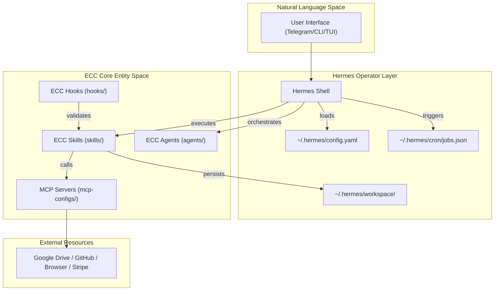
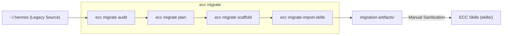

<!-- source: DeepWiki mcp.deepwiki.com · repo affaan-m/everything-claude-code · page 12.8 Hermes Operator Shell Integration · fetched 2026-10-26 -->

# Hermes Operator Shell Integration

Relevant source files

The following files were used as context for generating this wiki page:

- [AGENTS.md](AGENTS.md)
- [README.md](README.md)
- [README.zh-CN.md](README.zh-CN.md)
- [WORKING-CONTEXT.md](WORKING-CONTEXT.md)
- [agent.yaml](agent.yaml)
- [commands/auto-update.md](commands/auto-update.md)
- [commands/jira.md](commands/jira.md)
- [docs/HERMES-OPENCLAW-MIGRATION.md](docs/HERMES-OPENCLAW-MIGRATION.md)
- [docs/HERMES-SETUP.md](docs/HERMES-SETUP.md)
- [docs/architecture/cross-harness.md](docs/architecture/cross-harness.md)
- [docs/releases/2.0.0-rc.1/launch-checklist.md](docs/releases/2.0.0-rc.1/launch-checklist.md)
- [docs/releases/2.0.0-rc.1/quickstart.md](docs/releases/2.0.0-rc.1/quickstart.md)
- [docs/releases/2.0.0-rc.1/release-notes.md](docs/releases/2.0.0-rc.1/release-notes.md)
- [docs/tr/CHANGELOG.md](docs/tr/CHANGELOG.md)
- [docs/zh-CN/AGENTS.md](docs/zh-CN/AGENTS.md)
- [docs/zh-CN/CHANGELOG.md](docs/zh-CN/CHANGELOG.md)
- [docs/zh-CN/README.md](docs/zh-CN/README.md)
- [docs/zh-CN/commands/harness-audit.md](docs/zh-CN/commands/harness-audit.md)
- [manifests/install-modules.json](manifests/install-modules.json)
- [scripts/auto-update.js](scripts/auto-update.js)
- [skills/jira-integration/SKILL.md](skills/jira-integration/SKILL.md)
- [tests/ci/agent-yaml-surface.test.js](tests/ci/agent-yaml-surface.test.js)
- [tests/docs/ecc2-release-surface.test.js](tests/docs/ecc2-release-surface.test.js)
- [tests/scripts/auto-update.test.js](tests/scripts/auto-update.test.js)

The **Hermes Operator Shell** serves as the primary "front-door" layer for Everything Claude Code (ECC). While ECC provides the reusable substrate of agents, skills, and hooks, Hermes acts as the operational shell for chat, crons, workspace memory, and distribution flows [docs/HERMES-SETUP.md:1-5](). It enables running complex engineering, research, sales, and finance workflows from a single terminal-native surface [docs/HERMES-SETUP.md:5-7]().

## Architecture and Data Flow

Hermes sits on top of the ECC core, translating natural language intent from various interfaces (Telegram, CLI, TUI) into structured executions using ECC's skill and hook system.

### The Operator Stack

The integration follows a tiered architecture where Hermes manages the session and state, while ECC handles the logic and tool execution [docs/HERMES-SETUP.md:16-28]().

Title: Hermes-ECC Operational Flow

Sources: [docs/HERMES-SETUP.md:16-28](), [docs/HERMES-SETUP.md:34-48](), [docs/releases/2.0.0-rc.1/release-notes.md:5-8]()

## Hermes-ECC Setup Guide

Setting up the Hermes operator shell requires a specific "Bring-Up Order" to ensure the underlying ECC substrate is stable before layering complex operator workflows [docs/HERMES-SETUP.md:83-101]().

### 1. Verification and Baseline
Before installing Hermes, the ECC environment must be verified.
*   **Command:** `node tests/run-all.js` [docs/HERMES-SETUP.md:95-95]()
*   **Goal:** Ensure a zero-failure test summary for agents, skills, and hooks.

### 2. Workspace Configuration
Hermes uses a specific directory structure for its configuration and memory, distinct from the ECC core:
*   `~/.hermes/config.yaml`: Model routing and MCP registration [docs/HERMES-SETUP.md:34-37]().
*   `~/.hermes/skills/ecc-imports/`: Reusable ECC skills imported for Hermes-native use [docs/HERMES-SETUP.md:38-39]().
*   `~/.hermes/cron/jobs.json`: Scheduled automation prompts [docs/HERMES-SETUP.md:44-45]().

### 3. Capability Layering
Operators are encouraged to authenticate services in a specific sequence:
1.  **Google Drive**: Primary system of record for research and docs [docs/HERMES-SETUP.md:98-98]().
2.  **GitHub**: Engineering execution [docs/HERMES-SETUP.md:98-98]().
3.  **Distribution Channels**: Telegram, LinkedIn, or X for outreach [docs/HERMES-SETUP.md:98-98]().

Sources: [docs/HERMES-SETUP.md:34-48](), [docs/HERMES-SETUP.md:83-101](), [docs/HERMES-SETUP.md:67-71]()

## OpenClaw and Legacy Migration

For users migrating from OpenClaw or older Hermes setups, ECC 2.0 provides a bounded migration entrypoint via the `ecc` CLI. This process focuses on distilling reusable behavior while stripping private secrets and personal data [docs/HERMES-OPENCLAW-MIGRATION.md:1-21]().

### Migration Pipeline
The migration tool follows a "Plan-Scaffold-Import" pattern to prevent accidental leakage of private workspace state into the public ECC repository.

Title: ECC Migration CLI Logic

### Key Migration Targets
| Legacy Entity | ECC Translation |
| :--- | :--- |
| `cron/scheduler.py` | ECC 2.0 Scheduler (Issue #1050) / Hooks [docs/HERMES-OPENCLAW-MIGRATION.md:57-70]() |
| `memory_tool.py` | `knowledge-ops` / `WORKING-CONTEXT.md` [docs/HERMES-OPENCLAW-MIGRATION.md:99-108]() |
| Hermes Gateway | ECC Session Adapters / TUI Manager [docs/HERMES-OPENCLAW-MIGRATION.md:77-94]() |
| Private Skills | `skills/hermes-generated/` (Sanitized) [docs/HERMES-OPENCLAW-MIGRATION.md:118-131]() |

Sources: [docs/HERMES-OPENCLAW-MIGRATION.md:186-199](), [docs/HERMES-OPENCLAW-MIGRATION.md:22-43]()

## Distilling Private Workflows into ECC Skills

A core purpose of the Hermes integration is the **Codification Phase**: turning repeated operator actions into publishable, reusable ECC skills.

### Sanitization Rules
When moving a workflow from a private Hermes session to the `skills/` directory, the following rules apply:
1.  **No Secrets:** Remove all OAuth tokens, API keys, and Stripe keys [docs/HERMES-SETUP.md:72-82]().
2.  **Procedure over Knowledge:** Focus on the *logic* of the workflow (e.g., "how to audit billing") rather than the *data* (e.g., "March 2024 invoices") [docs/HERMES-OPENCLAW-MIGRATION.md:225-237]().
3.  **Local Auth Documentation:** Instead of hardcoding credentials, the skill must document the local MCP or environment variables required to run [docs/HERMES-OPENCLAW-MIGRATION.md:161-166]().

### Example: `hermes-imports` Skill
The `skills/hermes-imports/SKILL.md` serves as a template for this process, enforcing a "Sanitization Checklist" to ensure no raw workspace exports reach the public surface [tests/docs/ecc2-release-surface.test.js:74-79]().

Sources: [docs/HERMES-SETUP.md:72-82](), [docs/HERMES-OPENCLAW-MIGRATION.md:161-166](), [tests/docs/ecc2-release-surface.test.js:74-79]()

---

