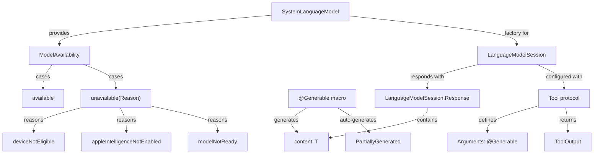
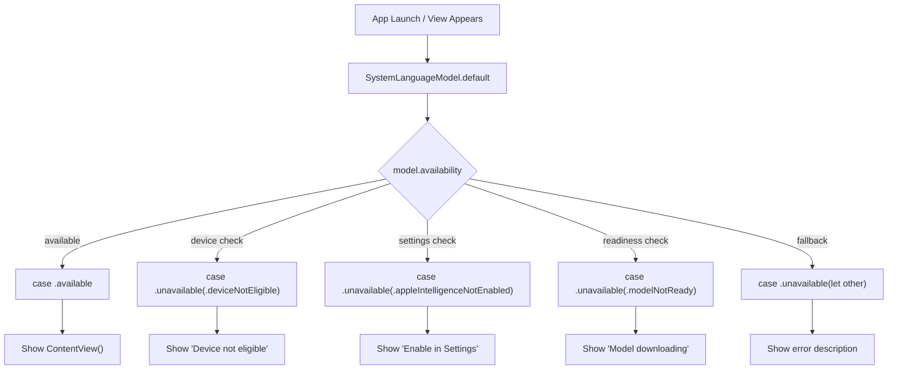
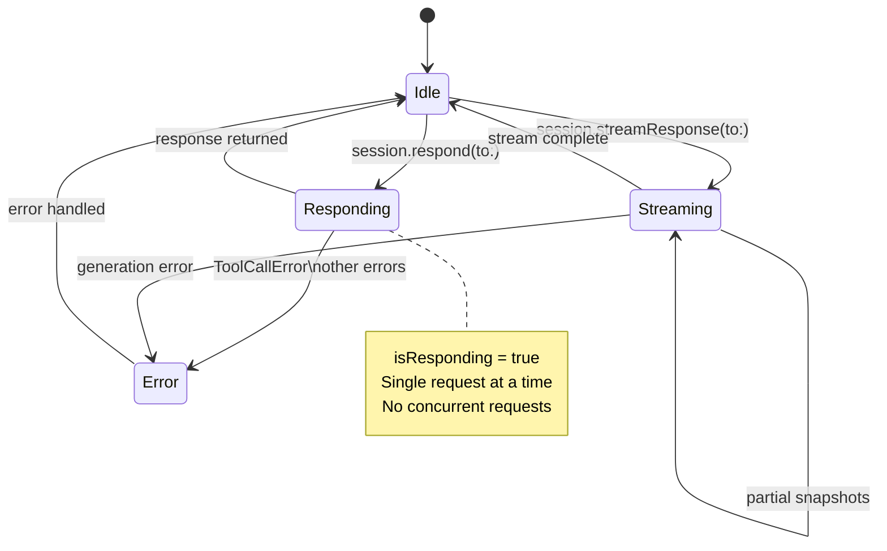
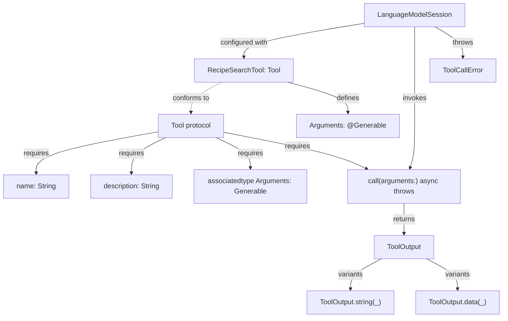
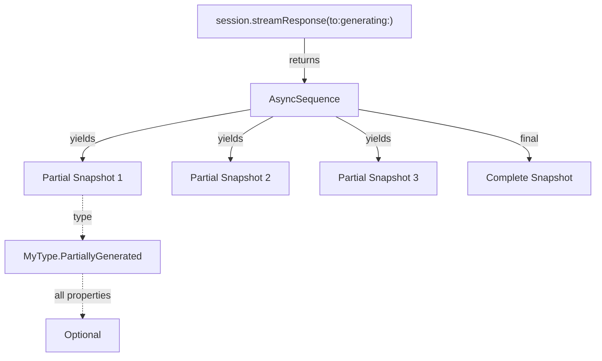

<!-- source: DeepWiki mcp.deepwiki.com · repo affaan-m/everything-claude-code · page 13.2 FoundationModels (On-Device LLM) · fetched 2026-10-26 -->

# FoundationModels (On-Device LLM)

<details>
<summary>Relevant source files</summary>

The following files were used as context for generating this wiki page:

- [skills/foundation-models-on-device/SKILL.md](skills/foundation-models-on-device/SKILL.md)
- [skills/liquid-glass-design/SKILL.md](skills/liquid-glass-design/SKILL.md)
- [skills/swift-concurrency-6-2/SKILL.md](skills/swift-concurrency-6-2/SKILL.md)

</details>


## Purpose and Scope

This page documents the `foundation-models-on-device` skill, which provides patterns for integrating Apple's FoundationModels framework into iOS 26+ applications. The skill covers on-device language model (LLM) capabilities including text generation, structured output via the `@Generable` macro, custom tool calling, and snapshot-based streaming. These features run locally, ensuring user privacy and offline functionality.

For details on the Swift concurrency model used to drive these APIs (specifically `@MainActor` and `@concurrent`), see [Swift 6.2 Concurrency (13.1)]().

**Sources:** [skills/foundation-models-on-device/SKILL.md:1-8]()

---

## Skill Metadata

The skill is defined in the Everything Claude Code (ECC) system with the following attributes:

| Property | Value |
|----------|-------|
| **Name** | `foundation-models-on-device` |
| **Description** | Apple FoundationModels framework for on-device LLM — text generation, guided generation with @Generable, tool calling, and snapshot streaming in iOS 26+. |
| **Target OS** | iOS 26+ |
| **Requirements** | Apple Intelligence enabled device |

**Sources:** [skills/foundation-models-on-device/SKILL.md:1-4]()

---

## When to Activate

This skill should be utilized when the following requirements are met:
- Building AI-powered features using **Apple Intelligence** on-device [skills/foundation-models-on-device/SKILL.md:12]().
- Generating or summarizing text without **cloud dependency** [skills/foundation-models-on-device/SKILL.md:13]().
- Extracting **structured data** from natural language input [skills/foundation-models-on-device/SKILL.md:14]().
- Implementing **custom tool calling** for domain-specific AI actions [skills/foundation-models-on-device/SKILL.md:15]().
- **Streaming structured responses** for real-time UI updates [skills/foundation-models-on-device/SKILL.md:16]().
- Requiring **privacy-preserving AI** where no data leaves the device [skills/foundation-models-on-device/SKILL.md:17]().

**Sources:** [skills/foundation-models-on-device/SKILL.md:10-18]()

---

## Core API Architecture

### API Class Hierarchy



**Diagram: FoundationModels API structure showing main types and their relationships**

**Sources:** [skills/foundation-models-on-device/SKILL.md:22-43](), [skills/foundation-models-on-device/SKILL.md:109-153]()

---

## Pattern 1: Availability Check

### Mandatory Availability Gate

Before initializing any AI session, the app must verify the `SystemLanguageModel.default.availability` [skills/foundation-models-on-device/SKILL.md:21-25](). Failing to check this is a primary anti-pattern [skills/foundation-models-on-device/SKILL.md:218]().



**Diagram: Availability check flow with all required cases**

### Implementation Pattern

```swift
struct GenerativeView: View {
    private var model = SystemLanguageModel.default

    var body: some View {
        switch model.availability {
        case .available:
            ContentView()
        case .unavailable(.deviceNotEligible):
            Text("Device not eligible for Apple Intelligence")
        case .unavailable(.appleIntelligenceNotEnabled):
            Text("Please enable Apple Intelligence in Settings")
        case .unavailable(.modelNotReady):
            Text("Model is downloading or not ready")
        case .unavailable(let other):
            Text("Model unavailable: \(other)")
        }
    }
}
```

**Sources:** [skills/foundation-models-on-device/SKILL.md:23-41]()

---

## Pattern 2: Session Management

### Single-Turn vs Multi-Turn Sessions

| Pattern | Usage | Implementation |
|---------|-------|----------------|
| **Single-turn** | One-off requests [skills/foundation-models-on-device/SKILL.md:47]() | Instantiate `LanguageModelSession` per call |
| **Multi-turn** | Conversational context [skills/foundation-models-on-device/SKILL.md:52]() | Reuse the same `LanguageModelSession` instance |

### Session State Constraints

The `LanguageModelSession` allows only one request at a time. The `isResponding` property must be checked before sending new prompts [skills/foundation-models-on-device/SKILL.md:213-220]().



**Diagram: LanguageModelSession state machine showing single-request constraint**

**Sources:** [skills/foundation-models-on-device/SKILL.md:45-67](), [skills/foundation-models-on-device/SKILL.md:213-220]()

---

## Pattern 3: Guided Generation with @Generable

### Structured Output Generation

The `@Generable` macro allows generating structured Swift types instead of raw strings [skills/foundation-models-on-device/SKILL.md:71](). It automatically creates a `PartiallyGenerated` version of the struct for streaming purposes [skills/foundation-models-on-device/SKILL.md:212]().

### Supported @Guide Constraints
- `.range(0...20)`: Numeric validation [skills/foundation-models-on-device/SKILL.md:104]().
- `.count(3)`: Array size constraints [skills/foundation-models-on-device/SKILL.md:105]().
- `description:`: Semantic guidance for the LLM [skills/foundation-models-on-device/SKILL.md:106]().

```swift
@Generable(description: "Basic profile information about a cat")
struct CatProfile {
    var name: String

    @Guide(description: "The age of the cat", .range(0...20))
    var age: Int

    @Guide(description: "A one sentence profile about the cat's personality")
    var profile: String
}
```

**Sources:** [skills/foundation-models-on-device/SKILL.md:76-86]()

---

## Pattern 4: Tool Calling

### Tool Protocol Architecture

Custom tools allow the LLM to invoke app-specific logic. Tools must conform to the `Tool` protocol and define their own `@Generable` arguments [skills/foundation-models-on-device/SKILL.md:115-123]().



**Diagram: Tool protocol structure and session integration**

### Implementation

```swift
struct RecipeSearchTool: Tool {
    let name = "recipe_search"
    let description = "Search for recipes matching a given term and return a list of results."

    @Generable
    struct Arguments {
        var searchTerm: String
        var numberOfResults: Int
    }

    func call(arguments: Arguments) async throws -> ToolOutput {
        let recipes = await searchRecipes(
            term: arguments.searchTerm,
            limit: arguments.numberOfResults
        )
        return .string(recipes.map { "- \($0.name): \($0.description)" }.joined(separator: "\n"))
    }
}
```

**Sources:** [skills/foundation-models-on-device/SKILL.md:114-133]()

---

## Pattern 5: Snapshot Streaming

FoundationModels uses **Snapshot Streaming** rather than delta-based streaming. Each iteration of the stream provides a `PartiallyGenerated` object representing the current complete state of the generation [skills/foundation-models-on-device/SKILL.md:211]().



**Diagram: Snapshot streaming flow with PartiallyGenerated types**

**Sources:** [skills/foundation-models-on-device/SKILL.md:157-175](), [skills/foundation-models-on-device/SKILL.md:211]()

---

## Key Design Decisions & Constraints

| Decision | Rationale |
|----------|-----------|
| **4,096 Token Limit** | Hard constraint for on-device models; requires chunking large data [skills/foundation-models-on-device/SKILL.md:210](). |
| **`response.content`** | The canonical property for accessing results (avoid `.output`) [skills/foundation-models-on-device/SKILL.md:214-215](). |
| **System Instructions** | Instructions take priority over the prompt for guiding behavior [skills/foundation-models-on-device/SKILL.md:219](). |
| **On-Device Only** | No data leaves the device; works entirely offline [skills/foundation-models-on-device/SKILL.md:209](). |
| **Snapshot Streaming** | Structured output friendly; each snapshot is a complete partial state [skills/foundation-models-on-device/SKILL.md:211](). |

**Sources:** [skills/foundation-models-on-device/SKILL.md:206-215](), [skills/foundation-models-on-device/SKILL.md:219-222]()

---

