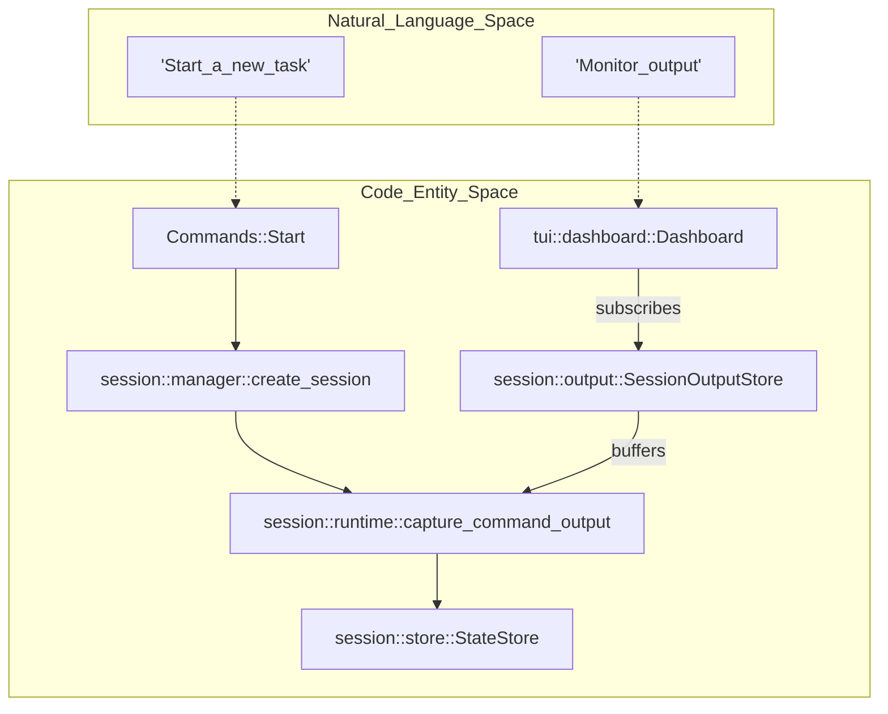
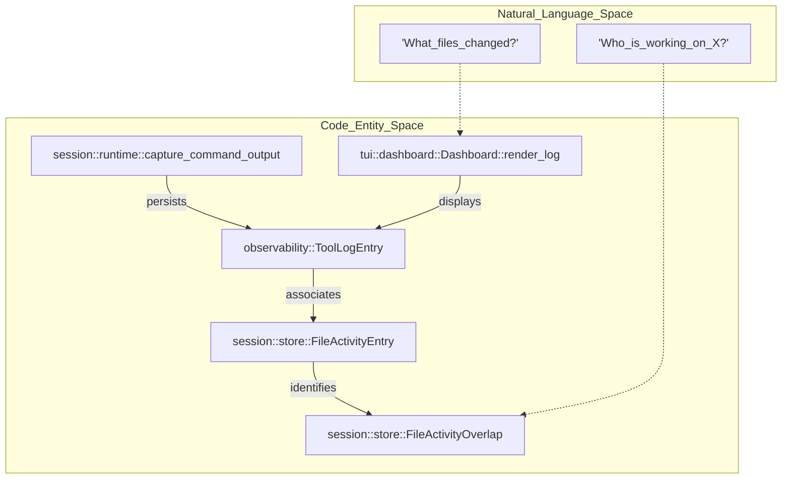

<!-- source: DeepWiki mcp.deepwiki.com · repo affaan-m/everything-claude-code · page 14 ECC2 — Rust TUI Control Plane · fetched 2026-10-26 -->

# ECC2 — Rust TUI Control Plane

<details>
<summary>Relevant source files</summary>

The following files were used as context for generating this wiki page:

- [.opencode/MIGRATION.md](.opencode/MIGRATION.md)
- [.opencode/README.md](.opencode/README.md)
- [.opencode/index.ts](.opencode/index.ts)
- [.opencode/opencode.json](.opencode/opencode.json)
- [.opencode/package-lock.json](.opencode/package-lock.json)
- [.opencode/package.json](.opencode/package.json)
- [.opencode/plugins/lib/changed-files-store.ts](.opencode/plugins/lib/changed-files-store.ts)
- [.opencode/tools/index.ts](.opencode/tools/index.ts)
- [CHANGELOG.md](CHANGELOG.md)
- [ecc2/Cargo.lock](ecc2/Cargo.lock)
- [ecc2/Cargo.toml](ecc2/Cargo.toml)
- [ecc2/src/comms/mod.rs](ecc2/src/comms/mod.rs)
- [ecc2/src/config/mod.rs](ecc2/src/config/mod.rs)
- [ecc2/src/main.rs](ecc2/src/main.rs)
- [ecc2/src/notifications.rs](ecc2/src/notifications.rs)
- [ecc2/src/observability/mod.rs](ecc2/src/observability/mod.rs)
- [ecc2/src/session/daemon.rs](ecc2/src/session/daemon.rs)
- [ecc2/src/session/manager.rs](ecc2/src/session/manager.rs)
- [ecc2/src/session/mod.rs](ecc2/src/session/mod.rs)
- [ecc2/src/session/output.rs](ecc2/src/session/output.rs)
- [ecc2/src/session/runtime.rs](ecc2/src/session/runtime.rs)
- [ecc2/src/session/store.rs](ecc2/src/session/store.rs)
- [ecc2/src/tui/app.rs](ecc2/src/tui/app.rs)
- [ecc2/src/tui/dashboard.rs](ecc2/src/tui/dashboard.rs)
- [ecc2/src/tui/widgets.rs](ecc2/src/tui/widgets.rs)
- [ecc2/src/worktree/mod.rs](ecc2/src/worktree/mod.rs)
- [scripts/hooks/session-activity-tracker.js](scripts/hooks/session-activity-tracker.js)
- [tests/hooks/session-activity-tracker.test.js](tests/hooks/session-activity-tracker.test.js)
- [tests/scripts/build-opencode.test.js](tests/scripts/build-opencode.test.js)
- [the-security-guide.md](the-security-guide.md)

</details>


ECC2 is a next-generation companion to the Node.js ECC system, implemented as a high-performance Rust Terminal User Interface (TUI) application [ecc2/Cargo.toml:1-5](). It serves as an agentic IDE control plane, providing centralized orchestration for AI coding sessions with integrated observability, state persistence, and git worktree management [ecc2/src/main.rs:19-24]().

## System Architecture

The ECC2 architecture is built on a modern Rust stack designed for responsiveness and reliability. It leverages `tokio` for asynchronous execution and `ratatui` with `crossterm` for the terminal interface [ecc2/Cargo.toml:14-20]().

### Core Components
*   **Session Management**: Handles the lifecycle and execution of AI agents across various harnesses (Claude, Codex, OpenCode, Gemini, Cursor, etc.) [ecc2/src/session/mod.rs:16-31]().
*   **TUI Dashboard**: A multi-pane interface for real-time monitoring of sessions, logs, and metrics [ecc2/src/tui/dashboard.rs:82-158]().
*   **State Persistence**: A SQLite-backed store using `rusqlite` for session history, tool logs, and output buffers [ecc2/src/session/store.rs:26-28]().
*   **Observability**: A logging and risk-scoring engine that evaluates tool calls based on security and impact [ecc2/src/observability/mod.rs:1-15]().
*   **Worktree Orchestration**: Automated Git worktree creation via `git2` and CLI commands to isolate agent environments and prevent branch pollution [ecc2/src/worktree/mod.rs:95-100]().
*   **Daemon Mode**: A background process that monitors heartbeats, handles scheduled tasks, and manages backlog coordination [ecc2/src/session/daemon.rs:18-25]().

### Module Relationships

The following diagram illustrates the relationship between the natural language intent (CLI/TUI) and the underlying Rust code entities.

**Intent to Code Mapping: Session Execution**

Sources: [ecc2/src/main.rs:74-90](), [ecc2/src/session/manager.rs:26-32](), [ecc2/src/session/runtime.rs:1-13](), [ecc2/src/tui/dashboard.rs:82-95](), [ecc2/src/session/output.rs:1-23]()

For a deep dive into the underlying libraries and module breakdown, see [ECC2 Architecture Overview](#14.1).

## Session State Machine

ECC2 enforces a strict state machine for all agent sessions to ensure data integrity and process control [ecc2/src/session/mod.rs:1-10]().

| State | Description |
| :--- | :--- |
| `Pending` | Session created and queued for execution or worktree setup [ecc2/src/session/store.rs:180]() |
| `Running` | Agent process is active and executing the task [ecc2/src/session/daemon.rs:74]() |
| `Idle` | Agent is waiting for user input or external events [ecc2/src/session/manager.rs:19]() |
| `Completed` | Task finished successfully [ecc2/src/tui/dashboard.rs:169]() |
| `Failed` | Process crashed or exited with an error [ecc2/src/session/daemon.rs:88]() |
| `Stopped` | Manually terminated by the user [ecc2/src/session/manager.rs:171]() |

**State Transition Logic**
```mermaid
stateDiagram-v2
    [*] --> "Pending"
    "Pending" --> "Running": "manager::activate_pending_worktree_sessions"
    "Running" --> "Idle": "agent_interaction"
    "Running" --> "Completed": "process_exit_0"
    "Running" --> "Failed": "daemon::resume_crashed_sessions"
    "Running" --> "Stopped": "manager::stop_session"
    "Idle" --> "Running": "manager::resume_session"
    "Completed" --> [*]
    "Failed" --> "Pending": "retry_logic"
```
Sources: [ecc2/src/session/daemon.rs:50-52](), [ecc2/src/session/daemon.rs:58-64](), [ecc2/src/session/manager.rs:158-176](), [ecc2/src/session/store.rs:180-194]()

For details on managing these states via the UI, see [ECC2 Session Management & TUI Dashboard](#14.2).

## Observability & Coordination

A core innovation in ECC2 is the automated tracking of tool activity and the coordination of session backlogs. Every tool execution is intercepted and logged into the `tool_log` table [ecc2/src/session/store.rs:197-205]().

### Key Observability Features:
*   **Tool Activity Tracking**: Captures file changes, diff previews, and patch previews [ecc2/src/session/store.rs:197-205]().
*   **Backlog Coordination**: The daemon performs "dispatch passes" to route unread task handoffs to available agents [ecc2/src/session/daemon.rs:145-184]().
*   **Conflict Detection**: Monitors file activity overlaps between concurrent sessions to prevent merge conflicts [ecc2/src/session/store.rs:40-47]().
*   **Scheduled Tasks**: Supports cron-based execution of agent tasks [ecc2/src/session/manager.rs:206-215]().

**Intent to Code Mapping: Observability Pipeline**

Sources: [ecc2/src/observability/mod.rs:1-15](), [ecc2/src/session/store.rs:13-23](), [ecc2/src/tui/dashboard.rs:107-112](), [ecc2/src/session/runtime.rs:1-13]()

## CLI Interface

While the TUI is the primary control plane, ECC2 provides a robust CLI for automation and team coordination [ecc2/src/main.rs:19-24]().

*   `ecc dashboard`: Launches the full TUI dashboard [ecc2/src/main.rs:72-73]().
*   `ecc start --task "..."`: Initiates a new top-level agent session [ecc2/src/main.rs:75-90]().
*   `ecc delegate --from-session <id>`: Spawns a sub-agent for a specific sub-task [ecc2/src/main.rs:92-106]().
*   `ecc auto-dispatch`: Sweeps unread handoffs and routes them to agents [ecc2/src/main.rs:151-160]().
*   `ecc coordinate-backlog`: Dispatches handoffs and rebalances delegate workloads [ecc2/src/main.rs:162-183]().
*   `ecc coordination-status`: Shows global coordination and saturation metrics [ecc2/src/main.rs:185-192]().

## Child Pages
- [ECC2 Architecture Overview](#14.1) — Deep dive into the Rust TUI architecture, async patterns, and the SQLite state store.
- [ECC2 Session Management & TUI Dashboard](#14.2) — Detailed guide to the session lifecycle, dashboard widgets, and daemon operations.

Sources: [ecc2/src/main.rs:19-192](), [ecc2/src/session/mod.rs:1-118](), [ecc2/src/tui/dashboard.rs:82-158](), [ecc2/src/session/daemon.rs:20-56]()

---

