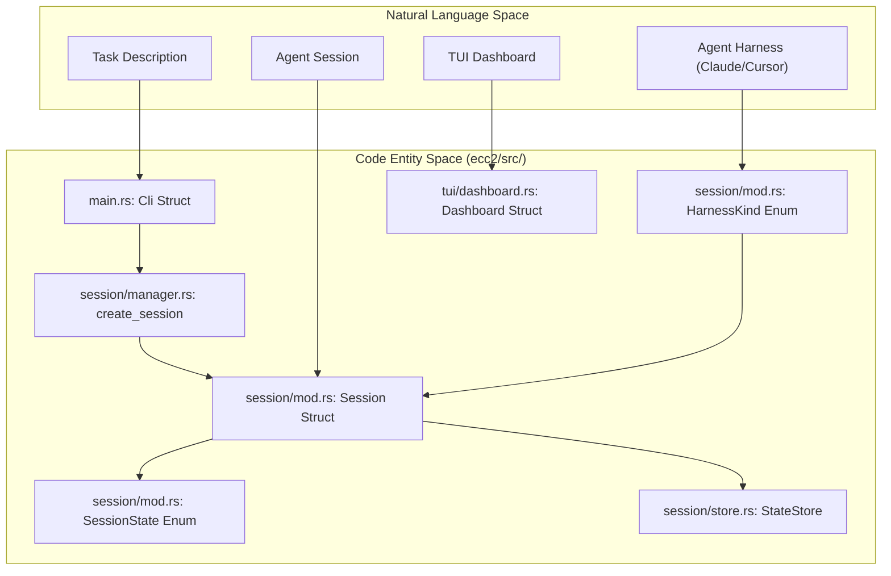

<!-- source: DeepWiki mcp.deepwiki.com · repo affaan-m/everything-claude-code · page 14.1 ECC2 Architecture Overview · fetched 2026-10-26 -->

# ECC2 Architecture Overview

<details>
<summary>Relevant source files</summary>

The following files were used as context for generating this wiki page:

- [.opencode/MIGRATION.md](.opencode/MIGRATION.md)
- [.opencode/README.md](.opencode/README.md)
- [.opencode/index.ts](.opencode/index.ts)
- [.opencode/opencode.json](.opencode/opencode.json)
- [.opencode/package-lock.json](.opencode/package-lock.json)
- [.opencode/package.json](.opencode/package.json)
- [.opencode/plugins/lib/changed-files-store.ts](.opencode/plugins/lib/changed-files-store.ts)
- [.opencode/tools/index.ts](.opencode/tools/index.ts)
- [CHANGELOG.md](CHANGELOG.md)
- [ecc2/Cargo.lock](ecc2/Cargo.lock)
- [ecc2/Cargo.toml](ecc2/Cargo.toml)
- [ecc2/src/comms/mod.rs](ecc2/src/comms/mod.rs)
- [ecc2/src/config/mod.rs](ecc2/src/config/mod.rs)
- [ecc2/src/main.rs](ecc2/src/main.rs)
- [ecc2/src/notifications.rs](ecc2/src/notifications.rs)
- [ecc2/src/observability/mod.rs](ecc2/src/observability/mod.rs)
- [ecc2/src/session/daemon.rs](ecc2/src/session/daemon.rs)
- [ecc2/src/session/manager.rs](ecc2/src/session/manager.rs)
- [ecc2/src/session/mod.rs](ecc2/src/session/mod.rs)
- [ecc2/src/session/output.rs](ecc2/src/session/output.rs)
- [ecc2/src/session/runtime.rs](ecc2/src/session/runtime.rs)
- [ecc2/src/session/store.rs](ecc2/src/session/store.rs)
- [ecc2/src/tui/app.rs](ecc2/src/tui/app.rs)
- [ecc2/src/tui/dashboard.rs](ecc2/src/tui/dashboard.rs)
- [ecc2/src/tui/widgets.rs](ecc2/src/tui/widgets.rs)
- [ecc2/src/worktree/mod.rs](ecc2/src/worktree/mod.rs)
- [scripts/hooks/session-activity-tracker.js](scripts/hooks/session-activity-tracker.js)
- [tests/hooks/session-activity-tracker.test.js](tests/hooks/session-activity-tracker.test.js)
- [tests/scripts/build-opencode.test.js](tests/scripts/build-opencode.test.js)
- [the-security-guide.md](the-security-guide.md)

</details>


ECC2 (Everything Claude Code 2.0) is a high-performance Rust TUI application designed as an agentic IDE control plane. It serves as a next-generation orchestrator for AI coding sessions, providing a robust terminal interface for managing multiple agents, monitoring their output in real-time, and coordinating complex multi-agent workflows.

## System Architecture

The architecture follows a modular design centered around a centralized SQLite state store (`rusqlite`) and an asynchronous runtime powered by `tokio`. The UI is built using `ratatui` and `crossterm`, utilizing a polling loop for responsiveness.

### Data Flow and Code Entity Mapping

The following diagram illustrates how natural language concepts in the ECC2 domain map to specific Rust modules and data structures.

**ECC2 Entity Mapping**

Sources: [ecc2/src/main.rs:19-24](), [ecc2/src/session/mod.rs:119-125](), [ecc2/src/session/mod.rs:18-31](), [ecc2/src/session/store.rs:26-28](), [ecc2/src/tui/dashboard.rs:82-157](), [ecc2/src/session/manager.rs:25-31]()

## Core Modules

| Module | File Path | Purpose |
|:---|:---|:---|
| **Session** | `ecc2/src/session/` | Manages the lifecycle, persistence, and execution of agent processes via `manager.rs` and `daemon.rs`. [ecc2/src/session/mod.rs:1-5]() |
| **TUI** | `ecc2/src/tui/` | Implements the terminal user interface, including the `Dashboard` and event handling in `app.rs`. [ecc2/src/tui/app.rs:11-13]() |
| **Observability** | `ecc2/src/observability/` | Logs tool execution history and handles event tracking via `ToolLogger`. [ecc2/src/observability/mod.rs:1-5]() |
| **Config** | `ecc2/src/config/` | Handles TOML-based configuration, agent profiles, and orchestration templates. [ecc2/src/config/mod.rs:219-230]() |
| **Worktree** | `ecc2/src/worktree/` | Manages isolated Git worktrees for safe agent experimentation. [ecc2/src/worktree/mod.rs:95-99]() |
| **Comms** | `ecc2/src/comms/` | Infrastructure for inter-agent messaging and task handoffs. [ecc2/src/comms/mod.rs:1-5]() |

Sources: [ecc2/src/main.rs:1-7](), [ecc2/src/session/mod.rs:1-5]()

## Key Architectural Patterns

### 1. The DbWriter Pattern
To handle the challenge of accessing a synchronous SQLite database (`rusqlite`) from an asynchronous `tokio` context, ECC2 initializes a `StateStore` that wraps a `rusqlite::Connection`. While the UI and manager logic are async, the `StateStore` methods perform synchronous blocking operations on the database file. The system relies on the fact that `rusqlite` is used within `tokio` tasks, and for high-concurrency writes, the `busy_timeout` is set to 5 seconds to manage lock contention.

Sources: [ecc2/src/session/store.rs:159-166](), [ecc2/src/session/store.rs:26-28]()

### 2. Session State Machine
Sessions follow a strict state machine to ensure data integrity and process control. The `SessionState` enum defines the possible lifecycle phases.

**Session State Transitions**
```mermaid
stateDiagram-v2
    [*] --> Pending
    Pending --> Running: manager::create_session
    Running --> Idle: Heartbeat timeout / User pause
    Running --> Completed: Process exit 0
    Running --> Failed: Process exit != 0 / Crash
    Running --> Stopped: SIGINT / User stop
    Idle --> Running: manager::resume_session
    Completed --> [*]
    Failed --> [*]
    Stopped --> [*]
```
Sources: [ecc2/src/session/mod.rs:255-267](), [ecc2/src/session/daemon.rs:58-93](), [ecc2/src/session/manager.rs:161-176]()

### 3. Ring Buffer Output
The TUI maintains a real-time view of agent output without consuming unbounded memory. The `SessionOutputStore` utilizes a buffer limited by `OUTPUT_BUFFER_LIMIT`.

*   **Limit**: `OUTPUT_BUFFER_LIMIT = 1000` lines. [ecc2/src/session/output.rs:22-22]()
*   **Implementation**: Uses a `VecDeque<OutputLine>` to provide efficient push-back and pop-front operations for scrolling and eviction. Output is distributed via a `broadcast::Sender<OutputEvent>`.

Sources: [ecc2/src/tui/dashboard.rs:21-23](), [ecc2/src/session/output.rs:11-23]()

### 4. Background Daemon (The "Brain")
The `session::daemon::run` function acts as a background controller that performs several critical maintenance tasks in a loop:
*   **Heartbeat Enforcement**: Checks if running sessions are still alive via `manager::enforce_session_heartbeats`. [ecc2/src/session/daemon.rs:95-98]()
*   **Scheduled Tasks**: Dispatches tasks based on cron expressions via `maybe_run_due_schedules`. [ecc2/src/session/daemon.rs:100-106]()
*   **Backlog Coordination**: Automatically routes unread handoffs through `coordinate_backlog_cycle`. [ecc2/src/session/daemon.rs:145-184]()
*   **Worktree Pruning**: Cleans up inactive Git worktrees via `maybe_auto_prune_inactive_worktrees`. [ecc2/src/session/daemon.rs:46-49]()

Sources: [ecc2/src/session/daemon.rs:20-55]()

## Data Persistence (SQLite Schema)

The `StateStore` manages the SQLite database, initializing the schema in `init_schema`.

| Table | Purpose | Key Columns |
|:---|:---|:---|
| `sessions` | Primary session records | `id`, `task`, `state`, `pid`, `tokens_used`, `cost_usd`, `working_dir` |
| `tool_log` | History of agent tool usage | `session_id`, `tool_name`, `hook_event_id`, `risk_score` |
| `scheduled_tasks` | Automation schedules | `cron_expr`, `task`, `agent_type`, `next_run_at` |
| `task_handoffs` | Multi-agent communication | `source_session_id`, `target_session_id`, `task`, `read` |

Sources: [ecc2/src/session/store.rs:168-200](), [ecc2/src/session/manager.rs:205-245]()

## Execution Flow: Starting a Session

1.  **CLI Entry**: The user runs `ecc start --task "..."`. [ecc2/src/main.rs:71-90]()
2.  **Manager Initialization**: `session::manager::create_session_with_profile_and_grouping` is called to resolve the environment. [ecc2/src/session/manager.rs:64-72]()
3.  **Harness Detection**: `SessionHarnessInfo::detect` looks for markers like `.claude` or `.codex` to determine which AI CLI to invoke. [ecc2/src/session/mod.rs:177-215]()
4.  **Worktree Setup**: If `--worktree` is enabled, `worktree::create_for_session` creates a new Git branch and directory. [ecc2/src/worktree/mod.rs:96-105]()
5.  **Process Spawning**: The session is queued in the database. The daemon or a direct call then uses `tokio::process::Command` to launch the agent. [ecc2/src/session/manager.rs:75-87]()
6.  **Output Capture**: `capture_command_output` in `session/runtime.rs` pipes stdout/stderr into the `SessionOutputStore` and broadcasts it to the TUI. [ecc2/src/session/runtime.rs:12-14]()

Sources: [ecc2/src/main.rs:71-90](), [ecc2/src/session/manager.rs:25-42](), [ecc2/src/session/mod.rs:177-215](), [ecc2/src/worktree/mod.rs:96-105]()

---

