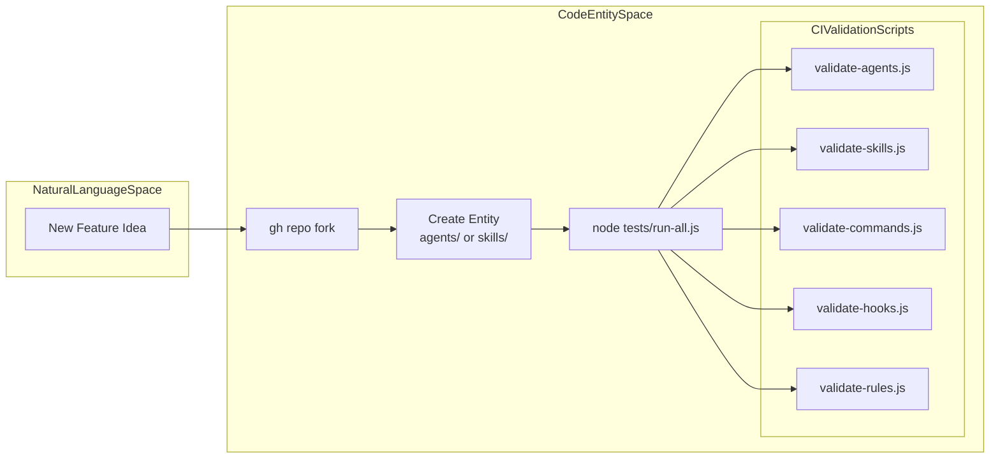

<!-- source: DeepWiki mcp.deepwiki.com · repo affaan-m/everything-claude-code · page 15 Contributing · fetched 2026-10-26 -->

# Contributing

<details>
<summary>Relevant source files</summary>

The following files were used as context for generating this wiki page:

- [.github/workflows/ci.yml](.github/workflows/ci.yml)
- [.github/workflows/maintenance.yml](.github/workflows/maintenance.yml)
- [.github/workflows/release.yml](.github/workflows/release.yml)
- [.github/workflows/reusable-release.yml](.github/workflows/reusable-release.yml)
- [.github/workflows/reusable-test.yml](.github/workflows/reusable-test.yml)
- [.github/workflows/reusable-validate.yml](.github/workflows/reusable-validate.yml)
- [CLAUDE.md](CLAUDE.md)
- [CONTRIBUTING.md](CONTRIBUTING.md)
- [agents/docs-lookup.md](agents/docs-lookup.md)
- [commitlint.config.js](commitlint.config.js)
- [docs/SKILL-DEVELOPMENT-GUIDE.md](docs/SKILL-DEVELOPMENT-GUIDE.md)
- [docs/examples/project-guidelines-template.md](docs/examples/project-guidelines-template.md)
- [docs/skill-adaptation-policy.md](docs/skill-adaptation-policy.md)
- [rules/common/code-review.md](rules/common/code-review.md)
- [rules/common/development-workflow.md](rules/common/development-workflow.md)
- [scripts/ci/validate-workflow-security.js](scripts/ci/validate-workflow-security.js)
- [scripts/release.sh](scripts/release.sh)
- [skills/search-first/SKILL.md](skills/search-first/SKILL.md)
- [tests/ci/validate-workflow-security.test.js](tests/ci/validate-workflow-security.test.js)
- [tests/scripts/release-publish.test.js](tests/scripts/release-publish.test.js)

</details>


This page provides an overview of how to contribute new components to the Everything Claude Code (ECC) plugin. It covers the plugin's architecture, the contribution workflow, and the standards required for each component type.

For detailed guides on creating specific component types, see:
- [Contributing Agents](#15.1) — Guidelines for creating new agents: YAML frontmatter structure, model selection, tool permissions, and description format.
- [Contributing Skills](#15.2) — Guidelines for creating new skills: markdown structure, YAML frontmatter, workflow definitions, and evidence sections.
- [Contributing Commands](#15.3) — Guidelines for creating new commands: markdown format, usage examples, agent/skill references, and validation requirements.
- [Contributing Hooks](#15.4) — Guidelines for creating new hooks: stdin/stdout protocol, exit codes, error handling, `hooks.json` registration, and testing requirements.
- [Contribution Guidelines](#15.5) — General contribution guidelines: PR process, code style, testing requirements, documentation standards, and CI validation.

---

## Plugin Architecture Overview

The plugin follows a modular architecture where each component type serves a distinct role. Most components are declared in the plugin manifest and distributed through the Claude Code plugin system.

### Component Relationship Diagram
This diagram maps the logical "Natural Language Space" of user intent to the "Code Entity Space" of the ECC filesystem.

```mermaid
graph TB
    subgraph "NaturalLanguageSpace (User Intent)"
        [UserRequest] -- "triggers" --> AGENTS
        [SlashCommand] -- "invokes" --> COMMANDS
    end

    subgraph "CodeEntitySpace (ECC Implementation)"
        MANIFEST[".claude-plugin/plugin.json"]
        
        subgraph "DistributableComponents"
            AGENTS["Agents<br/>agents/*.md"]
            SKILLS["Skills<br/>skills/*/SKILL.md"]
            COMMANDS["Commands<br/>commands/*.md"]
            HOOKS_DEF["Hooks Registry<br/>hooks/hooks.json"]
            RULES["Rules<br/>rules/common/*.md"]
        end
        
        subgraph "LogicAutomation"
            SCRIPTS["Scripts<br/>scripts/hooks/*.js"]
            UTILS["Utility Library<br/>scripts/lib/utils.js"]
        end
    end

    AGENTS -- "delegates to" --> SKILLS
    AGENTS -- "constrained by" --> RULES
    COMMANDS -- "launches" --> AGENTS
    
    MANIFEST -- "registers" --> AGENTS
    MANIFEST -- "registers" --> SKILLS
    MANIFEST -- "registers" --> COMMANDS
    
    HOOKS_DEF -- "triggers" --> SCRIPTS
    SCRIPTS -- "imports" --> UTILS
```

**Sources:** [CLAUDE.md:23-32](), [CONTRIBUTING.md:86-89](), [CONTRIBUTING.md:184-190](), [CONTRIBUTING.md:249-251]()

---

## Contribution Workflow

The standard contribution process follows GitHub flow with specific requirements for testing and validation via CI.

### Developer Workflow: From Idea to PR
This diagram bridges the conceptual workflow to specific code entities like the test runner and validation scripts.



**Sources:** [CONTRIBUTING.md:51-69](), [CLAUDE.md:9-19](), [.github/workflows/ci.yml:187-214](), [scripts/ci/validate-agents.js:1-12](), [scripts/ci/validate-commands.js:1-13]()

---

## Directory Structure for Contributions

All contributions must follow the established directory hierarchy. New components should be placed in their respective directories with appropriate naming conventions (lowercase with hyphens).

| Component Type | File Path Pattern | Key Metadata | Purpose |
| :--- | :--- | :--- | :--- |
| **Agents** | `agents/*.md` | YAML (`model`, `tools`) | Specialized assistants like `planner` or `code-reviewer` [CLAUDE.md:25]() |
| **Skills** | `skills/*/SKILL.md` | YAML (`name`, `description`) | Domain knowledge and workflow definitions [docs/SKILL-DEVELOPMENT-GUIDE.md:69-73]() |
| **Commands** | `commands/*.md` | YAML (`description`) | Slash commands for quick execution [CLAUDE.md:36-37]() |
| **Hooks** | `hooks/hooks.json` | JSON `matcher` | Event-driven automation scripts [CLAUDE.md:51]() |
| **Rules** | `rules/common/*.md` | Markdown Headers | Always-active guidelines and standards [rules/common/development-workflow.md:1-7]() |

**Sources:** [CLAUDE.md:23-32](), [CONTRIBUTING.md:188-193](), [docs/SKILL-DEVELOPMENT-GUIDE.md:53-64]()

---

## Testing & Quality Standards

Before submitting a contribution, ensure it meets the technical requirements enforced by the CI pipeline.

### Automated Validation
ECC uses a suite of validation scripts to ensure component integrity:
- **Run all tests:** `node tests/run-all.js` [CLAUDE.md:13]()
- **Agent Validation:** Ensures required frontmatter (`model`, `tools`) exists and uses valid model IDs [scripts/ci/validate-agents.js:10-11]()
- **Command Validation:** Validates cross-references to other commands, agents, and skills [scripts/ci/validate-commands.js:2-5]()
- **Skill Validation:** Checks for required "When to Activate" sections and markdown formatting [CONTRIBUTING.md:159-169]()
- **Manifest Validation:** Ensures `plugin.json` and marketplace manifests are in sync [scripts/release.sh:61-67]()

### Model Selection Guidelines
When contributing agents, select the appropriate model in the frontmatter based on task complexity:
- `haiku`: Simple, fast tasks or routing [CONTRIBUTING.md:242]()
- `sonnet`: Standard for coding and tool-heavy reasoning [CONTRIBUTING.md:242]()
- `opus`: Complex architectural planning or heavy reasoning [CONTRIBUTING.md:242]()

**Sources:** [scripts/ci/validate-agents.js:1-12](), [scripts/ci/validate-commands.js:1-13](), [CONTRIBUTING.md:237-242](), [.github/workflows/ci.yml:187-214]()

---

## High-Level Component Guides

For deep technical details on implementation, refer to the child pages:

### [Contributing Agents](#15.1)
Learn how to define specialized assistants. Agents require a `name`, `description`, `tools` list, and `model` in their frontmatter. They focus on role-based execution and subagent delegation.
**See:** [CONTRIBUTING.md:184-245](), [CLAUDE.md:48]()

### [Contributing Skills](#15.2)
Learn how to codify domain knowledge. Skills are stored in subdirectories and must contain a `SKILL.md` file with a "When to Activate" section to assist auto-activation.
**See:** [docs/SKILL-DEVELOPMENT-GUIDE.md:1-105](), [CONTRIBUTING.md:73-171]()

### [Contributing Commands](#15.3)
Learn how to create slash commands. Commands provide user-invokable entry points to workflows. They must include usage examples and can reference agents or skills.
**See:** [CLAUDE.md:34-43](), [CONTRIBUTING.md:253-261]()

### [Contributing Hooks](#15.4)
Learn how to automate quality gates. Hooks use a `matcher` syntax to trigger scripts during specific lifecycle phases. They must handle stdin/stdout JSON protocols correctly.
**See:** [CONTRIBUTING.md:264-270](), [CLAUDE.md:51]()

### [Contribution Guidelines](#15.5)
General standards for the repository, including the PR process, conventional commit formats, and the skill adaptation policy.
**See:** [CONTRIBUTING.md:1-16](), [CONTRIBUTING.md:148-158](), [rules/common/development-workflow.md:35-38]()

---

