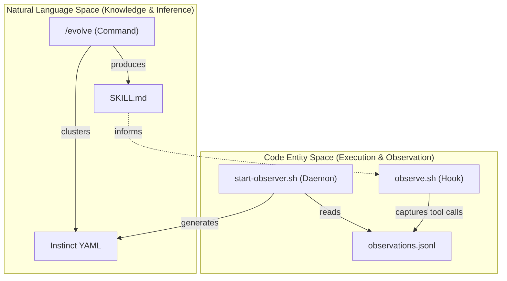
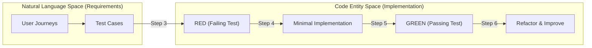

<!-- source: DeepWiki mcp.deepwiki.com · repo affaan-m/everything-claude-code · page 15.2 Contributing Skills · fetched 2026-10-26 -->

# Contributing Skills

<details>
<summary>Relevant source files</summary>

The following files were used as context for generating this wiki page:

- [CONTRIBUTING.md](CONTRIBUTING.md)
- [agents/docs-lookup.md](agents/docs-lookup.md)
- [docs/SKILL-DEVELOPMENT-GUIDE.md](docs/SKILL-DEVELOPMENT-GUIDE.md)
- [docs/examples/project-guidelines-template.md](docs/examples/project-guidelines-template.md)
- [docs/skill-adaptation-policy.md](docs/skill-adaptation-policy.md)
- [rules/common/code-review.md](rules/common/code-review.md)
- [rules/common/development-workflow.md](rules/common/development-workflow.md)
- [skills/search-first/SKILL.md](skills/search-first/SKILL.md)
- [skills/security-review/SKILL.md](skills/security-review/SKILL.md)
- [skills/tdd-workflow/SKILL.md](skills/tdd-workflow/SKILL.md)

</details>


This guide covers the technical requirements and best practices for contributing new skills to the Everything Claude Code (ECC) ecosystem. Skills are domain-specific knowledge modules that provide framework patterns, language idioms, and workflow definitions to inform agent behavior [docs/SKILL-DEVELOPMENT-GUIDE.md:20-27]().

## Skill Architecture

Skills in ECC are directory-based markdown entities. They bridge the gap between "Natural Language Space" (instructions) and "Code Entity Space" (specific implementation patterns) [CONTRIBUTING.md:72-74](). Unlike agents (task executors) or commands (user-invoked actions), skills are passive repositories of knowledge that Claude references when relevant [docs/SKILL-DEVELOPMENT-GUIDE.md:29-30]().

### Directory Structure
Each skill must reside in its own directory within the `skills/` path. Optional subdirectories for code examples and external references are encouraged [docs/SKILL-DEVELOPMENT-GUIDE.md:53-64]().

```text
skills/
  └── [your-skill-name]/
      ├── SKILL.md           # Required: Main skill definition
      ├── examples/          # Optional: Practical code snippets
      └── references/        # Optional: External documentation links
```
Sources: [CONTRIBUTING.md:83-89](), [docs/SKILL-DEVELOPMENT-GUIDE.md:53-64]()

### Data Flow: From Observation to Skill
Skills can be authored manually or generated through the Continuous Learning System. The system captures session data via hooks and evolves it into structured knowledge [docs/SKILL-DEVELOPMENT-GUIDE.md:22-27]().

**Bridge: Natural Language to Code Entity Space**

Sources: [CONTRIBUTING.md:184-186](), [docs/SKILL-DEVELOPMENT-GUIDE.md:22-27]()

---

## The SKILL.md Specification

Every skill must follow a strict markdown structure with YAML frontmatter to be correctly indexed by the ECC system [docs/SKILL-DEVELOPMENT-GUIDE.md:66-73]().

### 1. YAML Frontmatter
The frontmatter provides metadata for the skill registry and the auto-activation logic [docs/SKILL-DEVELOPMENT-GUIDE.md:107-115]().

| Field | Description | Required |
|-------|-------------|----------|
| `name` | Kebab-case unique identifier (e.g., `tdd-workflow`). | Yes |
| `description` | One-line summary used for auto-activation. | Yes |
| `origin` | Source identifier (e.g., `ECC`, `community`). | No |
| `tags` | Array of tags for categorization. | No |

Example:
```yaml
---
name: tdd-workflow
description: Enforces test-driven development with 80%+ coverage.
origin: ECC
---
```
Sources: [skills/tdd-workflow/SKILL.md:1-5](), [docs/SKILL-DEVELOPMENT-GUIDE.md:107-115]()

### 2. Activation Triggers ("When to Activate")
This section is critical for context window management. It defines the specific scenarios where Claude should pull this skill into its active context [CONTRIBUTING.md:104-107]().

```markdown
## When to Activate
- Writing new features or functionality
- Fixing bugs or issues
- Refactoring existing code
```
Sources: [skills/tdd-workflow/SKILL.md:11-18](), [CONTRIBUTING.md:104-107]()

---

## Skill Content Components

### Workflow Definitions
Skills often define step-by-step processes for complex tasks, such as the `search-first` workflow [skills/search-first/SKILL.md:19-47]() or the `tdd-workflow` [skills/tdd-workflow/SKILL.md:63-171]().

**Workflow Execution Flow (TDD Example)**

Sources: [skills/tdd-workflow/SKILL.md:63-165](), [rules/common/development-workflow.md:23-29]()

### Practical Examples and Anti-Patterns
High-quality skills must include copy-pasteable code examples and clear "Anti-Patterns" to show what to avoid [CONTRIBUTING.md:121-124](), [docs/SKILL-DEVELOPMENT-GUIDE.md:185-194]().

- **Core Concepts**: Explain key patterns like the TDD "Tests BEFORE Code" principle [skills/tdd-workflow/SKILL.md:21-22]() or Security "Input Validation" [skills/security-review/SKILL.md:49-74]().
- **Code Examples**: Practical, well-commented code such as the Jest/Vitest unit test patterns [skills/tdd-workflow/SKILL.md:174-199]() or parameterized SQL queries [skills/security-review/SKILL.md:118-131]().
- **Anti-Patterns**: Concrete examples of what NOT to do, such as hardcoding secrets [skills/security-review/SKILL.md:25-29]() or jumping to code without searching [skills/search-first/SKILL.md:157-162]().

Sources: [skills/tdd-workflow/SKILL.md:21-199](), [skills/security-review/SKILL.md:25-131](), [skills/search-first/SKILL.md:157-162](), [CONTRIBUTING.md:121-124]()

---

## Skill Adaptation Policy

When porting skills from external sources, contributors must adhere to the following policies [docs/skill-adaptation-policy.md:1-5]():
- **Idea over Identity**: Copy the underlying logic/workflow, not the external product's branding [CONTRIBUTING.md:153]().
- **Native Preference**: Prefer ECC-native rules, scripts, and MCPs over third-party dependencies [CONTRIBUTING.md:155]().
- **Renaming**: Rename skills if ECC materially changes or expands the original surface [CONTRIBUTING.md:154]().
- **Dependency Policy**: Avoid skills that exist mainly to tell users to install unvetted third-party packages [docs/skill-adaptation-policy.md:45-55]().

Sources: [CONTRIBUTING.md:148-158](), [docs/skill-adaptation-policy.md:1-55]()

---

## Technical Validation Checklist

Before submitting a skill PR, verify against the following requirements [CONTRIBUTING.md:159-170]():

1.  **Scope**: Skill must be focused on one domain (e.g., `react-hook-patterns` rather than `react`) [docs/SKILL-DEVELOPMENT-GUIDE.md:121-131]().
2.  **Size**: Keep content under 500 lines (800 lines absolute maximum) [CONTRIBUTING.md:165]().
3.  **No Secrets**: Ensure no API keys, tokens, or sensitive paths are included [CONTRIBUTING.md:169](), [skills/security-review/SKILL.md:25-29]().
4.  **Auto-Activation**: The "When to Activate" section must be clear and specific to trigger the LLM correctly [CONTRIBUTING.md:162]().
5.  **Evidence**: Include practical, copy-pasteable code examples and evidence of testing with Claude Code [CONTRIBUTING.md:163-167]().

Sources: [CONTRIBUTING.md:159-170](), [docs/SKILL-DEVELOPMENT-GUIDE.md:121-131](), [skills/security-review/SKILL.md:25-29]()

---

