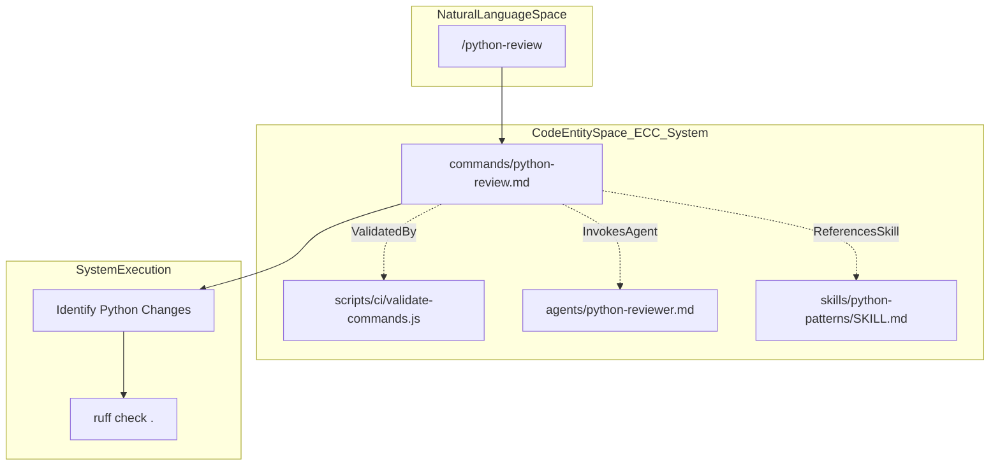

<!-- source: DeepWiki mcp.deepwiki.com · repo affaan-m/everything-claude-code · page 15.3 Contributing Commands · fetched 2026-10-26 -->

# Contributing Commands

Relevant source files

The following files were used as context for generating this wiki page:

- [CONTRIBUTING.md](CONTRIBUTING.md)
- [agents/docs-lookup.md](agents/docs-lookup.md)
- [commands/plan.md](commands/plan.md)
- [commands/prp-commit.md](commands/prp-commit.md)
- [commands/prp-plan.md](commands/prp-plan.md)
- [commands/prp-pr.md](commands/prp-pr.md)
- [commands/prp-prd.md](commands/prp-prd.md)
- [commands/python-review.md](commands/python-review.md)
- [docs/SKILL-DEVELOPMENT-GUIDE.md](docs/SKILL-DEVELOPMENT-GUIDE.md)
- [docs/SKILL-PLACEMENT-POLICY.md](docs/SKILL-PLACEMENT-POLICY.md)
- [docs/examples/project-guidelines-template.md](docs/examples/project-guidelines-template.md)
- [docs/skill-adaptation-policy.md](docs/skill-adaptation-policy.md)
- [rules/common/code-review.md](rules/common/code-review.md)
- [rules/common/development-workflow.md](rules/common/development-workflow.md)
- [schemas/provenance.schema.json](schemas/provenance.schema.json)
- [scripts/ci/validate-agents.js](scripts/ci/validate-agents.js)
- [scripts/ci/validate-commands.js](scripts/ci/validate-commands.js)
- [scripts/ci/validate-install-manifests.js](scripts/ci/validate-install-manifests.js)
- [scripts/ci/validate-skills.js](scripts/ci/validate-skills.js)
- [skills/hexagonal-architecture/SKILL.md](skills/hexagonal-architecture/SKILL.md)
- [skills/search-first/SKILL.md](skills/search-first/SKILL.md)
- [tests/commands/plan-command.test.js](tests/commands/plan-command.test.js)

## Purpose and Scope

This page provides a comprehensive guide to creating new slash commands for the Everything Claude Code (ECC) system. Commands are markdown files in the `commands/` directory that provide quick executable prompts for common workflows. They allow users to trigger complex multi-phase operations, such as generating PRDs or creating pull requests, using a simple `/command` syntax [CONTRIBUTING.MD:43-47]().

## Command Architecture

Commands in ECC are interpreted as high-level instructions that orchestrate the model's behavior. Unlike **agents** (specialized subassistants) or **skills** (passive knowledge), commands are explicit user-triggered actions [docs/SKILL-DEVELOPMENT-GUIDE.MD:39-47](). They often involve state transitions (Phases), external tool usage (Bash, Git, GitHub CLI), and delegation to specialized agents or skills [commands/prp-pr.md:1-151]().

### The Command Lifecycle
When a command is invoked, it typically follows a structured execution flow:
1.  **Input Parsing**: Capturing `$ARGUMENTS` provided by the user [commands/prp-pr.md:10-16]().
2.  **Validation**: Checking preconditions (e.g., git status, branch state) [commands/prp-pr.md:19-37]().
3.  **Discovery/Analysis**: Gathering context from the codebase or environment [commands/prp-pr.md:40-83]().
4.  **Execution**: Performing the primary task (e.g., `git push`, `gh pr create`) [commands/prp-pr.md:85-143]().
5.  **Output/Reporting**: Summarizing results and suggesting next steps to the user [commands/prp-pr.md:155-175]().

### Natural Language to Code Entity Mapping
This diagram illustrates how a user-facing slash command maps to specific file entities and system logic.

Sources: [commands/python-review.md:1-7](), [scripts/ci/validate-commands.js:1-13](), [commands/python-review.md:203-207]()

## Command File Format

Commands must follow a specific markdown structure to be valid within the ECC ecosystem.

### 1. YAML Frontmatter
Every command requires a frontmatter block at the top of the file [scripts/ci/validate-commands.js:15-25]().
- `description`: A clear explanation of what the command does. This is displayed in help menus [commands/prp-pr.md:1-2]().
- `argument-hint`: (Optional) A string showing the expected format for arguments [commands/prp-pr.md:3]().

### 2. Markdown Content
The body should use standard Markdown headings (`#`, `##`) to define phases and logic.
- **Input Handling**: Explicitly mention how `$ARGUMENTS` are handled [commands/prp-pr.md:10-16]().
- **Workflow Diagrams**: Use code blocks or mermaid diagrams to visualize the internal logic [skills/search-first/SKILL.MD:21-47]().
- **Tool Blocks**: Use fenced code blocks (bash) to show the exact commands the agent should execute [commands/python-review.md:57-75]().

### 3. Cross-References
Commands often refer to other ECC entities. These must be formatted correctly for the CI validator:
- **Commands**: Referenced as `` `/command-name` `` [scripts/ci/validate-commands.js:133-135]().
- **Agents**: Referenced as `agents/name.md` [scripts/ci/validate-commands.js:144-145]().
- **Skills**: Referenced as `skills/name/` [scripts/ci/validate-commands.js:156-157]().

Sources: [commands/prp-pr.md:1-151](), [scripts/ci/validate-commands.js:15-160](), [commands/python-review.md:203-207]()

## Validation Requirements

The `scripts/ci/validate-commands.js` utility enforces strict rules on all command contributions.

| Requirement | Description | Source |
| :--- | :--- | :--- |
| **Non-Empty** | Files must contain readable content. | [scripts/ci/validate-commands.js:112-116]() |
| **Frontmatter** | Must start with `---`, have valid key-value pairs, and close with `---`. | [scripts/ci/validate-commands.js:15-40]() |
| **Command Refs** | Any reference to `` `/other-command` `` must exist in the `commands/` dir. | [scripts/ci/validate-commands.js:134-140]() |
| **Agent Refs** | Any path like `agents/agent.md` must exist in the `agents/` dir. | [scripts/ci/validate-commands.js:144-151]() |
| **Skill Refs** | Any path like `skills/skill/` must exist in the `skills/` dir. | [scripts/ci/validate-commands.js:156-162]() |
| **Workflow Refs** | Agent names in `A -> B` diagrams must match valid agent files. | [scripts/ci/validate-commands.js:165-174]() |

## Implementation Data Flow

The following diagram shows how data flows through a command during execution, bridging the user input to the final system state.

```mermaid
graph LR
    subgraph "InputPhase"
        Input["$ARGUMENTS"]
        Parser["Argument Interpreter"]
    end

    subgraph "ValidationPhase"
        CheckGit["git branch --show-current"]
        CheckCommits["git log origin/main..HEAD"]
    end

    subgraph "LogicExecution"
        Analyze["Commit Analysis"]
        Discovery["PR Template Discovery"]
    end

    subgraph "FinalOutput"
        Action["gh pr create"]
        Report["Output Summary"]
    end

    Input --> Parser
    Parser --> CheckGit
    CheckGit --> CheckCommits
    CheckCommits --> Analyze
    Analyze --> Discovery
    Discovery --> Action
    Action --> Report
```

Sources: [commands/prp-pr.md:10-151](), [commands/prp-pr.md:19-155]()

## Best Practices for New Commands

1.  **Inline by Default**: For high-traffic commands like `/plan`, ensure they can run inline without requiring a subagent. This maintains compatibility with plugin installs that lack agent files [commands/plan.md:9-10]().
2.  **Confirmation Gates**: Critical commands that modify state MUST include explicit confirmation gates (e.g., "WAIT for user CONFIRM before touching any code") [commands/plan.md:1-2]().
3.  **Phase-Based Design**: Break complex logic into `Phase 1`, `Phase 2`, etc. This makes the command easier for the LLM to follow sequentially [commands/prp-pr.md:19-155]().
4.  **Error Handling**: Define "Action if Failed" scenarios for validation steps to prevent the agent from proceeding in a broken state [commands/prp-pr.md:29-34]().
5.  **Agent Delegation**: Use the `Task` tool to delegate to specialized agents (e.g., `python-reviewer`) when domain-specific depth is required [commands/python-review.md:1-7]().

Sources: [commands/plan.md:1-122](), [commands/prp-pr.md:19-155](), [commands/python-review.md:1-7](), [tests/commands/plan-command.test.js:31-54]()

---

