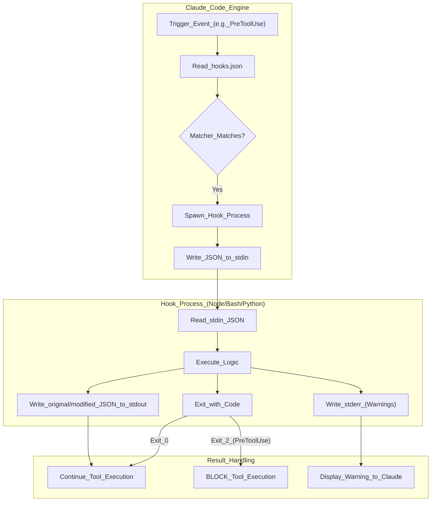

<!-- source: DeepWiki mcp.deepwiki.com · repo affaan-m/everything-claude-code · page 15.4 Contributing Hooks · fetched 2026-10-26 -->

# Contributing Hooks

<details>
<summary>Relevant source files</summary>

The following files were used as context for generating this wiki page:

- [.opencode/commands/harness-audit.md](.opencode/commands/harness-audit.md)
- [CONTRIBUTING.md](CONTRIBUTING.md)
- [agents/docs-lookup.md](agents/docs-lookup.md)
- [commands/harness-audit.md](commands/harness-audit.md)
- [commands/loop-start.md](commands/loop-start.md)
- [commands/model-route.md](commands/model-route.md)
- [commands/quality-gate.md](commands/quality-gate.md)
- [docs/SKILL-DEVELOPMENT-GUIDE.md](docs/SKILL-DEVELOPMENT-GUIDE.md)
- [docs/examples/project-guidelines-template.md](docs/examples/project-guidelines-template.md)
- [docs/skill-adaptation-policy.md](docs/skill-adaptation-policy.md)
- [hooks/README.md](hooks/README.md)
- [hooks/hooks.json](hooks/hooks.json)
- [rules/common/code-review.md](rules/common/code-review.md)
- [rules/common/development-workflow.md](rules/common/development-workflow.md)
- [scripts/harness-audit.js](scripts/harness-audit.js)
- [scripts/hooks/desktop-notify.js](scripts/hooks/desktop-notify.js)
- [scripts/hooks/gateguard-fact-force.js](scripts/hooks/gateguard-fact-force.js)
- [skills/gateguard/SKILL.md](skills/gateguard/SKILL.md)
- [skills/search-first/SKILL.md](skills/search-first/SKILL.md)
- [tests/hooks/gateguard-fact-force.test.js](tests/hooks/gateguard-fact-force.test.js)
- [tests/scripts/harness-audit.test.js](tests/scripts/harness-audit.test.js)

</details>


## Purpose and Scope

Hooks in Everything Claude Code (ECC) are event-driven automations that fire before or after tool executions. They are used to enforce code quality, catch security issues early, and automate repetitive checks like formatting or type-checking [hooks/README.md:1-4](). This page provides technical guidelines for creating new hooks, understanding the communication protocol, and registering them within the system.

---

## Hook Lifecycle and Protocol

Hooks communicate with the main process via a standard JSON-over-stdin/stdout protocol. 

### Data Flow Diagram
The following diagram illustrates how the system invokes a hook and processes its result.

**Hook Execution Flow**

**Sources:** [hooks/README.md:7-15](), [hooks/README.md:108-135](), [scripts/hooks/desktop-notify.js:154-168]()

### Input Schema
Every hook receives a JSON object on `stdin` containing the tool context [hooks/README.md:142-158]().

| Field | Type | Description |
| :--- | :--- | :--- |
| `tool_name` | `string` | The tool being invoked (e.g., `Bash`, `Edit`, `Write`, `Read`, `MultiEdit`) [hooks/README.md:146-146]() |
| `tool_input` | `object` | Tool-specific parameters (e.g., `command`, `file_path`, `content`, `new_string`) [hooks/README.md:147-153]() |
| `tool_output` | `object` | Available only in `PostToolUse` events; contains the tool's result [hooks/README.md:154-157]() |
| `last_assistant_message` | `string` | Available in `Stop` hooks; contains the response text for summaries [scripts/hooks/desktop-notify.js:122-123]() |

**Sources:** [hooks/README.md:142-158](), [scripts/hooks/desktop-notify.js:86-99]()

---

## Implementation Guidelines

### Exit Codes and Behavior
The exit code of the hook process determines if the operation proceeds [hooks/README.md:137-140]().

*   **`0`**: Success. The tool execution continues [hooks/README.md:138-138]().
*   **`2`**: **BLOCK**. Used in `PreToolUse` to prevent the tool from running (e.g., security violation or non-standard file creation) [hooks/README.md:11-12](), [hooks/README.md:139-139]().
*   **Other non-zero**: Treated as a hook error. It is logged but typically does not block the tool [hooks/README.md:140-140]().

### Error Handling and Warnings
*   **Warnings**: To show a non-blocking message to Claude, write to `stderr`. This is the standard way to provide feedback without interrupting the flow [hooks/README.md:126-127]().
*   **Standard Output**: Hooks **must** write the input JSON (or a modified version) back to `stdout` to maintain the pipeline [hooks/README.md:132-133]().
*   **Async Execution**: For background tasks like build analysis or notifications, set `"async": true` in `hooks.json`. These cannot block tool execution [hooks/hooks.json:44-44](), [hooks/README.md:160-174]().

### Registration in `hooks.json`
New hooks must be registered in `hooks/hooks.json`. The configuration supports `matcher` strings to filter when the hook runs based on the tool name [hooks/hooks.json:1-129]().

**Entity Association Diagram**
```mermaid
classDiagram
    class "hooks.json" {
        +PreToolUse: MatcherEntry[]
        +PostToolUse: MatcherEntry[]
        +SessionStart: MatcherEntry[]
        +Stop: MatcherEntry[]
        +PreCompact: MatcherEntry[]
    }
    class MatcherEntry {
        +matcher: String (e.g. "Bash", "Edit|Write", "*")
        +hooks: HookAction[]
        +description: String
        +id: String
    }
    class HookAction {
        +type: "command"
        +command: String (Shell command)
        +async: Boolean
        +timeout: Number
    }
    "hooks.json" *-- MatcherEntry
    MatcherEntry *-- HookAction
```
**Sources:** [hooks/hooks.json:1-129](), [hooks/README.md:160-174]()

---

## State Management and Persistence

Advanced hooks, such as `gateguard-fact-force.js`, often require persistent state across tool calls within a session.

### State Directory and Session Keys
Hooks should store state in a directory defined by `GATEGUARD_STATE_DIR` or a fallback like `~/.gateguard` [scripts/hooks/gateguard-fact-force.js:30-31](). To avoid cross-session races, resolve a unique session key using `CLAUDE_SESSION_ID` or the transcript path [scripts/hooks/gateguard-fact-force.js:79-96]().

### Atomic Writes
To prevent partial reads by concurrent hook executions, use atomic writes (write to a temporary file then rename) [scripts/hooks/gateguard-fact-force.js:171-188]().

**Sources:** [scripts/hooks/gateguard-fact-force.js:25-200]()

---

## Testing Requirements

All new hooks must include tests to ensure they don't break the main execution loop.

### 1. Hook Profile Compatibility
Hooks should respect the `ECC_HOOK_PROFILE` environment variable (`minimal`, `standard`, `strict`) to allow users to toggle groups of automations [hooks/README.md:93-101](). Use the `run-with-flags.js` utility to wrap hooks with profile and ID-based filtering [hooks/hooks.json:21-21]().

### 2. Testing Infrastructure
The codebase provides testing patterns in `tests/hooks/gateguard-fact-force.test.js`.
*   **Mock Inputs**: Use `spawnSync` to pipe mock JSON into the hook script [tests/hooks/gateguard-fact-force.test.js:60-86]().
*   **State Verification**: If the hook is stateful, verify that it correctly transitions between "blocking" and "allowing" states (e.g., GateGuard blocks the first edit but allows the second) [tests/hooks/gateguard-fact-force.test.js:141-176]().
*   **Fail-Open Logic**: Ensure that if the hook fails (e.g., cannot write state), it "fails open" rather than blocking the user's workflow [tests/hooks/gateguard-fact-force.test.js:195-204]().

### 3. CI and Automated Validation
*   **Harness Audit**: The `scripts/harness-audit.js` tool evaluates the quality of hooks, checking for implementation count and registration [scripts/harness-audit.js:221-240]().
*   **Timeouts**: Hooks must specify a `timeout` in `hooks.json` to prevent hanging the CLI [hooks/hooks.json:45-45]().

**Sources:** [tests/hooks/gateguard-fact-force.test.js:1-114](), [scripts/harness-audit.js:221-240](), [hooks/README.md:160-174]()

---

