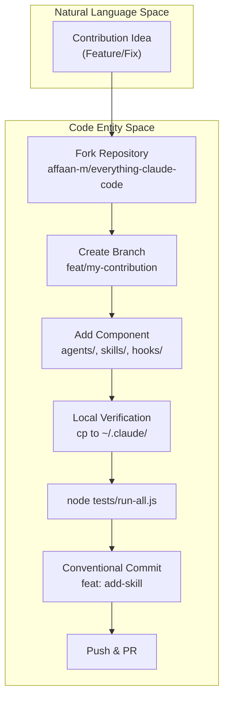
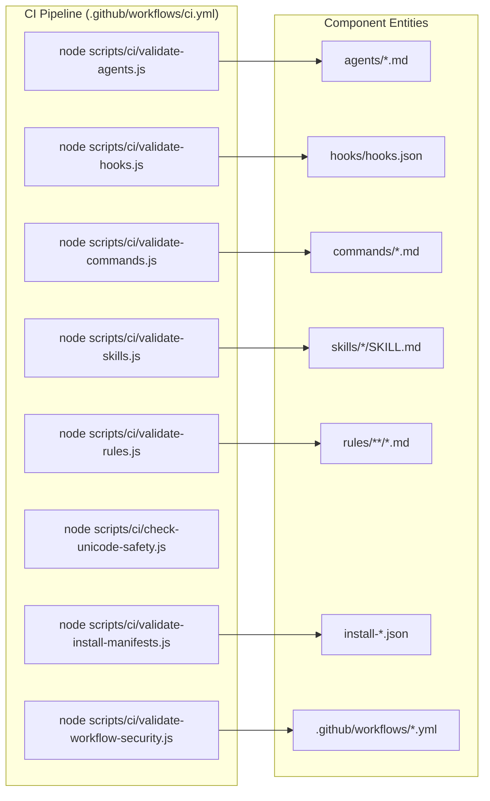

<!-- source: DeepWiki mcp.deepwiki.com · repo affaan-m/everything-claude-code · page 15.5 Contribution Guidelines · fetched 2026-10-26 -->

# Contribution Guidelines

Relevant source files

The following files were used as context for generating this wiki page:

- [.github/workflows/ci.yml](.github/workflows/ci.yml)
- [.github/workflows/maintenance.yml](.github/workflows/maintenance.yml)
- [.github/workflows/release.yml](.github/workflows/release.yml)
- [.github/workflows/reusable-release.yml](.github/workflows/reusable-release.yml)
- [.github/workflows/reusable-test.yml](.github/workflows/reusable-test.yml)
- [.github/workflows/reusable-validate.yml](.github/workflows/reusable-validate.yml)
- [CLAUDE.md](CLAUDE.md)
- [CONTRIBUTING.md](CONTRIBUTING.md)
- [agents/docs-lookup.md](agents/docs-lookup.md)
- [commitlint.config.js](commitlint.config.js)
- [docs/SKILL-DEVELOPMENT-GUIDE.md](docs/SKILL-DEVELOPMENT-GUIDE.md)
- [docs/examples/project-guidelines-template.md](docs/examples/project-guidelines-template.md)
- [docs/skill-adaptation-policy.md](docs/skill-adaptation-policy.md)
- [rules/common/code-review.md](rules/common/code-review.md)
- [rules/common/development-workflow.md](rules/common/development-workflow.md)
- [scripts/ci/validate-workflow-security.js](scripts/ci/validate-workflow-security.js)
- [scripts/release.sh](scripts/release.sh)
- [skills/search-first/SKILL.md](skills/search-first/SKILL.md)
- [tests/ci/validate-workflow-security.test.js](tests/ci/validate-workflow-security.test.js)
- [tests/scripts/release-publish.test.js](tests/scripts/release-publish.test.js)

## Purpose and Scope

This page documents the general guidelines for contributing to the `everything-claude-code` (ECC) repository. ECC is a community resource providing battle-tested workflows, agents, and skills for Claude Code and other AI-integrated development environments [CONTRIBUTING.md:1-4](). These guidelines ensure that all contributions maintain the high standards of reliability, security, and cross-platform compatibility required for autonomous coding agents [CLAUDE.md:44-48]().

For detailed instructions on contributing specific component types, see:
- Agent contributions: [15.1 Contributing Agents]()
- Skills contributions: [15.2 Contributing Skills]()
- Commands contributions: [15.3 Contributing Commands]()
- Hooks contributions: [15.4 Contributing Hooks]()

**Sources:** [CONTRIBUTING.md:1-48](), [CLAUDE.md:1-8]()

## Contribution Process Overview

The lifecycle of a contribution follows a standard fork-and-pull model, reinforced by local verification and CI validation.

Title: Contribution Lifecycle Flow

**Sources:** [CONTRIBUTING.md:50-68](), [CLAUDE.md:53-60]()

## Directory Structure and File Placement

ECC enforces a strict directory hierarchy. Components must be placed in their respective directories to be recognized by the installation and validation scripts [CLAUDE.md:21-32]().

| Directory | Component Type | Format |
|-----------|----------------|--------|
| `agents/` | Specialized assistants | Markdown with YAML frontmatter [CONTRIBUTING.md:188-202]() |
| `skills/` | Knowledge modules | Directory per skill with `SKILL.md` [CONTRIBUTING.md:84-90]() |
| `commands/`| Slash commands | Markdown with description frontmatter [CLAUDE.md:58]() |
| `hooks/` | Event-driven automation | JSON configuration (`hooks.json`) and scripts [CLAUDE.md:28]() |
| `rules/` | Always-on guidelines | Markdown files (Common or Language-specific) [CLAUDE.md:29]() |
| `scripts/` | Utilities | Node.js/Shell scripts [CLAUDE.md:31]() |

**Sources:** [CLAUDE.md:21-32](), [CONTRIBUTING.md:84-90](), [CONTRIBUTING.md:188-202]()

## Quality Standards and Workflow

Contributors are expected to follow the **Feature Implementation Workflow** defined in the project's own rules [rules/common/development-workflow.md:7-39]().

### 1. Research & Reuse
Before implementing a new utility or skill, search for existing solutions. Use `gh search repos` and `gh search code` to find templates and patterns [rules/common/development-workflow.md:9-15](). Use the `search-first` skill patterns to evaluate existing libraries or implementations [skills/search-first/SKILL.md:19-47]().

### 2. TDD and Code Review
- **TDD**: Use the `tdd-guide` agent. Write tests first (RED), implement (GREEN), and refactor (IMPROVE) [rules/common/development-workflow.md:23-28]().
- **Review**: Use the `code-reviewer` agent to check for logic and maintainability immediately after writing code [rules/common/development-workflow.md:30-34]().

### 3. Naming and Formatting
- **Filenames**: Use lowercase with hyphens (e.g., `python-reviewer.md`) [CLAUDE.md:61]().
- **Commit Messages**: Follow Conventional Commits (e.g., `feat:`, `fix:`, `docs:`, `chore:`) [rules/common/development-workflow.md:36-38](). The repository uses `commitlint` to enforce these standards [commitlint.config.js:1-5]().

**Sources:** [rules/common/development-workflow.md:1-45](), [skills/search-first/SKILL.md:1-162](), [commitlint.config.js:1-5]()

## Testing and CI Validation

All PRs must pass the automated validation suite executed by GitHub Actions [.github/workflows/ci.yml:1-13]().

### Automated Validation Suite
The CI pipeline runs several specialized validation scripts to ensure component integrity across multiple Node.js versions (18.x, 20.x, 22.x) and package managers (npm, pnpm, yarn, bun) [.github/workflows/ci.yml:19-34, 186-215]().

Title: CI Validation Mapping

### Test Execution
Local testing is required before submission. Use the following commands:
- **Run all tests**: `node tests/run-all.js` [CLAUDE.md:13](). This orchestrator runs the full suite including harness-specific tests [.github/workflows/ci.yml:154-155]().
- **Validation check**: The CI runs `npm ci --ignore-scripts` followed by individual validation scripts to verify structure and metadata [.github/workflows/ci.yml:183-215]().
- **Security**: `npm audit --audit-level=high` is performed weekly via maintenance workflows [.github/workflows/maintenance.yml:33-40]().

**Sources:** [.github/workflows/ci.yml:154-215](), [CLAUDE.md:9-19](), [.github/workflows/reusable-validate.yml:13-52](), [.github/workflows/maintenance.yml:25-41](), [scripts/ci/validate-workflow-security.js:1-10]()

## Maintenance and Releases

### Release Process
Releases are triggered by version tags (e.g., `v1.0.0`) [.github/workflows/release.yml:3-5]().
- **Manual Bump**: Use `scripts/release.sh VERSION` to update versions across all manifests including `package.json`, `.claude-plugin/plugin.json`, `.claude-plugin/marketplace.json`, and `.opencode/package.json` [scripts/release.sh:7-21, 74-82]().
- **Validation**: The release workflow verifies that the tag version matches the version in `package.json` [.github/workflows/release.yml:43-53]() and ensures release metadata stays in sync via `tests/plugin-manifest.test.js` [.github/workflows/release.yml:55-56]().
- **NPM Publication**: Successful releases are published to `ecc-universal` on npm with provenance enabled [.github/workflows/release.yml:105-108]().

### Scheduled Maintenance
A weekly maintenance task runs every Monday to check for outdated packages and perform security audits [.github/workflows/maintenance.yml:1-41](). Stale issues and PRs are automatically flagged after 30 days of inactivity [.github/workflows/maintenance.yml:42-52]().

**Sources:** [.github/workflows/release.yml:1-105](), [.github/workflows/reusable-release.yml:1-122](), [.github/workflows/maintenance.yml:1-52](), [scripts/release.sh:1-210](), [tests/scripts/release-publish.test.js:30-53]()

---

