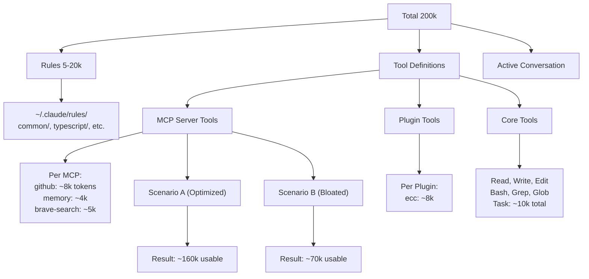
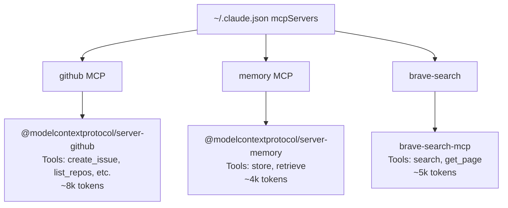
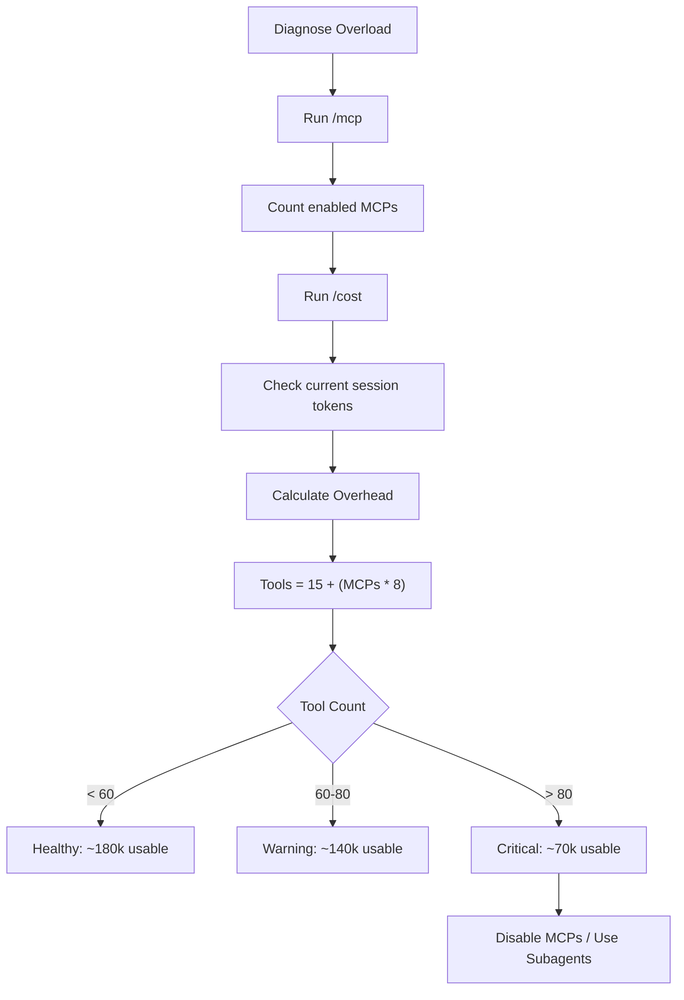

<!-- source: DeepWiki mcp.deepwiki.com · repo affaan-m/everything-claude-code · page 16.1 Context Window Issues · fetched 2026-10-26 -->

# Context Window Issues

Relevant source files

The following files were used as context for generating this wiki page:

- [TROUBLESHOOTING.md](TROUBLESHOOTING.md)
- [docs/TROUBLESHOOTING.md](docs/TROUBLESHOOTING.md)
- [docs/hook-bug-workarounds.md](docs/hook-bug-workarounds.md)
- [docs/token-optimization.md](docs/token-optimization.md)
- [tests/docs/mcp-management-docs.test.js](tests/docs/mcp-management-docs.test.js)

This page covers troubleshooting and resolving context window degradation in Claude Code caused by excessive MCP servers, plugin overload, and improper configuration. The focus is on identifying the root causes, diagnosing the problem, and applying targeted fixes using Everything Claude Code (ECC) utilities.

## Understanding Context Window Budget

Claude Code provides a 200k token context window, but the usable space for active conversation varies dramatically based on how many tools, MCPs, and plugins are enabled.

### Token Allocation Breakdown

**Context Window Budget Allocation (200k tokens total):**

| Component | Good (5 MCPs) | Bad (14 MCPs) |
|-----------|---------------|---------------|
| Rules (always loaded) | 10k tokens | 20k tokens |
| Core tools | 10k tokens | 10k tokens |
| MCP tools | 30k tokens | 100k tokens |
| Plugin tools | 10k tokens | 10k tokens |
| **Total overhead** | **60k tokens** | **140k tokens** |
| **Usable for conversation** | **140k tokens** | **60k tokens** |

**Sources:** [docs/token-optimization.md:97-98](), [docs/token-optimization.md:103-103]()

---

## Symptoms of Context Window Issues

| Symptom | Severity | Typical Cause |
|---------|----------|---------------|
| Context window reported as < 100k tokens | Critical | > 10 MCPs enabled or > 80 total tools [docs/token-optimization.md:97-98]() |
| Claude responses become truncated mid-thought | High | Active conversation + tools exceeding 200k [TROUBLESHOOTING.md:19-26]() |
| `/compact` suggestions appear frequently | Medium | High tool call frequency triggering `suggest-compact` [docs/token-optimization.md:74-77]() |
| `529 Overloaded` responses | Critical | High hook/tool/context pressure [docs/TROUBLESHOOTING.md:58-61]() |
| Performance degradation | Medium | Large tool definition parsing overhead |

**Sources:** [docs/token-optimization.md:64-104](), [TROUBLESHOOTING.md:19-26](), [docs/TROUBLESHOOTING.md:58-68]()

---

## Root Causes

### Excessive MCP Servers

Each enabled MCP server in `~/.claude.json` adds tool definitions to the context window. While Claude Code implements lazy loading for execution, the **definitions** are sent with every prompt to allow the model to select them.

#### MCP Tool Overhead by Server

**Common MCP servers and their overhead:**

**Configuration file locations:**

| Location | Purpose |
|----------|---------|
| `~/.claude.json` | User-level MCP definitions and runtime disable store [tests/docs/mcp-management-docs.test.js:38-39]() |
| `~/.claude/settings.json` | Global Claude Code settings (e.g., `MAX_THINKING_TOKENS`) [docs/token-optimization.md:13-16]() |
| `.claude/settings.json` | Project-level settings (Note: `disabledMcpServers` here may not affect live Claude runtime) [tests/docs/mcp-management-docs.test.js:46-48]() |

**The 10-Server Threshold:** It is strongly recommended to keep under 10 MCPs enabled simultaneously per project to preserve context for reasoning [docs/token-optimization.md:97-97]().

**Sources:** [docs/token-optimization.md:95-104](), [docs/TROUBLESHOOTING.md:67-67](), [tests/docs/mcp-management-docs.test.js:30-49]()

---

## Diagnosing Context Window Problems

### Calculate Total Tool Count

**Diagnostic flow for identifying bloat:**

**Sources:** [docs/token-optimization.md:68-72](), [docs/token-optimization.md:97-98]()

---

## Solutions

### Settings Optimization

Tuning the `MAX_THINKING_TOKENS` and subagent models can significantly reduce hidden costs.

| Setting | Recommended | Effect |
|---------|-------------|--------|
| `MAX_THINKING_TOKENS` | **10,000** | Cuts hidden reasoning cost by ~70% [docs/token-optimization.md:30-30](). |
| `CLAUDE_CODE_SUBAGENT_MODEL` | **haiku** | Subagents (Task tool) run 80% cheaper [docs/token-optimization.md:31-31](). |

**Sources:** [docs/token-optimization.md:15-32]()

### Strategic Compaction

ECC's `strategic-compact` skill suggests manual `/compact` at logical task boundaries (e.g., after exploration, before implementation) rather than relying on unpredictable auto-compaction [docs/token-optimization.md:74-77]().

**Note on Auto-Compaction:** Lowering `CLAUDE_AUTOCOMPACT_PCT_OVERRIDE` may actually cause compaction to happen *sooner* on some builds [docs/TROUBLESHOOTING.md:29-32](). For better control, remove the override and prefer manual `/compact` [docs/hook-bug-workarounds.md:40-43]().

**Sources:** [docs/token-optimization.md:74-89](), [docs/TROUBLESHOOTING.md:29-38](), [docs/hook-bug-workarounds.md:36-43]()

### Subagents for Context Protection

Use the **Task tool** (subagents) for exploration. A subagent can read 20 files and return a summary, preventing those 20 files from bloating your main session's context [docs/token-optimization.md:89-91](). Route these subagents to cheaper models like `haiku` to save on both tokens and cost [docs/token-optimization.md:20-31]().

**Sources:** [docs/token-optimization.md:15-32](), [docs/token-optimization.md:89-93]()

### MCP Discipline

- Use `/mcp` to disable servers for live runtime changes; Claude Code persists these in `~/.claude.json` [docs/token-optimization.md:101-102]().
- Prefer CLI tools (e.g., `gh`, `aws`) over their MCP counterparts when possible to avoid tool definition overhead [docs/token-optimization.md:102-102]().
- `ECC_DISABLED_MCPS` should be used to filter ECC-generated config output during installation/sync, but it is not a live toggle [docs/token-optimization.md:104-104]().

**Sources:** [docs/token-optimization.md:95-106](), [tests/docs/mcp-management-docs.test.js:42-44]()

---

## Related Pages
- [9.3 Context Window Management](9.3)
- [11.2 Token Optimization Strategies](11.2)
- [7.5 Strategic Compaction](7.5)

---

