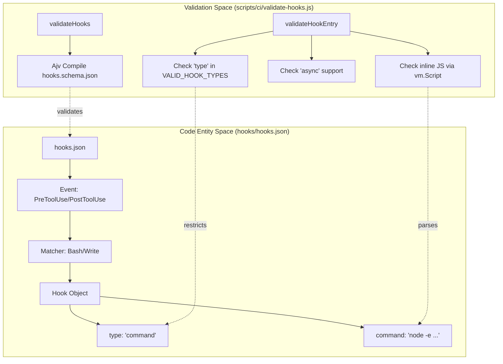

<!-- source: DeepWiki mcp.deepwiki.com · repo affaan-m/everything-claude-code · page 16.2 Hook Failures · fetched 2026-10-26 -->

# Hook Failures

<details>
<summary>Relevant source files</summary>

The following files were used as context for generating this wiki page:

- [TROUBLESHOOTING.md](TROUBLESHOOTING.md)
- [docs/fixes/HOOK-FIX-20260421-ADDENDUM.md](docs/fixes/HOOK-FIX-20260421-ADDENDUM.md)
- [docs/fixes/HOOK-FIX-20260421.md](docs/fixes/HOOK-FIX-20260421.md)
- [docs/fixes/apply-hook-fix.sh](docs/fixes/apply-hook-fix.sh)

</details>


This page covers troubleshooting and debugging hook execution failures in the Everything Claude Code (ECC) system. For general hook architecture and event flow, see [6.1. Hook Lifecycle & Event Flow](). For creating custom hooks, see [6.6. Creating Custom Hooks]().

## Purpose

Hook failures can manifest as:
- Tool calls blocking unexpectedly (exit code 2 when 0 expected).
- Tool calls proceeding when they should be blocked (e.g., security violations).
- Missing warnings or quality checks due to silent crashes.
- Corrupted stdin/stdout data flow breaking the tool chain.
- Timeout errors killing background analysis.
- JSON syntax errors in `hooks.json` or `settings.local.json` preventing hooks from loading.
- Windows-specific shell execution errors (e.g., `EFTYPE` or `cannot execute binary file`).

---

## Hook Execution Protocol

Understanding the stdin/stdout protocol is critical for debugging hook failures. Claude Code expects hooks to act as a "filter" in a pipeline.

### Hook Communication Flow
The following diagram illustrates how Claude Code interacts with hook scripts and how data must flow to avoid breaking the tool execution.

```mermaid
sequenceDiagram
    participant CC as "Claude Code (Main Process)"
    participant Hook as "Hook Script (scripts/hooks/*)"
    participant FS as "File System"
    
    CC->>Hook: "spawn hook command (node/bash)"
    CC->>Hook: "pipe ToolInput JSON to stdin"
    Note over Hook: "REQUIRED: consume stdin (process.stdin.on('data'))"
    Hook->>FS: "optional: read/write state (e.g. projects.json)"
    Note over Hook: "process logic (e.g. block-no-verify.js)"
    Hook->>CC: "REQUIRED: write original/modified JSON to stdout"
    Hook->>CC: "OPTIONAL: write warnings/errors to stderr"
    Hook->>CC: "exit with code (0=continue, 2=block)"
    
    alt Exit Code 2 (PreToolUse)
        CC->>CC: "Abort tool execution; show stderr to user"
    else Exit Code 0
        CC->>CC: "Proceed with tool execution"
    end
```
Sources: [hooks/README.md:5-15](), [scripts/hooks/block-no-verify.js:11-14](), [tests/integration/hooks.test.js:43-50]()

### Critical Requirements
*   **Stdin Consumption:** Hooks MUST consume `stdin` at the start to prevent the parent process from seeing an unconsumed pipe. Node.js hooks use `process.stdin.on('data', ...)` [scripts/hooks/desktop-notify.js:159-163]().
*   **Passthrough:** Hooks must write the tool input JSON back to `stdout`. Failure to do so results in Claude Code receiving empty input for the tool [hooks/README.md:110-135]().
*   **Stderr for UI:** All human-readable messages (warnings, diagnostics, reasons for blocking) must go to `stderr` [hooks/README.md:126-127]().
*   **Exit Codes:**
    *   `0`: Success/Allow execution [scripts/hooks/block-no-verify.js:12]().
    *   `2`: Block the tool call (PreToolUse only) [scripts/hooks/block-no-verify.js:13]().
    *   Other non-zero: Error (logged but usually does not block) [hooks/README.md:140-141]().

---

## Windows-Specific Failures (v2.1.116+)

Recent updates to Claude Code on Windows introduced specific failure modes related to how shell commands are spawned.

### 1. The `EFTYPE` / `bash.exe` Binary Error
**Symptoms:** `PreToolUse:Bash hook error` with message `cannot execute binary file` or `Error: spawn EFTYPE (errno -4028)`.
**Root Cause:** 
*   **Double-wrapping:** Explicitly calling `"C:\Program Files\Git\bin\bash.exe" script.sh` in `settings.json` causes Claude Code's argument splitter to fail [docs/fixes/HOOK-FIX-20260421.md:33-48]().
*   **Argv[0] Duplication:** In v2.1.116, the first token (the bash path) is sometimes passed as both `argv[0]` and `argv[1]`, causing bash to try to execute itself as a script [docs/fixes/HOOK-FIX-20260421-ADDENDUM.md:80-85]().

**Solution:** Use the "bash prefix" pattern or direct `.sh` execution.
```json
// Recommended (docs/fixes/HOOK-FIX-20260421-ADDENDUM.md:39)
"command": "bash \"C:/path/to/observe-wrapper.sh\" pre"
```

### 2. UTF-8 BOM and Line Endings
**Symptoms:** `parse_error` in logs or hooks failing to load.
**Root Cause:** PowerShell's `Out-File` often adds a Byte Order Mark (BOM) `EF BB BF` and `CRLF` line endings to `settings.local.json`, which breaks the hook parser [docs/fixes/HOOK-FIX-20260421.md:23-31]().
**Solution:** Ensure the file is saved as **UTF-8 (no BOM)** with **LF** line endings [docs/fixes/apply-hook-fix.sh:5-6]().

---

## Common Failure Modes

### 1. JSON Syntax & Schema Errors
**Symptoms:** Hooks fail to load or the entire plugin is ignored.
**Diagnosis:** The ECC system uses a strict JSON schema for `hooks.json`.
*   **Matcher Requirements:** Most events require a `matcher` (e.g., "Bash", "Write") except for lifecycle events like `Stop` [scripts/ci/validate-hooks.js:34]().
*   **Type Validation:** Hooks must have a valid `type` ("command", "http", "prompt", "agent") [scripts/ci/validate-hooks.js:33]().

### 2. Stdin/Stdout Corruption
**Symptoms:** Claude reports that it "sent an empty command".
**Diagnosis:** If a hook outputs anything other than the raw/modified JSON to `stdout`, it corrupts the tool call [hooks/README.md:126-135]().

---

## Diagnostic Tools

ECC provides internal scripts to validate hook integrity.

### Schema Validation
```bash
node scripts/ci/validate-hooks.js
```
Sources: [scripts/ci/validate-hooks.js:1-12]()

### System Mapping: Validation to Implementation
This diagram maps the validation logic in `validate-hooks.js` to the actual data structures in `hooks.json`.


Sources: [scripts/ci/validate-hooks.js:50-112](), [hooks/hooks.json:4-15](), [schemas/hooks.schema.json:156-176]()

---

## Troubleshooting Checklist

| Issue | Check | Resolution |
| :--- | :--- | :--- |
| **Hook doesn't run** | `hooks.json` Syntax | Run `node scripts/ci/validate-hooks.js` [scripts/ci/validate-hooks.js:141-153](). |
| **"cannot execute binary"** | Command format | Remove full path to `bash.exe`; use `bash "path/to/script.sh"` [docs/fixes/HOOK-FIX-20260421-ADDENDUM.md:87-93](). |
| **Hook Error (Windows)** | BOM / CRLF | Rewrite `settings.local.json` as UTF-8 (No BOM) / LF [docs/fixes/HOOK-FIX-20260421.md:61-67](). |
| **Tool blocks incorrectly** | Exit Code | Ensure script only returns `2` on actual violations [scripts/hooks/block-no-verify.js:11-14](). |
| **Corrupted Tool Input** | `stdout` output | Ensure `console.log` is ONLY used for the final JSON; use `console.error` for logs [hooks/README.md:126-135](). |

Sources:
- [docs/fixes/HOOK-FIX-20260421.md:1-145]()
- [docs/fixes/HOOK-FIX-20260421-ADDENDUM.md:1-110]()
- [docs/fixes/apply-hook-fix.sh:1-61]()
- [TROUBLESHOOTING.md:159-183]()
- [hooks/hooks.json:1-67]()
- [hooks/README.md:1-185]()
- [scripts/ci/validate-hooks.js:1-210]()
- [schemas/hooks.schema.json:1-198]()
- [tests/integration/hooks.test.js:43-92]()

---

