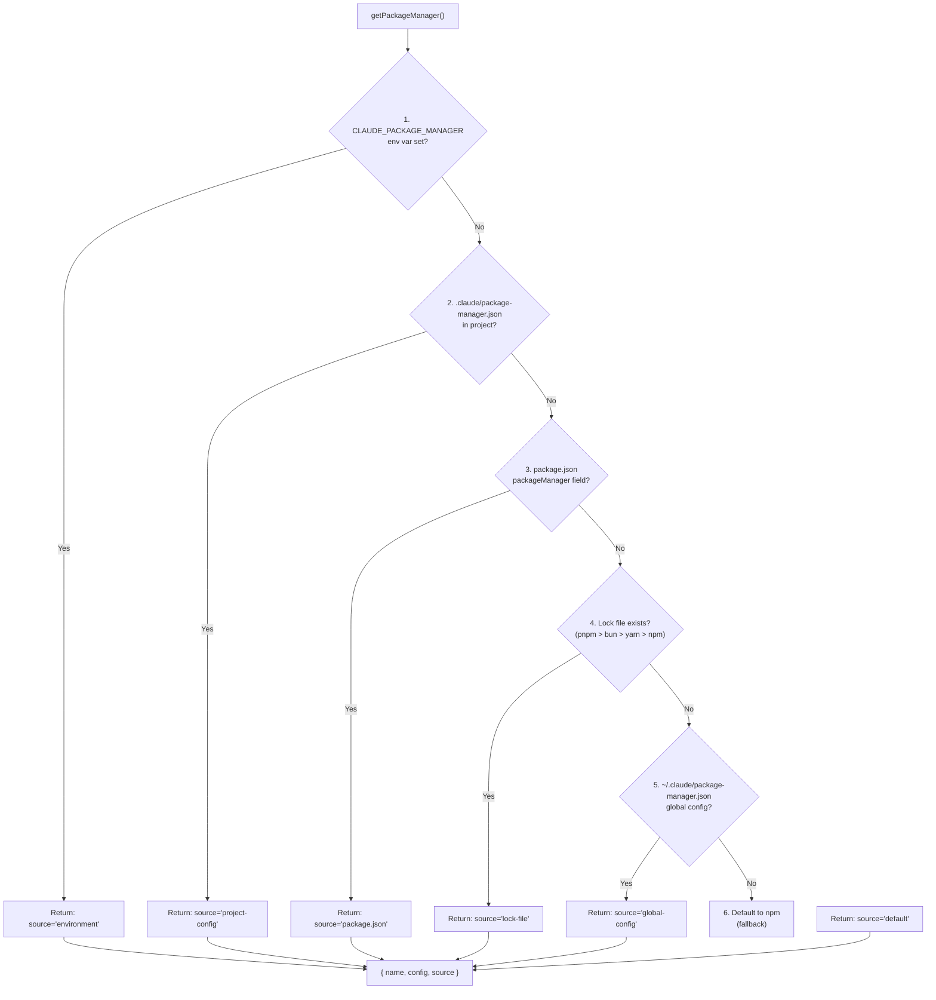
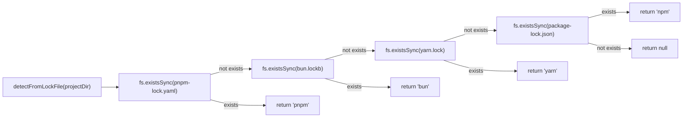
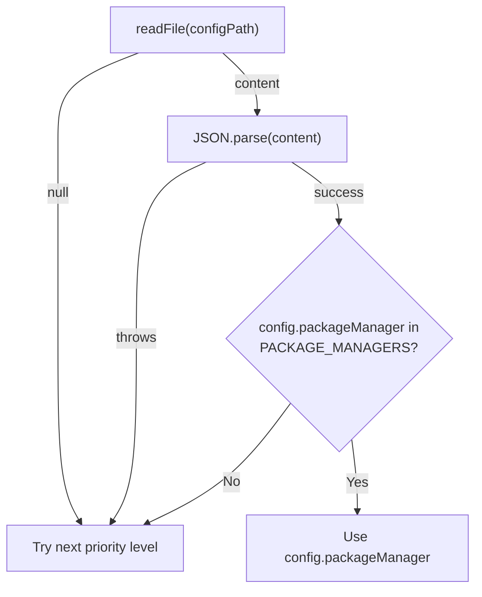
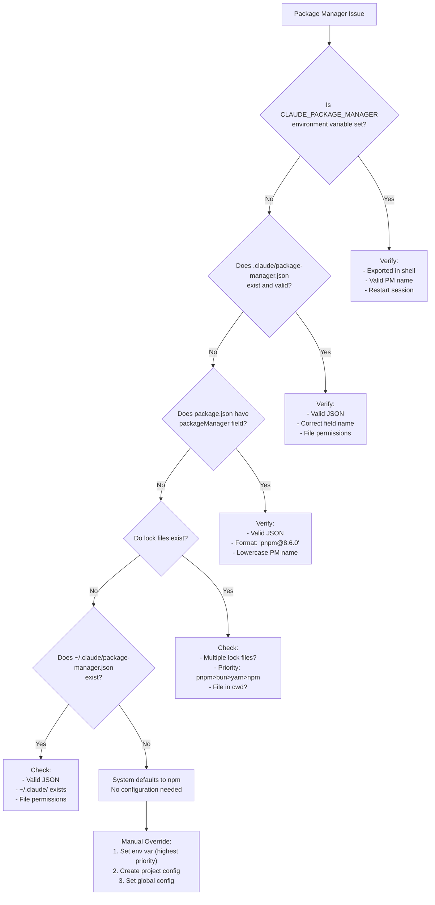

<!-- source: DeepWiki mcp.deepwiki.com · repo affaan-m/everything-claude-code · page 16.3 Package Manager Issues · fetched 2026-10-26 -->

# Package Manager Issues

<details>
<summary>Relevant source files</summary>

The following files were used as context for generating this wiki page:

- [TROUBLESHOOTING.md](TROUBLESHOOTING.md)
- [scripts/hooks/session-end.js](scripts/hooks/session-end.js)
- [scripts/hooks/session-start.js](scripts/hooks/session-start.js)
- [scripts/hooks/suggest-compact.js](scripts/hooks/suggest-compact.js)
- [scripts/lib/package-manager.js](scripts/lib/package-manager.js)
- [scripts/lib/session-aliases.js](scripts/lib/session-aliases.js)
- [scripts/lib/session-manager.js](scripts/lib/session-manager.js)
- [scripts/lib/utils.js](scripts/lib/utils.js)
- [tests/ci/validators.test.js](tests/ci/validators.test.js)
- [tests/hooks/hooks.test.js](tests/hooks/hooks.test.js)
- [tests/integration/hooks.test.js](tests/integration/hooks.test.js)
- [tests/lib/package-manager.test.js](tests/lib/package-manager.test.js)
- [tests/lib/session-aliases.test.js](tests/lib/session-aliases.test.js)
- [tests/lib/session-manager.test.js](tests/lib/session-manager.test.js)
- [tests/lib/utils.test.js](tests/lib/utils.test.js)

</details>


This document covers troubleshooting problems with package manager detection and configuration in Everything Claude Code. The system supports `npm`, `pnpm`, `yarn`, and `bun` across Windows, macOS, and Linux. Issues typically arise from misconfigured priority cascades, missing lock files, corrupted config files, or platform-specific spawn limits.

For general package manager configuration (non-troubleshooting), see [Package Manager Configuration](). For the underlying detection system architecture, see [Package Manager System]().

---

## Detection Priority Cascade

The package manager detection system uses a 6-level priority cascade implemented in `getPackageManager()`. When detection fails, the issue is typically at one specific level in this cascade.

### Package Manager Selection Flow
Title: Package Manager Detection Logic (`getPackageManager`)



**Sources:** [scripts/lib/package-manager.js:163-236]()

---

## Common Detection Failures

### Issue: Wrong Package Manager Detected

**Symptom:** Commands fail with "command not found" errors, or the wrong package manager runs (e.g., `npm` runs when you expect `pnpm`).

**Diagnosis Table:**

| Symptom | Likely Cause | Check This |
|---------|--------------|------------|
| `npm` used despite having `pnpm-lock.yaml` | Environment variable override | `echo $CLAUDE_PACKAGE_MANAGER` |
| Wrong PM in new project | Global config override | `cat ~/.claude/package-manager.json` |
| Inconsistent across sessions | Project config missing | `cat .claude/package-manager.json` |
| Different than `package.json` specifies | Lock file takes precedence | Check lock files exist |

**Detection Order (most to least specific):**

1. `CLAUDE_PACKAGE_MANAGER` env var (session-specific) [scripts/lib/package-manager.js:167-174]()
2. `.claude/package-manager.json` (project-specific) [scripts/lib/package-manager.js:177-192]()
3. `package.json` `packageManager` field (project manifest) [scripts/lib/package-manager.js:195-202]()
4. Lock file presence (implicit detection) [scripts/lib/package-manager.js:205-212]()
5. `~/.claude/package-manager.json` (user-wide) [scripts/lib/package-manager.js:215-222]()
6. `npm` (universal fallback) [scripts/lib/package-manager.js:231-235]()

**Sources:** [scripts/lib/package-manager.js:163-236]()

---

### Issue: Environment Variable Not Respected

**Symptom:** Setting `CLAUDE_PACKAGE_MANAGER=pnpm` has no effect.

**Causes:**

1. **Typo in variable name** - Must be exactly `CLAUDE_PACKAGE_MANAGER` [scripts/lib/package-manager.js:167]().
2. **Invalid package manager name** - Must be one of: `npm`, `pnpm`, `yarn`, `bun` [scripts/lib/package-manager.js:78-81]().
3. **Variable not exported** - Ensure it is available to the node process.
4. **Session started before variable set** - Restart Claude Code session.

**Code Path:**
The environment variable check is the FIRST priority in `getPackageManager()` [scripts/lib/package-manager.js:167-174]().

**Sources:** [scripts/lib/package-manager.js:167-174](), [scripts/lib/package-manager.js:77-82]()

---

### Issue: Lock File Detection Incorrect

**Symptom:** Wrong package manager detected despite correct lock file present.

**Priority Order:**
Lock files are detected in this priority (highest to lowest) defined by `DETECTION_PRIORITY` [tests/lib/package-manager.test.js:157-170]():

| Priority | Lock File | Package Manager |
|----------|-----------|-----------------|
| 1 | `pnpm-lock.yaml` | pnpm |
| 2 | `bun.lockb` | bun |
| 3 | `yarn.lock` | yarn |
| 4 | `package-lock.json` | npm |

### Lock File Search Logic
Title: Lock File Detection Flow (`detectFromLockFile`)



**Causes:**
1. **Multiple lock files present** - The highest priority in detection wins [tests/lib/package-manager.test.js:157-170]().
2. **Lock file in wrong directory** - Must be in `projectDir` (defaults to `process.cwd()`) [scripts/lib/package-manager.js:92-102]().

**Sources:** [tests/lib/package-manager.test.js:157-170](), [scripts/lib/package-manager.js:92-102]()

---

## Windows Spawn Limit Issue

**Symptom:** Plugin freezes during session startup on Windows.

**Root Cause:**
The `getAvailablePackageManagers()` function spawns child processes (e.g., `where.exe` on Windows) to check if package managers are installed [scripts/lib/package-manager.js:136-146](). When called during session startup hooks, this can exceed Bun's spawn limit on Windows and cause deadlocks.

**Fix Applied:**
The detection cascade in `getPackageManager()` now avoids calling `getAvailablePackageManagers()` entirely. Step 6 (fallback) defaults to `npm` without spawning any processes [scripts/lib/package-manager.js:224-236]().

**Warning in Code:**
The function `getAvailablePackageManagers()` includes a technical warning [scripts/lib/package-manager.js:129-135]():
> WARNING: This spawns child processes... Do NOT call this during session startup hooks — it can exceed Bun's spawn limit on Windows and freeze the plugin.

**Sources:** [scripts/lib/package-manager.js:129-146](), [scripts/lib/package-manager.js:224-236]()

---

## Configuration File Issues

### Corrupted `package-manager.json`

**Symptom:** Detection falls back to npm despite configuration file existing.

**File Locations:**
- Project: `.claude/package-manager.json` [scripts/lib/package-manager.js:177]()
- Global: `~/.claude/package-manager.json` [scripts/lib/package-manager.js:61]()

**Expected Format:**
```json
{
  "packageManager": "pnpm",
  "setAt": "2025-02-01T12:00:00.000Z"
}
```

### Configuration Validation Flow
Title: JSON Config Validation Logic



**Common Issues:**
1. **Invalid JSON syntax** - `JSON.parse` fails, triggering fallback [scripts/lib/package-manager.js:74]().
2. **Invalid package manager name** - Name not found in `PACKAGE_MANAGERS` constant [scripts/lib/package-manager.js:182]().

**Sources:** [scripts/lib/package-manager.js:60-88](), [scripts/lib/package-manager.js:177-192](), [scripts/lib/package-manager.js:215-222]()

---

## package.json packageManager Field Issues

### Invalid Field Format

**Symptom:** Detection ignores `package.json` `packageManager` field.

**Expected Format:**
The field is parsed using `split('@')[0]` to support both "pnpm" and "pnpm@8.6.0" [scripts/lib/package-manager.js:116]().

**Parsing Logic in Code:**
```javascript
// From scripts/lib/package-manager.js
const pmName = pkg.packageManager.split('@')[0];
if (PACKAGE_MANAGERS[pmName]) {
  return pmName;
}
```

**Common Mistakes:**
- Using uppercase (e.g., `"PNPM"`).
- Misspelling the field name (e.g., `"pkgManager"`).
- Invalid JSON in `package.json` causing the `try-catch` block to skip detection [scripts/lib/package-manager.js:122]().

**Sources:** [scripts/lib/package-manager.js:107-126]()

---

## Troubleshooting Decision Tree

Title: Package Manager Resolution Path



**Sources:** [scripts/lib/package-manager.js:163-236]()

---

