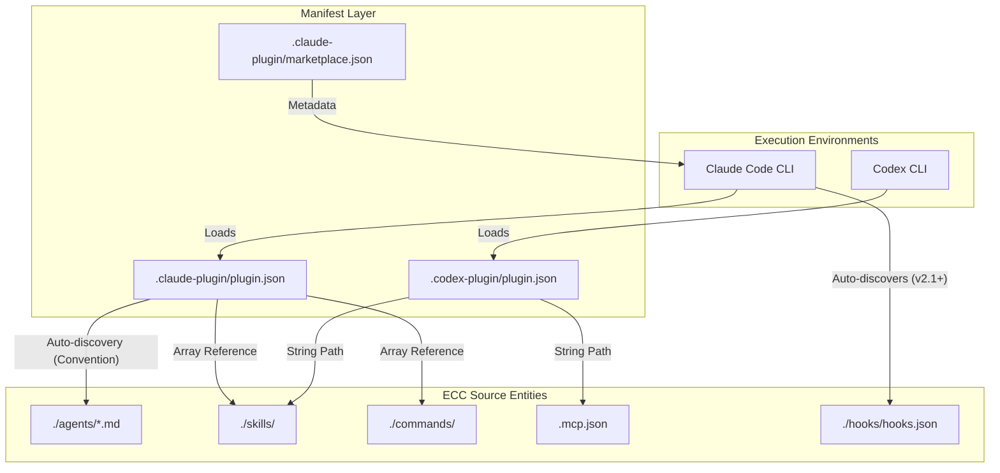
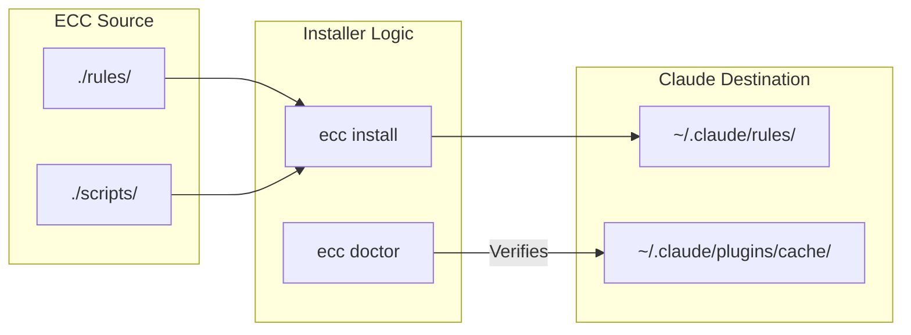

<!-- source: DeepWiki mcp.deepwiki.com · repo affaan-m/everything-claude-code · page 16.4 Plugin Installation Issues · fetched 2026-10-26 -->

# Plugin Installation Issues

Relevant source files

The following files were used as context for generating this wiki page:

- [.agents/plugins/marketplace.json](.agents/plugins/marketplace.json)
- [.claude-plugin/PLUGIN_SCHEMA_NOTES.md](.claude-plugin/PLUGIN_SCHEMA_NOTES.md)
- [.claude-plugin/README.md](.claude-plugin/README.md)
- [.claude-plugin/marketplace.json](.claude-plugin/marketplace.json)
- [.claude-plugin/plugin.json](.claude-plugin/plugin.json)
- [.codex-plugin/README.md](.codex-plugin/README.md)
- [.codex-plugin/plugin.json](.codex-plugin/plugin.json)
- [.mcp.json](.mcp.json)
- [TROUBLESHOOTING.md](TROUBLESHOOTING.md)
- [schemas/package-manager.schema.json](schemas/package-manager.schema.json)
- [schemas/plugin.schema.json](schemas/plugin.schema.json)
- [tests/plugin-manifest.test.js](tests/plugin-manifest.test.js)

This page covers troubleshooting for plugin installation problems, including marketplace connection issues, manifest validation errors, missing rules, and version compatibility issues. It focuses on the technical implementation of the ECC plugin manifests and the strict validation rules enforced by the Claude Code platform.

---

## Overview

The Everything Claude Code (ECC) plugin architecture supports multiple installation paths: the official Claude Code marketplace, Codex native plugins, and manual installation. Each platform (Claude Code, Codex, Cursor, etc.) has unique manifest requirements and security constraints that can lead to installation failures if not precisely followed.

**Sources:** `[.claude-plugin/plugin.json:1-28]()`, `[.claude-plugin/marketplace.json:1-47]()`, `[.codex-plugin/plugin.json:1-30]()`

---

## Plugin Manifest Architecture

ECC uses a multi-manifest strategy to support different AI coding environments from a single source of truth. Discrepancies between these manifests or violations of platform-specific schema rules are the primary cause of installation "Invalid input" errors.

### Component Mapping and Platform Targets

Title: ECC Plugin Manifest and Execution Flow

**Key Implementation Details:**
- **Claude Code**: Requires `skills` and `commands` to be directory paths wrapped in arrays `[.claude-plugin/plugin.json:26-27]()`.
- **Codex**: Requires `skills` and `mcpServers` to be strings (paths), not arrays `[.codex-plugin/plugin.json:14-15]()`. The `mcpServers` path must point exactly to `./.mcp.json` at the repository root.

**Sources:** `[.claude-plugin/plugin.json:26-27]()`, `[.codex-plugin/plugin.json:1-30]()`, `[.claude-plugin/PLUGIN_SCHEMA_NOTES.md:44-55]()`

---

## Issue 1: Marketplace and Manifest Validation Failures

### Symptom
Claude Code returns "Invalid input" or fails to add the marketplace source via `claude mkt add`.

### Root Cause: Undocumented Constraints
The Claude plugin validator is strict and opinionated. Several fields that appear valid in general JSON schemas are rejected by the Claude CLI.

1. **The `agents` Field (CRITICAL)**: Do NOT add an `"agents"` field to `plugin.json`. The validator rejects it entirely with `agents: Invalid input` `[.claude-plugin/PLUGIN_SCHEMA_NOTES.md:58-70]()`. Agents are discovered automatically by convention.
2. **The `hooks` Field (CRITICAL)**: Do NOT add a `"hooks"` field to `plugin.json`. Claude Code v2.1+ auto-loads `hooks/hooks.json`. Explicitly declaring it causes a "Duplicate hooks file detected" error `[.claude-plugin/PLUGIN_SCHEMA_NOTES.md:98-110]()`.
3. **Array Wrappers**: Fields like `commands` and `skills` MUST be arrays. Even if there is only one entry, strings are not accepted `[.claude-plugin/PLUGIN_SCHEMA_NOTES.md:44-55]()`.
4. **Mandatory Version**: A `version` field is required for reliable validation and installation `[.claude-plugin/PLUGIN_SCHEMA_NOTES.md:28-40]()`.

**Sources:** `[.claude-plugin/PLUGIN_SCHEMA_NOTES.md:1-216]()`, `[.claude-plugin/plugin.json:1-28]()`

---

## Issue 2: MCP Server Configuration and Tool Name Limits

### Symptom
Plugin installation fails or certain tools are missing when running through specific LLM gateways.

### Technical Detail: The 64-Character Limit
Strict OpenAI-compatible gateways can reject tool names that exceed 64 characters. When Claude Code auto-discovers MCP servers from a root `.mcp.json`, it generates prefixed names like `mcp__plugin_everything-claude-code_github__create_pull_request_review`, which often exceed this limit `[.claude-plugin/PLUGIN_SCHEMA_NOTES.md:148-150]()`.

### Solution: Explicit Opt-Out
ECC includes an explicit empty `mcpServers` object in `.claude-plugin/plugin.json` to prevent this auto-discovery during Claude plugin installs `[.claude-plugin/plugin.json:25]()`. Users should configure MCPs manually from the provided configs if needed `[.claude-plugin/PLUGIN_SCHEMA_NOTES.md:151-152]()`.

**Sources:** `[.claude-plugin/PLUGIN_SCHEMA_NOTES.md:135-152]()`, `[.claude-plugin/plugin.json:25]()`, `[.mcp.json:1-28]()`

---

## Issue 3: Version Conflicts and Update Logic

### Symptom
Plugin features are unavailable, or the CLI enters an update loop where it constantly claims a new version is available.

### Technical Data Flow: Versioning
ECC tracks versions across multiple files. The `tests/plugin-manifest.test.js` suite enforces that these versions remain synchronized to prevent installation mismatches.

| File | Role | Version Path |
| :--- | :--- | :--- |
| `package.json` | Source of truth | `$.version` `[tests/plugin-manifest.test.js:94-101]()` |
| `.claude-plugin/plugin.json` | Platform version | `$.version` `[.claude-plugin/plugin.json:3]()` |
| `.claude-plugin/marketplace.json` | Discovery version | `$.plugins[0].version` `[.claude-plugin/marketplace.json:15]()` |
| `.codex-plugin/plugin.json` | Codex version | `$.version` `[.codex-plugin/plugin.json:3]()` |
| `VERSION` | CLI check file | Raw text `[tests/plugin-manifest.test.js:137-141]()` |

**Sources:** `[tests/plugin-manifest.test.js:94-156]()`, `[.claude-plugin/plugin.json:3]()`, `[.claude-plugin/marketplace.json:15]()`

---

## Issue 4: Rules and Manual Installation Fallback

### Symptom
Plugin installs successfully, but language-specific rules are missing.

### Root Cause: Platform Limitations
Claude Code plugins are currently restricted from automatically writing to the `~/.claude/rules/` directory. This necessitates a manual installation step for rules.

Title: Rule Installation Data Flow

**Troubleshooting Steps:**
1. **Check Plugin Cache**: Verify files exist in `~/.claude/plugins/cache/` `[TROUBLESHOOTING.md:99-102]()`.
2. **Run Doctor**: Use `ecc doctor` to identify missing components or path issues `[TROUBLESHOOTING.md:254]()`.
3. **Repair**: Use `ecc repair` to restore corrupted or missing plugin files `[TROUBLESHOOTING.md:255]()`.
4. **Permissions**: Ensure hook scripts are executable using `chmod +x` `[TROUBLESHOOTING.md:149-152]()`.

**Sources:** `[TROUBLESHOOTING.md:238-280]()`, `[TROUBLESHOOTING.md:145-155]()`

---

