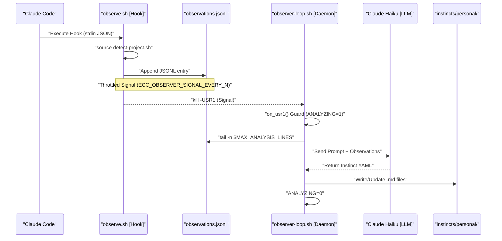
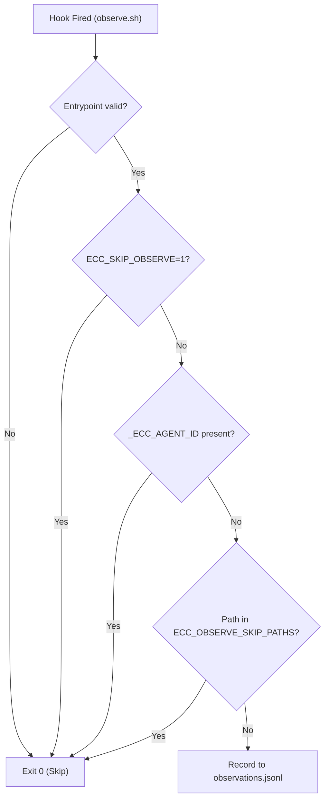

<!-- source: DeepWiki mcp.deepwiki.com · repo affaan-m/everything-claude-code · page 16.5 Continuous Learning Issues · fetched 2026-10-26 -->

# Continuous Learning Issues

Relevant source files

The following files were used as context for generating this wiki page:

- [.gitignore](.gitignore)
- [TROUBLESHOOTING.md](TROUBLESHOOTING.md)
- [scripts/hooks/session-end-marker.js](scripts/hooks/session-end-marker.js)
- [scripts/lib/observer-sessions.js](scripts/lib/observer-sessions.js)
- [skills/continuous-learning-v2/agents/observer-loop.sh](skills/continuous-learning-v2/agents/observer-loop.sh)
- [skills/continuous-learning-v2/agents/session-guardian.sh](skills/continuous-learning-v2/agents/session-guardian.sh)
- [skills/continuous-learning-v2/agents/start-observer.sh](skills/continuous-learning-v2/agents/start-observer.sh)
- [skills/continuous-learning-v2/hooks/observe.sh](skills/continuous-learning-v2/hooks/observe.sh)
- [skills/continuous-learning-v2/scripts/detect-project.sh](skills/continuous-learning-v2/scripts/detect-project.sh)
- [skills/strategic-compact/SKILL.md](skills/strategic-compact/SKILL.md)
- [tests/hooks/observe-subdirectory-detection.test.js](tests/hooks/observe-subdirectory-detection.test.js)
- [tests/hooks/observer-memory.test.js](tests/hooks/observer-memory.test.js)

This page provides technical troubleshooting for the Continuous Learning v2 system. It covers issues related to the background observer daemon, observation capture hooks, project detection, and instinct generation.

## System Architecture & Data Flow

The Continuous Learning system operates as a decoupled architecture where the `observe.sh` hook captures data and the `observer-loop.sh` daemon processes it asynchronously.

### Logic Flow: Observation to Instinct

The following diagram illustrates the lifecycle of an observation from tool execution to instinct codification.

**Diagram: Continuous Learning v2 Data Flow**

Sources: [skills/continuous-learning-v2/hooks/observe.sh:16-151](), [skills/continuous-learning-v2/agents/observer-loop.sh:108-192](), [skills/continuous-learning-v2/agents/start-observer.sh:199-212](), [tests/hooks/observer-memory.test.js:91-111]()

## Observer Agent Issues

### Issue: Observer Not Starting
The observer is a project-scoped background process. If it fails to start, instincts will not be generated even if observations are being recorded.

**Diagnostic Steps:**
1. **Check for Sentinel Lock:** If the observer detects a permission or confirmation prompt in the Claude CLI output (matching `CLV2_OBSERVER_PROMPT_PATTERN`), it "fails closed" and writes a sentinel file to `SENTINEL_FILE` [skills/continuous-learning-v2/agents/start-observer.sh:218-223](), [skills/continuous-learning-v2/scripts/detect-project.sh:49-50]().
2. **Verify Config:** Ensure `observer.enabled` is set to `true` in `config.json` [skills/continuous-learning-v2/agents/start-observer.sh:172-176]().
3. **PID Validation:** Check if a stale PID file exists in the project directory. The launcher script attempts to clean these up automatically [skills/continuous-learning-v2/agents/start-observer.sh:55-73]().
4. **Idle Exit:** The observer daemon may exit if it has been idle for more than 30 minutes and has no active session leases [skills/continuous-learning-v2/agents/observer-loop.sh:70-84]().

| File/Entity | Role in Startup | Path |
| :--- | :--- | :--- |
| `start-observer.sh` | Launcher & Config Loader | [skills/continuous-learning-v2/agents/start-observer.sh:1-15]() |
| `PID_FILE` | Process Tracking | `${PROJECT_DIR}/.observer.pid` |
| `SENTINEL_FILE` | Safety Lock | `${PROJECT_ROOT}/.observer.lock` |
| `LOG_FILE` | Debug Output | `${PROJECT_DIR}/observer.log` |

Sources: [skills/continuous-learning-v2/agents/start-observer.sh:38-49](), [skills/continuous-learning-v2/agents/observer-loop.sh:17-19]()

### Issue: Observer "Memory Explosion" (Fix #521)
The system implements several guards to prevent runaway parallel Claude processes and high memory usage.

**Key Guard Mechanisms:**
* **Re-entrancy Guard:** The `ANALYZING` variable in `observer-loop.sh` prevents multiple analyses from running simultaneously within the same daemon [skills/continuous-learning-v2/agents/observer-loop.sh:13-14](), [tests/hooks/observer-memory.test.js:91-111]().
* **Cooldown Throttle:** A minimum of 60 seconds (`ANALYSIS_COOLDOWN`) must pass between analysis cycles [skills/continuous-learning-v2/agents/observer-loop.sh:16](), [tests/hooks/observer-memory.test.js:119-133]().
* **Tail-based Sampling:** Instead of loading the entire `observations.jsonl` file, the observer only samples the last 500 lines (`MAX_ANALYSIS_LINES`) [skills/continuous-learning-v2/agents/observer-loop.sh:138-144](), [tests/hooks/observer-memory.test.js:154-160]().
* **Signal Throttling:** The `observe.sh` hook uses a `.observer-signal-counter` to only signal the daemon every N observations (default 20) [tests/hooks/observer-memory.test.js:62-77]().

Sources: [skills/continuous-learning-v2/agents/observer-loop.sh:1-20](), [tests/hooks/observer-memory.test.js:1-161]()

## Observation Hook Issues

### Issue: Observations Not Being Captured
The `observe.sh` script is a hook that Claude Code calls on every tool use.

**Common Failure Points:**
1. **Automated Session Suppression:** To avoid self-loops, `observe.sh` exits if `CLAUDE_CODE_ENTRYPOINT` is not `cli`, `sdk-ts`, or `claude-desktop` [skills/continuous-learning-v2/hooks/observe.sh:137-140](). It also exits if `_ECC_AGENT_ID` is present [skills/continuous-learning-v2/hooks/observe.sh:149-150]().
2. **Python Dependency:** The hook requires a Python interpreter to safely parse JSON. It checks `CLV2_PYTHON_CMD`, `python3`, and `python` while avoiding Windows App Installer stubs [skills/continuous-learning-v2/hooks/observe.sh:30-74]().
3. **Project Detection Failure:** If the script cannot identify the project root, it falls back to `global` storage in `~/.claude/homunculus` [skills/continuous-learning-v2/scripts/detect-project.sh:73-79]().

### Logic: Hook Suppression Layers

**Diagram: observe.sh Logic Gate Hierarchy**

Sources: [skills/continuous-learning-v2/hooks/observe.sh:137-162]()

## Project Detection Issues

The system uses `detect-project.sh` to scope observations and instincts to specific codebases.

**Detection Priority Cascade:**
1. `CLAUDE_PROJECT_DIR` environment variable [skills/continuous-learning-v2/scripts/detect-project.sh:58-62]().
2. Git repository root (via `git rev-parse --show-toplevel`) [skills/continuous-learning-v2/scripts/detect-project.sh:65-70]().
3. Fallback to `global` [skills/continuous-learning-v2/scripts/detect-project.sh:73-79]().

**Common Issues:**
* **Subdirectory Resolution:** `observe.sh` resolves the `cwd` from hook input to the git root to ensure all observations for a repo are grouped together [skills/continuous-learning-v2/hooks/observe.sh:105-108]().
* **Hash Mismatches:** Project IDs are derived from Git remote URLs. The system strips embedded credentials to ensure portable IDs across machines [skills/continuous-learning-v2/scripts/detect-project.sh:101-103]().
* **Legacy Migration:** If a project ID changes due to URL normalization, the system attempts to migrate the legacy directory [skills/continuous-learning-v2/scripts/detect-project.sh:127-138]().

Sources: [skills/continuous-learning-v2/scripts/detect-project.sh:16-141](), [scripts/lib/observer-sessions.js:42-74](), [tests/hooks/observe-subdirectory-detection.test.js:130-140]()

## Instinct Management Issues

### Issue: Instinct Generation Failures
Instincts are generated by a Haiku-model agent using a specific prompt and YAML format.

**Failure Modes:**
* **Threshold Not Met:** By default, the observer requires at least 20 observations (`MIN_OBSERVATIONS`) before analysis [skills/continuous-learning-v2/agents/start-observer.sh:77](), [skills/continuous-learning-v2/agents/observer-loop.sh:113-116]().
* **Pattern Frequency:** The LLM prompt instructs Claude to only create instincts for patterns with 3+ occurrences [skills/continuous-learning-v2/agents/observer-loop.sh:156-157]().
* **Format Errors:** The system requires a specific YAML frontmatter with fields like `id`, `trigger`, and `confidence` [skills/continuous-learning-v2/agents/observer-loop.sh:161-170]().

Sources: [skills/continuous-learning-v2/agents/observer-loop.sh:108-192](), [skills/continuous-learning-v2/agents/start-observer.sh:75-108]()

## Resource & Environment Constraints

### Session Guardian
The `session-guardian.sh` script gates observer execution based on system state to avoid interfering with user work.

| Gate Type | Configuration Variable | Default | Behavior |
| :--- | :--- | :--- | :--- |
| Time Window | `OBSERVER_ACTIVE_HOURS_START/END` | 0800-2300 | Skips analysis during "off-hours" [skills/continuous-learning-v2/agents/session-guardian.sh:31-52]() |
| Cooldown | `OBSERVER_INTERVAL_SECONDS` | 300s | Prevents rapid re-analysis of the same project [skills/continuous-learning-v2/agents/session-guardian.sh:86-91]() |
| Idle Check | `OBSERVER_MAX_IDLE_SECONDS`| 1800s | Skips analysis if system idle time is high [skills/continuous-learning-v2/agents/session-guardian.sh:142-148]() |

Sources: [skills/continuous-learning-v2/agents/session-guardian.sh:1-150](), [skills/continuous-learning-v2/agents/observer-loop.sh:131-134]()

---

