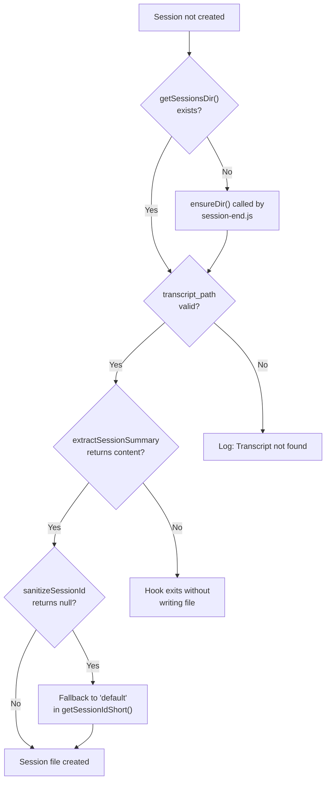
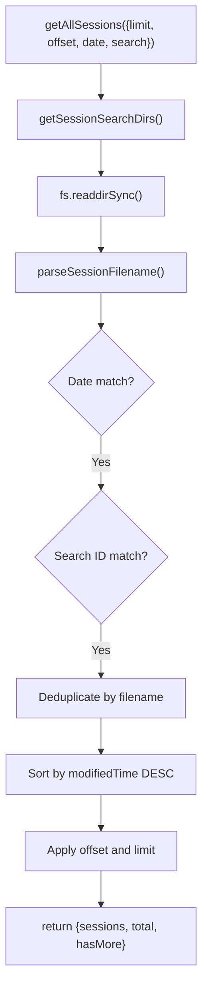

<!-- source: DeepWiki mcp.deepwiki.com · repo affaan-m/everything-claude-code · page 16.6 Session Management Issues · fetched 2026-10-26 -->

# Session Management Issues

<details>
<summary>Relevant source files</summary>

The following files were used as context for generating this wiki page:

- [TROUBLESHOOTING.md](TROUBLESHOOTING.md)
- [scripts/hooks/session-end.js](scripts/hooks/session-end.js)
- [scripts/hooks/session-start.js](scripts/hooks/session-start.js)
- [scripts/hooks/suggest-compact.js](scripts/hooks/suggest-compact.js)
- [scripts/lib/package-manager.js](scripts/lib/package-manager.js)
- [scripts/lib/session-aliases.js](scripts/lib/session-aliases.js)
- [scripts/lib/session-manager.js](scripts/lib/session-manager.js)
- [scripts/lib/utils.js](scripts/lib/utils.js)
- [tests/ci/validators.test.js](tests/ci/validators.test.js)
- [tests/hooks/hooks.test.js](tests/hooks/hooks.test.js)
- [tests/integration/hooks.test.js](tests/integration/hooks.test.js)
- [tests/lib/package-manager.test.js](tests/lib/package-manager.test.js)
- [tests/lib/session-aliases.test.js](tests/lib/session-aliases.test.js)
- [tests/lib/session-manager.test.js](tests/lib/session-manager.test.js)
- [tests/lib/utils.test.js](tests/lib/utils.test.js)

</details>


This page documents common problems encountered with ECC's session management system and provides technical troubleshooting steps. Session management handles persistence of conversation context across Claude Code invocations through session files stored in the canonical session data directory.

For information about the session management architecture and APIs, see [Session Management System](). For details on session file format and metadata extraction, see [Session Files & Format](). For alias management, see [Session Aliases System]().

---

## Overview of Session Management Components

The session management system consists of core libraries for CRUD operations and alias resolution, as well as lifecycle hooks that manage state during session transitions.

**Session Management Data Flow**

```mermaid
graph TB
    subgraph "Session Manager API [session-manager.js]"
        parseFile["parseSessionFilename()"]
        getById["getSessionById(id, includeContent)"]
        getAll["getAllSessions({limit, offset, date, search})"]
        writeContent["writeSessionContent(path, content)"]
    end
    
    subgraph "Session Aliases API [session-aliases.js]"
        setAlias["setAlias(name, path, title)"]
        resolveAlias["resolveAlias(name)"]
        listAliases["listAliases({search, limit})"]
        saveAliases["saveAliases(data)"]
    end
    
    subgraph "Lifecycle Hooks"
        SessionStart["session-start.js"]
        SessionEnd["session-end.js"]
        PreCompact["suggest-compact.js"]
    end
    
    subgraph "Storage [utils.js]"
        SessionFiles["getSessionsDir()<br/>~/.claude/session-data/"]
        LegacyFiles["getLegacySessionsDir()<br/>~/.claude/sessions/"]
        AliasesFile["getAliasesPath()<br/>session-aliases.json"]
    end
    
    getById --> SessionFiles
    getAll --> SessionFiles
    getAll --> LegacyFiles
    writeContent --> SessionFiles
    
    setAlias --> AliasesFile
    resolveAlias --> AliasesFile
    saveAliases --> AliasesFile
    
    SessionStart --> SessionFiles
    SessionEnd --> SessionFiles
    PreCompact --> SessionFiles
```



**Sources:** [scripts/lib/session-manager.js:1-10](), [scripts/lib/session-aliases.js:1-20](), [scripts/lib/utils.js:45-61]()

---

## Common Issues and Solutions

### Issue 1: Session Files Not Being Created

**Symptoms:**
- `session-end.js` hook runs but no `.tmp` file appears in `~/.claude/session-data/`.
- `SessionStart` hook cannot find previous session context.
- Session continuity is broken between invocations.

**Root Causes:**

| Cause | Detection | Fix |
|-------|-----------|-----|
| Missing directory | Check `fs.existsSync(getSessionsDir())` | `ensureDir(getSessionsDir())` is called by hooks [scripts/hooks/session-end.js:200-200]() |
| Invalid session ID | `getSessionIdShort()` fails to sanitize | Check `sanitizeSessionId()` logic for non-ASCII [scripts/lib/utils.js:146-169]() |
| Transcript missing | `CLAUDE_TRANSCRIPT_PATH` env or stdin JSON null | Verify Claude Code provides `transcript_path` [scripts/hooks/session-end.js:184-198]() |
| Empty transcript | `extractSessionSummary()` finds no user messages | Ensure session has at least one user interaction [scripts/hooks/session-end.js:103-103]() |

**Diagnostic Procedure:**



**Sources:** [scripts/hooks/session-end.js:181-210](), [scripts/lib/utils.js:146-182](), [scripts/lib/session-manager.js:27-37]()

---

### Issue 2: Alias Resolution Failures

**Symptoms:**
- `resolveAlias(name)` returns `null` for known aliases.
- `session-aliases.json` becomes corrupted or unparseable.
- Error: "Reserved alias name" when attempting to set a shortcut.

**Validation Requirements for Aliases:**

| Field | Requirement | Validation | Error |
|-------|-------------|------------|-------|
| `name` | 1-128 chars | `alias.length > 128` | "Alias name cannot exceed 128 characters" [scripts/lib/session-aliases.js:199-201]() |
| `name` | Allowed chars | `/^[a-zA-Z0-9_-]+$/` | "Alias name must contain only letters..." [scripts/lib/session-aliases.js:203-205]() |
| `name` | Not reserved | `!reserved.includes(alias)` | "'alias' is a reserved alias name" [scripts/lib/session-aliases.js:208-211]() |
| `sessionPath` | Non-empty | `typeof === 'string' && length > 0` | "Session path cannot be empty" [scripts/lib/session-aliases.js:195-197]() |

**Sources:** [scripts/lib/session-aliases.js:188-212](), [tests/lib/session-aliases.test.js:104-134]()

---

### Issue 3: Session File Corruption or Parsing Errors

**Symptoms:**
- `parseSessionMetadata()` returns null for title or empty arrays for tasks.
- Impossible dates appearing in session lists (e.g., February 31st).
- Date parsing shifting by one day due to timezone offsets.

**Implementation Details for Robustness:**

1. **Calendar Accuracy:** `parseSessionFilename` rejects impossible dates (e.g., Apr 31) by checking if the `Date` constructor rolls over the month [scripts/lib/session-manager.js:42-47]().
2. **Timezone Safety:** Uses local-time constructors (`new Date(year, month - 1, day)`) instead of `new Date(dateStr)` to avoid UTC midnight rollover which can show the previous day in negative offsets [scripts/lib/session-manager.js:56-60]().
3. **Regex Constraints:** Filenames must strictly match `YYYY-MM-DD-[id]-session.tmp`. The ID cannot start with a hyphen [scripts/lib/session-manager.js:27-27]().

**Sources:** [scripts/lib/session-manager.js:27-61](), [tests/lib/session-manager.test.js:51-81]()

---

### Issue 4: Pagination and Search Errors

**Symptoms:**
- `getAllSessions()` returns an empty list despite files being present.
- `hasMore` flag is incorrect when navigating large session histories.
- Search filters by `shortId` return no results.

**Pagination Logic Flow:**



**Sources:** [scripts/lib/session-manager.js:72-137](), [scripts/lib/utils.js:59-61](), [tests/lib/session-manager.test.js:361-424]()

---

### Issue 5: Session Retention and Pruning

**Symptoms:**
- Older session files are missing.
- Storage bloat due to excessive session history.

**Pruning Mechanism:**
The `SessionStart` hook performs periodic cleanup of expired sessions based on the `ECC_SESSION_RETENTION_DAYS` environment variable (defaults to 30 days) [scripts/hooks/session-start.js:36-36]().

| Function | Role | Citation |
|----------|------|----------|
| `getSessionRetentionDays()` | Resolves retention threshold from ENV | [scripts/hooks/session-start.js:85-90]() |
| `pruneExpiredSessions()` | Deletes files older than the threshold | [scripts/hooks/session-start.js:119-157]() |

**Sources:** [scripts/hooks/session-start.js:36-157]()

---

## Diagnostic Commands

### Check Session Health

```bash
# Verify directory resolution (Canonical vs Legacy)
node -e "const u = require('./scripts/lib/utils'); console.log(u.getSessionSearchDirs());"

# Test filename parsing logic
node -e "const sm = require('./scripts/lib/session-manager'); console.log(sm.parseSessionFilename('2026-02-01-a1b2c3d4-session.tmp'));"

# Inspect alias storage
node -e "const sa = require('./scripts/lib/session-aliases'); console.log(sa.loadAliases());"
```

**Sources:** [scripts/lib/utils.js:59-61](), [scripts/lib/session-manager.js:34-61](), [scripts/lib/session-aliases.js:42-81]()

---

## Recovery Procedures

### Corrupted Session Aliases File

The system uses an atomic write pattern to prevent corruption. If `session-aliases.json` is unparseable, it will fallback to a default structure and log the error.

**Atomic Write Mechanism:**
1. **Backup:** Copy `session-aliases.json` to `session-aliases.json.bak` [scripts/lib/session-aliases.js:106-108]().
2. **Temp Write:** Write new content to `session-aliases.json.tmp` [scripts/lib/session-aliases.js:111-111]().
3. **Atomic Rename:** Rename `.tmp` to the target path. On Windows, the target is unlinked first to avoid `EEXIST` [scripts/lib/session-aliases.js:116-119]().
4. **Cleanup:** Remove backup on success [scripts/lib/session-aliases.js:121-124]().

**Sources:** [scripts/lib/session-aliases.js:88-151](), [tests/lib/session-aliases.test.js:69-76]()

### Manual Session Matching Debugging

If `session-start.js` is loading the wrong session, check the match reason in the logs. Matching priority is:
1. **Worktree Match:** Matches the `**Worktree:**` header field to `process.cwd()` [scripts/hooks/session-start.js:210-213]().
2. **Project Match:** Matches the `**Project:**` header field to `getProjectName()` [scripts/hooks/session-start.js:218-225]().
3. **Recency Fallback:** Most recent readable session within the last 7 days [scripts/hooks/session-start.js:235-238]().

**Sources:** [scripts/hooks/session-start.js:185-238](), [scripts/hooks/session-end.js:151-167]()

---

