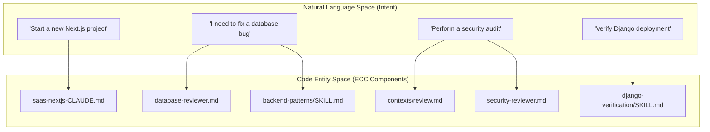
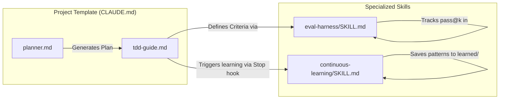

<!-- source: DeepWiki mcp.deepwiki.com · repo affaan-m/everything-claude-code · page 17 Examples & Templates · fetched 2026-10-26 -->

# Examples & Templates

Relevant source files

The following files were used as context for generating this wiki page:

- [agents/architect.md](agents/architect.md)
- [agents/build-error-resolver.md](agents/build-error-resolver.md)
- [agents/code-reviewer.md](agents/code-reviewer.md)
- [agents/database-reviewer.md](agents/database-reviewer.md)
- [agents/doc-updater.md](agents/doc-updater.md)
- [agents/e2e-runner.md](agents/e2e-runner.md)
- [agents/planner.md](agents/planner.md)
- [agents/python-reviewer.md](agents/python-reviewer.md)
- [agents/security-reviewer.md](agents/security-reviewer.md)
- [examples/django-api-CLAUDE.md](examples/django-api-CLAUDE.md)
- [examples/saas-nextjs-CLAUDE.md](examples/saas-nextjs-CLAUDE.md)
- [examples/user-CLAUDE.md](examples/user-CLAUDE.md)
- [scripts/setup-package-manager.js](scripts/setup-package-manager.js)
- [skills/backend-patterns/SKILL.md](skills/backend-patterns/SKILL.md)
- [skills/clickhouse-io/SKILL.md](skills/clickhouse-io/SKILL.md)
- [skills/coding-standards/SKILL.md](skills/coding-standards/SKILL.md)
- [skills/continuous-learning/SKILL.md](skills/continuous-learning/SKILL.md)
- [skills/cpp-testing/SKILL.md](skills/cpp-testing/SKILL.md)
- [skills/django-verification/SKILL.md](skills/django-verification/SKILL.md)
- [skills/e2e-testing/SKILL.md](skills/e2e-testing/SKILL.md)
- [skills/eval-harness/SKILL.md](skills/eval-harness/SKILL.md)
- [skills/frontend-patterns/SKILL.md](skills/frontend-patterns/SKILL.md)
- [skills/iterative-retrieval/SKILL.md](skills/iterative-retrieval/SKILL.md)
- [skills/postgres-patterns/SKILL.md](skills/postgres-patterns/SKILL.md)

This section provides a comprehensive reference for real-world application of Everything Claude Code (ECC). It includes battle-tested `CLAUDE.md` templates for various technology stacks and "Context Modes" that allow you to shift agent behavior dynamically based on your current task phase.

## Project CLAUDE.md Templates

ECC provides a variety of templates designed to bootstrap your project's interaction with Claude Code. These templates serve as the "brain" of the project, defining the core philosophy, available agents, and specific coding standards that the AI must follow.

### Global vs. Project Configuration
*   **User-Level (`user-CLAUDE.md`)**: Designed to be placed at `~/.claude/CLAUDE.md`. It establishes universal principles like "Agent-First" delegation, parallel execution, and personal privacy preferences that apply across all your repositories [examples/user-CLAUDE.md:1-22](). It also serves as a central hub linking to modular rules in `~/.claude/rules/` [examples/user-CLAUDE.md:25-39]().
*   **Project-Specific**: Located in the root of your repository, these templates define the tech stack (e.g., Next.js, Django, Go) and the specific testing and architectural patterns for that codebase.

### Available Templates
The `examples/` directory contains specialized configurations for:
*   **SaaS Next.js**: Optimized for App Router, TypeScript, and modern frontend patterns [examples/saas-nextjs-CLAUDE.md]().
*   **Django API**: Focuses on Pythonic conventions, migrations, and DRF patterns [examples/django-api-CLAUDE.md]().
*   **Go Microservice**: Emphasizes concurrency, interfaces, and standard Go project structure [examples/go-microservice-CLAUDE.md]().
*   **Rust API**: Configured for ownership safety, `tokio` async, and strict typing [examples/rust-api-CLAUDE.md]().
*   **Laravel API**: Tailored for PHP/Laravel service providers and Eloquent patterns [examples/laravel-api-CLAUDE.md]().

For details on how to implement and customize these, see [Project CLAUDE.md Templates](#17.1).

**Sources:** [examples/user-CLAUDE.md:1-40](), [examples/saas-nextjs-CLAUDE.md](), [examples/django-api-CLAUDE.md](), [examples/go-microservice-CLAUDE.md](), [examples/rust-api-CLAUDE.md](), [examples/laravel-api-CLAUDE.md]().

---

## Context Modes

Context Modes are named markdown files located in the `contexts/` directory (e.g., `dev.md`, `research.md`, `review.md`). They function as "behavioral overlays" that you can feed to Claude to shift its operational focus without permanently modifying your main `CLAUDE.md`.

### Core Contexts
| Mode | Focus | Key Activities |
|------|-------|----------------|
| **Dev** | Implementation | TDD loops, feature coding, bug fixing [contexts/dev.md:1-5](). |
| **Research** | Exploration | Understanding before acting, documentation exploration, and hypothesis verification [contexts/research.md:1-10](). |
| **Review** | Quality | Logic error detection, security audits (injection/auth), and performance analysis [contexts/review.md:1-20](). |

### Usage Workflow
Context modes allow the agent to transition through the software development lifecycle (SDLC) while maintaining high precision for the current phase. For example, switching to `research.md` encourages the agent to "read widely before concluding" and favor tools like `Grep`, `Glob`, and specialized lookup agents [contexts/research.md:6-24](). This approach prevents "context drift" where an agent might try to fix code before fully understanding the architecture.

For details, see [Context Modes](#17.2).

**Sources:** [contexts/dev.md:1-5](), [contexts/research.md:1-27](), [contexts/review.md:1-23]().

---

## Technical Mapping: From Intent to Entity

The following diagram illustrates how user intent (Natural Language Space) maps to specific ECC entities and project templates (Code Entity Space).

### Intent-to-Entity Mapping

**Sources:** [examples/saas-nextjs-CLAUDE.md](), [skills/backend-patterns/SKILL.md:1-5](), [skills/django-verification/SKILL.md:1-9](), [contexts/review.md:1-6](), [agents/security-reviewer.md](), [agents/database-reviewer.md:1-10]().

### Specialized Workflow Orchestration
This diagram shows how specific agents and skills collaborate within the framework of an ECC template to execute complex technical tasks like Eval-Driven Development (EDD) or Continuous Learning.

**Sources:** [agents/planner.md](), [skills/eval-harness/SKILL.md:8-28](), [skills/continuous-learning/SKILL.md:25-30](), [skills/continuous-learning/SKILL.md:72-81]().

## Related Sections
*   **[Core Concepts](#3)**: Understand the underlying architecture of agents and skills.
*   **[Continuous Learning System](#8)**: See how the system evolves instincts into new skills [skills/continuous-learning/SKILL.md:9-21]().
*   **[Component Reference](#5)**: Full listing of all available agents like `code-reviewer` [agents/code-reviewer.md:1-6]() and `database-reviewer` [agents/database-reviewer.md:1-6]().
*   **[Installation & Setup](#4)**: Learn how to configure package managers using `setup-package-manager.js` [scripts/setup-package-manager.js:1-13]().
*   **[Context Window Management](#9.3)**: Optimization strategies for maintaining performance when using large templates.

---

