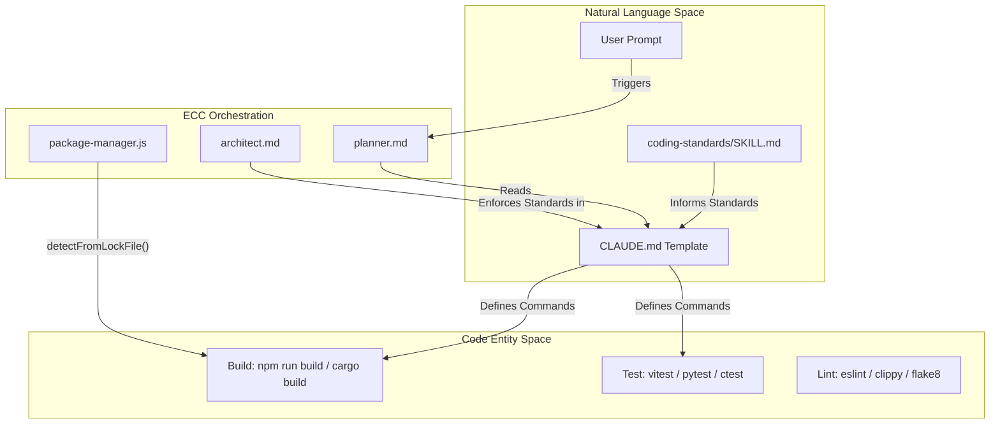
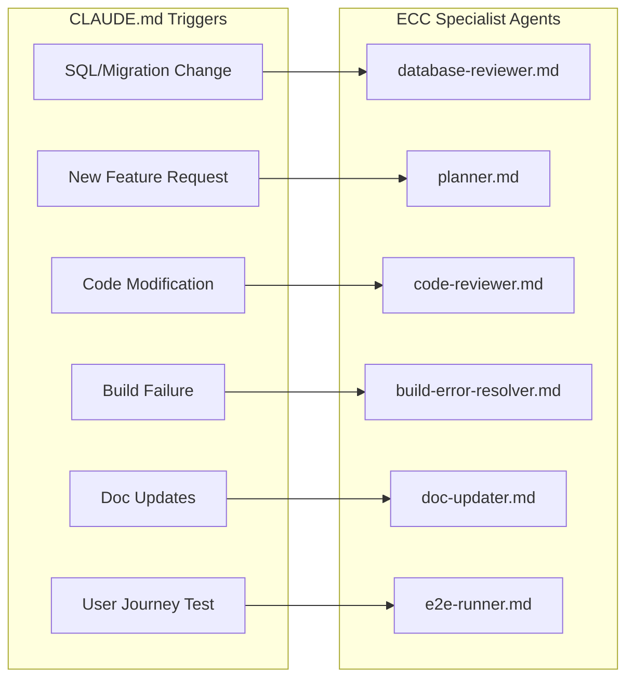

<!-- source: DeepWiki mcp.deepwiki.com · repo affaan-m/everything-claude-code · page 17.1 Project CLAUDE.md Templates · fetched 2026-10-26 -->

# Project CLAUDE.md Templates

Relevant source files

The following files were used as context for generating this wiki page:

- [agents/architect.md](agents/architect.md)
- [agents/build-error-resolver.md](agents/build-error-resolver.md)
- [agents/code-reviewer.md](agents/code-reviewer.md)
- [agents/database-reviewer.md](agents/database-reviewer.md)
- [agents/doc-updater.md](agents/doc-updater.md)
- [agents/e2e-runner.md](agents/e2e-runner.md)
- [agents/planner.md](agents/planner.md)
- [agents/python-reviewer.md](agents/python-reviewer.md)
- [agents/security-reviewer.md](agents/security-reviewer.md)
- [examples/django-api-CLAUDE.md](examples/django-api-CLAUDE.md)
- [examples/saas-nextjs-CLAUDE.md](examples/saas-nextjs-CLAUDE.md)
- [examples/user-CLAUDE.md](examples/user-CLAUDE.md)
- [scripts/setup-package-manager.js](scripts/setup-package-manager.js)
- [skills/backend-patterns/SKILL.md](skills/backend-patterns/SKILL.md)
- [skills/clickhouse-io/SKILL.md](skills/clickhouse-io/SKILL.md)
- [skills/coding-standards/SKILL.md](skills/coding-standards/SKILL.md)
- [skills/continuous-learning/SKILL.md](skills/continuous-learning/SKILL.md)
- [skills/cpp-testing/SKILL.md](skills/cpp-testing/SKILL.md)
- [skills/django-verification/SKILL.md](skills/django-verification/SKILL.md)
- [skills/e2e-testing/SKILL.md](skills/e2e-testing/SKILL.md)
- [skills/eval-harness/SKILL.md](skills/eval-harness/SKILL.md)
- [skills/frontend-patterns/SKILL.md](skills/frontend-patterns/SKILL.md)
- [skills/iterative-retrieval/SKILL.md](skills/iterative-retrieval/SKILL.md)
- [skills/postgres-patterns/SKILL.md](skills/postgres-patterns/SKILL.md)

This page documents the collection of `CLAUDE.md` templates provided by Everything Claude Code (ECC) to standardize agent behavior across different project types. These templates act as the "brain" of the project-level configuration, defining build commands, test runners, and coding standards that Claude Code uses to maintain high-quality output.

## Purpose and Scope

The `CLAUDE.md` file is the primary entry point for Claude Code to understand a repository's specific workflows. While ECC provides global rules and agents, these templates allow for per-project customization of:
*   **Build & Test Commands**: Specific CLI invocations for the project's stack (e.g., `npm`, `pytest`, `cargo`, or `ctest`).
*   **Coding Guidelines**: Language-specific patterns (e.g., "Use functional components in React" or "Prefer immutability").
*   **Architecture Overviews**: Mapping of key directories and entry points for specialized agents like `doc-updater`.
*   **Agent Instructions**: Guidance on which ECC agents to invoke for specific tasks (e.g., `database-reviewer` for SQL or `e2e-runner` for Playwright).

## Template Types

ECC provides specialized templates for various tech stacks located in the `examples/` directory.

### 1. User-Level Global Config (`user-CLAUDE.md`)
This template is intended for the user's home directory (`~/.claude/CLAUDE.md`) to provide persistent, cross-project instructions. It defines core philosophies such as "Agent-First" delegation and "Plan Before Execute" [examples/user-CLAUDE.md:12-22](). It also establishes universal personal preferences like "No emojis in code" and "200-400 lines typical per file" [examples/user-CLAUDE.md:66-70]().

### 2. SaaS Next.js (`saas-nextjs-CLAUDE.md`)
Designed for modern full-stack TypeScript applications. It focuses on:
*   **Frontend**: Tailwind CSS, React Server Components (RSC), and Zod validation [skills/coding-standards/SKILL.md:174-202]().
*   **Backend**: Next.js App Router, Server Actions, and Supabase integration [skills/backend-patterns/SKILL.md:105-127]().
*   **Testing**: Playwright for E2E via the `e2e-runner` agent [agents/e2e-runner.md:21-36]().

### 3. Django API (`django-api-CLAUDE.md`)
Tailored for Python-based REST APIs using Django and DRF.
*   **Verification**: Uses the `django-verification` skill for checking settings and migrations [skills/django-verification/SKILL.md:1-10]().
*   **Review**: Invokes the `python-reviewer` for type hinting (mypy) and PEP8 compliance [agents/python-reviewer.md:1-10]().
*   **Database**: PostgreSQL optimization and migration safety via `database-reviewer` [agents/database-reviewer.md:3-6]().

### 4. Go Microservice (`go-microservice-CLAUDE.md`)
Optimized for high-performance Go services.
*   **Architecture**: Hexagonal/Clean architecture, interface-based mocking.
*   **Commands**: `go test ./...` and `golangci-lint`.
*   **Review**: Uses the `go-reviewer` agent for concurrency safety and context propagation [agents/go-reviewer.md:1-10]().

### 5. Laravel API (`laravel-api-CLAUDE.md`)
Standardized for PHP Laravel applications.
*   **Testing**: Pest or PHPUnit.
*   **Patterns**: Form Requests for validation, API Resources for transformations, and Action classes.

### 6. Rust API (`rust-api-CLAUDE.md`)
Focused on safety and performance in Rust services (Axum/Actix).
*   **Tools**: `cargo check`, `cargo clippy`, and `tokio` for async.
*   **Review**: Uses the `rust-reviewer` and `rust-build-resolver` for handling borrow checker issues [agents/rust-reviewer.md:1-5](), [agents/rust-build-resolver.md:1-5]().

## Technical Implementation and Data Flow

The `CLAUDE.md` file serves as a context bridge. When a session starts, Claude Code reads this file to populate its internal instructions. This is often supplemented by the `package-manager.js` logic which detects the correct environment for build commands [scripts/setup-package-manager.js:15-23]().

### System Architecture Diagram

Title: "CLAUDE.md Integration Flow"

**Sources**: [agents/planner.md:1-55](), [agents/architect.md:1-64](), [scripts/setup-package-manager.js:15-23](), [skills/coding-standards/SKILL.md:1-5]()

## Customization Strategy

To customize a template for a specific project, ECC recommends a "Search-First" approach (using `iterative-retrieval`) followed by "Command Mapping."

### Command Mapping Table
Templates map high-level intentions to specific project CLI tools:

| Intention | Next.js (npm) | Python (pytest) | C++ (CMake/CTest) |
| :--- | :--- | :--- | :--- |
| **Build** | `npm run build` | `pip install -e .` | `cmake --build build` |
| **Test** | `npm test` | `pytest` | `ctest --test-dir build` |
| **Lint** | `npm run lint` | `flake8` | `cppcheck` |
| **Coverage** | `vitest run --coverage` | `pytest --cov` | `lcov --capture` |

**Sources**: [examples/saas-nextjs-CLAUDE.md:1-10](), [skills/cpp-testing/SKILL.md:180-192](), [skills/cpp-testing/SKILL.md:224-233](), [agents/build-error-resolver.md:21-28]()

## Multi-Agent Interaction via CLAUDE.md

The templates include instructions for Claude to delegate tasks to specific ECC agents based on the project context defined in the markdown file.

Title: "Agent Delegation Mapping"

**Sources**: [agents/database-reviewer.md:1-6](), [agents/planner.md:1-6](), [agents/code-reviewer.md:1-6](), [agents/build-error-resolver.md:1-6](), [agents/doc-updater.md:1-6](), [agents/e2e-runner.md:1-6]()

### Example: Database Integration in CLAUDE.md
When using the `django-api-CLAUDE.md` or `saas-nextjs-CLAUDE.md` templates, the instructions mandate that any schema change must be reviewed by the `database-reviewer` agent [agents/database-reviewer.md:1-10](). This agent uses tools like `pg_stat_statements` to verify performance before the migration is finalized [agents/database-reviewer.md:25-28](). It specifically checks for anti-patterns like `SELECT *` or missing foreign key indexes [agents/database-reviewer.md:60-70]().

## Best Practices for Templates

1.  **Keep it Actionable**: Avoid fluff. Only include commands that can be executed in the current environment [agents/planner.md:1-55]().
2.  **Version the Tooling**: If the project uses a specific version (e.g., C++17/20), specify it in the "Standards" section [skills/cpp-testing/SKILL.md:7-10]().
3.  **Test-First Enforcement**: All templates emphasize the Red-Green-Refactor cycle [skills/cpp-testing/SKILL.md:36-43]().
4.  **Codemap Links**: Use the `doc-updater` agent to maintain a `docs/CODEMAPS/` directory and link to it from `CLAUDE.md` for architectural context [agents/doc-updater.md:28-50]().
5.  **Eval Integration**: For complex features, use the `eval-harness` skill to define pass/fail criteria (pass@k) directly in the project's `.claude/evals/` directory [skills/eval-harness/SKILL.md:94-105]().

**Sources**: [agents/doc-updater.md:1-10](), [skills/eval-harness/SKILL.md:1-27](), [agents/build-error-resolver.md:1-10](), [skills/cpp-testing/SKILL.md:27-35](), [agents/database-reviewer.md:1-10](), [examples/user-CLAUDE.md:1-88]()

---

