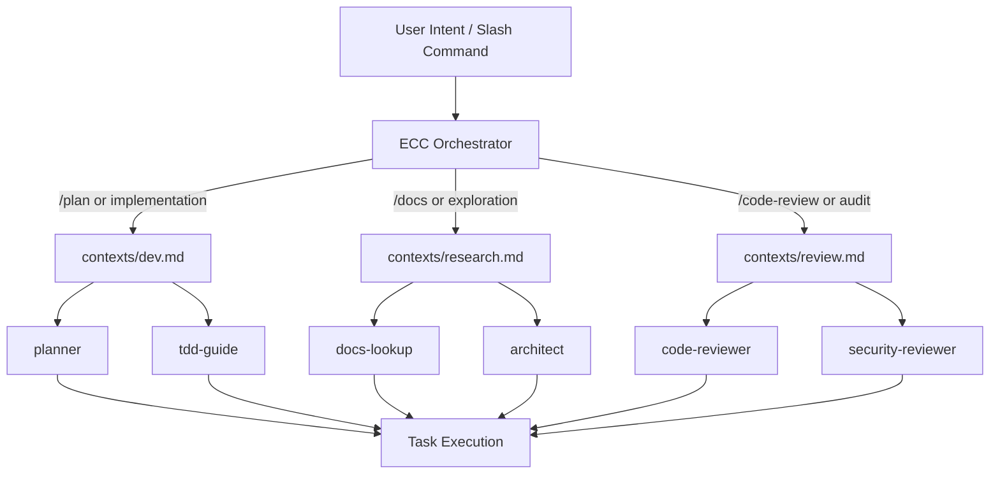
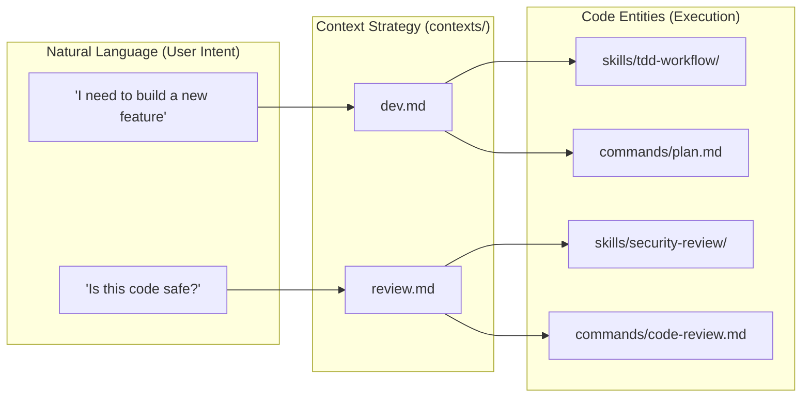

<!-- source: DeepWiki mcp.deepwiki.com · repo affaan-m/everything-claude-code · page 17.2 Context Modes · fetched 2026-10-26 -->

# Context Modes

<details>
<summary>Relevant source files</summary>

The following files were used as context for generating this wiki page:

- [AGENTS.md](AGENTS.md)
- [README.md](README.md)
- [README.zh-CN.md](README.zh-CN.md)
- [WORKING-CONTEXT.md](WORKING-CONTEXT.md)
- [agent.yaml](agent.yaml)
- [commands/auto-update.md](commands/auto-update.md)
- [commands/jira.md](commands/jira.md)
- [docs/zh-CN/AGENTS.md](docs/zh-CN/AGENTS.md)
- [docs/zh-CN/README.md](docs/zh-CN/README.md)
- [examples/user-CLAUDE.md](examples/user-CLAUDE.md)
- [manifests/install-modules.json](manifests/install-modules.json)
- [scripts/auto-update.js](scripts/auto-update.js)
- [skills/backend-patterns/SKILL.md](skills/backend-patterns/SKILL.md)
- [skills/clickhouse-io/SKILL.md](skills/clickhouse-io/SKILL.md)
- [skills/coding-standards/SKILL.md](skills/coding-standards/SKILL.md)
- [skills/continuous-learning/SKILL.md](skills/continuous-learning/SKILL.md)
- [skills/django-verification/SKILL.md](skills/django-verification/SKILL.md)
- [skills/eval-harness/SKILL.md](skills/eval-harness/SKILL.md)
- [skills/frontend-patterns/SKILL.md](skills/frontend-patterns/SKILL.md)
- [skills/iterative-retrieval/SKILL.md](skills/iterative-retrieval/SKILL.md)
- [skills/jira-integration/SKILL.md](skills/jira-integration/SKILL.md)
- [tests/ci/agent-yaml-surface.test.js](tests/ci/agent-yaml-surface.test.js)
- [tests/scripts/auto-update.test.js](tests/scripts/auto-update.test.js)

</details>


Context Modes are specialized, named configurations located in the `contexts/` directory that allow an AI agent to shift its behavioral focus without requiring permanent modifications to the project's root `CLAUDE.md` or global rules [README.md:39-41](). By invoking a specific context mode, the user pivots the agent's persona, instruction set, and tool-use priorities toward implementation, exploration, or quality assurance.

## Overview of Context Modes

The `contexts/` directory provides a set of pre-defined operational modes. Each mode is a Markdown file containing specific instructions, preferred agents, and success criteria tailored to a specific phase of the software development lifecycle [README.md:103-104](). These are integrated into the "selective install" architecture, ensuring they are deployed based on the user's chosen profile [manifests/install-modules.json:83-108]().

| Mode | File | Primary Focus | Key Agents Involved |
| :--- | :--- | :--- | :--- |
| **Development** | `dev.md` | Feature implementation and bug fixing. | `planner`, `tdd-guide`, `build-error-resolver` |
| **Research** | `research.md` | Exploration, API discovery, and prototyping. | `docs-lookup`, `architect` |
| **Review** | `review.md` | Code quality, security audits, and maintenance. | `code-reviewer`, `security-reviewer`, `refactor-cleaner` |

Sources: [AGENTS.md:15-45](), [manifests/install-modules.json:83-108](), [WORKING-CONTEXT.md:13]()

## Implementation and Data Flow

Context modes function as "soft overrides" for the system prompt. When a mode is active, the agent prioritizes the instructions found within the corresponding `.md` file. This is managed through the ECC orchestration layer, which integrates these files into the active context window to manage token utilization effectively, avoiding the last 20% of the context window for complex tasks [AGENTS.md:139-143]().

### Context Mode Selection and Agent Routing

The following diagram illustrates how the system transitions between different operational modes based on user intent and how it routes to specific code entities (agents).

**Title: Context Mode Selection and Agent Routing**

Sources: [AGENTS.md:15-45](), [AGENTS.md:46-58](), [README.md:103-104]()

## Mode Definitions

### 1. Development Mode (`dev.md`)
Focuses on the **Plan-Execute-Verify** loop. It enforces the use of the `planner` agent to break down requirements before any code is written [AGENTS.md:109-110]().
*   **Core Principle**: Test-Driven Development (TDD) [AGENTS.md:10]().
*   **Mandatory Step**: Call `tdd-guide` to create failing tests before implementation [AGENTS.md:100-104]().
*   **Error Handling**: Automatically routes compiler or runtime errors to `build-error-resolver` [AGENTS.md:24]().

### 2. Research Mode (`research.md`)
Focuses on **Discovery and Feasibility**. It prioritizes gathering information and architectural planning over immediate code output.
*   **Core Principle**: Search-First Workflow [README.md:99]().
*   **Tooling**: Heavy use of `docs-lookup` for API reference research [AGENTS.md:30]().
*   **Outcome**: Produces architectural decisions or prototypes rather than production-ready features [AGENTS.md:20]().

### 3. Review Mode (`review.md`)
Focuses on **Quality and Security Gates**. This mode is typically triggered before a commit or PR merge [AGENTS.md:61-62]().
*   **Core Principle**: Security-First [AGENTS.md:11]().
*   **Mandatory Step**: Use `security-reviewer` to scan for vulnerabilities and hardcoded secrets [AGENTS.md:23]().
*   **Refactoring**: Invokes `refactor-cleaner` to identify and remove dead code [AGENTS.md:26]().

Sources: [AGENTS.md:7-14](), [AGENTS.md:107-118](), [README.md:99-103]()

## Integration with Skills and Commands

Context modes act as the "Strategy" pattern for the agent, while **Skills** and **Commands** provide the "Tactics." The system uses `agent.yaml` as an export surface for these shared catalogs [agent.yaml:1-4]().

**Title: Natural Language Space to Code Entity Space Mapping**

Sources: [AGENTS.md:119-124](), [manifests/install-modules.json:198-218](), [AGENTS.md:149-153](), [agent.yaml:11-145]()

## Technical Configuration

Context modes are part of the core ECC installation and are tracked via the selective install system. In `manifests/install-modules.json`, these modes are associated with the `platform-configs` and `workflow-quality` modules [manifests/install-modules.json:83-108]().

### File Structure
The modes are stored as standard Markdown files in the `.claude/contexts/` directory, allowing users to extend them with project-specific nuances [README.md:103-104]().

```text
.claude/
└── contexts/
    ├── dev.md        # Implementation focus
    ├── research.md   # Exploration focus
    └── review.md     # Quality focus
```

### Runtime Gating and Learning
The behavior of agents within these modes can be further constrained by environment variables such as `CLAUDE_PACKAGE_MANAGER`, which determines the preferred toolchain during that specific context session [README.md:193-194](). Additionally, the `skills/agent-introspection-debugging` skill can be used within these modes to provide a self-debugging framework when the agent stalls [WORKING-CONTEXT.md:96](). Continuous learning v2 also integrates with these modes by extracting "instincts" from sessions to refine behavioral patterns [skills/continuous-learning/SKILL.md:115-123]().

Sources: [README.md:190-200](), [manifests/install-modules.json:83-108](), [WORKING-CONTEXT.md:94-98](), [skills/continuous-learning/SKILL.md:1-20]()

---

