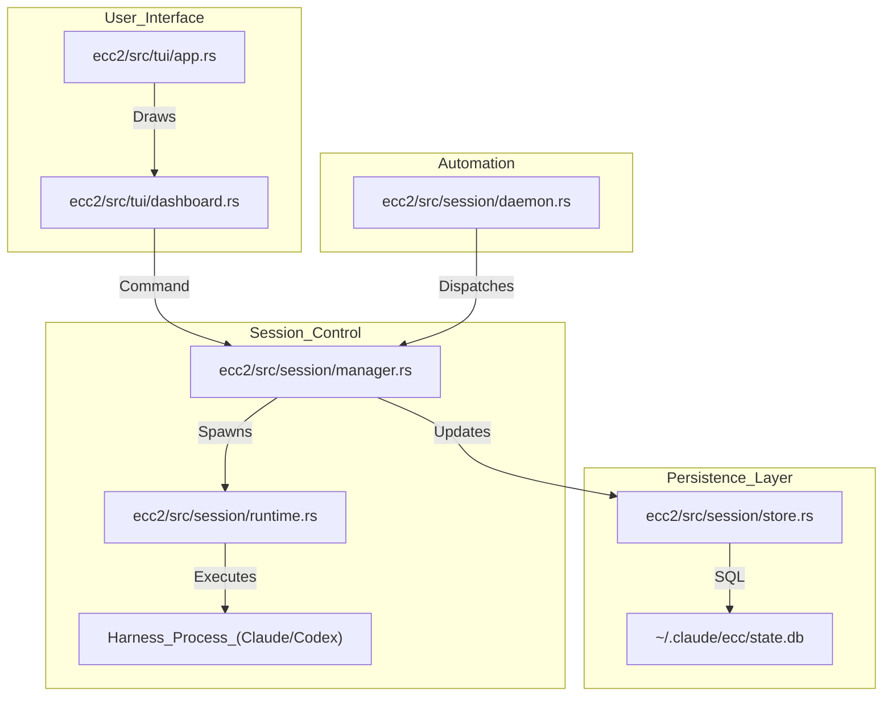
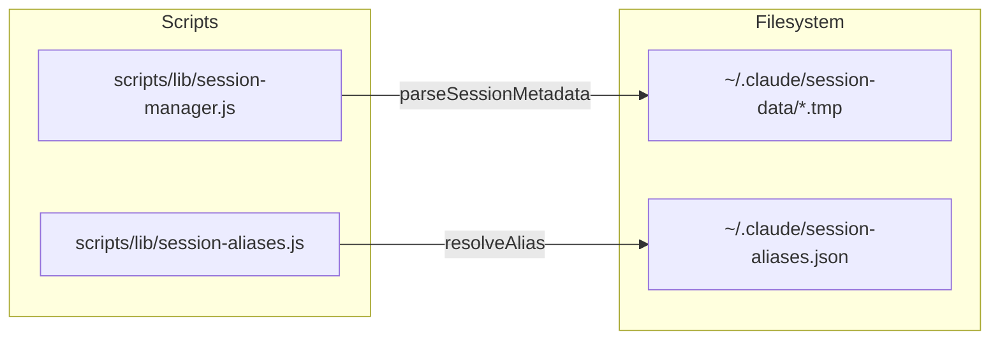

<!-- source: DeepWiki mcp.deepwiki.com · repo affaan-m/everything-claude-code · page 18 Glossary · fetched 2026-10-26 -->

# Glossary

Relevant source files

The following files were used as context for generating this wiki page:

- [.gitignore](.gitignore)
- [.opencode/commands/harness-audit.md](.opencode/commands/harness-audit.md)
- [AGENTS.md](AGENTS.md)
- [README.md](README.md)
- [README.zh-CN.md](README.zh-CN.md)
- [WORKING-CONTEXT.md](WORKING-CONTEXT.md)
- [agent.yaml](agent.yaml)
- [commands/auto-update.md](commands/auto-update.md)
- [commands/harness-audit.md](commands/harness-audit.md)
- [commands/jira.md](commands/jira.md)
- [commands/loop-start.md](commands/loop-start.md)
- [commands/model-route.md](commands/model-route.md)
- [commands/quality-gate.md](commands/quality-gate.md)
- [docs/zh-CN/AGENTS.md](docs/zh-CN/AGENTS.md)
- [docs/zh-CN/README.md](docs/zh-CN/README.md)
- [ecc2/src/comms/mod.rs](ecc2/src/comms/mod.rs)
- [ecc2/src/config/mod.rs](ecc2/src/config/mod.rs)
- [ecc2/src/main.rs](ecc2/src/main.rs)
- [ecc2/src/notifications.rs](ecc2/src/notifications.rs)
- [ecc2/src/observability/mod.rs](ecc2/src/observability/mod.rs)
- [ecc2/src/session/daemon.rs](ecc2/src/session/daemon.rs)
- [ecc2/src/session/manager.rs](ecc2/src/session/manager.rs)
- [ecc2/src/session/mod.rs](ecc2/src/session/mod.rs)
- [ecc2/src/session/output.rs](ecc2/src/session/output.rs)
- [ecc2/src/session/runtime.rs](ecc2/src/session/runtime.rs)
- [ecc2/src/session/store.rs](ecc2/src/session/store.rs)
- [ecc2/src/tui/app.rs](ecc2/src/tui/app.rs)
- [ecc2/src/tui/dashboard.rs](ecc2/src/tui/dashboard.rs)
- [ecc2/src/tui/widgets.rs](ecc2/src/tui/widgets.rs)
- [ecc2/src/worktree/mod.rs](ecc2/src/worktree/mod.rs)
- [hooks/README.md](hooks/README.md)
- [hooks/hooks.json](hooks/hooks.json)
- [manifests/install-modules.json](manifests/install-modules.json)
- [scripts/auto-update.js](scripts/auto-update.js)
- [scripts/harness-audit.js](scripts/harness-audit.js)
- [scripts/hooks/desktop-notify.js](scripts/hooks/desktop-notify.js)
- [scripts/hooks/gateguard-fact-force.js](scripts/hooks/gateguard-fact-force.js)
- [scripts/hooks/session-activity-tracker.js](scripts/hooks/session-activity-tracker.js)
- [scripts/hooks/session-end-marker.js](scripts/hooks/session-end-marker.js)
- [scripts/hooks/session-end.js](scripts/hooks/session-end.js)
- [scripts/hooks/session-start.js](scripts/hooks/session-start.js)
- [scripts/hooks/suggest-compact.js](scripts/hooks/suggest-compact.js)
- [scripts/lib/observer-sessions.js](scripts/lib/observer-sessions.js)
- [scripts/lib/package-manager.js](scripts/lib/package-manager.js)
- [scripts/lib/session-aliases.js](scripts/lib/session-aliases.js)
- [scripts/lib/session-manager.js](scripts/lib/session-manager.js)
- [scripts/lib/utils.js](scripts/lib/utils.js)
- [skills/continuous-learning-v2/agents/observer-loop.sh](skills/continuous-learning-v2/agents/observer-loop.sh)
- [skills/continuous-learning-v2/agents/session-guardian.sh](skills/continuous-learning-v2/agents/session-guardian.sh)
- [skills/continuous-learning-v2/agents/start-observer.sh](skills/continuous-learning-v2/agents/start-observer.sh)
- [skills/continuous-learning-v2/hooks/observe.sh](skills/continuous-learning-v2/hooks/observe.sh)
- [skills/continuous-learning-v2/scripts/detect-project.sh](skills/continuous-learning-v2/scripts/detect-project.sh)
- [skills/gateguard/SKILL.md](skills/gateguard/SKILL.md)
- [skills/jira-integration/SKILL.md](skills/jira-integration/SKILL.md)
- [skills/strategic-compact/SKILL.md](skills/strategic-compact/SKILL.md)
- [tests/ci/agent-yaml-surface.test.js](tests/ci/agent-yaml-surface.test.js)
- [tests/ci/validators.test.js](tests/ci/validators.test.js)
- [tests/hooks/gateguard-fact-force.test.js](tests/hooks/gateguard-fact-force.test.js)
- [tests/hooks/hooks.test.js](tests/hooks/hooks.test.js)
- [tests/hooks/observe-subdirectory-detection.test.js](tests/hooks/observe-subdirectory-detection.test.js)
- [tests/hooks/observer-memory.test.js](tests/hooks/observer-memory.test.js)
- [tests/hooks/session-activity-tracker.test.js](tests/hooks/session-activity-tracker.test.js)
- [tests/integration/hooks.test.js](tests/integration/hooks.test.js)
- [tests/lib/package-manager.test.js](tests/lib/package-manager.test.js)
- [tests/lib/session-aliases.test.js](tests/lib/session-aliases.test.js)
- [tests/lib/session-manager.test.js](tests/lib/session-manager.test.js)
- [tests/lib/utils.test.js](tests/lib/utils.test.js)
- [tests/scripts/auto-update.test.js](tests/scripts/auto-update.test.js)
- [tests/scripts/build-opencode.test.js](tests/scripts/build-opencode.test.js)
- [tests/scripts/harness-audit.test.js](tests/scripts/harness-audit.test.js)

This glossary defines the technical terminology, internal subsystems, and architectural components specific to the **Everything Claude Code (ECC)** ecosystem. It serves as a reference for onboarding engineers to understand how natural language concepts map to specific code entities and implementation logic.

## Core System Entities

The ECC architecture is built on five primary primitives that extend the capabilities of AI agent harnesses.

| Term | Definition | Code Pointer |
|:---|:---|:---|
| **Agent** | A specialized persona with a dedicated system prompt, model configuration, and tool permissions. | [AGENTS.md:1-13]() |
| **Skill** | A structured workflow definition (Markdown) providing "how-to" knowledge and execution logic. Now the canonical workflow surface. | [WORKING-CONTEXT.md:121-122]() |
| **Command** | A slash command shortcut (e.g., `/plan`). Now considered a legacy compatibility surface for cross-harness parity. | [WORKING-CONTEXT.md:123-124]() |
| **Rule** | Mandatory guidelines (Markdown) constraining agent behavior regarding coding style and security. | [README.md:37-38]() |
| **Hook** | Event-driven scripts triggered by the harness lifecycle (e.g., `PreToolUse`, `SessionStart`). | [hooks/hooks.json:1-62]() |

**Sources:** [README.md:33-39](), [AGENTS.md:1-13](), [WORKING-CONTEXT.md:121-124](), [hooks/hooks.json:1-62]()

---

## Technical Subsystems

### 1. ECC 2.0 (Rust Control Plane)
**ECC 2.0** is the next-generation Rust-based orchestration layer located in the `ecc2/` directory. It provides a Terminal User Interface (TUI) for managing multiple agent sessions, worktrees, and global coordination.

*   **Dashboard:** The central TUI view for monitoring session states, token usage, and tool logs. [ecc2/src/tui/dashboard.rs:82-158]()
*   **State Store:** A persistent SQLite backend for sessions, scheduled tasks, and context graphs. [ecc2/src/session/store.rs:26-170]()
*   **Session Manager:** Handles the lifecycle of agent processes, including spawning, pausing, and resuming. [ecc2/src/session/manager.rs:26-114]()
*   **Daemon:** Background process for autonomous dispatch and coordination. [ecc2/src/session/daemon.rs:1-50]()

#### Control Plane Data Flow
The following diagram bridges the natural language concept of "Orchestration" to the specific Rust entities in ECC 2.0.

**Diagram: ECC 2.0 Architecture**

**Sources:** [ecc2/src/main.rs:71-183](), [ecc2/src/tui/app.rs:15-135](), [ecc2/src/session/manager.rs:25-72](), [ecc2/src/session/store.rs:168-195](), [ecc2/src/session/daemon.rs:1-20]()

### 2. Homunculus (Continuous Learning v2)
The **Homunculus** system is the continuous learning engine that observes interactions and evolves them into permanent skills.

*   **Observation:** The `observe.sh` hook captures tool activity in real-time. [skills/continuous-learning-v2/hooks/observe.sh:1-94]()
*   **Observer Loop:** A background daemon that analyzes observations for recurring patterns. [skills/continuous-learning-v2/agents/start-observer.sh:1-50]()
*   **Project Detection:** Determines the context of observations based on repository structure. [skills/continuous-learning-v2/scripts/detect-project.sh:1-30]()

**Sources:** [skills/continuous-learning-v2/hooks/observe.sh:83-94](), [README.md:94-101](), [WORKING-CONTEXT.md:32-33](), [skills/continuous-learning-v2/scripts/detect-project.sh:1-15]()

### 3. Session Management System
ECC uses a structured approach to persist session history across agent restarts, primarily managed via the `session-manager.js` library.

| Component | Responsibility | Implementation |
|:---|:---|:---|
| **Session Manager** | Parses and writes `.tmp` session files with frontmatter metadata. | [scripts/lib/session-manager.js:48-130]() |
| **Session Aliases** | Provides human-readable names for complex session IDs. | [scripts/lib/session-aliases.js:1-150]() |
| **Compaction** | Monitors token usage and suggests summarizing the transcript. | [scripts/hooks/suggest-compact.js:1-81]() |

**Diagram: Session Data Flow**

**Sources:** [scripts/lib/session-manager.js:12-13](), [scripts/lib/session-aliases.js:24-25](), [tests/lib/session-manager.test.js:48-88](), [tests/hooks/hooks.test.js:85-91]()

---

## Jargon & Abbreviations

*   **ECC**: Everything Claude Code. [README.md:3-4]()
*   **Harness**: The host application running the agent (e.g., Claude Code, Cursor, OpenCode, Codex). [ecc2/src/session/mod.rs:18-31]()
*   **MCP**: Model Context Protocol. A standard for connecting LLMs to external tools and data sources. [README.md:37-38]()
*   **Plankton**: The three-phase code quality system involving silent auto-fix, remediation, and reporting. [README.md:100-102]()
*   **NanoClaw**: High-performance routing utility for agent sessions. [README.md:85-91]()
*   **Worktree**: A Git feature allowing multiple checkouts of the same repository; ECC uses these for parallel agent execution. [ecc2/src/worktree/mod.rs:1-50]()
*   **Priority Cascade**: The logic for detecting the correct package manager (npm, pnpm, yarn, bun) based on lockfiles or project configuration. [scripts/lib/package-manager.js:74-94]()
*   **Session Start/End Hooks**: Automation scripts that run when a harness session begins or terminates to manage context persistence. [scripts/hooks/session-start.js:1-50](), [scripts/hooks/session-end.js:1-50]()
*   **State Store**: The SQLite database (`state.db`) used by ECC 2.0 to persist session and tool logs. [ecc2/src/session/store.rs:158-170]()
*   **Selective Install**: A manifest-driven pipeline (`install-modules.json`) for installing specific ECC components. [README.md:101-102]()

**Sources:** [README.md:34-38](), [ecc2/src/session/mod.rs:18-47](), [scripts/lib/package-manager.js:74-94](), [WORKING-CONTEXT.md:94-102](), [ecc2/src/session/store.rs:168-195](), [manifests/install-modules.json:1-10]()