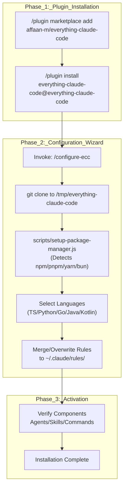
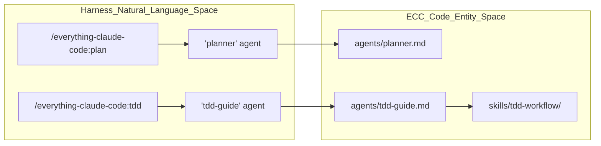

<!-- source: DeepWiki mcp.deepwiki.com · repo affaan-m/everything-claude-code · page 2 Getting Started · fetched 2026-10-26 -->

# Getting Started

<details>
<summary>Relevant source files</summary>

The following files were used as context for generating this wiki page:

- [AGENTS.md](AGENTS.md)
- [README.md](README.md)
- [README.zh-CN.md](README.zh-CN.md)
- [WORKING-CONTEXT.md](WORKING-CONTEXT.md)
- [agent.yaml](agent.yaml)
- [commands/auto-update.md](commands/auto-update.md)
- [commands/jira.md](commands/jira.md)
- [docs/ja-JP/README.md](docs/ja-JP/README.md)
- [docs/ja-JP/skills/configure-ecc/SKILL.md](docs/ja-JP/skills/configure-ecc/SKILL.md)
- [docs/ko-KR/README.md](docs/ko-KR/README.md)
- [docs/pt-BR/README.md](docs/pt-BR/README.md)
- [docs/tr/README.md](docs/tr/README.md)
- [docs/zh-CN/AGENTS.md](docs/zh-CN/AGENTS.md)
- [docs/zh-CN/README.md](docs/zh-CN/README.md)
- [docs/zh-CN/skills/configure-ecc/SKILL.md](docs/zh-CN/skills/configure-ecc/SKILL.md)
- [docs/zh-TW/README.md](docs/zh-TW/README.md)
- [manifests/install-modules.json](manifests/install-modules.json)
- [scripts/auto-update.js](scripts/auto-update.js)
- [skills/configure-ecc/SKILL.md](skills/configure-ecc/SKILL.md)
- [skills/jira-integration/SKILL.md](skills/jira-integration/SKILL.md)
- [tests/ci/agent-yaml-surface.test.js](tests/ci/agent-yaml-surface.test.js)
- [tests/docs/configure-ecc-install-paths.test.js](tests/docs/configure-ecc-install-paths.test.js)
- [tests/docs/install-identifiers.test.js](tests/docs/install-identifiers.test.js)
- [tests/scripts/auto-update.test.js](tests/scripts/auto-update.test.js)

</details>


This page documents the installation process, verification steps, and initial usage of the Everything Claude Code (ECC) system. ECC is a performance optimization system for AI agent harnesses, evolved from an Anthropic hackathon winner into a production-ready suite of agents, skills, hooks, and rules [README.md:3-37]().

The system is designed to work across **Claude Code**, **Codex**, **Cursor**, **OpenCode**, and **Gemini** [README.md:39-41]().

---

## Installation Methods

ECC supports multiple installation paths. For most users, the **Marketplace** or the **Selective Install** system (v1.9.0+) is recommended.

### Option 1: Marketplace & Wizard (Recommended)

The interactive `configure-ecc` skill provides a guided setup with merge/overwrite detection, making it the safest path for first-time users [skills/configure-ecc/SKILL.md:1-16]().

**Marketplace Installation Flow:**



**Essential Commands:**

```bash
# 1. Add the marketplace source
/plugin marketplace add https://github.com/affaan-m/everything-claude-code [README.zh-CN.md:102]()

# 2. Install the plugin (using the canonical slug)
/plugin install everything-claude-code@everything-claude-code [README.zh-CN.md:105]()

# 3. Run the configuration wizard
/configure-ecc [skills/configure-ecc/SKILL.md:13]()
```

**Rules Installation (Mandatory Manual Step):**
Claude Code plugins cannot automatically distribute files to the `~/.claude/rules/` directory due to platform limitations. You must manually install the language-specific rules [README.zh-CN.md:112-114]().

```bash
# Clone the repository to access rule files
git clone https://github.com/affaan-m/everything-claude-code.git [README.zh-CN.md:119-120]()

# Use the install script for your platform
./install.sh --profile full  # macOS/Linux [README.zh-CN.md:132]()
.\install.ps1 --profile full # Windows [README.zh-CN.md:144]()
```

**Sources:** [README.md:85-104](), [README.zh-CN.md:96-148](), [skills/configure-ecc/SKILL.md:1-230](), [WORKING-CONTEXT.md:14]()

### Option 2: Selective Install System (v1.9.0+)

The manifest-driven install pipeline allows for targeted component installation using profiles like `core`, `developer`, or `full` [README.md:101-102](). It uses `manifests/install-modules.json` to define the dependencies and paths for 48 agents and 182 skills [README.md:92-93]().

**Profile Selection:**

| Profile | Purpose | Included Modules |
|---------|---------|------------------|
| `core` | Minimal baseline | `rules-core`, `agents-core`, `commands-core`, `hooks-runtime` [manifests/install-modules.json:4-81]() |
| `developer` | Standard engineering | `core` + `framework-language`, `database`, `workflow-quality` [manifests/install-modules.json:111-234]() |
| `full` | Complete suite | All classified modules including `security`, `research`, `media` [manifests/install-modules.json:236-256]() |

**Execution:**
The `install.sh` (macOS/Linux) and `install.ps1` (Windows) wrappers delegate to the Node-based installer runtime [README.zh-CN.md:132-145]().

```bash
# Install specific language rules targeting Cursor
./install.sh --target cursor typescript [README.zh-CN.md:130]()

# Perform a dry-run to see planned operations
./install.sh --dry-run --profile full [README.md:97]()
```

**Sources:** [manifests/install-modules.json:1-256](), [README.md:95-104](), [README.zh-CN.md:116-148]()

---

## Installation Verification

Verify that the ECC components are correctly recognized by your harness.

**Verification Checklist:**

| Check | Command | Expected Result |
|-------|---------|-----------------|
| **Plugin Status** | `/plugin list` | `everything-claude-code@everything-claude-code` is enabled [README.zh-CN.md:160]() |
| **Commands** | Type `/everything-claude-code:` | Autocomplete shows `/everything-claude-code:plan`, etc. [README.zh-CN.md:154]() |
| **Agents** | `/everything-claude-code:plan "test"` | Response identifies as `planner` agent [AGENTS.md:19]() |
| **PM Detection** | `/setup-pm` | Shows detected package manager (npm/pnpm/yarn/bun) [README.zh-CN.md:185-194]() |
| **Rules** | `ls ~/.claude/rules` | Directory contains `common/` and language folders [README.zh-CN.md:127-130]() |

**Component to Code Mapping:**



**Sources:** [README.zh-CN.md:154-167](), [AGENTS.md:15-45](), [manifests/install-modules.json:23-42]()

---

## First Commands to Try

ECC treats `skills/` as the canonical workflow surface [WORKING-CONTEXT.md:121](). Use these commands to trigger optimized agent behaviors.

### 1. Feature Planning (`/plan`)
Invokes the **planner** agent [AGENTS.md:19](). This agent creates detailed implementation plans, identifying dependencies and breaking tasks into phases [AGENTS.md:109]().

```bash
/everything-claude-code:plan "Add user authentication to the API"
```

### 2. Test-Driven Development (`/tdd`)
Invokes the **tdd-guide** agent [AGENTS.md:21](). It follows the mandatory RED-GREEN-REFACTOR cycle [AGENTS.md:100-103]().

```bash
/everything-claude-code:tdd "Implement the login controller"
```

### 3. Code Review (`/code-review`)
Invokes the **code-reviewer** agent [AGENTS.md:22](). It checks for code quality, maintainability, and adheres to the **Immutability (CRITICAL)** principle [AGENTS.md:77]().

```bash
/everything-claude-code:code-review
```

### 4. Security Scanning (`/security-scan`)
Invokes the **security-reviewer** agent [AGENTS.md:23](). It checks for hardcoded secrets, SQL injection, and XSS vulnerabilities before any commit [AGENTS.md:61-73]().

```bash
/everything-claude-code:security-scan
```

**Sources:** [AGENTS.md:15-118](), [README.zh-CN.md:154-163](), [manifests/install-modules.json:198-219]()

---

## Configuration Basics

### Package Manager Detection
The system uses a priority cascade to detect your preferred tool [README.zh-CN.md:187-194]():
1.  **Env Var:** `CLAUDE_PACKAGE_MANAGER` [README.zh-CN.md:189]()
2.  **Project Config:** `.claude/package-manager.json` [README.zh-CN.md:190]()
3.  **package.json:** `packageManager` field [README.zh-CN.md:191]()
4.  **Lock Files:** Detection from `package-lock.json`, `yarn.lock`, etc. [README.zh-CN.md:192]()
5.  **Global Config:** `~/.claude/package-manager.json` [README.zh-CN.md:193]()

### Hook Runtime Control
You can adjust hook behavior using environment variables [docs/zh-CN/README.md:109]():
*   **ECC_HOOK_PROFILE**: Set to `minimal`, `standard`, or `strict` [docs/zh-CN/README.md:109]().
*   **ECC_DISABLED_HOOKS**: A comma-separated list of hook IDs to skip [docs/zh-CN/README.md:109]().

### ECC 2.0 (Alpha)
The next-generation Rust control plane is available in the `ecc2/` directory [README.md:96](). It provides a TUI dashboard and advanced session management [README.md:96]().

```bash
# Build and run the alpha dashboard (requires Rust)
cd ecc2
cargo run -- dashboard
```

**Sources:** [README.md:96](), [README.zh-CN.md:185-210](), [docs/zh-CN/README.md:105-113]()

---

