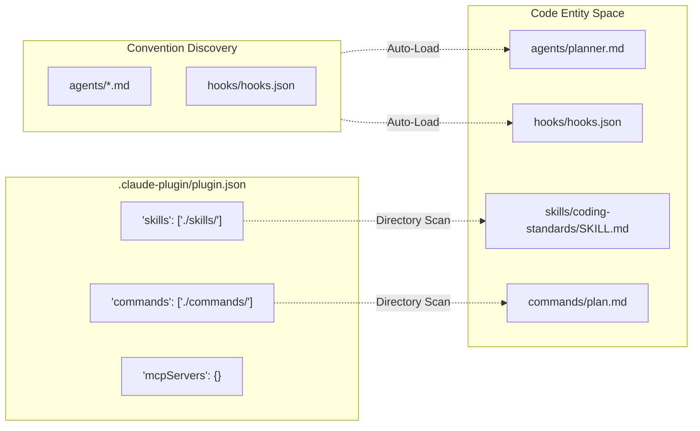
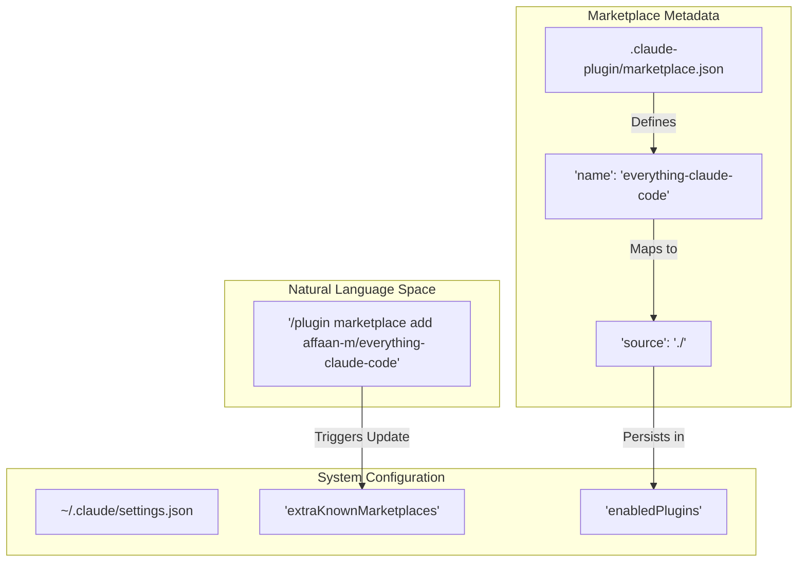

<!-- source: DeepWiki mcp.deepwiki.com · repo affaan-m/everything-claude-code · page 3.1 Plugin Architecture · fetched 2026-10-26 -->

# Plugin Architecture

<details>
<summary>Relevant source files</summary>

The following files were used as context for generating this wiki page:

- [.agents/plugins/marketplace.json](.agents/plugins/marketplace.json)
- [.claude-plugin/PLUGIN_SCHEMA_NOTES.md](.claude-plugin/PLUGIN_SCHEMA_NOTES.md)
- [.claude-plugin/README.md](.claude-plugin/README.md)
- [.claude-plugin/marketplace.json](.claude-plugin/marketplace.json)
- [.claude-plugin/plugin.json](.claude-plugin/plugin.json)
- [.codex-plugin/README.md](.codex-plugin/README.md)
- [.codex-plugin/plugin.json](.codex-plugin/plugin.json)
- [.mcp.json](.mcp.json)
- [AGENTS.md](AGENTS.md)
- [README.md](README.md)
- [README.zh-CN.md](README.zh-CN.md)
- [WORKING-CONTEXT.md](WORKING-CONTEXT.md)
- [agent.yaml](agent.yaml)
- [commands/auto-update.md](commands/auto-update.md)
- [commands/jira.md](commands/jira.md)
- [docs/zh-CN/AGENTS.md](docs/zh-CN/AGENTS.md)
- [docs/zh-CN/README.md](docs/zh-CN/README.md)
- [manifests/install-modules.json](manifests/install-modules.json)
- [schemas/package-manager.schema.json](schemas/package-manager.schema.json)
- [schemas/plugin.schema.json](schemas/plugin.schema.json)
- [scripts/auto-update.js](scripts/auto-update.js)
- [skills/jira-integration/SKILL.md](skills/jira-integration/SKILL.md)
- [tests/ci/agent-yaml-surface.test.js](tests/ci/agent-yaml-surface.test.js)
- [tests/plugin-manifest.test.js](tests/plugin-manifest.test.js)
- [tests/scripts/auto-update.test.js](tests/scripts/auto-update.test.js)

</details>


## Overview

Everything Claude Code (ECC) is a production-ready AI agent performance optimization system distributed as a multi-platform plugin. It provides a structured package of components including 48 specialized agents, 182 skills, and 68 legacy command shims evolved through continuous real-world use [.claude-plugin/plugin.json:1-4](). The architecture enables distribution via the Claude Code marketplace, Codex, OpenCode, and manual integration, ensuring high-level performance across diverse engineering workflows [.claude-plugin/marketplace.json:10-15]().

This page details the plugin's structural organization, manifest specifications, and the component-based distribution model.

Sources: [.claude-plugin/plugin.json:1-28](), [.claude-plugin/marketplace.json:1-47](), [WORKING-CONTEXT.md:12-14]()

## Plugin Directory Structure

The ECC repository is organized into directories that map to specific component types, supported by specialized manifests for different AI harnesses.

```text
everything-claude-code/
├── .claude-plugin/          # Claude Code plugin metadata
│   ├── plugin.json          # Main manifest (skills, commands)
│   ├── marketplace.json     # Marketplace catalog entry
│   └── PLUGIN_SCHEMA_NOTES.md # Enforced validator constraints
├── .codex-plugin/           # Codex native plugin metadata
│   └── plugin.json          # Codex manifest (skills, MCP ref)
├── .opencode/               # OpenCode specific integration
├── agents/                  # Specialized subagents (Markdown)
├── skills/                  # Domain workflows (SKILL.md format)
├── commands/                # Slash command shims (Markdown)
├── rules/                   # Guidelines (Manual/Selective install)
├── hooks/                   # Event-driven automation logic
└── .mcp.json                # Model Context Protocol server configs
```

Sources: [.claude-plugin/plugin.json:25-27](), [.claude-plugin/marketplace.json:1-47](), [AGENTS.md:147-157](), [.claude-plugin/PLUGIN_SCHEMA_NOTES.md:1-216]()

## Plugin Manifests

ECC maintains multiple manifests to ensure strict compatibility across different AI execution environments.

### Claude Code Manifest (`plugin.json`)

The manifest at `.claude-plugin/plugin.json` is the entry point for the Claude Code CLI. Unlike previous versions, it strictly avoids an explicit `agents` or `hooks` field to prevent validation errors and duplicate loading, as modern versions of Claude Code (v2.1+) discover these by convention [.claude-plugin/PLUGIN_SCHEMA_NOTES.md:58-74](), [.claude-plugin/PLUGIN_SCHEMA_NOTES.md:98-131]().

**Title: Claude Plugin Component Resolution**


The manifest follows a strict schema where `commands` and `skills` must be arrays [.claude-plugin/PLUGIN_SCHEMA_NOTES.md:44-56](). It also includes an explicit empty `mcpServers` object to prevent the overlong tool name error that occurs when Claude auto-discovers root `.mcp.json` files during plugin installation [.claude-plugin/PLUGIN_SCHEMA_NOTES.md:136-153]().

Sources: [.claude-plugin/plugin.json:1-28](), [.claude-plugin/PLUGIN_SCHEMA_NOTES.md:1-216](), [tests/plugin-manifest.test.js:1-180]()

## Marketplace Distribution

The plugin is distributed via a self-hosted marketplace configuration in `.claude-plugin/marketplace.json`. This allows users to add the repository as a source, providing access to the full catalog of 48 agents and 182 skills [.claude-plugin/marketplace.json:10-15]().

**Title: Marketplace Installation Data Flow**


Sources: [.claude-plugin/marketplace.json:1-47](), [README.zh-CN.md:100-106]()

## Component Organization

### Specialized Agents
Agents are defined as Markdown files in the `agents/` directory. While not explicitly listed in the `plugin.json` manifest to avoid validator rejection, they are authoritative in the repository and exported to `agent.yaml` for broader ecosystem compatibility [agent.yaml:1-11](). The system provides 48 agents including `planner`, `architect`, `tdd-guide`, and various language-specific reviewers [AGENTS.md:15-45]().

### Skills & Workflows
Skills are stored in the `skills/` directory, with each skill containing a `SKILL.md` file. The system includes 182 skills, categorized into modules such as `rules-core`, `framework-language`, and `workflow-quality` [manifests/install-modules.json:1-234]().

* **Workflow Quality**: Includes `continuous-learning-v2`, `tdd-workflow`, and `verification-loop` [manifests/install-modules.json:201-218]().
* **Security**: Includes `security-scan`, `defi-amm-security`, and `hipaa-compliance` [manifests/install-modules.json:236-253]().

### Legacy Command Shims
The `commands/` directory contains 68 slash-command shims (e.g., `/plan`, `/review-pr`) that provide a compatibility layer for users accustomed to legacy CLI patterns [AGENTS.md:145-213]().

Sources: [AGENTS.md:1-166](), [agent.yaml:1-222](), [manifests/install-modules.json:1-260](), [.claude-plugin/plugin.json:26-27]()

---

