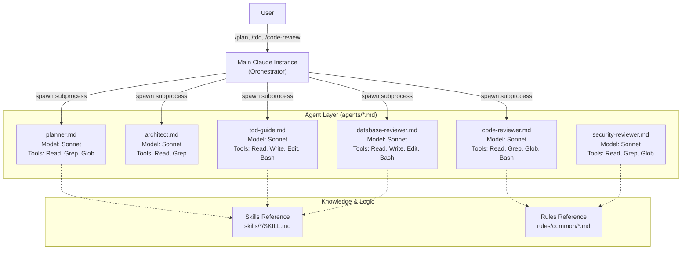
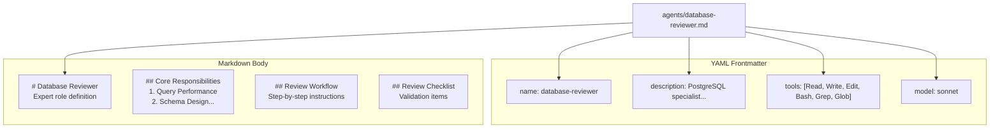
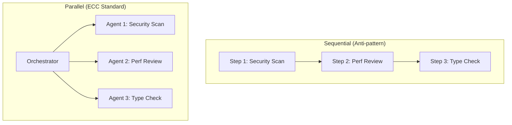

<!-- source: DeepWiki mcp.deepwiki.com · repo affaan-m/everything-claude-code · page 3.2 Agents · fetched 2026-10-26 -->

# Agents

Relevant source files

The following files were used as context for generating this wiki page:

- [AGENTS.md](AGENTS.md)
- [README.md](README.md)
- [README.zh-CN.md](README.zh-CN.md)
- [WORKING-CONTEXT.md](WORKING-CONTEXT.md)
- [agent.yaml](agent.yaml)
- [agents/architect.md](agents/architect.md)
- [agents/build-error-resolver.md](agents/build-error-resolver.md)
- [agents/code-reviewer.md](agents/code-reviewer.md)
- [agents/database-reviewer.md](agents/database-reviewer.md)
- [agents/doc-updater.md](agents/doc-updater.md)
- [agents/e2e-runner.md](agents/e2e-runner.md)
- [agents/planner.md](agents/planner.md)
- [agents/python-reviewer.md](agents/python-reviewer.md)
- [agents/security-reviewer.md](agents/security-reviewer.md)
- [commands/auto-update.md](commands/auto-update.md)
- [commands/jira.md](commands/jira.md)
- [docs/zh-CN/AGENTS.md](docs/zh-CN/AGENTS.md)
- [docs/zh-CN/README.md](docs/zh-CN/README.md)
- [examples/django-api-CLAUDE.md](examples/django-api-CLAUDE.md)
- [examples/saas-nextjs-CLAUDE.md](examples/saas-nextjs-CLAUDE.md)
- [manifests/install-modules.json](manifests/install-modules.json)
- [scripts/auto-update.js](scripts/auto-update.js)
- [scripts/setup-package-manager.js](scripts/setup-package-manager.js)
- [skills/cpp-testing/SKILL.md](skills/cpp-testing/SKILL.md)
- [skills/e2e-testing/SKILL.md](skills/e2e-testing/SKILL.md)
- [skills/jira-integration/SKILL.md](skills/jira-integration/SKILL.md)
- [skills/postgres-patterns/SKILL.md](skills/postgres-patterns/SKILL.md)
- [tests/ci/agent-yaml-surface.test.js](tests/ci/agent-yaml-surface.test.js)
- [tests/scripts/auto-update.test.js](tests/scripts/auto-update.test.js)

**Purpose:** This page defines what agents are in the Everything Claude Code (ECC) system, their YAML structure, model and tool configurations, delegation patterns, and orchestration strategies. Agents are the primary specialized actors that execute domain-specific tasks within the ECC ecosystem.

---

## What Are Agents?

Agents are **specialized subprocesses** that handle delegated tasks with limited scope. The main Claude Code instance (the "orchestrator") delegates specific responsibilities to agents, each configured with restricted tool permissions, specific models, and focused instructions. This "Agent-First" principle [AGENTS.md:9-9]() ensures that domain tasks are handled by specialized logic rather than a generic prompt.

ECC provides a catalog of **47 specialized agents** [WORKING-CONTEXT.md:13-13]() (up to 48 in recent manifests [AGENTS.md:3-3]()) designed for production-ready AI coding workflows.

**Key characteristics:**

- **Focused scope** — Each agent handles one type of task (planning, code review, security analysis, etc.) [AGENTS.md:17-44]().
- **Separate context** — Agents run in isolated processes with their own context windows to prevent "author bias" during reviews.
- **Tool restrictions** — Agents have explicit `tools` permissions defined in their frontmatter [agents/database-reviewer.md:4-4]().
- **Model routing** — Different agents use different models (Haiku/Sonnet/Opus) based on task complexity [agents/database-reviewer.md:5-5]().
- **Stateless execution** — Agents receive input, perform work, return output, then exit.

**Diagram: Agent Role in ECC Architecture**

Sources: [AGENTS.md:1-58](), [agents/database-reviewer.md:1-6](), [manifests/install-modules.json:23-43](), [WORKING-CONTEXT.md:13-13]()

---

## Agent File Structure

Agents are Markdown files with YAML frontmatter stored in the `agents/` directory [manifests/install-modules.json:27-28]().

**Diagram: Agent File Anatomy**

**Frontmatter fields:**

| Field | Type | Required | Purpose |
|-------|------|----------|---------|
| `name` | string | Yes | Unique identifier (kebab-case) [agents/database-reviewer.md:2-2]() |
| `description` | string | Yes | Single-line summary shown in agent lists [agents/database-reviewer.md:3-3]() |
| `tools` | string[] | Yes | Allowed tool names (Read, Write, Edit, Bash, Grep, Glob) [agents/database-reviewer.md:4-4]() |
| `model` | string | No | Preferred model (haiku, sonnet) [agents/database-reviewer.md:5-5]() |

Sources: [agents/database-reviewer.md:1-6](), [agents/doc-updater.md:1-6](), [agents/e2e-runner.md:1-6](), [agent.yaml:1-10]()

---

## Model Configuration

ECC routes tasks to specific models based on the reasoning depth required for the agent's role. The global `agent.yaml` prefers `claude-opus-4-6` with `claude-sonnet-4-6` as a fallback [agent.yaml:7-10]().

| Model | Use Case | Agents |
|-------|-----------|----------|
| **haiku** | Fast exploration, simple updates, documentation syncing, and pattern detection. | `doc-updater` [agents/doc-updater.md:5-5](), `observer` [README.md:102-102]() |
| **sonnet** | Standard coding, complex logic, multi-file reviews, and database optimization. | `database-reviewer` [agents/database-reviewer.md:5-5](), `e2e-runner` [agents/e2e-runner.md:5-5](), `tdd-guide` [AGENTS.md:21-21]() |
| **opus** | High-sensitivity architectural decisions and complex remediation. | `architect` [AGENTS.md:20-20](), `plankton` (subprocess routing) [README.md:118-118]() |

**Context Window Strategy:**
Agents are instructed to avoid the last 20% of the context window for large refactorings to maintain performance and reliability [AGENTS.md:141-141]().

Sources: [AGENTS.md:140-142](), [agents/doc-updater.md:5-5](), [agents/database-reviewer.md:5-5](), [agent.yaml:7-10]()

---

## Tool Permissions

Agents declare allowed tools to create security boundaries. This prevents a "Reviewer" agent from accidentally modifying code, maintaining the integrity of the review process.

**Common Tool Sets:**

- **Read-Only/Analysis:** `["Read", "Grep", "Glob"]` (e.g., initial planning or documentation lookup).
- **Review & Verification:** `["Read", "Bash", "Grep", "Glob"]` (e.g., `code-reviewer` uses `Bash` to run tests but not `Edit` to change code).
- **Implementation:** `["Read", "Write", "Edit", "Bash", "Grep", "Glob"]` (e.g., `database-reviewer` [agents/database-reviewer.md:4-4](), `e2e-runner` [agents/e2e-runner.md:4-4]()).

Sources: [agents/database-reviewer.md:4-4](), [agents/e2e-runner.md:4-4](), [agents/doc-updater.md:4-4]()

---

## Agent Orchestration & Delegation

The ECC system uses an **Agent-First** approach where the orchestrator delegates tasks proactively without waiting for user prompts [AGENTS.md:48-48]().

### Proactive Invocation Patterns
- **Complex feature requests** → `planner` [AGENTS.md:49-49]()
- **Code just written/modified** → `code-reviewer` [AGENTS.md:50-50]()
- **Bug fix or new feature** → `tdd-guide` [AGENTS.md:51-51]()
- **Architectural decision** → `architect` [AGENTS.md:52-52]()
- **Security-sensitive code** → `security-reviewer` [AGENTS.md:53-53]()
- **Autonomous loops** → `loop-operator` [AGENTS.md:54-54]()

### Parallel Execution
ECC emphasizes **parallel execution** for independent operations. Instead of waiting for one agent to finish, multiple agents (e.g., a security reviewer and a performance reviewer) can be launched simultaneously [AGENTS.md:57-57]().

**Diagram: Sequential vs. Parallel Delegation**

Sources: [AGENTS.md:46-57](), [README.md:78-78]()

---

## Available Agents Reference

ECC includes 48 specialized agents [AGENTS.md:3-3](). Below are key agents and their specific roles.

| Agent | Purpose | When to Use |
|-------|---------|-------------|
| `planner` | Implementation planning for complex features [AGENTS.md:19-19]() | Complex features, refactoring |
| `tdd-guide` | Enforces RED → GREEN → REFACTOR loop [AGENTS.md:21-21]() | New features, bug fixes |
| `database-reviewer` | PostgreSQL query optimization and schema design [agents/database-reviewer.md:14-18]() | Writing SQL, creating migrations |
| `e2e-runner` | End-to-end Playwright testing [agents/e2e-runner.md:14-19]() | Critical user flows |
| `doc-updater` | Documentation and codemaps maintenance [agents/doc-updater.md:14-18]() | Updating docs |
| `build-error-resolver` | Analyzes and fixes build/type errors [AGENTS.md:24-24]() | When build fails |
| `security-reviewer` | Vulnerability detection (SQLi, XSS, CSRF) [AGENTS.md:23-23]() | Before commits, sensitive code |
| `loop-operator` | Autonomous loop execution and monitoring [AGENTS.md:39-39]() | Safe loop running, intervention |
| `harness-optimizer` | Tuning harness configuration for cost/reliability [AGENTS.md:40-40]() | Performance/cost tuning |
| `typescript-reviewer` | Specialized TypeScript/JS code review [AGENTS.md:44-44]() | TS/JS projects |
| `pytorch-build-resolver` | Fixes PyTorch/CUDA/training errors [AGENTS.md:43-43]() | ML/PyTorch projects |

Sources: [AGENTS.md:15-45](), [agents/database-reviewer.md:1-20](), [agents/e2e-runner.md:1-20](), [agents/doc-updater.md:1-20](), [WORKING-CONTEXT.md:13-13]()

---

## Development Workflow with Agents

The standard ECC workflow integrates agents at every phase of the lifecycle [AGENTS.md:108-118]():

1. **Plan:** Use `planner` to identify dependencies and risks, breaking the task into phases [AGENTS.md:109-109]().
2. **TDD:** Use `tdd-guide` to write tests first (RED), implement (GREEN), and refactor (IMPROVE) [AGENTS.md:110-110]().
3. **Review:** Use `code-reviewer` immediately after modification to address issues [AGENTS.md:111-111]().
4. **Capture:** Store knowledge in project docs or auto-memory [AGENTS.md:112-116]().
5. **Commit:** Use conventional commits and draft comprehensive PR summaries [AGENTS.md:117-117]().

**Success Metrics for Agents:**
- All tests pass with **80%+ coverage** [AGENTS.md:93-93]().
- No security vulnerabilities (no hardcoded secrets, validated inputs) [AGENTS.md:61-69]().
- Code quality checklist met (small functions <50 lines, focused files <800 lines) [AGENTS.md:85-90]().

Sources: [AGENTS.md:61-118](), [AGENTS.md:159-166]()

---

