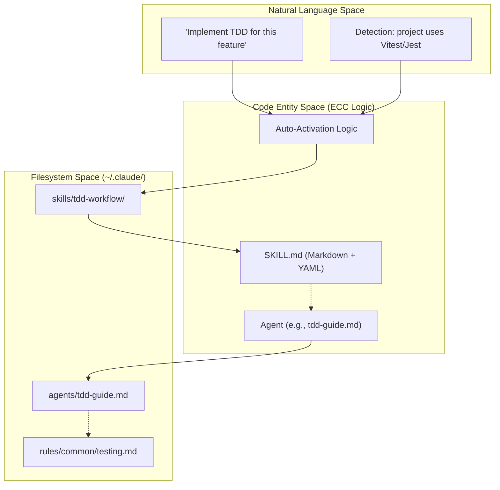
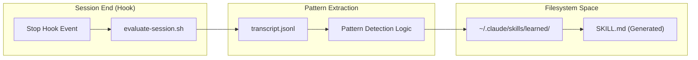

<!-- source: DeepWiki mcp.deepwiki.com · repo affaan-m/everything-claude-code · page 3.3 Skills · fetched 2026-10-26 -->

# Skills

<details>
<summary>Relevant source files</summary>

The following files were used as context for generating this wiki page:

- [CONTRIBUTING.md](CONTRIBUTING.md)
- [agents/docs-lookup.md](agents/docs-lookup.md)
- [docs/SKILL-DEVELOPMENT-GUIDE.md](docs/SKILL-DEVELOPMENT-GUIDE.md)
- [docs/examples/project-guidelines-template.md](docs/examples/project-guidelines-template.md)
- [docs/skill-adaptation-policy.md](docs/skill-adaptation-policy.md)
- [examples/user-CLAUDE.md](examples/user-CLAUDE.md)
- [rules/common/code-review.md](rules/common/code-review.md)
- [rules/common/development-workflow.md](rules/common/development-workflow.md)
- [skills/backend-patterns/SKILL.md](skills/backend-patterns/SKILL.md)
- [skills/clickhouse-io/SKILL.md](skills/clickhouse-io/SKILL.md)
- [skills/coding-standards/SKILL.md](skills/coding-standards/SKILL.md)
- [skills/continuous-learning/SKILL.md](skills/continuous-learning/SKILL.md)
- [skills/django-verification/SKILL.md](skills/django-verification/SKILL.md)
- [skills/eval-harness/SKILL.md](skills/eval-harness/SKILL.md)
- [skills/frontend-patterns/SKILL.md](skills/frontend-patterns/SKILL.md)
- [skills/iterative-retrieval/SKILL.md](skills/iterative-retrieval/SKILL.md)
- [skills/search-first/SKILL.md](skills/search-first/SKILL.md)

</details>


This page defines skills as workflow definitions in the Everything Claude Code (ECC) system, their markdown structure with YAML frontmatter, and how agents and commands invoke them. For quick-execution prompts, see [Commands](3.4). For always-follow guidelines, see [Rules](3.5). For how agents delegate to skills, see [Agents](3.2).

---

## Overview

Skills are **knowledge modules** that Claude Code loads based on context [docs/SKILL-DEVELOPMENT-GUIDE.md:20-22](). They provide:
*   **Domain expertise**: Framework patterns, language idioms, and best practices [docs/SKILL-DEVELOPMENT-GUIDE.md:24-24]().
*   **Workflow definitions**: Step-by-step processes for common tasks (e.g., TDD, research) [docs/SKILL-DEVELOPMENT-GUIDE.md:25-25]().
*   **Reference material**: Code snippets, checklists, and decision trees [docs/SKILL-DEVELOPMENT-GUIDE.md:26-26]().

Unlike **agents** (specialized sub-assistants) which are explicitly delegated to via the `Task` tool, or **commands** which are user-invoked, skills are passive knowledge that Claude references automatically when relevant context is detected [docs/SKILL-DEVELOPMENT-GUIDE.md:29-37]().

**Sources:** [docs/SKILL-DEVELOPMENT-GUIDE.md:20-37](), [CONTRIBUTING.md:74-76]()

---

## File Structure and Format

### Skill File Anatomy

Every skill is contained within its own directory and defined by a mandatory `SKILL.md` file [docs/SKILL-DEVELOPMENT-GUIDE.md:53-58]().

```markdown
---
name: skill-name
description: Brief description for auto-activation
origin: ECC
version: 1.0.0
---

# Skill Title

## When to Activate
Describe scenarios where Claude should use this skill. Critical for auto-activation.

## Core Concepts
Explain key patterns and guidelines.

## Code Examples
Practical, copy-pasteable, and well-commented code.

## Anti-Patterns
Show what NOT to do with concrete examples.

## Best Practices
Actionable guidelines and common pitfalls.

## Related Skills
Link to complementary skills (e.g., `related-skill-1`).
```

**Sources:** [CONTRIBUTING.md:91-135](), [docs/SKILL-DEVELOPMENT-GUIDE.md:66-105]()

### Directory Organization

Skills are organized within the `skills/` directory [docs/SKILL-DEVELOPMENT-GUIDE.md:53-56](). Optional subdirectories like `examples/` or `references/` can be included for additional context [docs/SKILL-DEVELOPMENT-GUIDE.md:59-64]().

```
skills/
└── your-skill-name/
    ├── SKILL.md           # Required: Main skill definition
    ├── examples/          # Optional: Code examples
    └── references/        # Optional: External references
```

**Sources:** [docs/SKILL-DEVELOPMENT-GUIDE.md:53-64](), [CONTRIBUTING.md:83-90]()

---

## Frontmatter Schema

The YAML frontmatter is used by the ECC system to index and activate skills during sessions.

| Field | Required | Description | Example |
|-------|----------|-------------|---------|
| `name` | Yes | Lowercase, hyphenated identifier | `tdd-workflow` |
| `description` | Yes | One-line summary used for auto-activation | `Test-driven development process` |
| `origin` | No | Source identifier (ECC, community, etc.) | `ECC` |
| `version` | No | Skill version for tracking updates | `2.1.0` |

**Sources:** [docs/SKILL-DEVELOPMENT-GUIDE.md:107-115](), [skills/search-first/SKILL.md:1-5]()

---

## Skill Space to Code Entity Mapping

**Diagram: Skill Activation and Execution Flow**

This diagram maps the natural language intent to the specific code entities and files involved in skill resolution within the ECC architecture.



**Sources:** [docs/SKILL-DEVELOPMENT-GUIDE.md:31-48](), [CONTRIBUTING.md:184-202](), [examples/user-CLAUDE.md:25-58]()

---

## Skill Categories

Skills are categorized to maintain focus and actionability. Effective skills avoid being too broad to ensure the model retrieves high-density relevant information [docs/SKILL-DEVELOPMENT-GUIDE.md:121-131]().

| Category | Purpose | Examples |
|----------|---------|----------|
| **Language Standards** | Idioms and naming conventions | `python-patterns`, `typescript-standards` |
| **Framework Patterns** | Framework-specific conventions | `django-patterns`, `nextjs-patterns` |
| **Workflow** | Step-by-step development processes | `tdd-workflow`, `search-first` |
| **Domain Knowledge** | Specialized expertise | `security-review`, `api-design` |
| **Tool Integration** | Specific tool/library usage | `eval-harness`, `docker-patterns` |

**Sources:** [CONTRIBUTING.md:136-145](), [docs/SKILL-DEVELOPMENT-GUIDE.md:197-300]()

---

## Specialized Skill: Continuous Learning

A core feature of ECC is the ability to evolve session patterns into codified skills. This bridges the gap between raw session data and reusable knowledge through an automated pipeline.

**Diagram: Continuous Learning v1 Flow**

This diagram illustrates how the `evaluate-session.sh` script, triggered by the `Stop` hook, extracts patterns into the filesystem [skills/continuous-learning/SKILL.md:23-30]().



**Sources:** [skills/continuous-learning/SKILL.md:23-30, 66-82](), [docs/SKILL-DEVELOPMENT-GUIDE.md:46-46]()

### Key Learning Components
*   **Session Evaluation**: Checks if a session has sufficient length (default: 10+ messages) before attempting extraction [skills/continuous-learning/SKILL.md:27-27, 37-37]().
*   **Pattern Types**: Extracts specific categories like `error_resolution`, `workarounds`, and `project_specific` conventions [skills/continuous-learning/SKILL.md:56-64]().
*   **v1 vs v2**: v1 uses a `Stop` hook for batch extraction at session end, while v2 (instinct-based) uses `PreToolUse`/`PostToolUse` hooks for more granular observation [skills/continuous-learning/SKILL.md:21-21, 105-110]().

**Sources:** [skills/continuous-learning/SKILL.md:1-123]()

---

## Comparison: Skills vs. Other Components

| Component | Purpose | Activation |
|-----------|---------|------------|
| **Skill** | Knowledge repository | Context-based (automatic) |
| **Agent** | Task executor | Explicit delegation (`Task` tool) |
| **Command** | User action | User-invoked (`/command`) |
| **Rule** | Always-on guidelines | Always active (global/project) |
| **Hook** | Automation | Event-triggered |

**Sources:** [docs/SKILL-DEVELOPMENT-GUIDE.md:39-48](), [examples/user-CLAUDE.md:12-22]()

---

## References

*   **Skill Development Guide**: [docs/SKILL-DEVELOPMENT-GUIDE.md]()
*   **Search-First Workflow**: [skills/search-first/SKILL.md]()
*   **Coding Standards**: [skills/coding-standards/SKILL.md]()
*   **Eval Harness**: [skills/eval-harness/SKILL.md]()
*   **Continuous Learning**: [skills/continuous-learning/SKILL.md]()

**Sources:** [docs/SKILL-DEVELOPMENT-GUIDE.md:1-17](), [skills/search-first/SKILL.md:1-5](), [skills/coding-standards/SKILL.md:1-5]()

---

