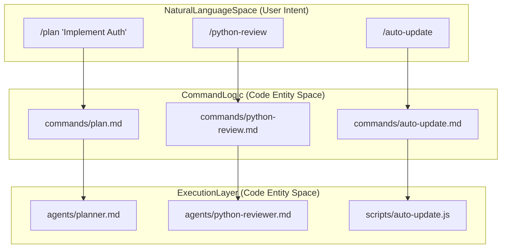
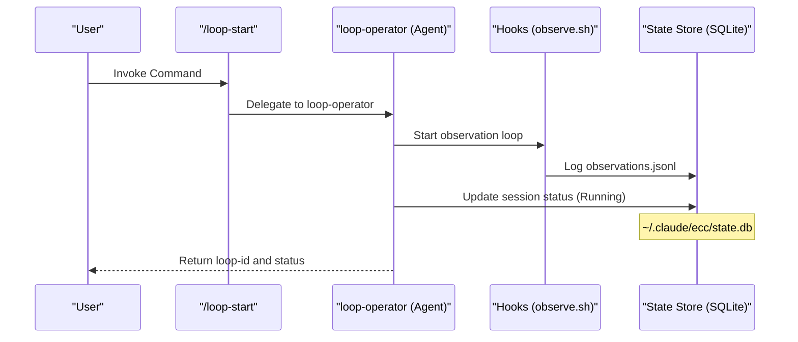

<!-- source: DeepWiki mcp.deepwiki.com · repo affaan-m/everything-claude-code · page 3.4 Commands · fetched 2026-10-26 -->

# Commands

<details>
<summary>Relevant source files</summary>

The following files were used as context for generating this wiki page:

- [AGENTS.md](AGENTS.md)
- [README.md](README.md)
- [README.zh-CN.md](README.zh-CN.md)
- [WORKING-CONTEXT.md](WORKING-CONTEXT.md)
- [agent.yaml](agent.yaml)
- [commands/auto-update.md](commands/auto-update.md)
- [commands/jira.md](commands/jira.md)
- [commands/plan.md](commands/plan.md)
- [commands/prp-commit.md](commands/prp-commit.md)
- [commands/prp-plan.md](commands/prp-plan.md)
- [commands/prp-pr.md](commands/prp-pr.md)
- [commands/prp-prd.md](commands/prp-prd.md)
- [commands/python-review.md](commands/python-review.md)
- [docs/SKILL-PLACEMENT-POLICY.md](docs/SKILL-PLACEMENT-POLICY.md)
- [docs/zh-CN/AGENTS.md](docs/zh-CN/AGENTS.md)
- [docs/zh-CN/README.md](docs/zh-CN/README.md)
- [manifests/install-modules.json](manifests/install-modules.json)
- [schemas/provenance.schema.json](schemas/provenance.schema.json)
- [scripts/auto-update.js](scripts/auto-update.js)
- [scripts/ci/validate-agents.js](scripts/ci/validate-agents.js)
- [scripts/ci/validate-commands.js](scripts/ci/validate-commands.js)
- [scripts/ci/validate-install-manifests.js](scripts/ci/validate-install-manifests.js)
- [scripts/ci/validate-skills.js](scripts/ci/validate-skills.js)
- [skills/hexagonal-architecture/SKILL.md](skills/hexagonal-architecture/SKILL.md)
- [skills/jira-integration/SKILL.md](skills/jira-integration/SKILL.md)
- [tests/ci/agent-yaml-surface.test.js](tests/ci/agent-yaml-surface.test.js)
- [tests/commands/plan-command.test.js](tests/commands/plan-command.test.js)
- [tests/scripts/auto-update.test.js](tests/scripts/auto-update.test.js)

</details>


Commands are slash-invoked prompts that provide quick access to common workflows. They serve as entry points to structured tasks, often delegating to specialized agents or invoking skill workflows.

For information about agents that commands delegate to, see **3.2 Agents**. For details on skill workflows that commands invoke, see **3.3 Skills**. For hook-based automation that runs alongside command execution, see **3.6 Hooks**.

---

## Purpose and Scope

Commands fulfill three primary roles in the ECC system:

1.  **Quick Execution Prompts** — Pre-written prompts for common tasks like `/plan` [[commands/plan.md:1-7]]() or `/save-session` [[agent.yaml:206]]().
2.  **Agent Delegation Entry Points** — Commands that spawn specialized subagents for focused work. For example, `/plan` invokes the `planner` agent [[commands/plan.md:113-114]]() and `/python-review` invokes the `python-reviewer` agent [[AGENTS.md:36]]().
3.  **Skill Workflow Triggers** — Many commands serve as "shims" or entry points to deeper Skill definitions. For instance, `/plan` integrates with the `tdd-workflow` skill [[commands/plan.md:108-111]]() and `/pm2` manages multi-service workflows [[README.zh-CN.md:139]]().

Commands exist in the middle layer of the ECC architecture: users interact with commands, commands orchestrate agents and skills, and hooks enforce quality gates during command execution.

---

## Command Architecture

### File-Based Storage

Commands are stored as markdown files in the `commands/` directory. Each command file defines a prompt template that Claude Code executes when the user invokes the corresponding slash command. As of version 2.0.0-rc.1, the system supports 68 legacy command shims and 79 catalog commands [[README.md:93]]() [[WORKING-CONTEXT.md:13]]().

```text
commands/
├── plan.md             # /plan command (Standard)
├── python-review.md    # /python-review (Agent shim)
├── prp-pr.md           # /prp-pr (GitHub PR automation)
├── prp-plan.md         # /prp-plan (Deep planning)
├── auto-update.md      # /auto-update (Self-update)
└── jira.md             # /jira (Integration shim)
```

**Sources:** [[commands/plan.md:1-5]](), [[commands/python-review.md:1-5]](), [[commands/prp-pr.md:1-5]](), [[agent.yaml:145-213]]()

### Command Structure

Commands follow a markdown format, including YAML frontmatter for metadata and standard variables for user input. The CI suite validates these files for proper delimiters and syntax [[scripts/ci/validate-commands.js:15-60]]().

```markdown
---
description: Restate requirements, assess risks, and create step-by-step implementation plan.
---

# Command Title

Detailed instructions for Claude Code to execute.
$ARGUMENTS
```

The command name is derived directly from the filename (e.g., `prp-pr.md` becomes `/prp-pr`).

**Sources:** [[commands/plan.md:1-3]](), [[scripts/ci/validate-commands.js:15-60]](), [[scripts/ci/validate-commands.js:73]]()

---

## Command Categories

### 1. Planning & Analysis
| Command | Purpose | Logic |
| :--- | :--- | :--- |
| `/plan` | Restate requirements and assess risks | Standard implementation planning [[commands/plan.md:1-16]]() |
| `/prp-plan` | Artifact-producing planning | PRD integration and pattern extraction [[commands/plan.md:112]]() |
| `/harness-audit`| Audit harness scoring | Reliability and cost analysis [[README.zh-CN.md:110]]() |

### 2. Specialized Review & Build
| Command | Purpose | Reference |
| :--- | :--- | :--- |
| `/python-review`| Python-specific code review | Delegates to `python-reviewer` [[AGENTS.md:36]]() |
| `/rust-build`   | Fix Rust build errors | Delegates to `rust-build-resolver` [[AGENTS.md:42]]() |
| `/cpp-test`     | C++ testing workflow | Domain-specific test execution [[agent.yaml:153]]() |

### 3. Workflow & Orchestration
| Command | Purpose | Reference |
| :--- | :--- | :--- |
| `/multi-plan`   | Multi-service planning | Requires `ccg-workflow` runtime [[README.zh-CN.md:169]]() |
| `/loop-start`   | Autonomous loop execution | Managed by `loop-operator` agent [[AGENTS.md:39]]() |
| `/prp-pr`       | Automated GitHub PR creation | Uses `gh` CLI and PR templates [[commands/prp-pr.md:7-12]]() |

---

## Technical Implementation Details

### Bridge: Natural Language to Code Entity
Commands translate user intent into specific agent invocations, skill triggers, or platform scripts.

**Command Execution Logic**


**Sources:** [[commands/plan.md:121]](), [[AGENTS.md:36]](), [[commands/auto-update.md:1-5]](), [[scripts/auto-update.js:10-16]]()

### Multi-Agent Orchestration Flow
Advanced commands like `/multi-plan` or `/loop-start` utilize external runtimes or specialized agents to handle complex state.

**Autonomous Loop Data Flow**


**Sources:** [[AGENTS.md:39-40]](), [[README.md:104-105]](), [[README.zh-CN.md:110-111]]()

---

## Validation & Quality Assurance

ECC includes a validation suite to ensure commands remain functional and correctly referenced.

*   **validate-commands.js**: A CI script that checks that markdown files are non-empty, have valid YAML frontmatter, and maintain correct cross-references to agents and skills [[scripts/ci/validate-commands.js:2-5]]().
*   **Frontmatter Parsing**: The system strictly validates YAML delimiters (`---`) and ensures fields like `description` are present and properly quoted if they contain special characters [[scripts/ci/validate-commands.js:15-60]]().
*   **Cross-Reference Verification**: The validator builds a set of valid command, agent, and skill names and verifies that any reference (e.g., `` `/build-fix` `` or `agents/planner.md`) exists in the repository [[scripts/ci/validate-commands.js:72-175]]().

**Sources:** [[scripts/ci/validate-commands.js:1-189]](), [[scripts/ci/validate-agents.js:10-11]]()

---

