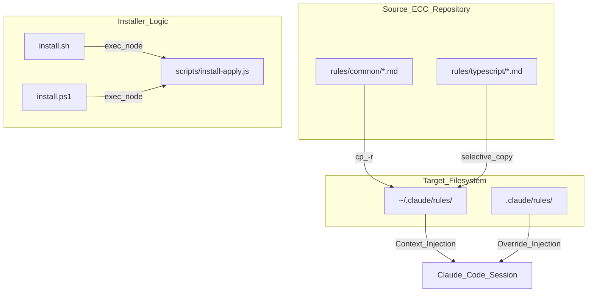
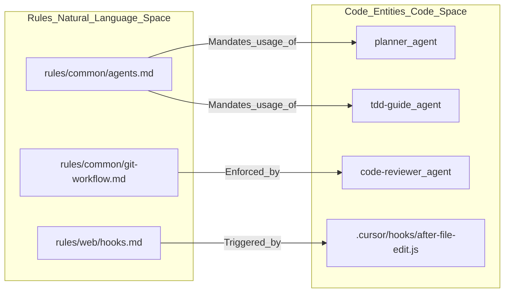

<!-- source: DeepWiki mcp.deepwiki.com · repo affaan-m/everything-claude-code · page 3.5 Rules · fetched 2026-10-26 -->

# Rules

<details>
<summary>Relevant source files</summary>

The following files were used as context for generating this wiki page:

- [.agents/skills/bun-runtime/agents/openai.yaml](.agents/skills/bun-runtime/agents/openai.yaml)
- [.agents/skills/documentation-lookup/agents/openai.yaml](.agents/skills/documentation-lookup/agents/openai.yaml)
- [.agents/skills/nextjs-turbopack/agents/openai.yaml](.agents/skills/nextjs-turbopack/agents/openai.yaml)
- [.cursor/hooks/after-file-edit.js](.cursor/hooks/after-file-edit.js)
- [install.ps1](install.ps1)
- [install.sh](install.sh)
- [rules/README.md](rules/README.md)
- [rules/common/agents.md](rules/common/agents.md)
- [rules/common/coding-style.md](rules/common/coding-style.md)
- [rules/common/git-workflow.md](rules/common/git-workflow.md)
- [rules/common/hooks.md](rules/common/hooks.md)
- [rules/common/patterns.md](rules/common/patterns.md)
- [rules/common/security.md](rules/common/security.md)
- [rules/common/testing.md](rules/common/testing.md)
- [rules/web/coding-style.md](rules/web/coding-style.md)
- [rules/web/design-quality.md](rules/web/design-quality.md)
- [rules/web/hooks.md](rules/web/hooks.md)
- [rules/web/patterns.md](rules/web/patterns.md)
- [rules/web/performance.md](rules/web/performance.md)

</details>


Rules are always-follow guidelines that constrain Claude Code's behavior across all sessions. They form a declarative specification layer that operates above individual prompts, enforcing project-specific patterns, coding standards, security requirements, and workflow conventions without requiring explicit reminders in every interaction.

For detailed listings of available rules and their contents, see [Rules Reference](#5.4). For information about dynamic system prompt injection and context management techniques, see [Memory & Context Preservation](#11.3).

---

## What Rules Are

Rules are Markdown files stored in the `rules/` directory that Claude Code loads at the start of every session. Unlike skills (which are invoked explicitly) or commands (which run on demand), rules are **always active** — they establish the baseline constraints and preferences that guide all agent behavior.

**Core Characteristics:**

| Property | Behavior |
|----------|----------|
| **Scope** | Universal — applies to all operations in a session |
| **Invocation** | Automatic — loaded at session start without user action |
| **Priority** | Higher authority than user messages; Language-specific overrides common [rules/README.md:94-96]() |
| **Persistence** | Session-scoped — reloaded for each new `claude` invocation |
| **Mutability** | Read-only — agents cannot modify rule files |

**Example rule statements:**

```markdown
# From coding-style.md
- ALWAYS create new objects, NEVER mutate existing ones [rules/common/coding-style.md:3-5]()
- Rationale: Immutable data prevents hidden side effects [rules/common/coding-style.md:13-13]()

# From testing.md
- Minimum Test Coverage: 80% [rules/common/testing.md:3-3]()
- Write test first (RED) -> Implementation (GREEN) [rules/common/testing.md:12-19]()

# From git-workflow.md
- Use standard types: feat, fix, refactor, docs, test, chore, perf, ci [rules/common/git-workflow.md:10-10]()
```

Sources: [rules/README.md:70-71](), [rules/common/coding-style.md:3-13](), [rules/common/testing.md:3-19](), [rules/common/git-workflow.md:10-10]()

---

## Hierarchical Structure

Rules are organized into a two-tier hierarchy: **common rules** (language-agnostic) and **language-specific rules** (ecosystem conventions).

### Directory Organization

```
rules/
├── common/                   # Universal principles (always install) [rules/README.md:8-16]()
│   ├── coding-style.md       # Immutability, KISS, DRY, YAGNI [rules/common/coding-style.md:1-34]()
│   ├── git-workflow.md       # Commit format, PR analysis [rules/common/git-workflow.md:1-20]()
│   ├── testing.md            # 80% Coverage, TDD, AAA pattern [rules/common/testing.md:1-58]()
│   ├── performance.md        # Resource optimization
│   ├── patterns.md           # Design patterns
│   ├── hooks.md              # Hook usage
│   ├── agents.md             # Agent delegation rules [rules/common/agents.md:1-51]()
│   └── security.md           # Mandatory security checks
├── typescript/               # TypeScript/JavaScript specific [rules/README.md:17-17]()
├── python/                   # Python specific [rules/README.md:18-18]()
├── golang/                   # Go specific [rules/README.md:19-19]()
├── web/                      # Web and frontend specific [rules/README.md:20-20]()
├── swift/                    # Swift specific [rules/README.md:21-21]()
└── php/                      # PHP specific [rules/README.md:22-22]()
```

**Design Rationale:**

- **Common rules** contain universal principles without language-specific code examples [rules/README.md:25-25]().
- **Language directories** extend the common rules with framework-specific patterns, tools, and code examples [rules/README.md:26-26]().
- **Specificity Precedence**: When language-specific rules and common rules conflict, language-specific rules take precedence (specific overrides general) [rules/README.md:94-100]().

Sources: [rules/README.md:4-27](), [rules/README.md:94-100](), [rules/common/coding-style.md:1-34](), [rules/common/testing.md:1-58]()

---

## Installation and Data Flow

Rules must be installed manually due to platform limitations. They are typically placed in `~/.claude/rules/` (User-level) or `.claude/rules/` (Project-level).

### Rule Installation Flow

The following diagram bridges the Natural Language rules to the Code Entity space by showing how the `install.sh` script (and its underlying `scripts/install-apply.js` logic) populates the system.

**Rule Deployment Architecture**



### Installation Methods

**Option 1: Install Script (Recommended)**
The `install.sh` (Bash) and `install.ps1` (PowerShell) wrappers resolve the package root and delegate to the Node-based installer `scripts/install-apply.js` [install.sh:32-32](), [install.ps1:52-52]().

```bash
# Install common + specific language rules
./install.sh typescript python
```

**Option 2: Manual Installation**
Users must copy entire directories rather than flattening files to maintain relative references like `../common/` used by language-specific files [rules/README.md:45-51]().

```bash
cp -r rules/common ~/.claude/rules/common
cp -r rules/typescript ~/.claude/rules/typescript
```

Sources: [install.sh:1-32](), [install.ps1:1-53](), [rules/README.md:30-43](), [rules/README.md:45-63]()

---

## How Rules Constrain Behavior

Rules act as the "constitution" for the agent. They are not just documentation; they are active constraints injected into the system prompt.

### Workflow Constraints: Git & Agents

The rules mandate specific sequences and behaviors for core operations:

1.  **Git Workflow**: Mandatory commit message formats (feat, fix, refactor, etc.) and PR analysis using `git diff [base-branch]...HEAD` [rules/common/git-workflow.md:3-19]().
2.  **Agent Delegation**: Mandatory use of specific agents for specific tasks, such as `planner` for complex features and `tdd-guide` for new features [rules/common/agents.md:20-27]().
3.  **Parallelism**: Agents are instructed to use parallel Task execution for independent operations (e.g., launching security analysis and performance review simultaneously) [rules/common/agents.md:30-41]().

### Technical Implementation: Rule to Code Association

This diagram maps natural language rules found in the `rules/` directory to the specific agents and configuration files defined in the codebase that enforce them.

**Constraint Enforcement Mapping**



Sources: [rules/common/agents.md:7-18](), [rules/common/git-workflow.md:10-10](), [rules/web/hooks.md:1-25](), [.cursor/hooks/after-file-edit.js:13-16]()

---

## Rules vs. Skills

It is critical to distinguish between Rules (what to follow) and Skills (how to perform).

| Feature | Rules (`rules/`) | Skills (`skills/`) |
| :--- | :--- | :--- |
| **Nature** | Standards, conventions, and checklists [rules/README.md:70-71]() | Deep, actionable reference material [rules/README.md:71-72]() |
| **Precedence** | Language-specific overrides common [rules/README.md:94-96]() | Context-dependent |
| **Example** | "80% test coverage" [rules/common/testing.md:3-3]() | `nextjs-turbopack` workflow [skills/nextjs-turbopack/agents/openai.yaml:1-8]() |
| **Relationship** | Rules tell you *what* to do | Skills tell you *how* to do it [rules/README.md:73-73]() |

Sources: [rules/README.md:68-74](), [rules/README.md:94-100](), [.agents/skills/nextjs-turbopack/agents/openai.yaml:1-8]()

---

## Agent Orchestration Rules

The `rules/common/agents.md` file defines the catalog of available agents and the logic for their invocation.

**Available Agents Catalog:**
Located in `~/.claude/agents/`, these include `planner`, `architect`, `tdd-guide`, `code-reviewer`, `security-reviewer`, and specialized ones like `rust-reviewer` [rules/common/agents.md:5-19]().

**Immediate Agent Usage Triggers:**
*   **Complex feature requests**: Use `planner` agent [rules/common/agents.md:23-23]().
*   **Code just written/modified**: Use `code-reviewer` agent [rules/common/agents.md:24-24]().
*   **Bug fix or new feature**: Use `tdd-guide` agent [rules/common/agents.md:25-25]().
*   **Architectural decision**: Use `architect` agent [rules/common/agents.md:26-26]().

**Execution Strategy:**
*   **Parallelism**: ALWAYS use parallel Task execution for independent operations [rules/common/agents.md:30-38]().
*   **Multi-Perspective Analysis**: For complex problems, use split role sub-agents such as "Security expert" or "Consistency reviewer" [rules/common/agents.md:43-51]().

Sources: [rules/common/agents.md:1-51]()

---

