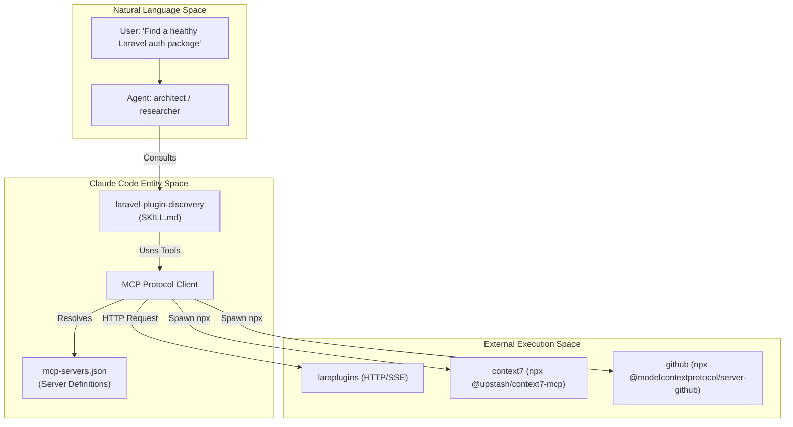
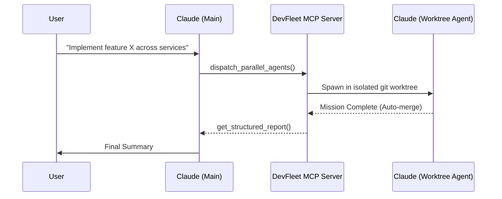

<!-- source: DeepWiki mcp.deepwiki.com · repo affaan-m/everything-claude-code · page 3.7 MCPs (Model Context Protocol) · fetched 2026-10-26 -->

# MCPs (Model Context Protocol)

Relevant source files

The following files were used as context for generating this wiki page:

- [.agents/plugins/marketplace.json](.agents/plugins/marketplace.json)
- [.claude-plugin/PLUGIN_SCHEMA_NOTES.md](.claude-plugin/PLUGIN_SCHEMA_NOTES.md)
- [.claude-plugin/README.md](.claude-plugin/README.md)
- [.claude-plugin/marketplace.json](.claude-plugin/marketplace.json)
- [.claude-plugin/plugin.json](.claude-plugin/plugin.json)
- [.codex-plugin/README.md](.codex-plugin/README.md)
- [.codex-plugin/plugin.json](.codex-plugin/plugin.json)
- [.mcp.json](.mcp.json)
- [mcp-configs/mcp-servers.json](mcp-configs/mcp-servers.json)
- [schemas/package-manager.schema.json](schemas/package-manager.schema.json)
- [schemas/plugin.schema.json](schemas/plugin.schema.json)
- [scripts/hooks/insaits-security-monitor.py](scripts/hooks/insaits-security-monitor.py)
- [scripts/hooks/insaits-security-wrapper.js](scripts/hooks/insaits-security-wrapper.js)
- [skills/laravel-plugin-discovery/SKILL.md](skills/laravel-plugin-discovery/SKILL.md)
- [tests/hooks/insaits-security-monitor.test.js](tests/hooks/insaits-security-monitor.test.js)
- [tests/hooks/insaits-security-wrapper.test.js](tests/hooks/insaits-security-wrapper.test.js)
- [tests/hooks/plugin-hook-bootstrap.test.js](tests/hooks/plugin-hook-bootstrap.test.js)
- [tests/hooks/test_insaits_security_monitor.py](tests/hooks/test_insaits_security_monitor.py)
- [tests/plugin-manifest.test.js](tests/plugin-manifest.test.js)

## Purpose and Scope

This page explains MCPs (Model Context Protocol) in the context of Everything Claude Code (ECC). MCP servers act as external service integrations that extend Claude's capabilities by providing a standardized way to expose tools, resources, and prompts to the model. This section details the technical implementation, the configuration schema, and the critical relationship between MCP usage and context window management.

---

## What Are MCPs?

MCPs are **prompt-driven wrappers around external services** that allow Claude to interact with APIs, databases, and local filesystems through natural language. Instead of writing custom integration code for every service, the Model Context Protocol provides a universal interface where an MCP server describes its available tools to the Claude client.

**Key Technical Distinction**: MCPs are not simple API clients. They are stateful or stateless external processes that translate LLM tool calls into service-specific actions.

### Implementation Patterns

| Pattern | Description | Example File/Tool |
|---------|-------------|-------------------|
| **Stdio** | Server runs as a local subprocess; communication via JSON-RPC over stdin/stdout. | `jira`, `github`, `memory`, `filesystem` [mcp-configs/mcp-servers.json:3-106]() |
| **HTTP/SSE** | Server runs remotely or locally as a web service; communication via Server-Sent Events. | `vercel`, `laraplugins`, `browser-use`, `devfleet` [mcp-configs/mcp-servers.json:49-149]() |
| **Python Local** | Server runs as a local Python module, often for testing or specialized logic. | `evalview` [mcp-configs/mcp-servers.json:161-168]() |

**Sources:** [mcp-configs/mcp-servers.json:1-176]()

---

## MCP Architecture and Data Flow

The following diagram illustrates how the Claude Code harness interacts with MCP servers to bridge the gap between natural language requests and external code execution.

### Data Flow: Natural Language to Code Entity Space

**Implementation Details:**
- **Server Discovery**: Servers are defined in a central configuration file [mcp-configs/mcp-servers.json:1-169]().
- **Tool Mapping**: Skills like `laravel-plugin-discovery` map natural language intent to specific MCP tools like `SearchPluginTool` [skills/laravel-plugin-discovery/SKILL.md:36-46]().
- **Multi-Runtime Support**: ECC supports MCPs written in Node.js (`npx`), Python (`python3`), Rust (`uvx`), and native HTTP [mcp-configs/mcp-servers.json:4, 40, 85, 147, 162]().
- **Tool Registration**: MCP servers use SDK functions like `server.tool()` or `registerTool()` to expose capabilities to the model.

**Sources:** [mcp-configs/mcp-servers.json:1-176](), [skills/laravel-plugin-discovery/SKILL.md:1-230]()

---

## Context Window Impact: The 200k to 70k Problem

A critical technical constraint in ECC is the "Context Window Degradation" caused by MCP bloat. Each enabled MCP server injects its tool definitions, schemas, and descriptions into the system prompt.

### Context Consumption Metrics

| Configuration State | Tokens Consumed (Approx) | Remaining Context (Sonnet 3.5) |
|---------------------|--------------------------|--------------------------------|
| Baseline (No MCPs)  | ~2k (System Prompt)      | ~198k                          |
| 5-10 MCPs Enabled   | ~30k - 50k               | ~150k                          |
| 30+ MCPs Enabled    | ~130k+                   | **<70k (Critical)**            |

**Optimization Strategy:**
ECC enforces a discipline of having many servers *configured* but few *enabled* simultaneously. The `ECC_DISABLED_MCPS` environment variable or `disabledMcpServers` in project configuration is used to prune the toolset [mcp-configs/mcp-servers.json:173-174]().

**Sources:** [mcp-configs/mcp-servers.json:170-176]()

---

## Key MCP Servers in ECC

The ECC repository provides a pre-configured library of battle-tested MCP servers.

### Integration Reference Table

| Server Name | Implementation / Command | Primary Purpose |
|-------------|-------------------------|-----------------|
| `github` | `npx @modelcontextprotocol/server-github` | PRs, issues, and repo management [mcp-configs/mcp-servers.json:13-20]() |
| `context7` | `npx @upstash/context7-mcp@latest` | Live documentation lookup for libraries [mcp-configs/mcp-servers.json:92-96]() |
| `devfleet` | `http://localhost:18801/mcp` | Multi-agent orchestration in worktrees [mcp-configs/mcp-servers.json:136-140]() |
| `evalview` | `python3 -m evalview mcp serve` | AI agent regression testing and snapshots [mcp-configs/mcp-servers.json:161-168]() |
| `laraplugins` | `https://laraplugins.io/mcp/plugins` | Laravel package discovery and health checks [mcp-configs/mcp-servers.json:146-150]() |
| `sequential-thinking` | `npx @modelcontextprotocol/server-sequential-thinking` | Chain-of-thought reasoning extension [mcp-configs/mcp-servers.json:44-48]() |
| `token-optimizer` | `npx token-optimizer-mcp` | 95%+ context reduction via deduplication [mcp-configs/mcp-servers.json:141-145]() |

### Case Study: Laravel Plugin Discovery

The `laravel-plugin-discovery` skill demonstrates how MCP tools are integrated into a workflow:
1. **Requirement**: Requires the `laraplugins` MCP server [skills/laravel-plugin-discovery/SKILL.md:19-28]().
2. **Tool Use**: Utilizes `SearchPluginTool` to find packages by keyword, health score, and version compatibility [skills/laravel-plugin-discovery/SKILL.md:36-46]().
3. **Deep Dive**: Uses `GetPluginDetailsTool` to fetch detailed metrics, readme content, and risk scores [skills/laravel-plugin-discovery/SKILL.md:48-55]().
4. **Decision Logic**: Recommends `Healthy` packages for production projects based on the health score returned by the MCP [skills/laravel-plugin-discovery/SKILL.md:144-153]().

**Sources:** [skills/laravel-plugin-discovery/SKILL.md:1-230](), [mcp-configs/mcp-servers.json:146-150]()

---

## Multi-Agent Orchestration via DevFleet

The `devfleet` MCP server represents an advanced use case where one Claude instance orchestrates a "swarm" of other agents.

### Orchestration Sequence Diagram

**Key DevFleet Tools:**
- **Dispatch**: Parallelizes Claude Code agents in isolated worktrees [mcp-configs/mcp-servers.json:139]().
- **Reporting**: Provides structured reports on mission progress and results [mcp-configs/mcp-servers.json:139]().

**Sources:** [mcp-configs/mcp-servers.json:136-140]()

---

## Platform Support and Manifests

MCP configuration is handled differently across platforms supported by ECC:

- **Claude Code**: Uses `~/.claude.json` for server definitions [mcp-configs/mcp-servers.json:171](). The plugin manifest explicitly opts out of auto-bundling MCPs to avoid overlong tool names in OpenAI-compatible gateways [.claude-plugin/plugin.json:25](), [.claude-plugin/PLUGIN_SCHEMA_NOTES.md:136-153]().
- **Codex**: Requires an `.mcp.json` file at the plugin root for native installs.
- **Cursor**: Supports MCP environment interpolation but lacks native hook support for automated validation.

**Sources:** [.claude-plugin/plugin.json:1-28](), [.claude-plugin/PLUGIN_SCHEMA_NOTES.md:1-216](), [mcp-configs/mcp-servers.json:170-176]()

---

