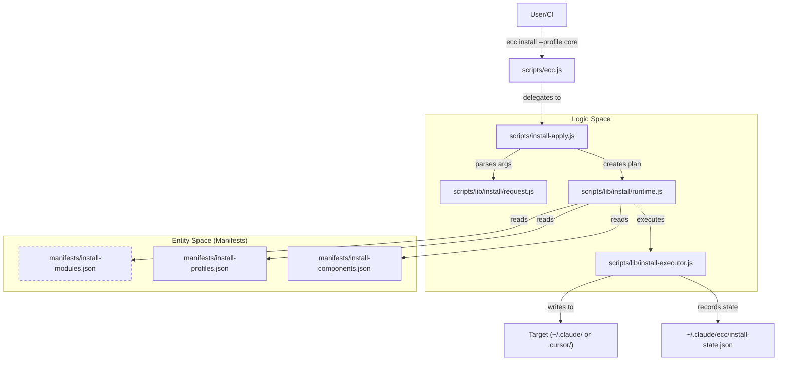
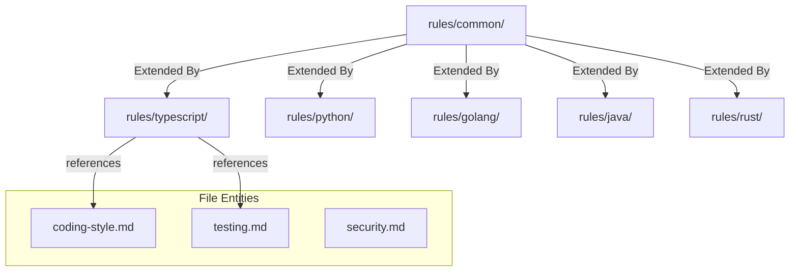

<!-- source: DeepWiki mcp.deepwiki.com · repo affaan-m/everything-claude-code · page 4 Installation & Setup · fetched 2026-10-26 -->

# Installation & Setup

<details>
<summary>Relevant source files</summary>

The following files were used as context for generating this wiki page:

- [AGENTS.md](AGENTS.md)
- [README.md](README.md)
- [README.zh-CN.md](README.zh-CN.md)
- [WORKING-CONTEXT.md](WORKING-CONTEXT.md)
- [agent.yaml](agent.yaml)
- [commands/auto-update.md](commands/auto-update.md)
- [commands/jira.md](commands/jira.md)
- [docs/SELECTIVE-INSTALL-ARCHITECTURE.md](docs/SELECTIVE-INSTALL-ARCHITECTURE.md)
- [docs/zh-CN/AGENTS.md](docs/zh-CN/AGENTS.md)
- [docs/zh-CN/README.md](docs/zh-CN/README.md)
- [manifests/install-modules.json](manifests/install-modules.json)
- [scripts/auto-update.js](scripts/auto-update.js)
- [scripts/install-apply.js](scripts/install-apply.js)
- [scripts/lib/cursor-agent-names.js](scripts/lib/cursor-agent-names.js)
- [scripts/lib/install-executor.js](scripts/lib/install-executor.js)
- [scripts/lib/install-targets/claude-home.js](scripts/lib/install-targets/claude-home.js)
- [scripts/lib/install-targets/cursor-project.js](scripts/lib/install-targets/cursor-project.js)
- [scripts/lib/install-targets/helpers.js](scripts/lib/install-targets/helpers.js)
- [scripts/lib/install/apply.js](scripts/lib/install/apply.js)
- [skills/jira-integration/SKILL.md](skills/jira-integration/SKILL.md)
- [tests/ci/agent-yaml-surface.test.js](tests/ci/agent-yaml-surface.test.js)
- [tests/lib/install-executor.test.js](tests/lib/install-executor.test.js)
- [tests/lib/install-targets.test.js](tests/lib/install-targets.test.js)
- [tests/lib/selective-install.test.js](tests/lib/selective-install.test.js)
- [tests/scripts/auto-update.test.js](tests/scripts/auto-update.test.js)
- [tests/scripts/install-apply.test.js](tests/scripts/install-apply.test.js)
- [tests/scripts/install-readme-clarity.test.js](tests/scripts/install-readme-clarity.test.js)

</details>


This page provides a comprehensive guide to installing the Everything Claude Code (ECC) system. ECC supports multiple installation pathways—ranging from the automated plugin marketplace to a sophisticated selective-install CLI—to accommodate different environments like Claude Code, Cursor, OpenCode, and more.

For details on post-installation settings, see [Configuration Guide](#9). For resolving setup errors, see [Troubleshooting](#16).

---

## Installation Methods Overview

ECC can be installed through several methods depending on your target environment and required level of granularity. The system has evolved into a performance optimization framework for AI agent harnesses, supporting over 12 language ecosystems [README.md:14-22]().

### Comparison of Methods

| Method | Best For | Complexity | Target Platforms |
|:---|:---|:---|:---|
| **Plugin Marketplace** | Most users, automatic updates | Low | Claude Code |
| **ECC CLI (`ecc`)** | Selective modules, profiles | Medium | Claude, Cursor, Antigravity, Codex, OpenCode, CodeBuddy, Trae |
| **NPM Package** | Automation, CI/CD | Low | All |
| **Manual / Git** | Development, heavy customization | High | All |

### Installation Logic & Entity Mapping

The following diagram bridges high-level installation concepts to the underlying code entities that manage the process, specifically highlighting the manifest-driven architecture used by the `install-apply.js` runtime [scripts/install-apply.js:10-18]().

**Installer System Architecture**

Sources: [scripts/install-apply.js:111-138](), [tests/scripts/install-apply.test.js:106-111](), [manifests/install-modules.json:1-10]()

---

## Automated Installation (NPM & CLI)

The recommended way to install ECC is via the global NPM package `ecc-universal`. The `ecc` command-line interface uses a manifest-driven pipeline with `install-apply.js` for targeted component installation [scripts/install-apply.js:24-42]().

```bash
# 1. Install the global package
npm install -g ecc-universal

# 2. Run a standard installation for your primary language
ecc install typescript
```

The `ecc` CLI manages the installation lifecycle, including `plan`, `apply`, `doctor`, `repair`, and `uninstall`. It tracks the installation state in `install-state.json`, enabling incremental updates and drift detection [tests/scripts/install-apply.test.js:106-111]().

For details on the command-line interface, see [Selective Install System](#4.6).

Sources: [README.md:10](), [scripts/install-apply.js:1-53](), [tests/scripts/install-apply.test.js:88-124]()

---

## Plugin Marketplace Installation

For users of the native Claude Code CLI, ECC is available as a first-class plugin.

1. **Add the Marketplace Source:**
   `/plugin marketplace add https://github.com/affaan-m/everything-claude-code`
2. **Install the Plugin:**
   `/plugin install everything-claude-code@everything-claude-code`

**Note:** Due to platform limitations, rules must be installed separately as Claude Code plugins cannot automatically distribute the `rules/` directory to `~/.claude/rules/` [README.zh-CN.md:112-117]().

For details, see [Plugin Installation](#4.1) and [Rules Installation](#4.4).

Sources: [README.zh-CN.md:100-108](), [README.zh-CN.md:112-117]()

---

## Manual Installation

Manual installation involves cloning the repository and using the cross-platform entrypoints. ECC provides `install.sh` for Unix-like systems and `install.ps1` for Windows [README.zh-CN.md:119-146]().

```bash
git clone https://github.com/affaan-m/everything-claude-code.git
cd everything-claude-code

# Unix/macOS
./install.sh typescript python

# Windows (PowerShell)
.\install.ps1 typescript
```

The installer supports various targets including `claude`, `cursor`, `antigravity`, `codex`, `gemini`, and `opencode` [scripts/install-apply.js:29-33](), [tests/lib/install-targets.test.js:36-46]().

For details, see [Manual Installation](#4.2).

Sources: [README.zh-CN.md:119-146](), [scripts/install-apply.js:1-53](), [tests/lib/install-targets.test.js:36-46]()

---

## Rules Installation & Language Support

Rules are organized into a common layer plus language-specific directories [manifests/install-modules.json:5-21](). This hierarchy ensures that universal principles are always present, while specific tech stacks can provide tailored overrides. ECC covers language ecosystems including TypeScript, Python, Go, Java, Kotlin, and Rust [AGENTS.md:17-45]().

**Rule Extension Hierarchy**


**Important:** When installing manually for the plugin path, users are advised to copy the `rules/` directory to `~/.claude/rules/ecc/` to avoid naming conflicts [tests/scripts/install-readme-clarity.test.js:136-138]().

For details on rule priority and adding new languages, see [Rules Installation](#4.4).

Sources: [manifests/install-modules.json:5-21](), [AGENTS.md:17-45](), [tests/scripts/install-readme-clarity.test.js:136-138]()

---

## Initial Configuration

After files are deployed, ECC requires minimal configuration to align with your project's environment.

### Package Manager Setup
ECC uses a priority cascade to detect your package manager (npm, yarn, pnpm, or bun). It checks environment variables (`CLAUDE_PACKAGE_MANAGER`), project configs (`.claude/package-manager.json`), and lockfiles [README.zh-CN.md:185-195]().

For details, see [Package Manager Configuration](#4.3).

### Interactive Wizard
For a guided setup that helps you select specific skills (from over 180 available) and agents, use the interactive configuration wizard skill `configure-ecc` [manifests/install-modules.json:205]().

For details, see [Interactive Configuration Wizard](#4.5).

Sources: [README.zh-CN.md:185-195](), [manifests/install-modules.json:111-153](), [manifests/install-modules.json:205]()

---

## Verification

To verify your installation and check for configuration drift, use the `doctor` command:

```bash
ecc doctor
```

This command inspects the installation state against your local filesystem [tests/scripts/install-readme-clarity.test.js:64-66](). You can also use `list-installed` to view the currently tracked modules and components [tests/scripts/install-readme-clarity.test.js:60-62]().

Sources: [tests/scripts/install-readme-clarity.test.js:60-66](), [scripts/install-apply.js:94-96]()

---

