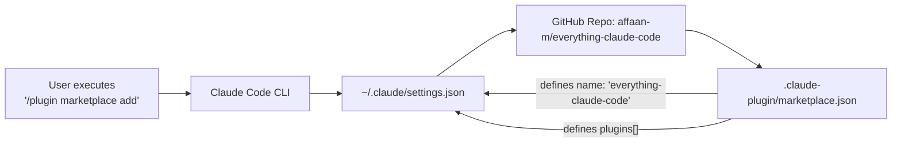
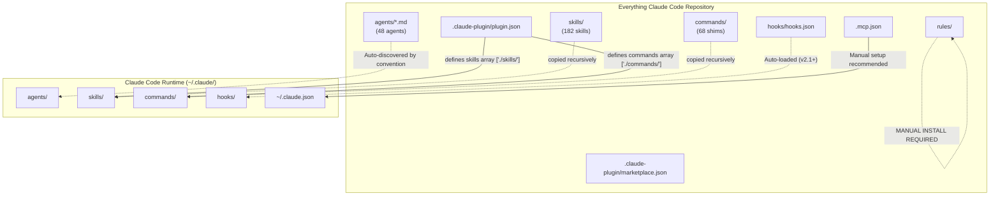

<!-- source: DeepWiki mcp.deepwiki.com · repo affaan-m/everything-claude-code · page 4.1 Plugin Installation · fetched 2026-10-26 -->

# Plugin Installation

<details>
<summary>Relevant source files</summary>

The following files were used as context for generating this wiki page:

- [.agents/plugins/marketplace.json](.agents/plugins/marketplace.json)
- [.claude-plugin/PLUGIN_SCHEMA_NOTES.md](.claude-plugin/PLUGIN_SCHEMA_NOTES.md)
- [.claude-plugin/README.md](.claude-plugin/README.md)
- [.claude-plugin/marketplace.json](.claude-plugin/marketplace.json)
- [.claude-plugin/plugin.json](.claude-plugin/plugin.json)
- [.codex-plugin/README.md](.codex-plugin/README.md)
- [.codex-plugin/plugin.json](.codex-plugin/plugin.json)
- [.mcp.json](.mcp.json)
- [AGENTS.md](AGENTS.md)
- [README.md](README.md)
- [README.zh-CN.md](README.zh-CN.md)
- [WORKING-CONTEXT.md](WORKING-CONTEXT.md)
- [agent.yaml](agent.yaml)
- [commands/auto-update.md](commands/auto-update.md)
- [commands/jira.md](commands/jira.md)
- [docs/zh-CN/AGENTS.md](docs/zh-CN/AGENTS.md)
- [docs/zh-CN/README.md](docs/zh-CN/README.md)
- [manifests/install-modules.json](manifests/install-modules.json)
- [schemas/package-manager.schema.json](schemas/package-manager.schema.json)
- [schemas/plugin.schema.json](schemas/plugin.schema.json)
- [scripts/auto-update.js](scripts/auto-update.js)
- [skills/jira-integration/SKILL.md](skills/jira-integration/SKILL.md)
- [tests/ci/agent-yaml-surface.test.js](tests/ci/agent-yaml-surface.test.js)
- [tests/plugin-manifest.test.js](tests/plugin-manifest.test.js)
- [tests/scripts/auto-update.test.js](tests/scripts/auto-update.test.js)

</details>


This page covers installing Everything Claude Code (ECC) via the Claude Code plugin marketplace. This is the recommended installation method as it provides automatic component installation and updates through Claude Code's native plugin system.

For manual installation (git clone and copy), see **4.2 Manual Installation**. For rules installation (required after plugin install), see **4.4 Rules Installation**. For package manager configuration, see **4.3 Package Manager Configuration**.

---

## Overview

The plugin installation method uses Claude Code's marketplace system to install agents, skills, commands, and hooks automatically. The marketplace identifies plugins by their repository structure and distributes them as namespaced components within Claude Code.

As of version `2.0.0-rc.1`, the public plugin slug is `ecc`, though legacy `everything-claude-code` paths remain supported for compatibility [[WORKING-CONTEXT.md:12-14](), [.claude-plugin/plugin.json:2-3]()].

**What gets installed automatically:**
- **48 specialized agents** discovered by convention in the `agents/` directory [[README.md:92](), [.claude-plugin/PLUGIN_SCHEMA_NOTES.md:70-74]()].
- **182 skills** from the `./skills/` directory [[.claude-plugin/plugin.json:26](), [README.md:92]()].
- **68 legacy command shims** from the `./commands/` directory [[.claude-plugin/plugin.json:27](), [README.md:92]()].
- **Automated Hooks** defined in `hooks/hooks.json` which are loaded automatically by convention in Claude Code v2.1+ [[.claude-plugin/PLUGIN_SCHEMA_NOTES.md:104-107]()].

**What requires manual installation:**
- **Rules** — Claude Code platform limitations prevent rules distribution via plugins; these must be placed in `~/.claude/rules/` manually or via the installation script [[README.zh-CN.md:112-116]()].

**Sources:** [[README.md:89-98](), [.claude-plugin/plugin.json:1-28](), [.claude-plugin/PLUGIN_SCHEMA_NOTES.md:1-216]()]

---

## Installation Flow

### Step 1: Add Marketplace Source

The marketplace source tells Claude Code where to find the plugin catalog. Add the ECC marketplace:

```bash
# Add the marketplace
/plugin marketplace add https://github.com/affaan-m/everything-claude-code
```

This registers the GitHub repository as a known marketplace. The manifest at `.claude-plugin/marketplace.json` defines the marketplace metadata, including the owner and the list of available plugins [[.claude-plugin/marketplace.json:1-10]()].

**Diagram: Marketplace Registration (Code Entity Space)**



**Sources:** [[.claude-plugin/marketplace.json:1-47](), [README.zh-CN.md:101-102]()]

---

### Step 2: Install Plugin

Once the marketplace is registered, install the plugin using the canonical identifier:

```bash
# Install the plugin
/plugin install everything-claude-code@everything-claude-code
```

> **Note:** While the slug is `ecc`, the installation uses the normalized identifier `everything-claude-code@everything-claude-code` to ensure consistency across marketplace entries, install commands, and documentation [[README.zh-CN.md:108]()].

**Sources:** [[.claude-plugin/plugin.json:2](), [.claude-plugin/marketplace.json:12](), [README.zh-CN.md:105-108]()]

---

## Plugin Structure and Component Distribution

The plugin system reads component paths from `.claude-plugin/plugin.json`. Unlike previous versions, `agents` and `hooks` are no longer explicitly declared in the manifest to avoid validation errors and duplication; they are discovered by convention [[.claude-plugin/PLUGIN_SCHEMA_NOTES.md:60-74, 98-111]()].

**Diagram: Plugin Component Distribution (System to Code Association)**



**Sources:** [[.claude-plugin/plugin.json:26-27](), [.claude-plugin/PLUGIN_SCHEMA_NOTES.md:60-111](), [README.md:92-93]()]

---

## Component Namespacing

Plugin-installed commands use a namespaced format to avoid collisions with native Claude Code commands.

| Install Method | Command Format | Example |
| :--- | :--- | :--- |
| **Plugin Install** | `/everything-claude-code:<command>` | `/everything-claude-code:plan "Add auth"` |
| **Manual Install** | `/<command>` | `/plan "Add auth"` |

**Verification Command:**
To see all components currently recognized by the ECC plugin, use:
```bash
/plugin list everything-claude-code@everything-claude-code
```

**Sources:** [[README.zh-CN.md:153-161](), [.claude-plugin/plugin.json:2]()]

---

## MCP Server Integration

The plugin root contains a `.mcp.json` file for Codex and manual setups. However, for Claude Code plugin installs, ECC explicitly opts out of automatic MCP bundling by providing an empty `mcpServers` object in the manifest [[.claude-plugin/PLUGIN_SCHEMA_NOTES.md:136-152]()].

This prevents issues where strict gateways reject tool names that exceed 64 characters (e.g., `mcp__plugin_everything-claude-code_...`). Users should configure MCP servers manually from `mcp-configs/` [[.claude-plugin/PLUGIN_SCHEMA_NOTES.md:149-152]()].

**Sources:** [[.claude-plugin/PLUGIN_SCHEMA_NOTES.md:136-152](), [.claude-plugin/plugin.json:25]()]

---

## Mandatory Rules Installation

Claude Code plugins **cannot distribute rules** to the `~/.claude/rules/` directory due to platform security constraints [[README.zh-CN.md:112-114]()].

To install rules after the plugin is active:
1.  Clone the repository: `git clone https://github.com/affaan-m/everything-claude-code.git` [[README.zh-CN.md:119-120]()].
2.  Manually copy the required language directories to `~/.claude/rules/` [[README.zh-CN.md:126-129]()].
3.  Alternatively, use the `configure-ecc` skill for guided setup: `/everything-claude-code:configure-ecc` [[README.zh-CN.md:138]()].

**Sources:** [[README.zh-CN.md:110-148](), [manifests/install-modules.json:5-21]()]

---

## Verification Steps

1.  **Verify Plugin Components:** Ensure the 48 agents and associated commands are listed.
    `/plugin list everything-claude-code@everything-claude-code`
2.  **Test a Command:** Verify the dispatcher works.
    `/everything-claude-code:plan "Verify ECC installation"`
3.  **Check Rules:** Confirm rules files exist in the global directory.
    `ls ~/.claude/rules/`

**Sources:** [[README.zh-CN.md:153-161](), [AGENTS.md:1-5]()].

---

## Troubleshooting

| Issue | Cause | Fix |
| :--- | :--- | :--- |
| **"Invalid input" during install** | Manifest contains `agents` or `hooks` field. | Ensure `.claude-plugin/plugin.json` follows convention-based loading [[.claude-plugin/PLUGIN_SCHEMA_NOTES.md:60-68]()]. |
| **"Duplicate hooks file detected"** | `hooks/hooks.json` explicitly declared in manifest. | Remove explicit `hooks` field from `plugin.json` [[.claude-plugin/PLUGIN_SCHEMA_NOTES.md:104-111]()]. |
| **Commands not found** | Using short names instead of namespace. | Use `/everything-claude-code:<command>` for plugin installs [[README.zh-CN.md:153-154]()]. |
| **Rules not active** | Plugin cannot install rules automatically. | Manually copy `rules/` or run `install.sh` [[README.zh-CN.md:112-116]()]. |

**Sources:** [[.claude-plugin/PLUGIN_SCHEMA_NOTES.md:1-216](), [README.zh-CN.md:153-161]()]

---

