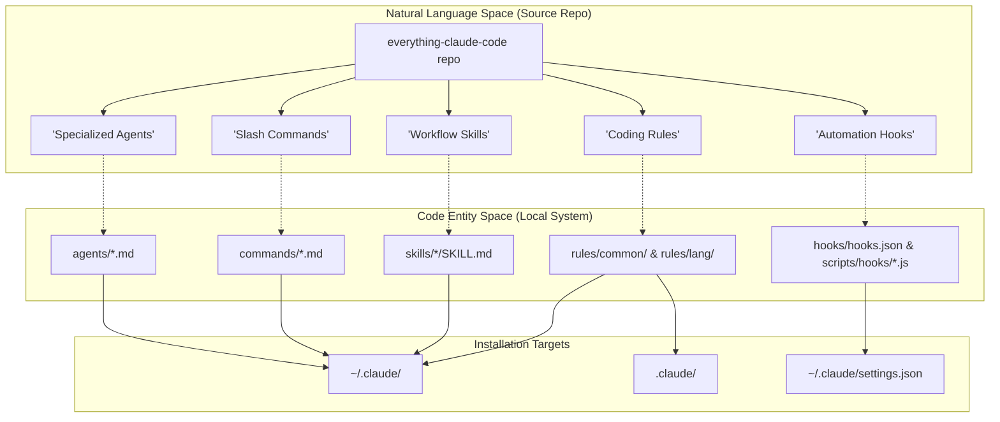
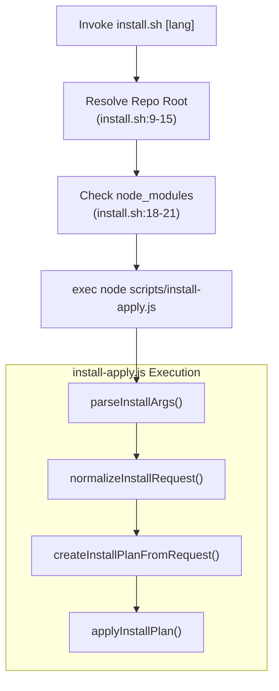

<!-- source: DeepWiki mcp.deepwiki.com · repo affaan-m/everything-claude-code · page 4.2 Manual Installation · fetched 2026-10-26 -->

# Manual Installation

<details>
<summary>Relevant source files</summary>

The following files were used as context for generating this wiki page:

- [.cursor/hooks/after-file-edit.js](.cursor/hooks/after-file-edit.js)
- [AGENTS.md](AGENTS.md)
- [README.md](README.md)
- [README.zh-CN.md](README.zh-CN.md)
- [WORKING-CONTEXT.md](WORKING-CONTEXT.md)
- [agent.yaml](agent.yaml)
- [commands/auto-update.md](commands/auto-update.md)
- [commands/jira.md](commands/jira.md)
- [docs/zh-CN/AGENTS.md](docs/zh-CN/AGENTS.md)
- [docs/zh-CN/README.md](docs/zh-CN/README.md)
- [install.ps1](install.ps1)
- [install.sh](install.sh)
- [manifests/install-modules.json](manifests/install-modules.json)
- [rules/README.md](rules/README.md)
- [rules/web/coding-style.md](rules/web/coding-style.md)
- [rules/web/design-quality.md](rules/web/design-quality.md)
- [rules/web/hooks.md](rules/web/hooks.md)
- [rules/web/patterns.md](rules/web/patterns.md)
- [rules/web/performance.md](rules/web/performance.md)
- [scripts/auto-update.js](scripts/auto-update.js)
- [skills/jira-integration/SKILL.md](skills/jira-integration/SKILL.md)
- [tests/ci/agent-yaml-surface.test.js](tests/ci/agent-yaml-surface.test.js)
- [tests/scripts/auto-update.test.js](tests/scripts/auto-update.test.js)

</details>


This document covers manual installation of Everything Claude Code (ECC) components via `git clone` and direct file copying. This method provides complete control over component selection and is essential for platforms where the plugin marketplace is unavailable or for developers who wish to selectively include agents, skills, or rules based on a specific tech stack.

For plugin marketplace installation, see [Plugin Installation](#4.1). For language-specific rules setup details, see [Rules Installation](#4.4). For guided interactive setup, see [Interactive Configuration Wizard](#4.5). For package manager configuration, see [Package Manager Configuration](#4.3).

---

## Installation Overview

Manual installation involves three stages:

1.  **Clone** — Clone the repository to your local machine.
2.  **Copy** — Selectively copy components to `~/.claude/` (global) or `.claude/` (project-specific).
3.  **Configure** — Register hooks and MCP servers in configuration files.

Two approaches are available:

| Approach | Control | Complexity | Best For |
| :--- | :--- | :--- | :--- |
| **Full Manual Copy** | Complete | High | Users who want exact component selection and custom paths. |
| **Semi-Automated (`install.sh`)** | Moderate | Low | Users who want a guided shell script with language targeting. |

---

## Prerequisites

Before beginning manual installation:

| Requirement | Verification Command | Minimum Version |
| :--- | :--- | :--- |
| Git | `git --version` | Any modern version |
| Claude Code CLI | `claude --version` | v2.1.0+ |
| Shell | `bash --version` or `pwsh --version` | Bash 4.0+ or PowerShell 7+ |
| Node.js (for hooks) | `node --version` | v18+ |

The ECC system includes a legacy shell entrypoint `install.sh` that delegates to a Node-based installer runtime `scripts/install-apply.js` [install.sh:1-32]().

---

## Component Distribution Map

The following diagram illustrates how entities from the source repository are mapped to the local system during a manual installation.

### Source to Entity Mapping

**Sources:** [rules/README.md:1-22](), [manifests/install-modules.json:1-109](), [AGENTS.md:148-157]()

---

## Method 1: Full Manual Copy

### Step 1: Clone Repository

```bash
# Clone the repository
git clone https://github.com/affaan-m/everything-claude-code.git
cd everything-claude-code

# Verify directory structure
ls -F
# agents/ commands/ skills/ rules/ hooks/ scripts/ manifests/
```

### Step 2: Copy Core Components

#### Rules
Rules must be copied while maintaining their directory structure to preserve relative references [rules/README.md:45-51](). **Important:** Do NOT flatten the directory structure with `/*` as language-specific files (e.g., `testing.md`) will overwrite common counterparts and break relative links [rules/README.md:47-51]().

```bash
# Install common rules (required)
mkdir -p ~/.claude/rules/common
cp -r rules/common/ ~/.claude/rules/common/

# Install language-specific rules (e.g., TypeScript)
mkdir -p ~/.claude/rules/typescript
cp -r rules/typescript/ ~/.claude/rules/typescript/
```
**Sources:** [rules/README.md:53-66]()

#### Agents, Skills, and Commands
While the plugin system handles these automatically, manual installation requires copying them to the global `~/.claude/` directory.

```bash
# Copy agents
cp -r agents/ ~/.claude/agents/

# Copy skills
cp -r skills/ ~/.claude/skills/

# Copy commands
cp -r commands/ ~/.claude/commands/
```
**Sources:** [AGENTS.md:148-157](), [manifests/install-modules.json:23-61]()

---

## Method 2: Semi-Automated with install.sh

The `install.sh` script (and `install.ps1` for Windows) acts as a wrapper that resolves the repository root, installs Node dependencies if missing, and delegates to the Node-based installer runtime `scripts/install-apply.js` [install.sh:9-32](), [install.ps1:10-54]().

### Logic Flow for install-apply.js

**Sources:** [install.sh:1-32](), [install.ps1:1-54](), [scripts/install-apply.js:32-53]()

### Command Options

The installer supports several targets and modes defined in the CLI argument parsing logic:

| Option | Description |
| :--- | :--- |
| `--target <id>` | Target platform: `claude`, `cursor`, `antigravity`, `codex`, `opencode`, `gemini`, `codebuddy` [manifests/install-modules.json:96-104]() |
| `--profile <name>`| Install a specific profile (e.g., `full`, `developer`, `security`) |
| `--modules <ids>` | Install specific module IDs (e.g., `rules-core`, `hooks-runtime`) [manifests/install-modules.json:3-82]() |
| `--dry-run` | Show the install plan without copying files [tests/scripts/auto-update.test.js:97-103]() |
| `--json` | Emit machine-readable plan/result JSON [tests/scripts/auto-update.test.js:98-104]() |

**Sources:** [scripts/install-apply.js:32-53](), [manifests/install-modules.json:1-109]()

### Basic Usage

```bash
# Install common rules plus TypeScript support
./install.sh typescript

# Install multiple languages at once
./install.sh typescript python golang

# Install using a specific profile (e.g., full suite)
./install.sh --profile full
```
**Sources:** [rules/README.md:30-43](), [README.zh-CN.md:132-133]()

---

## Verification and Post-Install

After installation, the installer writes an `install-state.json` file to track applied operations and enable future updates [tests/scripts/auto-update.test.js:45-52]().

### Post-Install Directory Structure
```text
~/.claude/
├── agents/            # 48 specialized sub-agents [AGENTS.md:149]()
├── commands/          # 68 slash commands [AGENTS.md:151]()
├── skills/            # 182 workflow skills [AGENTS.md:150]()
├── hooks/             # Trigger-based automation [AGENTS.md:152]()
└── rules/             # Layered rules
    ├── common/        # Agnostic principles [rules/README.md:8-16]()
    └── [language]/    # Language-specific overrides [rules/README.md:17-22]()
```

### Windows Support
On Windows, `install.ps1` handles path resolution and symlink following before invoking Node [install.ps1:10-32](). If running via MSYS2 or Git Bash, `install.sh` uses `cygpath` to convert POSIX paths to Windows-native paths for the Node.js binary [install.sh:26-30]().

**Sources:** [install.sh:26-30](), [install.ps1:10-54]()

---

