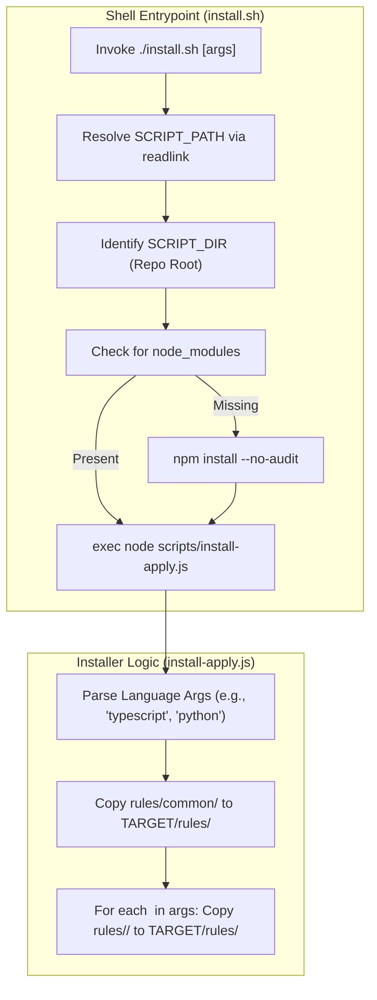
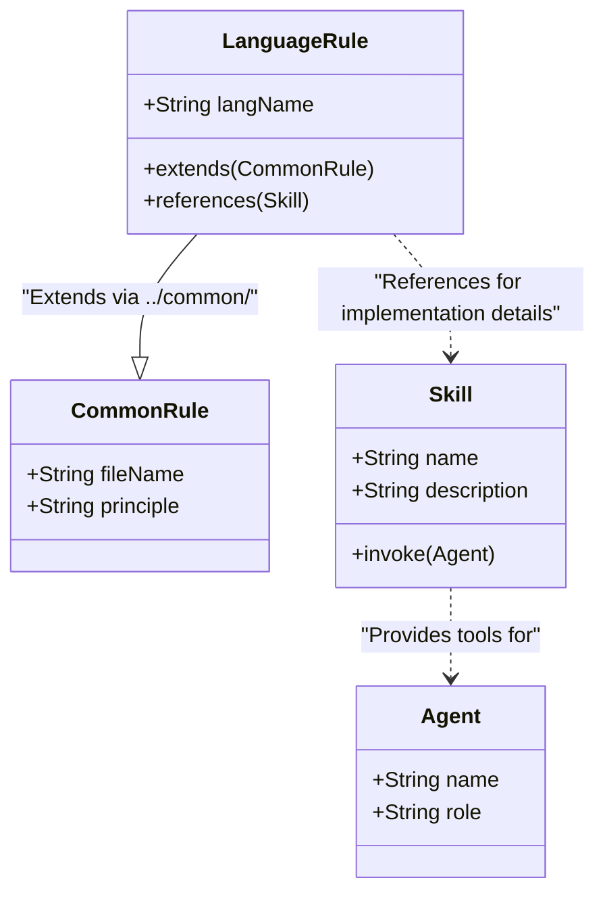

<!-- source: DeepWiki mcp.deepwiki.com · repo affaan-m/everything-claude-code · page 4.4 Rules Installation · fetched 2026-10-26 -->

# Rules Installation

<details>
<summary>Relevant source files</summary>

The following files were used as context for generating this wiki page:

- [.cursor/hooks/after-file-edit.js](.cursor/hooks/after-file-edit.js)
- [docs/ja-JP/README.md](docs/ja-JP/README.md)
- [docs/ja-JP/skills/configure-ecc/SKILL.md](docs/ja-JP/skills/configure-ecc/SKILL.md)
- [docs/ko-KR/README.md](docs/ko-KR/README.md)
- [docs/pt-BR/README.md](docs/pt-BR/README.md)
- [docs/tr/README.md](docs/tr/README.md)
- [docs/zh-CN/skills/configure-ecc/SKILL.md](docs/zh-CN/skills/configure-ecc/SKILL.md)
- [docs/zh-TW/README.md](docs/zh-TW/README.md)
- [install.ps1](install.ps1)
- [install.sh](install.sh)
- [rules/README.md](rules/README.md)
- [rules/web/coding-style.md](rules/web/coding-style.md)
- [rules/web/design-quality.md](rules/web/design-quality.md)
- [rules/web/hooks.md](rules/web/hooks.md)
- [rules/web/patterns.md](rules/web/patterns.md)
- [rules/web/performance.md](rules/web/performance.md)
- [skills/configure-ecc/SKILL.md](skills/configure-ecc/SKILL.md)
- [tests/docs/configure-ecc-install-paths.test.js](tests/docs/configure-ecc-install-paths.test.js)
- [tests/docs/install-identifiers.test.js](tests/docs/install-identifiers.test.js)

</details>


This page explains the manual rules installation requirement (due to platform limitations), language-specific rule selection, and the `install.sh` script with language targeting.

## Platform Limitation & Manual Requirement

Claude Code plugins **cannot distribute rules automatically**. This is a platform limitation: while the plugin system can distribute agents, skills, commands, and hooks via `.claude-plugin/plugin.json`, the `rules` directory must be installed manually by users to either `~/.claude/rules/` (global) or `.claude/rules/` (project-specific). [rules/README.md:45-51](), [docs/ja-JP/README.md:116-120]()

The `configure-ecc` skill provides an interactive way to handle this by guiding the user through the selection of an `INSTALL_LEVEL` (User-level, Project-level, or Both) and then executing the necessary `cp` operations. [skills/configure-ecc/SKILL.md:41-61]()

---

## Rules Directory Structure

Rules are organized into a **common** layer and **language-specific** directories.

### Implementation Hierarchy

1.  **`rules/common/`**: Contains language-agnostic principles (e.g., Git workflow, TDD philosophy, security). These are intended to be installed for every project. [rules/README.md:8-16](), [rules/README.md:25-25]()
2.  **`rules/<language>/`**: Extends common rules with framework-specific patterns, tools, and code examples. Each file in these directories explicitly references its common counterpart using relative paths like `../common/xxx.md`. [rules/README.md:17-23](), [rules/README.md:26-26](), [rules/README.md:86-89]()

### File Organization

| Directory | Purpose | Key Files |
| :--- | :--- | :--- |
| `common/` | Universal Standards | `coding-style.md`, `testing.md`, `git-workflow.md`, `agents.md`, `security.md`, `hooks.md` |
| `typescript/` | TS/JS Standards | `coding-style.md`, `patterns.md`, `hooks.md` |
| `python/` | Python Standards | `coding-style.md`, `testing.md`, `security.md` |
| `php/` | PHP Standards | `coding-style.md`, `patterns.md`, `hooks.md` |
| `golang/` | Go Standards | `coding-style.md`, `testing.md`, `patterns.md` |
| `web/` | Web/Frontend | `design-quality.md`, `performance.md`, `patterns.md` |
| `swift/` | Swift/iOS | `coding-style.md`, `testing.md`, `patterns.md` |

**Sources:** [rules/README.md:4-23](), [rules/README.md:99-100](), [docs/ja-JP/README.md:200-210]()

---

## Installation via `install.sh`

The `install.sh` (Unix) script is the recommended entrypoint for installing rules from a git clone. It acts as a wrapper that resolves the repository root and delegates execution to the Node-based installer runtime.

### Execution Flow

The script resolves the `SCRIPT_DIR` to find the repository root (supporting symlinked npm bins) and ensures `node_modules` are installed before invoking `scripts/install-apply.js`. [install.sh:9-32]()



**Sources:** [install.sh:1-32](), [rules/README.md:30-43](), [docs/ko-KR/README.md:130-133]()

---

## Language-Specific Rule Selection

Users select rules based on their project's tech stack. Language-specific rules are designed to **override** common rules when conflicts occur (specific overrides general). [rules/README.md:94-96]()

### Precedence Example: Immutability
*   `common/coding-style.md`: Recommends immutability as a default principle.
*   `golang/coding-style.md`: Overrides this for pointer receivers, which are idiomatic in Go for struct mutation. [rules/README.md:103-104]()

### Interactive Selection (`configure-ecc`)
The `configure-ecc` skill uses `AskUserQuestion` to allow users to multi-select rule sets (Common, TypeScript, Python, Go). If a user selects a language but skips Common, the skill triggers a warning about incomplete coverage. [skills/configure-ecc/SKILL.md:227-234](), [docs/ja-JP/skills/configure-ecc/SKILL.md:177-179]()

### Installation Commands
```bash
# Install common + TypeScript rules
./install.sh typescript

# Install common + multiple languages
./install.sh python golang
```
**Sources:** [rules/README.md:32-43](), [docs/ko-KR/README.md:131-133]()

---

## Manual Installation Safety

If not using the script or the `configure-ecc` skill, users must copy entire directories rather than flattening files.

### Why Flattening Fails
Language-specific directories contain files with the same names as those in `common/`. Flattening them into a single directory causes:
1.  **Overwriting**: Language-specific files overwrite the universal common rules. [rules/README.md:48-50]()
2.  **Broken References**: Language files use relative paths (e.g., `../common/coding-style.md`) to extend their counterparts. Flattening breaks these links. [rules/README.md:50-51]()

### Manual Copy Commands
```bash
# Correct Manual Approach (Preserve directory structure)
cp -r rules/common ~/.claude/rules/common
cp -r rules/typescript ~/.claude/rules/typescript
```
**Sources:** [rules/README.md:53-64]()

---

## Rules vs. Skills in Installation

During installation, it is important to distinguish between these two entities:
*   **Rules**: Define "What" to do (standards, conventions, and checklists like "80% test coverage"). They are "always-follow" guidelines. [rules/README.md:70-71]()
*   **Skills**: Define "How" to do it (actionable workflows, deep reference material like `python-patterns`). They are task-specific. [rules/README.md:71-72]()

### Extension Pattern
Language rules often reference skills. For example, a rule file might point to relevant skills to provide the implementation "How-to". [rules/README.md:73-74](), [rules/README.md:90-90]()



**Sources:** [rules/README.md:25-26](), [rules/README.md:73-74](), [skills/configure-ecc/SKILL.md:2-3](), [docs/ja-JP/skills/configure-ecc/SKILL.md:2-3]()

---

