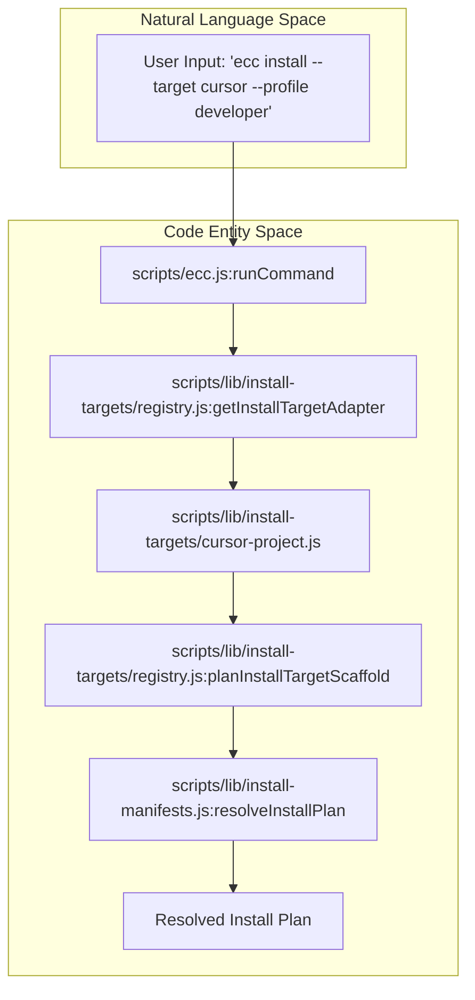
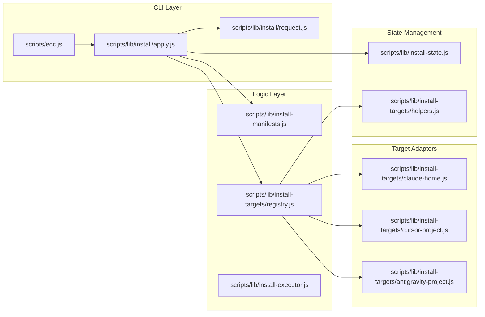

<!-- source: DeepWiki mcp.deepwiki.com · repo affaan-m/everything-claude-code · page 4.6 Selective Install System · fetched 2026-10-26 -->

# Selective Install System

Relevant source files

The following files were used as context for generating this wiki page:

- [.gemini/GEMINI.md](.gemini/GEMINI.md)
- [docs/SELECTIVE-INSTALL-ARCHITECTURE.md](docs/SELECTIVE-INSTALL-ARCHITECTURE.md)
- [manifests/install-components.json](manifests/install-components.json)
- [manifests/install-profiles.json](manifests/install-profiles.json)
- [schemas/ecc-install-config.schema.json](schemas/ecc-install-config.schema.json)
- [schemas/install-components.schema.json](schemas/install-components.schema.json)
- [schemas/install-modules.schema.json](schemas/install-modules.schema.json)
- [scripts/doctor.js](scripts/doctor.js)
- [scripts/install-apply.js](scripts/install-apply.js)
- [scripts/lib/cursor-agent-names.js](scripts/lib/cursor-agent-names.js)
- [scripts/lib/install-executor.js](scripts/lib/install-executor.js)
- [scripts/lib/install-lifecycle.js](scripts/lib/install-lifecycle.js)
- [scripts/lib/install-manifests.js](scripts/lib/install-manifests.js)
- [scripts/lib/install-state.js](scripts/lib/install-state.js)
- [scripts/lib/install-targets/antigravity-project.js](scripts/lib/install-targets/antigravity-project.js)
- [scripts/lib/install-targets/claude-home.js](scripts/lib/install-targets/claude-home.js)
- [scripts/lib/install-targets/cursor-project.js](scripts/lib/install-targets/cursor-project.js)
- [scripts/lib/install-targets/gemini-project.js](scripts/lib/install-targets/gemini-project.js)
- [scripts/lib/install-targets/helpers.js](scripts/lib/install-targets/helpers.js)
- [scripts/lib/install-targets/registry.js](scripts/lib/install-targets/registry.js)
- [scripts/lib/install/apply.js](scripts/lib/install/apply.js)
- [scripts/list-installed.js](scripts/list-installed.js)
- [scripts/repair.js](scripts/repair.js)
- [scripts/sessions-cli.js](scripts/sessions-cli.js)
- [scripts/status.js](scripts/status.js)
- [scripts/uninstall.js](scripts/uninstall.js)
- [tests/lib/install-executor.test.js](tests/lib/install-executor.test.js)
- [tests/lib/install-lifecycle.test.js](tests/lib/install-lifecycle.test.js)
- [tests/lib/install-manifests.test.js](tests/lib/install-manifests.test.js)
- [tests/lib/install-state.test.js](tests/lib/install-state.test.js)
- [tests/lib/install-targets.test.js](tests/lib/install-targets.test.js)
- [tests/lib/selective-install.test.js](tests/lib/selective-install.test.js)
- [tests/scripts/install-apply.test.js](tests/scripts/install-apply.test.js)
- [tests/scripts/install-readme-clarity.test.js](tests/scripts/install-readme-clarity.test.js)
- [tests/scripts/repair.test.js](tests/scripts/repair.test.js)
- [tests/scripts/uninstall.test.js](tests/scripts/uninstall.test.js)

The Selective Install System is the core mechanism used by the `ecc` CLI to provision Everything Claude Code (ECC) components into various AI development environments. It provides a manifest-driven approach to resolving dependencies, applying profiles, and targeting specific platforms like Claude Code, Cursor, or Antigravity.

## Overview and Manifests

The system is governed by three primary JSON manifests located in the `manifests/` directory. These manifests define the granularity of the installation, from individual file paths to high-level user profiles.

| Manifest | Purpose | Key Entity |
| :--- | :--- | :--- |
| `install-modules.json` | Defines atomic units of functionality, their file paths, and target compatibility. | `Module` [scripts/lib/install-manifests.js:205-214]() |
| `install-components.json` | Groups modules into logical features (e.g., `lang:typescript`, `capability:security`). | `Component` [manifests/install-components.json:3-230]() |
| `install-profiles.json` | High-level presets that bundle multiple modules for specific use cases. | `Profile` [scripts/lib/install-manifests.js:198-202]() |

### Module Resolution Logic
Modules are the building blocks of the system. Each module defines its `kind` (e.g., rules, agents, skills), the source `paths` it manages, and which `targets` it can be installed into [scripts/lib/install-manifests.js:205-214](). The `resolveInstallPlan` function processes these manifests to determine the final set of files to be deployed based on user input, handling dependency expansion and target-specific skips [scripts/lib/install-manifests.js:104-157]().

**Sources:** [scripts/lib/install-manifests.js:154-194](), [manifests/install-components.json:1-230](), [tests/lib/install-manifests.test.js:54-81]()

## Installation Profiles

Profiles allow users to install curated sets of ECC functionality without manually selecting dozens of modules. Profiles are defined in `install-profiles.json` and resolved by the `listInstallProfiles` function [scripts/lib/install-manifests.js:196-203]().

*   **`core`**: Minimal baseline with rules, agents, and commands [scripts/lib/install-manifests.js:16-24]().
*   **`developer`**: The default engineering profile, adding framework-language skills.
*   **`security`**: Focuses on security-specific guidance and review agents [manifests/install-components.json:125-131]().
*   **`research`**: Optimized for investigation, synthesis, and publishing workflows [manifests/install-components.json:133-139]().
*   **`full`**: Installs every classified module in the ECC repository [tests/lib/install-manifests.test.js:64-64]().

**Sources:** [scripts/lib/install-manifests.js:16-38](), [tests/lib/install-manifests.test.js:61-65](), [manifests/install-components.json:117-179]()

## Install Targets and Adapters

The system uses a "Target Adapter" pattern to handle structural differences between AI tools. Each adapter defines where files should be placed and how they should be named.

### Supported Targets
1.  **`claude`**: Targets the Anthropic Claude Code CLI. Installs into `~/.claude/` [scripts/lib/install-targets/helpers.js:6-6]().
2.  **`cursor`**: Targets the Cursor IDE. Installs into `.cursor/` and renames rules to `.mdc` [scripts/lib/install-targets/cursor-project.js:11-27]().
3.  **`antigravity`**: Targets the Antigravity agent harness. Installs into `.agent/` [tests/scripts/install-apply.test.js:174-175]().
4.  **`codex` / `opencode`**: Specialized targets for Codex CLI and OpenCode environments [scripts/lib/install-targets/registry.js:4-7]().
5.  **`gemini`**: Targets Gemini CLI, installing into `.gemini/` [scripts/lib/install-targets/registry.js:6-6]().
6.  **`codebuddy`**: Targets CodeBuddy IDE, installing into `.codebuddy/` [scripts/lib/install-targets/registry.js:3-3]().

### Data Flow: Target Resolution
The following diagram illustrates how the `ecc` CLI resolves a request into a platform-specific installation plan.

**Target Resolution Flow**

**Sources:** [scripts/ecc.js:148-186](), [scripts/lib/install-targets/registry.js:23-31](), [scripts/lib/install-manifests.js:4-15](), [scripts/lib/install-targets/cursor-project.js:21-27]()

## CLI Command Reference

The `ecc` CLI acts as a central orchestrator for installation and lifecycle management [scripts/ecc.js:7-52]().

### Primary Commands
*   **`ecc install`**: Executes the installation. It supports a "Legacy Compatibility" mode (e.g., `ecc typescript`) which automatically selects `framework-language` [scripts/ecc.js:131-146]().
*   **`ecc plan`**: Previews what would be installed. It lists resolved modules and operations without modifying the filesystem [scripts/ecc.js:12-15]().
*   **`ecc catalog`**: Discovers install profiles and component IDs [scripts/catalog.js:1-10]().
*   **`ecc doctor`**: Diagnoses the current installation by checking for missing or drifted files [scripts/doctor.js:1-10]().
*   **`ecc repair`**: Restores files that `doctor` identified as drifted or missing [scripts/repair.js:1-10]().
*   **`ecc status`**: Queries the ECC SQLite state store status summary [scripts/status.js:1-10]().
*   **`ecc sessions`**: Lists or inspects ECC sessions from the SQLite state store [scripts/sessions-cli.js:1-10]().
*   **`ecc uninstall`**: Removes all ECC-managed files recorded in the install state [scripts/uninstall.js:1-10]().

### Dry-Run Mode
The system supports a `--dry-run` flag. When enabled, the system generates the full `install-state` and operation list but skips filesystem writes [tests/scripts/install-apply.test.js:76-76]().

**Sources:** [scripts/ecc.js:54-65](), [tests/scripts/ecc.test.js:64-103](), [scripts/lib/install/apply.js:124-157]()

## Implementation Details

### Install State Persistence
The system maintains an `ecc-install-state.json` (or target-specific variant) within the target's root directory. This file tracks the original request, resolution details, and every file operation performed [scripts/lib/install/apply.js:151-151]().

### Scaffold Strategies
The `planInstallTargetScaffold` function [scripts/lib/install-targets/registry.js:33-64]() determines how files are copied:
*   **`flatten-copy`**: Flattens nested directory structures into a single folder, used for Cursor and Antigravity rules to avoid collisions. For example, `rules/common/coding-style.md` becomes `rules/common-coding-style.mdc` for Cursor [scripts/lib/install-targets/helpers.js:184-224]().
*   **`preserve-relative-path`**: Maintains the original directory hierarchy, used for scripts and hooks [scripts/lib/install-targets/helpers.js:82-102]().

### MCP and Hook Configuration
For the `claude` target, the installer resolves placeholders like `${CLAUDE_PLUGIN_ROOT}` in `hooks.json` [scripts/lib/install/apply.js:56-79](). It also filters MCP configurations based on the `ECC_DISABLED_MCPS` environment variable during the application phase, specifically handling `merge-json` operations for `mcp.json` files [scripts/lib/install/apply.js:125-143]().

### System Architecture Diagram
The relationship between the CLI, manifest resolution, and filesystem adapters is shown below.

**Selective Install Architecture**

**Sources:** [scripts/ecc.js:148-186](), [scripts/lib/install/apply.js:118-170](), [scripts/lib/install-targets/registry.js:1-17](), [scripts/lib/install-manifests.js:4-15]()

---

