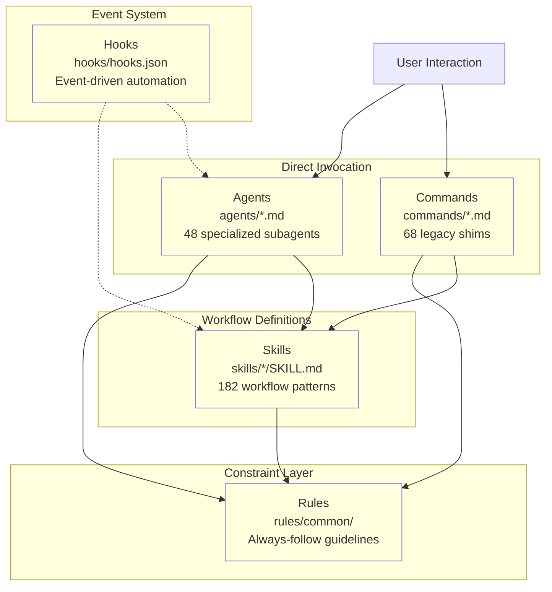
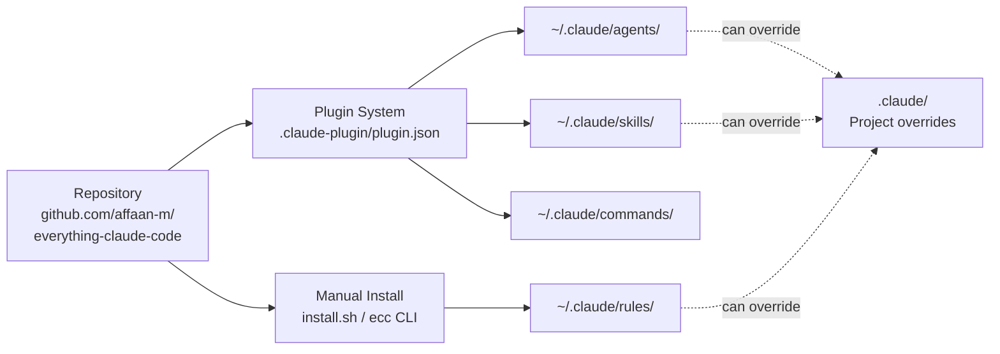
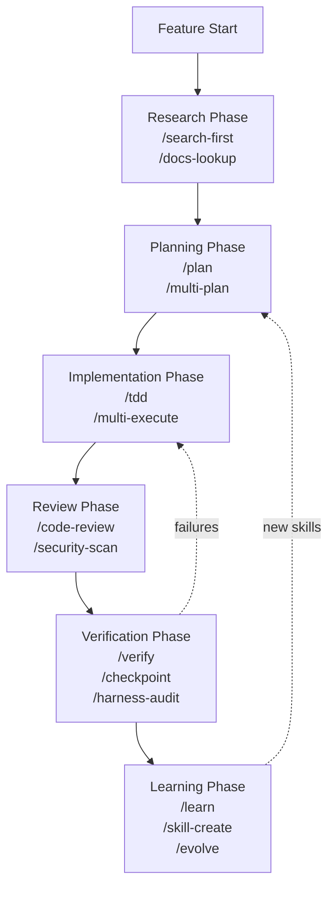
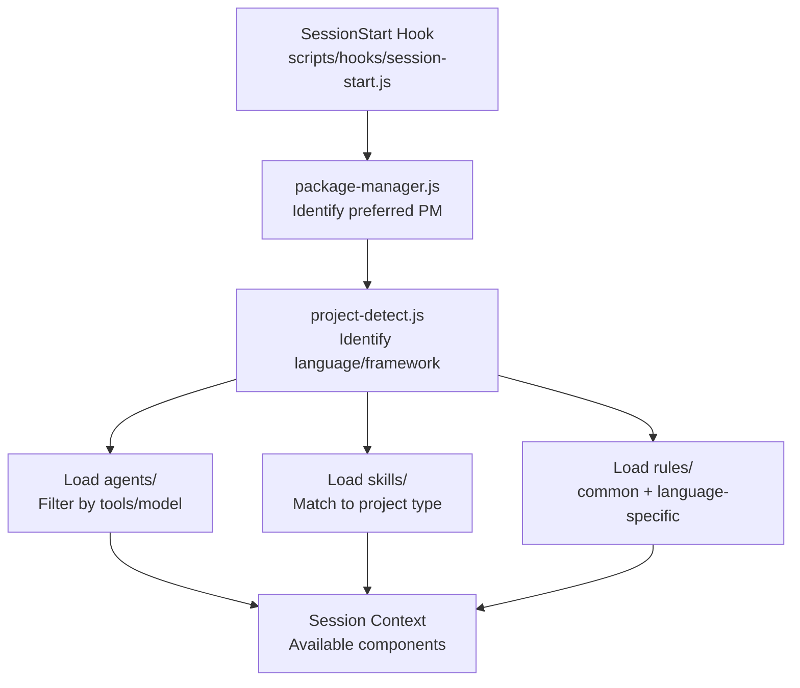

<!-- source: DeepWiki mcp.deepwiki.com · repo affaan-m/everything-claude-code · page 5 Component Reference · fetched 2026-10-26 -->

# Component Reference

Relevant source files

The following files were used as context for generating this wiki page:

- [AGENTS.md](AGENTS.md)
- [README.md](README.md)
- [README.zh-CN.md](README.zh-CN.md)
- [WORKING-CONTEXT.md](WORKING-CONTEXT.md)
- [agent.yaml](agent.yaml)
- [agents/architect.md](agents/architect.md)
- [agents/build-error-resolver.md](agents/build-error-resolver.md)
- [agents/code-reviewer.md](agents/code-reviewer.md)
- [agents/database-reviewer.md](agents/database-reviewer.md)
- [agents/doc-updater.md](agents/doc-updater.md)
- [agents/e2e-runner.md](agents/e2e-runner.md)
- [agents/planner.md](agents/planner.md)
- [agents/python-reviewer.md](agents/python-reviewer.md)
- [agents/security-reviewer.md](agents/security-reviewer.md)
- [commands/auto-update.md](commands/auto-update.md)
- [commands/jira.md](commands/jira.md)
- [docs/zh-CN/AGENTS.md](docs/zh-CN/AGENTS.md)
- [docs/zh-CN/README.md](docs/zh-CN/README.md)
- [examples/django-api-CLAUDE.md](examples/django-api-CLAUDE.md)
- [examples/saas-nextjs-CLAUDE.md](examples/saas-nextjs-CLAUDE.md)
- [manifests/install-modules.json](manifests/install-modules.json)
- [scripts/auto-update.js](scripts/auto-update.js)
- [scripts/setup-package-manager.js](scripts/setup-package-manager.js)
- [skills/cpp-testing/SKILL.md](skills/cpp-testing/SKILL.md)
- [skills/e2e-testing/SKILL.md](skills/e2e-testing/SKILL.md)
- [skills/jira-integration/SKILL.md](skills/jira-integration/SKILL.md)
- [skills/postgres-patterns/SKILL.md](skills/postgres-patterns/SKILL.md)
- [tests/ci/agent-yaml-surface.test.js](tests/ci/agent-yaml-surface.test.js)
- [tests/scripts/auto-update.test.js](tests/scripts/auto-update.test.js)

This page provides a comprehensive reference for all components in the Everything Claude Code (ECC) system. Components are the building blocks that extend AI agent capabilities: **agents** (specialized subagents), **skills** (workflow definitions), **commands** (slash commands), and **rules** (always-follow guidelines).

As of version `2.0.0-rc.1`, the system has evolved into a production-ready optimization layer for AI agent harnesses, featuring **48 agents**, **182 skills**, and **68 legacy command shims** [[README.md:92-93]]() [[WORKING-CONTEXT.md:13]]().

For detailed documentation of specific components, see:
- Agent specifications and configurations: [Agent Reference](#5.1)
- Skill workflow definitions: [Skills Reference](#5.2)
- Command usage and examples: [Command Reference](#5.3)
- Rules structure and guidelines: [Rules Reference](#5.4)

For information about how components are installed and distributed, see [Installation & Setup](#4). For component interaction patterns, see [Development Workflows](#10).

---

## Component Architecture

The ECC system organizes components into four primary types. The architecture is "Agent-First," prioritizing the delegation of domain-specific tasks to specialized subagents [[AGENTS.md:9]]().

**Component Type Hierarchy**

Sources: [[AGENTS.md:7-13]](), [[README.md:92-93]](), [[WORKING-CONTEXT.md:13]]()

---

## Component Organization

### File System Mapping

Components are distributed across the repository and mapped to specific installation targets. ECC supports multiple platforms including Claude Code, Cursor, OpenCode, and Codex [[README.md:39-41]]().

| Component Type | Repository Location | Installation Target | Count (v2.0.0-rc.1) |
|---------------|-------------------|-------------------|-------|
| **Agents** | `agents/*.md` | `~/.claude/agents/` | 48 |
| **Skills** | `skills/*/SKILL.md` | `~/.claude/skills/` | 182 |
| **Commands** | `commands/*.md` | `~/.claude/commands/` | 68 |
| **Rules** | `rules/common/`, `rules/{lang}/` | `~/.claude/rules/` | 12 ecosystems |
| **Hooks** | `hooks/hooks.json` | `~/.claude/hooks.json` | 8 event types |
| **Hook Scripts** | `scripts/hooks/*.js` | Executed by hooks | 20+ scripts |

**Component Distribution Flow**

Sources: [[AGENTS.md:148-157]](), [[manifests/install-modules.json:4-109]](), [[agent.yaml:1-144]]()

---

## Component Taxonomy

### Agents by Function

Agents are specialized subagents that handle delegated tasks. Each agent is defined in a Markdown file with a YAML frontmatter specifying its configuration (e.g., `agents/database-reviewer.md`) [[agents/database-reviewer.md:1-6]]().

| Category | Examples | Primary Model |
|----------|----------|--------------|
| **Planning & Architecture** | `planner`, `architect` | Opus |
| **Development** | `tdd-guide`, `build-error-resolver`, `pytorch-build-resolver` | Sonnet |
| **Quality & Security** | `code-reviewer`, `security-reviewer`, `typescript-reviewer` | Opus/Sonnet |
| **Autonomous Ops** | `loop-operator`, `harness-optimizer` | Sonnet |
| **Language-Specific** | `rust-reviewer`, `go-reviewer`, `java-reviewer`, `kotlin-reviewer` | Sonnet/Opus |

**Agent Definition Example**
Agents like `database-reviewer` specify tools like `Read`, `Write`, and `Bash` to perform specialized audits [[agents/database-reviewer.md:4]]().

Sources: [[AGENTS.md:15-44]](), [[agents/database-reviewer.md:1-6]]()

### Skills by Domain

Skills are the canonical workflow surface in ECC [[AGENTS.md:121]](). They are organized into modules for selective installation via the `install-modules.json` manifest [[manifests/install-modules.json:110-266]]().

| Category | Examples |
|----------|----------|
| **Framework & Language** | `nestjs-patterns`, `cpp-testing`, `dart-flutter-patterns` |
| **Database** | `postgres-patterns`, `clickhouse-io`, `jpa-patterns` |
| **Workflow & Quality** | `tdd-workflow`, `verification-loop`, `plankton-code-quality` |
| **Learning & Automation** | `continuous-learning-v2`, `autonomous-loops`, `skill-stocktake` |
| **Security** | `security-scan`, `defi-amm-security`, `hipaa-compliance` |
| **Operational** | `google-workspace-ops`, `customer-billing-ops`, `project-flow-ops` |

Sources: [[AGENTS.md:121]](), [[README.md:92-95]](), [[manifests/install-modules.json:110-266]]()

### Commands by Workflow Phase

Commands serve as legacy slash-entry compatibility shims that invoke agents and skills [[AGENTS.md:123]]().

**Development Lifecycle Command Map**

| Phase | Key Commands | Primary Agent |
|-------|--------------|---------------|
| **Planning** | `/plan`, `/multi-plan` | `planner` |
| **Implementation** | `/tdd`, `/multi-execute`, `/multi-backend` | `tdd-guide` |
| **Review** | `/code-review`, `/security-scan`, `/typescript-review` | `code-reviewer` |
| **Verification** | `/verify`, `/checkpoint`, `/harness-audit` | `build-error-resolver` |
| **Learning** | `/skill-create`, `/evolve`, `/instinct-status` | `loop-operator` |

Sources: [[AGENTS.md:46-55]](), [[README.md:92-95]](), [[agent.yaml:145-213]]()

### Rules Hierarchy

Rules are always-follow guidelines organized by language and common principles [[manifests/install-modules.json:5-21]]().

| Scope | Location | Purpose |
|-------|----------|---------|
| **Common** | `rules/common/` | Language-agnostic principles (TDD, Security, Immutability) [[AGENTS.md:7-13]]() |
| **TypeScript** | `rules/typescript/` | TS/JS patterns and ESM/CJS standards [[AGENTS.md:44]]() |
| **Java/Kotlin** | `rules/java/`, `rules/kotlin/` | JVM standards, Maven/Gradle, and Coroutines [[AGENTS.md:33-38]]() |
| **Rust/Go** | `rules/rust/`, `rules/golang/` | Concurrency patterns and idiomatic safety [[AGENTS.md:31-43]]() |

Sources: [[AGENTS.md:153]](), [[README.md:101-102]](), [[manifests/install-modules.json:5-21]]()

---

## Component Discovery and Loading

**Runtime Component Resolution**

Sources: [[README.md:185-194]](), [[scripts/setup-package-manager.js:15-23]](), [[WORKING-CONTEXT.md:92-105]]()

---

## Component Validation

All components are validated in CI to ensure structural integrity and metadata accuracy.

| Validator | Target | Checks |
|-----------|--------|--------|
| `validate-agents.js` | `agents/*.md` | YAML frontmatter, model IDs, tool permissions |
| `validate-skills.js` | `skills/*/SKILL.md` | Frontmatter, evidence sections, path resolution |
| `validate-commands.js` | `commands/*.md` | Markdown format, usage examples, agent shims |
| `agent-yaml-surface.test.js` | `agent.yaml` | Syncs documentation counts with file system [[tests/ci/agent-yaml-surface.test.js:1-10]]() |

Sources: [[WORKING-CONTEXT.md:13]](), [[WORKING-CONTEXT.md:95-97]](), [[tests/ci/agent-yaml-surface.test.js:1-10]]()

---

For detailed documentation of individual components, navigate to the appropriate sub-page:
- [Agent Reference](#5.1) — All 48 agents with tools, models, and purposes
- [Skills Reference](#5.2) — All 182 skills organized by category
- [Command Reference](#5.3) — All 68 legacy commands with usage examples
- [Rules Reference](#5.4) — Common and language-specific rules documentation

---

