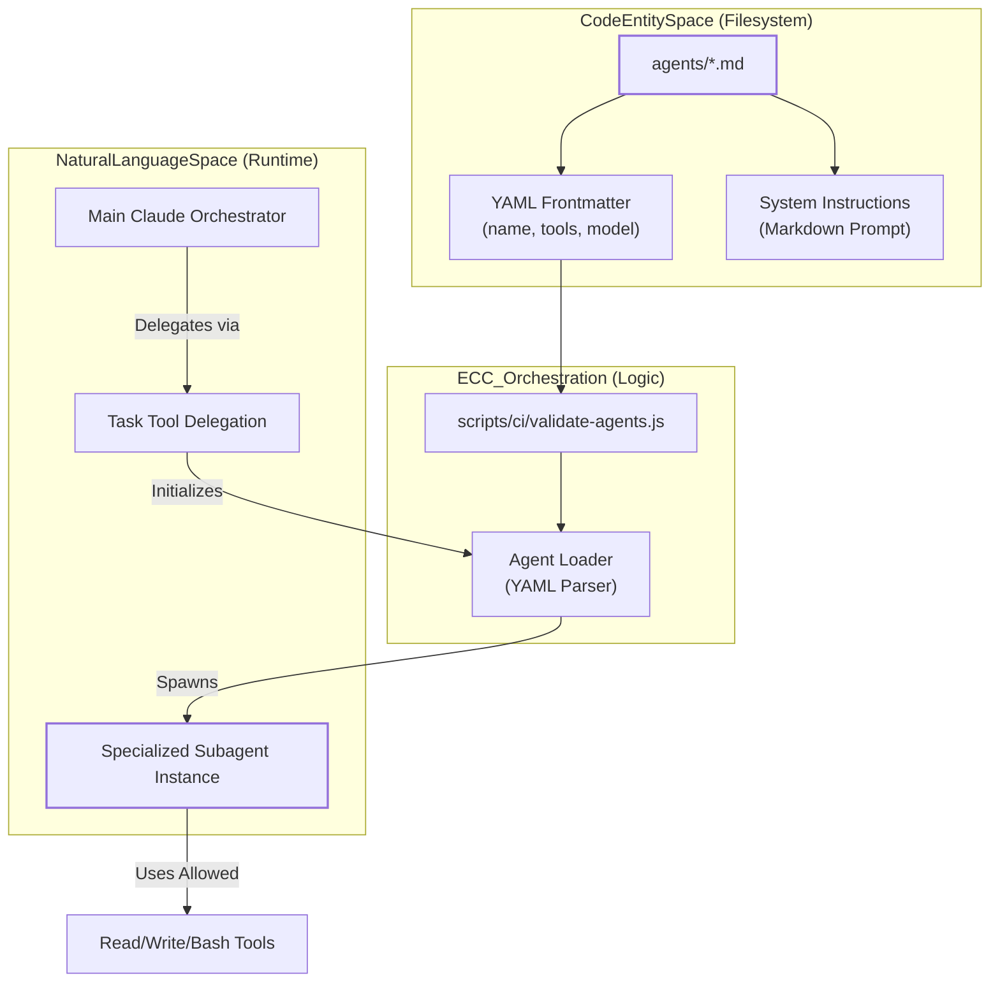
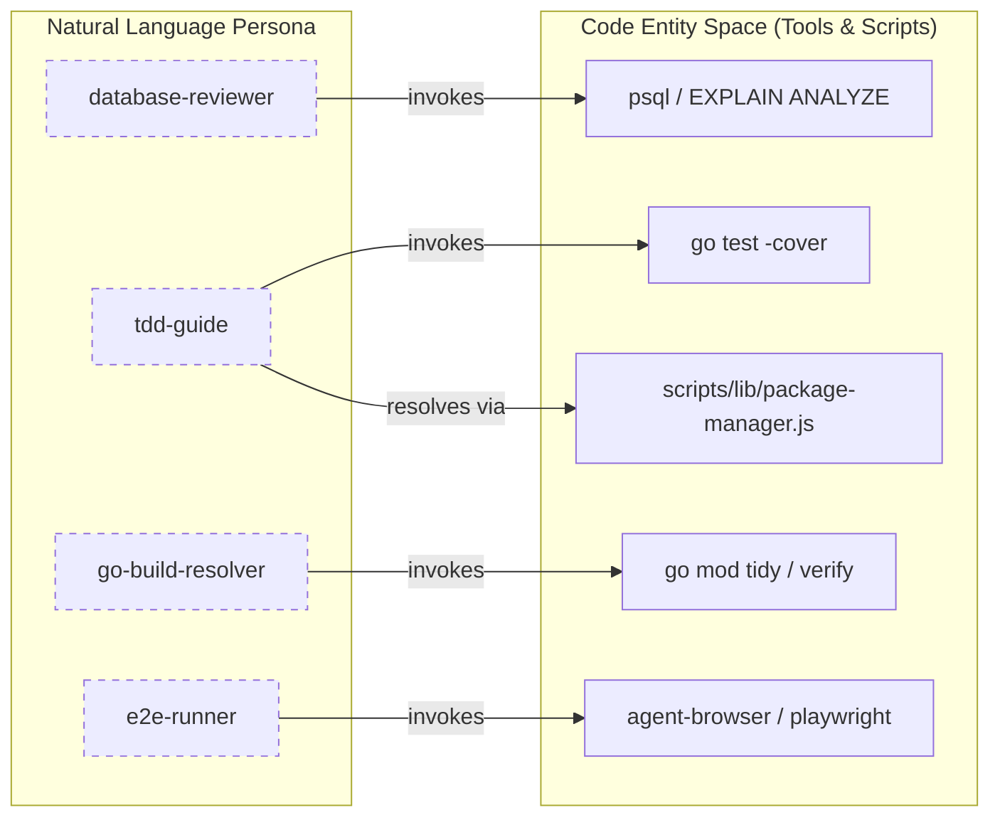

<!-- source: DeepWiki mcp.deepwiki.com · repo affaan-m/everything-claude-code · page 5.1 Agent Reference · fetched 2026-10-26 -->

# Agent Reference

<details>
<summary>Relevant source files</summary>

The following files were used as context for generating this wiki page:

- [agents/architect.md](agents/architect.md)
- [agents/build-error-resolver.md](agents/build-error-resolver.md)
- [agents/code-reviewer.md](agents/code-reviewer.md)
- [agents/database-reviewer.md](agents/database-reviewer.md)
- [agents/doc-updater.md](agents/doc-updater.md)
- [agents/e2e-runner.md](agents/e2e-runner.md)
- [agents/go-build-resolver.md](agents/go-build-resolver.md)
- [agents/go-reviewer.md](agents/go-reviewer.md)
- [agents/kotlin-reviewer.md](agents/kotlin-reviewer.md)
- [agents/planner.md](agents/planner.md)
- [agents/python-reviewer.md](agents/python-reviewer.md)
- [agents/refactor-cleaner.md](agents/refactor-cleaner.md)
- [agents/security-reviewer.md](agents/security-reviewer.md)
- [agents/tdd-guide.md](agents/tdd-guide.md)
- [commands/go-build.md](commands/go-build.md)
- [commands/go-review.md](commands/go-review.md)
- [commands/go-test.md](commands/go-test.md)
- [commands/gradle-build.md](commands/gradle-build.md)
- [examples/django-api-CLAUDE.md](examples/django-api-CLAUDE.md)
- [examples/saas-nextjs-CLAUDE.md](examples/saas-nextjs-CLAUDE.md)
- [rules/kotlin/coding-style.md](rules/kotlin/coding-style.md)
- [rules/kotlin/patterns.md](rules/kotlin/patterns.md)
- [rules/kotlin/security.md](rules/kotlin/security.md)
- [rules/kotlin/testing.md](rules/kotlin/testing.md)
- [scripts/setup-package-manager.js](scripts/setup-package-manager.js)
- [skills/android-clean-architecture/SKILL.md](skills/android-clean-architecture/SKILL.md)
- [skills/compose-multiplatform-patterns/SKILL.md](skills/compose-multiplatform-patterns/SKILL.md)
- [skills/cpp-testing/SKILL.md](skills/cpp-testing/SKILL.md)
- [skills/e2e-testing/SKILL.md](skills/e2e-testing/SKILL.md)
- [skills/golang-patterns/SKILL.md](skills/golang-patterns/SKILL.md)
- [skills/golang-testing/SKILL.md](skills/golang-testing/SKILL.md)
- [skills/kotlin-coroutines-flows/SKILL.md](skills/kotlin-coroutines-flows/SKILL.md)
- [skills/postgres-patterns/SKILL.md](skills/postgres-patterns/SKILL.md)

</details>


This page provides a comprehensive reference for all agents in the Everything Claude Code (ECC) system. Agents are specialized subagents that handle delegated tasks with constrained scope, specific tool permissions, and model configurations optimized for their workload.

---

## What Are Agents?

Agents in ECC are Markdown files containing YAML frontmatter, typically stored in the `agents/` directory. Each agent is a "domain specialist" designed to be used proactively by the main orchestrator or via slash commands.

**Core Agent Characteristics:**
- **Constrained Scope**: Focused on a specific task type (e.g., `tdd-guide` for testing, `database-reviewer` for SQL optimization). [agents/tdd-guide.md:2-3](), [agents/database-reviewer.md:2-3]()
- **Tool Permissions**: Explicit allow-list of tools (e.g., `Read`, `Write`, `Edit`, `Bash`, `Grep`, `Glob`). [agents/doc-updater.md:4](), [agents/code-reviewer.md:4]()
- **Model Configuration**: Defaults to `sonnet` for reasoning and surgical fixes, or `haiku` for high-speed documentation and analysis tasks. [agents/doc-updater.md:5](), [agents/code-reviewer.md:5]()
- **System Prompt**: Detailed instructions in the Markdown body defining the agent's persona, diagnostic commands, and quality checklists. [agents/e2e-runner.md:8-10](), [agents/database-reviewer.md:10-20]()

**Sources:** [agents/database-reviewer.md:1-6](), [agents/doc-updater.md:1-6](), [agents/tdd-guide.md:1-6](), [agents/code-reviewer.md:1-6](), [agents/e2e-runner.md:1-6]()

---

## Agent Architecture & Data Flow

The following diagram illustrates how an agent definition in the "Code Entity Space" (the `.md` files) translates into an active execution unit in the "Natural Language Space" (the conversation).

**Agent Execution Pipeline**



**Sources:** [scripts/ci/validate-agents.js:9-12](), [agents/e2e-runner.md:1-6](), [agents/database-reviewer.md:1-6](), [agents/doc-updater.md:1-6]()

---

## Agent YAML Configuration Reference

All agents follow a standardized frontmatter schema, validated by CI scripts. [scripts/ci/validate-agents.js:10-11]()

```yaml
---
name: agent-identifier      # kebab-case name used for invocation
description: purpose string # Used by the main agent to decide when to delegate
tools: ["Read", "Bash"]     # Allowed Claude Code tools
model: sonnet               # haiku | sonnet | opus
---
```

### Tool Permission Patterns
- **Analyst (Read-Only)**: `["Read", "Grep", "Glob", "Bash"]` — Used for reviews where no code changes should occur, such as `code-reviewer` or `go-reviewer`. [agents/code-reviewer.md:4](), [agents/go-reviewer.md:4]()
- **Implementer (Write)**: `["Read", "Write", "Edit", "Grep", "Glob"]` — Used for documentation updates or specific file edits. [agents/doc-updater.md:4]()
- **Operator (Full)**: `["Read", "Write", "Edit", "Bash", "Grep", "Glob"]` — Used by agents that must run build systems or test runners, like `database-reviewer`, `e2e-runner`, or `go-build-resolver`. [agents/database-reviewer.md:4](), [agents/e2e-runner.md:4](), [agents/go-build-resolver.md:4]()

**Sources:** [agents/database-reviewer.md:1-6](), [agents/e2e-runner.md:1-6](), [agents/doc-updater.md:1-6](), [agents/go-reviewer.md:1-6](), [agents/go-build-resolver.md:1-6]()

---

## Core Agents Reference

The system includes specialized agents for different phases of the software development lifecycle and specific language ecosystems.

### Planning & Architecture

| Agent | Model | Primary Tools | Purpose |
|-------|-------|---------------|---------|
| `planner` | `sonnet` | Read, Grep, Glob | Implementation planning, breaking features into phases. [agents/planner.md:1-6]() |
| `architect` | `sonnet` | Read, Grep, Glob | System design and high-level tech decisions. [agents/architect.md:1-6]() |
| `doc-updater` | `haiku` | Read, Write, Edit | Updates READMEs and codemaps (docs/CODEMAPS/*). [agents/doc-updater.md:1-6]() |

### Quality & Testing

| Agent | Model | Primary Tools | Purpose |
|-------|-------|---------------|---------|
| `tdd-guide` | `sonnet` | Full Access | Enforces RED → GREEN → REFACTOR workflow. [agents/tdd-guide.md:18-35]() |
| `code-reviewer` | `sonnet` | Read, Grep, Glob | Reviews code for quality, security, and React/Node patterns. [agents/code-reviewer.md:1-6]() |
| `database-reviewer`| `sonnet` | Full Access | PostgreSQL specialist for query optimization and RLS. [agents/database-reviewer.md:1-6]() |
| `e2e-runner` | `sonnet` | Full Access | Manages Playwright/Agent Browser E2E journeys. [agents/e2e-runner.md:1-10]() |
| `security-reviewer` | `sonnet` | Read, Grep, Glob | Focused on vulnerabilities like SQLi, XSS, and path traversal. [agents/security-reviewer.md:1-6]() |

### Language & Build Specialists

| Agent | Model | Primary Tools | Purpose |
|-------|-------|---------------|---------|
| `go-reviewer` | `sonnet` | Read, Grep, Glob | Expert Go reviewer for idiomatic code and concurrency. [agents/go-reviewer.md:1-6]() |
| `go-build-resolver`| `sonnet` | Full Access | Surgical resolution of Go compilation and `go vet` errors. [agents/go-build-resolver.md:1-6]() |
| `kotlin-reviewer` | `sonnet` | Read, Grep, Glob | Expert Kotlin/KMP reviewer for Coroutines and Compose. [agents/kotlin-reviewer.md:1-6]() |
| `python-reviewer` | `sonnet` | Read, Grep, Glob | Expert Python reviewer for PEP8, async, and type hinting. [agents/python-reviewer.md:1-6]() |
| `build-error-resolver`| `sonnet` | Full Access | General specialist for diagnosing and fixing build/type failures. [agents/build-error-resolver.md:1-6]() |

**Sources:** [agents/database-reviewer.md:1-6](), [agents/doc-updater.md:1-6](), [agents/tdd-guide.md:1-6](), [agents/go-reviewer.md:1-6](), [agents/go-build-resolver.md:1-6](), [agents/kotlin-reviewer.md:1-6]()

---

## Agent-Specific Workflows

### Test-Driven Development (`tdd-guide`)
This agent enforces a strict "tests-before-code" methodology to ensure 80%+ coverage. [agents/tdd-guide.md:3-14]()
- **Workflow**: Red (Write failing test) → Green (Minimal implementation) → Refactor (Improve code). [agents/tdd-guide.md:18-35]()
- **Go Specifics**: Leverages `/go-test` to enforce table-driven test patterns and coverage checks. [commands/go-test.md:9-16]()

### Database Reviewer (`database-reviewer`)
Specializes in PostgreSQL and Supabase patterns. [agents/database-reviewer.md:10]()
- **Diagnostics**: Uses `pg_stat_statements` to find slow queries and `EXPLAIN ANALYZE` for plan analysis. [agents/database-reviewer.md:21-28]()
- **Security**: Enforces Row Level Security (RLS) with indexed policy columns and least privilege. [agents/database-reviewer.md:43-48]()

### Documentation Specialist (`doc-updater`)
Focused on keeping architectural maps and READMEs current. [agents/doc-updater.md:10]()
- **Codemaps**: Generates structural documentation under `docs/CODEMAPS/` using AST analysis. [agents/doc-updater.md:28-50]()
- **Tools**: Utilizes `scripts/codemaps/generate.ts` and `madge` for dependency mapping. [agents/doc-updater.md:22-24]()

### Go Build Resolver (`go-build-resolver`)
Focused on surgical fixes for Go projects. [agents/go-build-resolver.md:10]()
- **Workflow**: Runs `go build`, `go vet`, and `staticcheck` to parse error messages before applying minimal changes. [agents/go-build-resolver.md:21-31]()
- **Module Troubleshooting**: Uses `go mod why` and `go mod tidy` to resolve dependency conflicts. [agents/go-build-resolver.md:61-66]()

**Sources:** [agents/tdd-guide.md:18-41](), [agents/database-reviewer.md:12-19](), [agents/go-build-resolver.md:33-42](), [commands/go-test.md:27-34]()

---

## Agent Invocation & Tool Usage

The following diagram maps how the high-level Agent personas interact with specific CLI tools and libraries within the codebase.

**Natural Language to Code Entity Mapping**



**Sources:** [agents/database-reviewer.md:23-28](), [commands/go-test.md:217-232](), [agents/go-build-resolver.md:24-31](), [agents/e2e-runner.md:25-36](), [scripts/lib/package-manager.js:15-23]()

---

