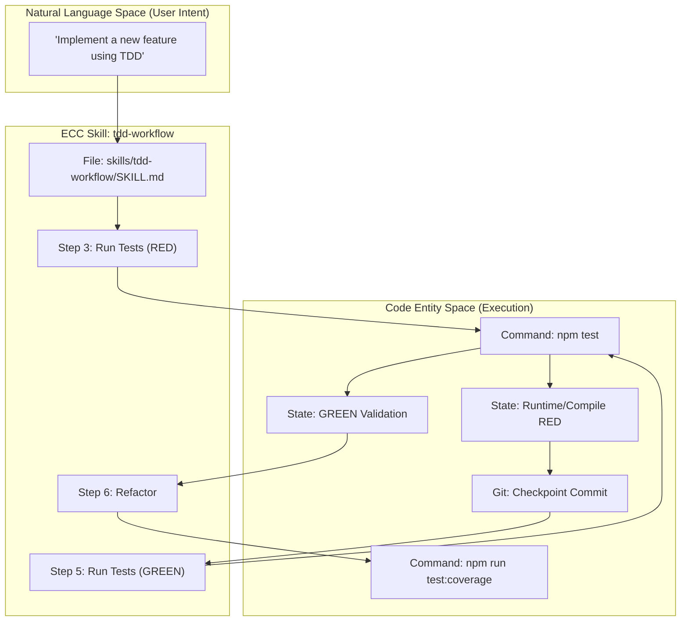
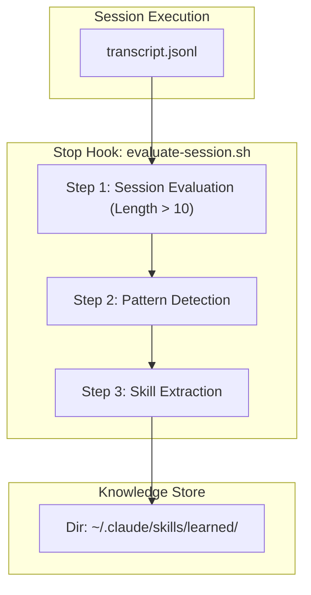

<!-- source: DeepWiki mcp.deepwiki.com · repo affaan-m/everything-claude-code · page 5.2 Skills Reference · fetched 2026-10-26 -->

# Skills Reference

Relevant source files

The following files were used as context for generating this wiki page:

- [examples/user-CLAUDE.md](examples/user-CLAUDE.md)
- [skills/agent-eval/SKILL.md](skills/agent-eval/SKILL.md)
- [skills/autonomous-loops/SKILL.md](skills/autonomous-loops/SKILL.md)
- [skills/backend-patterns/SKILL.md](skills/backend-patterns/SKILL.md)
- [skills/clickhouse-io/SKILL.md](skills/clickhouse-io/SKILL.md)
- [skills/coding-standards/SKILL.md](skills/coding-standards/SKILL.md)
- [skills/continuous-learning/SKILL.md](skills/continuous-learning/SKILL.md)
- [skills/django-verification/SKILL.md](skills/django-verification/SKILL.md)
- [skills/eval-harness/SKILL.md](skills/eval-harness/SKILL.md)
- [skills/frontend-patterns/SKILL.md](skills/frontend-patterns/SKILL.md)
- [skills/iterative-retrieval/SKILL.md](skills/iterative-retrieval/SKILL.md)
- [skills/plankton-code-quality/SKILL.md](skills/plankton-code-quality/SKILL.md)
- [skills/security-review/SKILL.md](skills/security-review/SKILL.md)
- [skills/tdd-workflow/SKILL.md](skills/tdd-workflow/SKILL.md)

This page provides a comprehensive reference for all skills available in the Everything Claude Code (ECC) system. Skills are codified workflow definitions and domain knowledge packages that guide Claude through specific development patterns, coding standards, and technical implementations.

## Skill Architecture

Skills are implemented as Markdown files with YAML frontmatter. This structure allows them to be both human-readable and machine-parseable by the ECC system.

### Skill Metadata (Frontmatter)
Each skill contains a header that defines its identity and scope:
- `name`: Unique identifier for the skill. [skills/tdd-workflow/SKILL.md:2]()
- `description`: Brief summary used by agents to determine relevance. [skills/continuous-learning/SKILL.md:2-3]()
- `origin`: Indicates the source (e.g., ECC, Community). [skills/tdd-workflow/SKILL.md:4]()
- `tools`: (Optional) Lists specific tools required by the skill. [skills/eval-harness/SKILL.md:5]()

### Technical Implementation & Data Flow
Skills bridge the gap between "Natural Language Space" (user intent) and "Code Entity Space" (tool execution). When an agent is invoked, the ECC system injects the relevant `SKILL.md` content into the system prompt.

#### Skill-to-Code Mapping (TDD Workflow)
The following diagram illustrates how the `tdd-workflow` skill maps high-level TDD concepts to specific terminal commands and code states.

**Sources:** [skills/tdd-workflow/SKILL.md:7-171]()

---

## Framework & Language Skills

These skills provide specialized knowledge for specific runtimes, languages, and frameworks.

### Code Quality & Standards
- **Coding Standards**: Baseline conventions for naming (verb-noun patterns), immutability (always use spread operator), and error handling. [skills/coding-standards/SKILL.md:7-135]()
- **Plankton Code Quality**: A three-phase architecture for write-time enforcement. Phase 1 (Auto-format) fixes 40-50% of issues silently; Phase 3 (Delegate) spawns Claude subprocesses (Haiku/Sonnet/Opus) to fix complex violations. [skills/plankton-code-quality/SKILL.md:20-43]()
- **Frontend Patterns**: Modern patterns for React and Next.js, including Composition, Compound Components, and Custom Hooks (e.g., `useDebounce`). [skills/frontend-patterns/SKILL.md:7-235]()

### Specialized Patterns
- **Backend Patterns**: Covers Repository and Service layer patterns, N+1 prevention via batch fetching, and Transaction patterns using SQL RPCs. [skills/backend-patterns/SKILL.md:21-204]()
- **Iterative Retrieval**: A 4-phase loop (Dispatch, Evaluate, Refine, Loop) to progressively gather relevant codebase context for subagents. [skills/iterative-retrieval/SKILL.md:31-141]()
- **Autonomous Loops**: Patterns for running Claude Code autonomously, including Sequential Pipelines (`claude -p`), NanoClaw REPL, and the Infinite Agentic Loop. [skills/autonomous-loops/SKILL.md:25-169]()

**Sources:** [skills/coding-standards/SKILL.md:7-15](), [skills/plankton-code-quality/SKILL.md:7-11](), [skills/frontend-patterns/SKILL.md:7-19](), [skills/iterative-retrieval/SKILL.md:31-49]()

---

## Database & Quality Skills

### Quality Enforcement
- **TDD Workflow**: Enforces an 80%+ coverage requirement and strict RED-GREEN-REFACTOR cycles. It mandates Git checkpoints (e.g., `test: add reproducer` for RED). [skills/tdd-workflow/SKILL.md:24-62]()
- **Eval Harness**: Implements Eval-Driven Development (EDD). It tracks `pass@k` (reliability) and `pass^k` (stability) metrics using code-based or model-based graders. [skills/eval-harness/SKILL.md:20-105]()
- **Agent Eval**: A lightweight CLI tool for comparing coding agents (Claude Code vs Aider) head-to-head on reproducible tasks using Git worktrees. [skills/agent-eval/SKILL.md:8-58]()

### Implementation & Verification
- **Database Patterns**: Optimizes queries by selecting only needed columns and using transactions to ensure data integrity. [skills/backend-patterns/SKILL.md:129-183]()
- **Django Verification**: A comprehensive 12-phase loop covering migrations, security scans (`bandit`, `safety`), and deployment readiness checks. [skills/django-verification/SKILL.md:7-272]()

**Sources:** [skills/tdd-workflow/SKILL.md:24-30](), [skills/eval-harness/SKILL.md:8-27](), [skills/agent-eval/SKILL.md:8-10](), [skills/django-verification/SKILL.md:7-18]()

---

## Workflow & Continuous Learning

ECC features systems for turning session activity into permanent knowledge and managing long-running tasks.

### Continuous Learning
The learning system extracts reusable patterns from Claude Code sessions to save as learned skills.

- **Continuous Learning v1**: A legacy Stop-hook based extraction flow that evaluates sessions based on length (default 10+ messages) and pattern detection. [skills/continuous-learning/SKILL.md:23-30]()
- **Continuous Learning v2 (Reference)**: A more sophisticated approach using atomic "instincts" with confidence scoring (0.3-0.9) and background observer agents (Haiku). [skills/continuous-learning/SKILL.md:99-123]()

**Diagram: Learning Data Flow (v1)**

**Sources:** [skills/continuous-learning/SKILL.md:23-30]()

---

## Business & Content Skills

### Management & Documentation
- **Doc Updater**: Agent-led skill for keeping project documentation in sync with code changes. [examples/user-CLAUDE.md:56-56]()
- **Core Philosophy**: Global user-level rules enforcing "Agent-First" delegation, "Plan Before Execute," and "Security-First" principles. [examples/user-CLAUDE.md:12-22]()

### Specialized Analysis
- **Security Reviewer**: Specialist agent/skill for vulnerability analysis and secret management enforcement. [examples/user-CLAUDE.md:52-52]()
- **Build Error Resolver**: Automated workflow for identifying and fixing compilation or runtime environment errors. [examples/user-CLAUDE.md:53-53]()

**Sources:** [examples/user-CLAUDE.md:12-58]()

---

