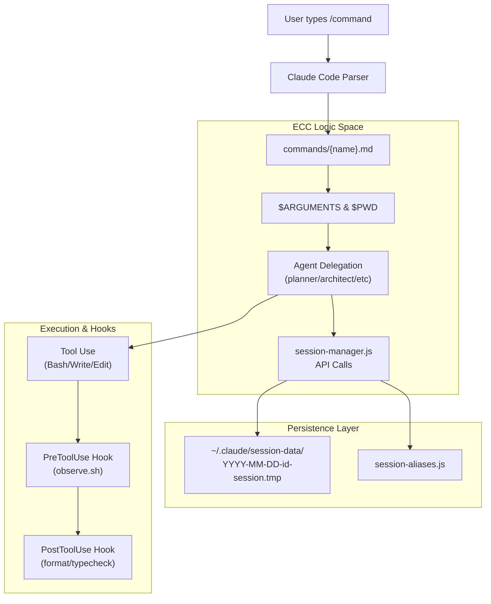
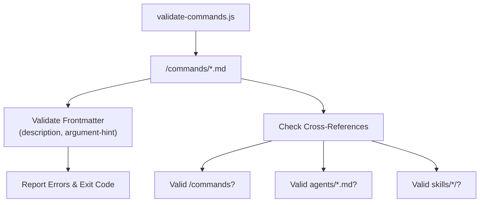

<!-- source: DeepWiki mcp.deepwiki.com · repo affaan-m/everything-claude-code · page 5.3 Command Reference · fetched 2026-10-26 -->

# Command Reference

Relevant source files

The following files were used as context for generating this wiki page:

- [commands/build-fix.md](commands/build-fix.md)
- [commands/multi-backend.md](commands/multi-backend.md)
- [commands/multi-execute.md](commands/multi-execute.md)
- [commands/multi-frontend.md](commands/multi-frontend.md)
- [commands/multi-plan.md](commands/multi-plan.md)
- [commands/multi-workflow.md](commands/multi-workflow.md)
- [commands/plan.md](commands/plan.md)
- [commands/pm2.md](commands/pm2.md)
- [commands/prp-commit.md](commands/prp-commit.md)
- [commands/prp-plan.md](commands/prp-plan.md)
- [commands/prp-pr.md](commands/prp-pr.md)
- [commands/prp-prd.md](commands/prp-prd.md)
- [commands/python-review.md](commands/python-review.md)
- [commands/refactor-clean.md](commands/refactor-clean.md)
- [commands/test-coverage.md](commands/test-coverage.md)
- [commands/update-codemaps.md](commands/update-codemaps.md)
- [commands/update-docs.md](commands/update-docs.md)
- [docs/SKILL-PLACEMENT-POLICY.md](docs/SKILL-PLACEMENT-POLICY.md)
- [docs/ja-JP/commands/multi-backend.md](docs/ja-JP/commands/multi-backend.md)
- [docs/ja-JP/commands/multi-execute.md](docs/ja-JP/commands/multi-execute.md)
- [docs/ja-JP/commands/multi-frontend.md](docs/ja-JP/commands/multi-frontend.md)
- [docs/ja-JP/commands/multi-plan.md](docs/ja-JP/commands/multi-plan.md)
- [docs/ja-JP/commands/multi-workflow.md](docs/ja-JP/commands/multi-workflow.md)
- [examples/rust-api-CLAUDE.md](examples/rust-api-CLAUDE.md)
- [schemas/provenance.schema.json](schemas/provenance.schema.json)
- [scripts/ci/validate-agents.js](scripts/ci/validate-agents.js)
- [scripts/ci/validate-commands.js](scripts/ci/validate-commands.js)
- [scripts/ci/validate-install-manifests.js](scripts/ci/validate-install-manifests.js)
- [scripts/ci/validate-skills.js](scripts/ci/validate-skills.js)
- [skills/hexagonal-architecture/SKILL.md](skills/hexagonal-architecture/SKILL.md)
- [skills/nutrient-document-processing/SKILL.md](skills/nutrient-document-processing/SKILL.md)
- [tests/commands/plan-command.test.js](tests/commands/plan-command.test.js)

This page provides a complete reference for all slash commands available in Everything Claude Code (ECC). Commands are executable prompts that trigger specific workflows, agents, or skills. They provide quick access to common development tasks without requiring full prompt composition.

For detailed information about the agents invoked by these commands, see [Agent Reference](5.1). For the underlying skills and workflows, see [Skills Reference](5.2).

---

## Command Categories

ECC provides 30+ commands organized into the following categories:

| Category | Purpose | Key Commands |
|----------|---------|--------------|
| **Planning & Execution** | Multi-model collaborative workflows | `/ccg:plan`, `/ccg:execute`, `/workflow`, `/plan` |
| **Session Management** | Context persistence and history | `/save-session`, `/resume-session`, `/sessions` |
| **Development & Quality** | TDD, verification, and orchestration | `/tdd`, `/verify`, `/build-fix`, `/checkpoint`, `/eval` |
| **Continuous Learning** | Instinct and skill evolution | `/instinct-status`, `/evolve`, `/skill-health`, `/skill-create` |
| **Service Management** | Process monitoring and lifecycle | `/pm2`, `/pm2-logs`, `/pm2-status` |
| **Specialized Skills** | Document and data processing | `/nutrient-document-processing` |

---

## Command Flow Architecture

The diagram below illustrates the data flow from a user's slash command input to the final tool execution, highlighting the interaction between the `session-manager.js` and the command markdown files.

**Command Execution Logic**

**Sources:** [commands/save-session.md:37-46](), [commands/sessions.md:31-34](), [commands/resume-session.md:28-48]()

---

## Core Planning & Development

### `/plan`
**Purpose:** Restate requirements, assess risks, and create a step-by-step implementation plan.
**Implementation:** This command runs inline by default to maintain compatibility with plugin installs that lack agent files [commands/plan.md:9-10](). It defines a fallback mechanism if the `planner` subagent is unavailable [commands/plan.md:116-118]().
**Guardrails:** Includes a critical "Confirmation Gate"—it will NOT write code until the user explicitly confirms with "yes" or "proceed" [commands/plan.md:97-98]().

### `/build-fix`
**Purpose:** Detects the project build system and incrementally fixes errors.
**Workflow:** 
1. **Detection**: Scans for `package.json`, `tsconfig.json`, `Cargo.toml`, `go.mod`, etc., to determine the build command [commands/build-fix.md:9-21]().
2. **Fix Loop**: Groups errors by file and fixes them one-by-one using the `Edit` tool, re-verifying after each change [commands/build-fix.md:30-38]().
3. **Safety**: Stops if a fix introduces more errors or if the same error persists after 3 attempts [commands/build-fix.md:42-45]().

**Sources:** [commands/plan.md:1-122](), [commands/build-fix.md:1-67](), [tests/commands/plan-command.test.js:31-54]()

---

## Multi-Model Collaborative Commands

ECC implements a "Code Sovereignty" protocol where external models (Codex/Gemini) generate prototypes, but Claude performs all filesystem writes [commands/multi-execute.md:12-13]().

### `/ccg:plan` (Multi-Plan)
**Purpose:** Context retrieval + Dual-model analysis to generate a step-by-step plan.
**Process:**
1. **Prompt Enhancement**: Uses `mcp__ace-tool__enhance_prompt` if available [commands/multi-plan.md:74-81]().
2. **Parallel Analysis**: Dispatches tasks to Codex (Backend authority) and Gemini (Frontend authority) using `run_in_background: true` [commands/multi-plan.md:125-139]().
3. **Synthesis**: Claude integrates consensus and resolves divergence into a final implementation plan with pseudo-code [commands/multi-plan.md:164-182]().

### `/ccg:execute` (Multi-Execute)
**Purpose:** Implements a plan by acquiring prototypes from specialized models and refactoring them for production.
**Workflow:**
- **Phase 3 (Prototype)**: Routes UI tasks to Gemini (`frontend.md`) and Logic tasks to Codex (`architect.md`) [commands/multi-execute.md:174-192]().
- **Refactoring**: Claude treats external diffs as "dirty prototypes" and refactors them to production-grade code [commands/multi-execute.md:13]().

### `/workflow` (Multi-Workflow)
**Purpose:** Orchestrates a 6-phase lifecycle: Research → Ideation → Plan → Execute → Optimize → Review [commands/multi-workflow.md:3]().
**Collaborative Roles**:
- **Codex**: Backend logic authority [commands/multi-workflow.md:26]().
- **Gemini**: Frontend expert [commands/multi-workflow.md:27]().
- **Claude**: Orchestrator, planning, and delivery [commands/multi-workflow.md:28]().

**Sources:** [commands/multi-plan.md:1-195](), [commands/multi-execute.md:1-200](), [commands/multi-workflow.md:1-175]()

---

## Continuous Learning & Quality

### `/skill-health`
**Purpose:** Displays a health dashboard for the skill portfolio [commands/skill-health.md:9]().
**Implementation:** Runs `skills-health.js --dashboard`. It includes panels for success rate sparklines, failure pattern clustering, and version history [commands/skill-health.md:15-55]().
**Data Flow:** Reads `skill-runs.jsonl` and `instincts.jsonl` to calculate metrics via `scripts/lib/skill-evolution/health.js`.

### `/prp-pr`
**Purpose:** Automates the creation of GitHub Pull Requests.
**Workflow:** 
1. **Validation**: Checks for clean working directory and existing commits ahead of the base branch [commands/prp-pr.md:19-35]().
2. **Discovery**: Searches for PR templates in `.github/` or `docs/` [commands/prp-pr.md:40-51]().
3. **Creation**: Pushes the branch and uses the `gh` CLI to create the PR with an auto-generated body based on commit analysis [commands/prp-pr.md:85-142]().

**Sources:** [commands/skill-health.md:1-55](), [commands/prp-pr.md:1-185]()

---

## Service Management & Special Skills

### `/pm2`
**Purpose:** Auto-analyzes project and generates PM2 service commands for Node.js, Python, and Go [commands/pm2.md:1-4]().
**Service Detection:** Scans for `vite.config.*`, `next.config.*`, `go.mod`, etc. [commands/pm2.md:19-27]().
**Output:** Generates `ecosystem.config.cjs` and command wrappers in `.claude/commands/` (e.g., `/pm2-all`, `/pm2-logs`) [commands/pm2.md:33-52]().

### `/nutrient-document-processing`
**Purpose:** High-level wrapper for the Nutrient DWS API [skills/nutrient-document-processing/SKILL.md:3]().
**Capabilities:** Convert (DOCX/HTML to PDF), OCR, Redact PII, and Sign documents [skills/nutrient-document-processing/SKILL.md:25-132]().
**Execution:** Uses `curl` multipart POST requests to `https://api.nutrient.io/build` with an `instructions` JSON field [skills/nutrient-document-processing/SKILL.md:11-21]().

**Sources:** [commands/pm2.md:1-273](), [skills/nutrient-document-processing/SKILL.md:1-166]()

---

## Validation Infrastructure

The ECC repository includes CI scripts to ensure command files remain valid and consistent.

**Command Validation Logic**

**Sources:** [scripts/ci/validate-commands.js:1-189](), [scripts/ci/validate-agents.js:1-82]()

---

