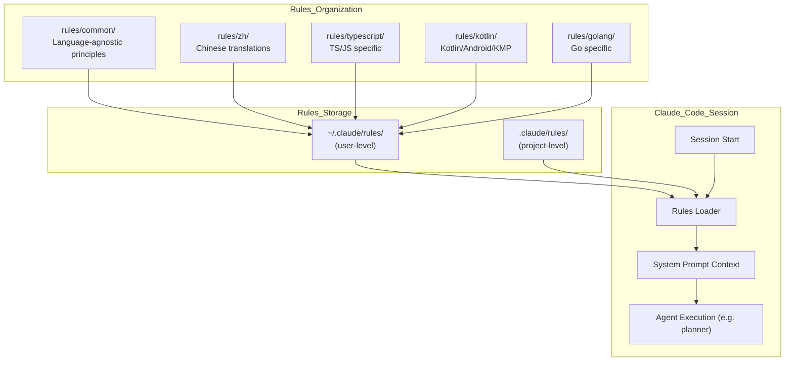
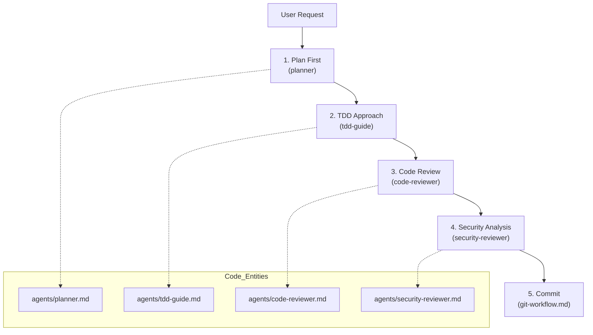
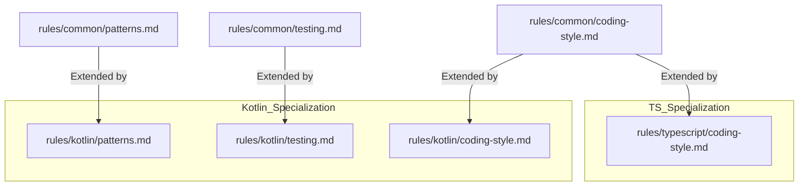

<!-- source: DeepWiki mcp.deepwiki.com · repo affaan-m/everything-claude-code · page 5.4 Rules Reference · fetched 2026-10-26 -->

# Rules Reference

<details>
<summary>Relevant source files</summary>

The following files were used as context for generating this wiki page:

- [.agents/skills/bun-runtime/agents/openai.yaml](.agents/skills/bun-runtime/agents/openai.yaml)
- [.agents/skills/documentation-lookup/agents/openai.yaml](.agents/skills/documentation-lookup/agents/openai.yaml)
- [.agents/skills/nextjs-turbopack/agents/openai.yaml](.agents/skills/nextjs-turbopack/agents/openai.yaml)
- [agents/kotlin-reviewer.md](agents/kotlin-reviewer.md)
- [commands/gradle-build.md](commands/gradle-build.md)
- [rules/common/agents.md](rules/common/agents.md)
- [rules/common/coding-style.md](rules/common/coding-style.md)
- [rules/common/git-workflow.md](rules/common/git-workflow.md)
- [rules/common/hooks.md](rules/common/hooks.md)
- [rules/common/patterns.md](rules/common/patterns.md)
- [rules/common/security.md](rules/common/security.md)
- [rules/common/testing.md](rules/common/testing.md)
- [rules/golang/coding-style.md](rules/golang/coding-style.md)
- [rules/golang/hooks.md](rules/golang/hooks.md)
- [rules/golang/patterns.md](rules/golang/patterns.md)
- [rules/golang/security.md](rules/golang/security.md)
- [rules/golang/testing.md](rules/golang/testing.md)
- [rules/kotlin/coding-style.md](rules/kotlin/coding-style.md)
- [rules/kotlin/patterns.md](rules/kotlin/patterns.md)
- [rules/kotlin/security.md](rules/kotlin/security.md)
- [rules/kotlin/testing.md](rules/kotlin/testing.md)
- [rules/python/coding-style.md](rules/python/coding-style.md)
- [rules/python/hooks.md](rules/python/hooks.md)
- [rules/python/patterns.md](rules/python/patterns.md)
- [rules/python/security.md](rules/python/security.md)
- [rules/python/testing.md](rules/python/testing.md)
- [rules/typescript/coding-style.md](rules/typescript/coding-style.md)
- [skills/android-clean-architecture/SKILL.md](skills/android-clean-architecture/SKILL.md)
- [skills/compose-multiplatform-patterns/SKILL.md](skills/compose-multiplatform-patterns/SKILL.md)
- [skills/kotlin-coroutines-flows/SKILL.md](skills/kotlin-coroutines-flows/SKILL.md)

</details>


## Purpose and Scope

This page documents the rules system in Everything Claude Code (ECC) — the "always-follow" guidelines that constrain Claude's behavior across all sessions. Rules are markdown files loaded automatically by Claude Code that define coding standards, workflows, security requirements, and best practices. These rules serve as the "guardrails" for the system, ensuring that agents like `planner` or `code-reviewer` adhere to project-specific and language-specific standards.

For information about skills (workflow definitions), see [3.3 Skills](). For commands that execute specific tasks, see [3.4 Commands]().

---

## Rules System Architecture

### How Rules Work

Rules are markdown files stored in `~/.claude/rules/` (user-level) or `.claude/rules/` (project-level) that Claude Code loads on every session start. Unlike skills which are invoked explicitly, rules apply continuously throughout the session.

**Title: Rules Architecture and Data Flow**


**Rules Loading Priority**
Rules are matched against file paths using glob patterns defined in the frontmatter. For example, Kotlin rules target `**/*.kt` and `**/*.kts` [rules/kotlin/patterns.md:2-5](). TypeScript rules target `.ts`, `.tsx`, `.js`, and `.jsx` [rules/typescript/coding-style.md:2-7](). When language-specific rules conflict with common rules, the language-specific rule takes precedence.

Sources: [rules/kotlin/patterns.md:1-5](), [rules/typescript/coding-style.md:1-7](), [rules/common/coding-style.md:1-7]()

---

## Common Rules

Common rules apply regardless of programming language. These establish universal principles for all Claude Code sessions.

| Rule File | Purpose | Key Constraints |
|-----------|---------|----------------|
| `coding-style.md` | Code organization and style | Immutability (CRITICAL), file size limits (800 lines max), KISS/DRY/YAGNI principles [rules/common/coding-style.md:3-34]() |
| `git-workflow.md` | Git and version control | Conventional commits, PR process, attribution disabled [rules/common/git-workflow.md:3-12]() |
| `testing.md` | Test requirements | TDD workflow (RED/GREEN/IMPROVE), 80%+ coverage mandate, AAA pattern [rules/common/testing.md:1-47]() |
| `agents.md` | Agent orchestration | Parallel task execution, multi-perspective analysis [rules/common/agents.md:28-51]() |
| `patterns.md` | Design patterns | Repository pattern, DTOs, abstraction layers |
| `security.md` | Security requirements | Input validation, secrets handling, dependency auditing |

### Development Workflow Integration

The ECC system mandates a structured approach to agent usage. For complex feature requests, the `planner` agent is used first [rules/common/agents.md:23](). After writing code, the `code-reviewer` agent is invoked [rules/common/agents.md:24]().

**Title: Agent Orchestration Workflow (Natural Language to Code)**


Sources: [rules/common/agents.md:7-27](), [rules/common/git-workflow.md:1-25](), [rules/common/coding-style.md:1-91](), [rules/common/testing.md:1-58]()

---

## Language-Specific Rules

Language-specific rules extend common rules with idioms and framework-specific patterns.

### Kotlin Rules
Located in `rules/kotlin/`. These focus heavily on **Structured Concurrency** and **Compose Multiplatform**.

*   **Patterns**: Prefers constructor injection (Koin/Hilt), ViewModel with single state objects, and the `expect`/`actual` pattern for Kotlin Multiplatform (KMP) [rules/kotlin/patterns.md:10-109]().
*   **Coroutines**: Mandates `viewModelScope` and prohibits `GlobalScope` [rules/kotlin/patterns.md:111-115](). Long-running loops must use `ensureActive()` for cooperative cancellation [skills/kotlin-coroutines-flows/SKILL.md:191-197]().
*   **Testing**: Mandates `kotlin.test` for KMP and **Turbine** for Flow verification [rules/kotlin/testing.md:10-32](). Prefers fakes over mocks [rules/kotlin/testing.md:35-53]().
*   **Reviewer**: The `kotlin-reviewer` agent (Sonnet model) enforces these rules, specifically checking for `GlobalScope` usage, mutable state inside StateFlow, and unstable Compose parameters [agents/kotlin-reviewer.md:58-93]().

### TypeScript/JavaScript Rules
Located in `rules/typescript/`.

*   **Coding Style**: Mandates explicit types for public APIs and prohibits the use of `any` [rules/typescript/coding-style.md:12-77]().
*   **Validation**: Recommends **Zod** for schema-based input validation and type inference [rules/typescript/coding-style.md:178-194]().
*   **Immutability**: Requires the spread operator for updates to maintain state integrity [rules/typescript/coding-style.md:116-139]().

### Golang Rules
Located in `rules/golang/`.

*   **Testing**: Extends common testing rules with Go-specific table-driven tests and benchmark patterns [rules/golang/testing.md:1-10]().
*   **Hooks**: Implements Go-specific hooks for `go fmt`, `go vet`, and `staticcheck` [rules/golang/hooks.md:1-10]().

**Title: Rule Extension Hierarchy**


Sources: [rules/kotlin/patterns.md:8-9](), [rules/kotlin/testing.md:8-108](), [rules/typescript/coding-style.md:10-194](), [agents/kotlin-reviewer.md:12-156]()

---

## Rules Installation

### Manual Installation Requirement
Claude Code plugins cannot distribute rules automatically due to platform limitations. Rules must be installed manually to `~/.claude/rules/`.

### Installation via `install.sh`
The repository includes an `install.sh` script that automates the copying of common and language-specific rules.

```bash
# Install common + Kotlin + TypeScript rules
./install.sh kotlin typescript
```

### Installation via `configure-ecc` Skill
The `configure-ecc` skill provides an interactive wizard to select and install rules for specific stacks.

---

## Rules vs. Skills vs. Commands

| Component | Nature | Activation | Scope |
|-----------|--------|------------|-------|
| **Rules** | Constraint | Automatic (Always-on) | Global/Project-wide |
| **Skills** | Methodology | Agent Invocation | Task-specific |
| **Commands** | Execution | User Triggered (`/`) | Immediate action |

### Example: Kotlin Coroutines
1.  **Rule**: `rules/kotlin/patterns.md` mandates using `viewModelScope` over `GlobalScope` [rules/kotlin/patterns.md:111-115]().
2.  **Skill**: `kotlin-coroutines-flows` provides deep implementation patterns for `StateFlow`, `SharedFlow`, and structured concurrency [skills/kotlin-coroutines-flows/SKILL.md:19-167]().
3.  **Agent**: `kotlin-reviewer` flags any violations of the scope rules, such as missing `withContext` for IO [agents/kotlin-reviewer.md:58-66]().

Sources: [rules/kotlin/patterns.md:111-115](), [skills/kotlin-coroutines-flows/SKILL.md:2-3](), [agents/kotlin-reviewer.md:12-15]()

---

