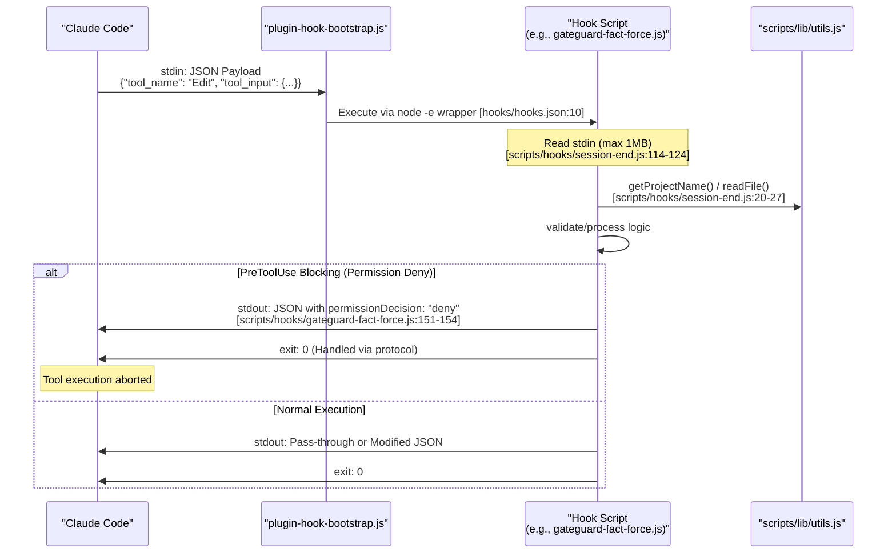
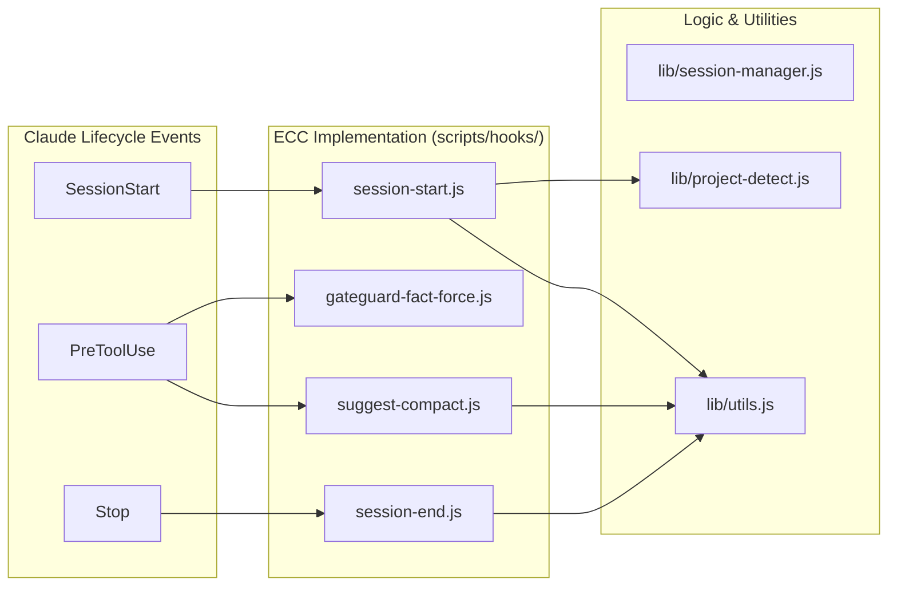

<!-- source: DeepWiki mcp.deepwiki.com · repo affaan-m/everything-claude-code · page 6 Hooks System · fetched 2026-10-26 -->

# Hooks System

Relevant source files

The following files were used as context for generating this wiki page:

- [.opencode/commands/harness-audit.md](.opencode/commands/harness-audit.md)
- [commands/harness-audit.md](commands/harness-audit.md)
- [commands/loop-start.md](commands/loop-start.md)
- [commands/model-route.md](commands/model-route.md)
- [commands/quality-gate.md](commands/quality-gate.md)
- [hooks/README.md](hooks/README.md)
- [hooks/hooks.json](hooks/hooks.json)
- [scripts/harness-audit.js](scripts/harness-audit.js)
- [scripts/hooks/desktop-notify.js](scripts/hooks/desktop-notify.js)
- [scripts/hooks/gateguard-fact-force.js](scripts/hooks/gateguard-fact-force.js)
- [scripts/hooks/session-end.js](scripts/hooks/session-end.js)
- [scripts/hooks/session-start.js](scripts/hooks/session-start.js)
- [scripts/hooks/suggest-compact.js](scripts/hooks/suggest-compact.js)
- [scripts/lib/package-manager.js](scripts/lib/package-manager.js)
- [scripts/lib/session-aliases.js](scripts/lib/session-aliases.js)
- [scripts/lib/session-manager.js](scripts/lib/session-manager.js)
- [scripts/lib/utils.js](scripts/lib/utils.js)
- [skills/gateguard/SKILL.md](skills/gateguard/SKILL.md)
- [tests/ci/validators.test.js](tests/ci/validators.test.js)
- [tests/hooks/gateguard-fact-force.test.js](tests/hooks/gateguard-fact-force.test.js)
- [tests/hooks/hooks.test.js](tests/hooks/hooks.test.js)
- [tests/integration/hooks.test.js](tests/integration/hooks.test.js)
- [tests/lib/package-manager.test.js](tests/lib/package-manager.test.js)
- [tests/lib/session-aliases.test.js](tests/lib/session-aliases.test.js)
- [tests/lib/session-manager.test.js](tests/lib/session-manager.test.js)
- [tests/lib/utils.test.js](tests/lib/utils.test.js)
- [tests/scripts/harness-audit.test.js](tests/scripts/harness-audit.test.js)

## Purpose and Scope

This document provides a deep dive into the architecture of the hooks system in Everything Claude Code (ECC). Hooks are event-driven automation points that intercept the Claude Code tool execution lifecycle to provide validation, quality enforcement, observation, and context management.

For detailed information on specific hook categories and technical details, see the following child pages:
- **[Hook Lifecycle & Event Flow](#6.1)** — Detailed execution model, stdin/stdout/stderr protocol, and exit code definitions.
- **[PreToolUse Hooks](#6.2)** — Documentation on blocking/validation hooks like `doc-file-warning`, `git-push-warning`, and `suggest-compact`.
- **[PostToolUse Hooks](#6.3)** — Quality enforcement patterns including `format`, `typecheck`, and `console-warn`.
- **[Session & Context Hooks](#6.4)** — Lifecycle hooks for memory persistence (`SessionStart`, `SessionEnd`) and context management (`PreCompact`).
- **[Hook Testing Infrastructure](#6.5)** — The testing framework, including `runHookWithInput` and integration test suites.
- **[Creating Custom Hooks](#6.6)** — Step-by-step guide for developing new hooks, JSON parsing, and registration in `hooks.json`.

---

## System Architecture

Hooks are executable scripts (Node.js or Bash) registered in `hooks/hooks.json` [hooks/hooks.json:1-70]() that run at specific lifecycle phases. They allow ECC to extend Claude Code's behavior through a standard JSON-in/JSON-out protocol. The system uses a `plugin-hook-bootstrap.js` to ensure the correct environment and `CLAUDE_PLUGIN_ROOT` are set before execution [hooks/hooks.json:10-11]().

### Core Responsibilities
1.  **Validation & Blocking**: Hooks can abort risky operations by exiting with code `2`. For example, the consolidated `pre-bash-dispatcher.js` handles security and quality checks for Bash commands [hooks/hooks.json:13-15]().
2.  **Quality Enforcement**: Hooks ensure code remains compliant. The `gateguard-fact-force.js` hook forces investigation before destructive actions [scripts/hooks/gateguard-fact-force.js:5-14]().
3.  **Observation**: The `observe-runner.js` hook captures tool use for the Continuous Learning System [hooks/hooks.json:43-50]().
4.  **Context Management**: `SessionStart` hooks load previous session context, project detection, and package manager selection [scripts/hooks/session-start.js:7-10]().
5.  **State Persistence**: `SessionEnd` (Stop hook) extracts summaries from transcripts to maintain cross-session continuity [scripts/hooks/session-end.js:7-10]().

**Sources:** [hooks/hooks.json:1-70](), [scripts/hooks/session-start.js:1-10](), [scripts/hooks/session-end.js:1-10](), [scripts/hooks/gateguard-fact-force.js:1-21]()

---

## Hook Event Types

The system supports several distinct event phases, allowing for precise intervention at different stages of the agent's "thought" and "action" loop.

| Event Type | When It Fires | Can Block? | Typical Use Cases |
| :--- | :--- | :--- | :--- |
| **SessionStart** | At session initialization | No | Load context, prune expired sessions, detect project type [scripts/hooks/session-start.js:119-160]() |
| **PreToolUse** | Before a tool executes | **Yes** (exit 2) | Fact-forcing investigation, doc-file warnings, governance capture [scripts/hooks/gateguard-fact-force.js:140-155]() |
| **PostToolUse** | After a tool completes | No | Linting, formatting, learning from observations [hooks/hooks.json:115-130]() |
| **Stop** | After each Claude response | No | Desktop notifications, session summary extraction [scripts/hooks/session-end.js:125-134]() |
| **PreCompact** | Before context compaction | No | Save critical state to prevent memory loss during context shrinking [hooks/hooks.json:145-155]() |
| **SessionEnd** | At session termination | No | Final cleanup and state finalization [hooks/hooks.json:156-165]() |

**Sources:** [hooks/hooks.json:1-165](), [scripts/hooks/session-start.js:7-10](), [scripts/hooks/session-end.js:7-10]()

---

## Hook Execution Protocol

Hooks communicate via a standard protocol. Claude Code pipes the tool context to the hook's `stdin` [scripts/hooks/session-end.js:113-115](), and the hook may emit modified context or additional instructions via `stdout`.

### Execution Flow & Entity Mapping

This diagram maps the high-level execution flow to the specific code entities involved in processing hook inputs and outputs.

**Sources:** [scripts/hooks/session-end.js:113-134](), [scripts/hooks/gateguard-fact-force.js:140-155](), [hooks/hooks.json:1-30]()

---

## Configuration & Profile Management

Hooks are registered in `hooks/hooks.json`. ECC uses a profile system (`minimal`, `standard`, `strict`) controlled via the `ECC_HOOK_PROFILE` environment variable to determine which hooks should execute [scripts/hooks/gateguard-fact-force.js:72-73](). Many hooks use a `run-with-flags.js` wrapper to respect these profile settings [hooks/hooks.json:21, 32, 43]().

### Hook Component Mapping
This diagram bridges high-level hook categories to their specific implementation files in the codebase.

**Sources:** [hooks/hooks.json:1-65](), [scripts/hooks/session-start.js:12-27](), [scripts/hooks/session-end.js:14-27]()

---

## Testing Infrastructure

Reliability is maintained through an extensive testing framework that simulates Claude Code's invocation environment.

- **`runHookWithInput`**: A helper in `tests/integration/hooks.test.js` [tests/integration/hooks.test.js:50-92]() that spawns a hook process and feeds it JSON via `stdin`.
- **`runHookCommand`**: Validates the exact command strings defined in `hooks.json`, supporting both inline Node.js scripts and shell wrappers [tests/integration/hooks.test.js:109-217]().
- **Validators**: CI scripts like `validate-hooks.js` check for schema compliance and syntax errors in the `hooks.json` registry [tests/ci/validators.test.js:1-15]().
- **Unit Tests**: Scripts like `tests/hooks/hooks.test.js` provide deep coverage for hook logic and utility functions [tests/hooks/hooks.test.js:1-112]().

**Sources:** [tests/integration/hooks.test.js:50-217](), [tests/hooks/hooks.test.js:1-112](), [tests/ci/validators.test.js:1-15]()

---

