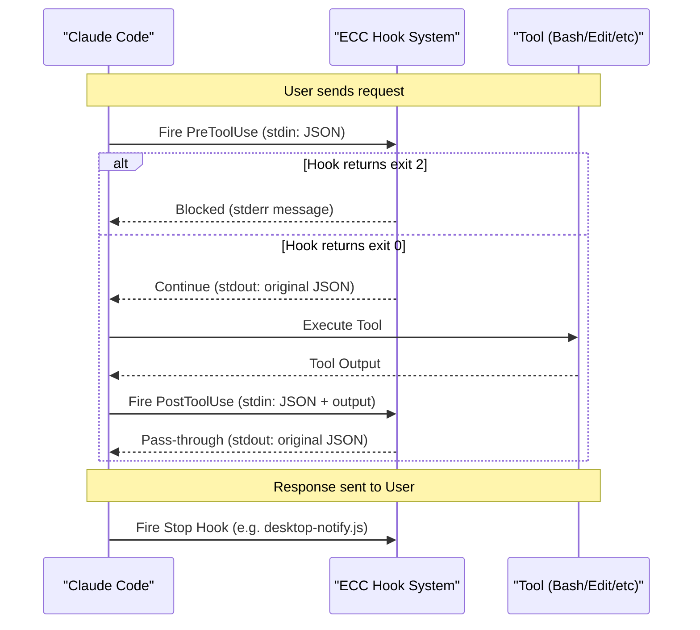
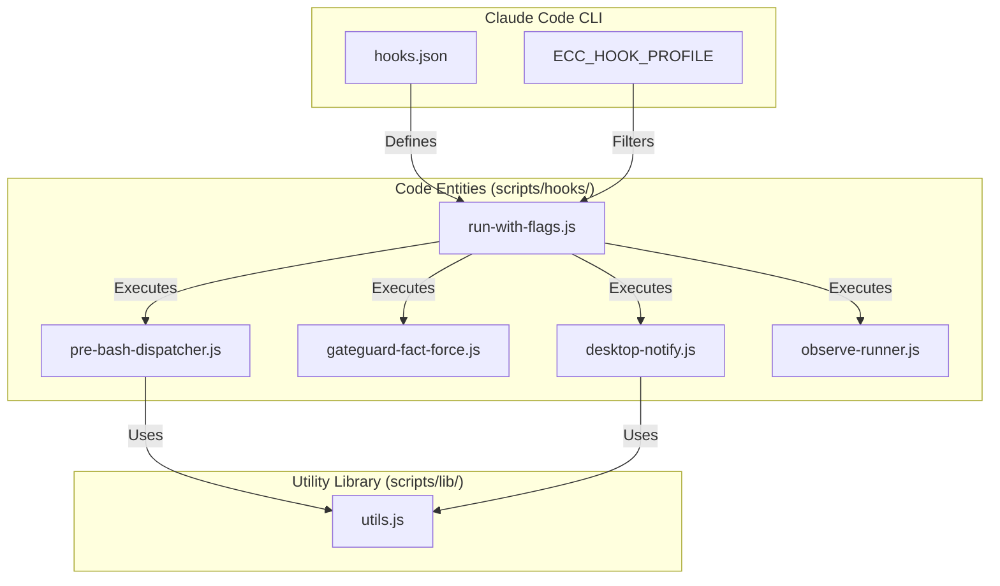

<!-- source: DeepWiki mcp.deepwiki.com · repo affaan-m/everything-claude-code · page 6.1 Hook Lifecycle & Event Flow · fetched 2026-10-26 -->

# Hook Lifecycle & Event Flow

Relevant source files

The following files were used as context for generating this wiki page:

- [.opencode/commands/harness-audit.md](.opencode/commands/harness-audit.md)
- [commands/harness-audit.md](commands/harness-audit.md)
- [commands/loop-start.md](commands/loop-start.md)
- [commands/model-route.md](commands/model-route.md)
- [commands/quality-gate.md](commands/quality-gate.md)
- [hooks/README.md](hooks/README.md)
- [hooks/hooks.json](hooks/hooks.json)
- [schemas/hooks.schema.json](schemas/hooks.schema.json)
- [scripts/ci/catalog.js](scripts/ci/catalog.js)
- [scripts/ci/validate-hooks.js](scripts/ci/validate-hooks.js)
- [scripts/harness-audit.js](scripts/harness-audit.js)
- [scripts/hooks/desktop-notify.js](scripts/hooks/desktop-notify.js)
- [scripts/hooks/gateguard-fact-force.js](scripts/hooks/gateguard-fact-force.js)
- [skills/gateguard/SKILL.md](skills/gateguard/SKILL.md)
- [tests/ci/catalog.test.js](tests/ci/catalog.test.js)
- [tests/hooks/gateguard-fact-force.test.js](tests/hooks/gateguard-fact-force.test.js)
- [tests/run-all.js](tests/run-all.js)
- [tests/scripts/harness-audit.test.js](tests/scripts/harness-audit.test.js)

This document explains the complete lifecycle of hooks in the Everything Claude Code (ECC) plugin, detailing the event points where hooks execute, the order of execution, stdin/stdout/stderr protocol, and integration with the Claude Code runtime.

## Hook Event Points

The ECC plugin leverages the Claude Code hook system to inject logic at specific lifecycle boundaries. These events are defined in the central configuration file [hooks/hooks.json:1-210](). The schema for these hooks is strictly validated to ensure compatibility with the Claude Code runtime [schemas/hooks.schema.json:158-176](), [scripts/ci/validate-hooks.js:13-32]().

| Event | Fires When | Primary Use Cases |
|-------|------------|-------------------|
| `SessionStart` | A new Claude Code session begins. | Load previous context, detect package manager, and initialize project-scoped state [hooks/hooks.json:173-186](), [hooks/README.md:62](). |
| `PreToolUse` | Before a tool (Bash, Edit, etc.) executes. | Validation, blocking, safety reminders (GateGuard), and capturing observations [hooks/hooks.json:4-130](), [hooks/README.md:11](). |
| `PostToolUse` | After a tool completes execution. | Audit logging, quality gates, and post-processing (e.g., formatting) [hooks/hooks.json:187-210](), [hooks/README.md:12](). |
| `Stop` | Claude finishes a response cycle. | Desktop notifications, session state persistence, and pattern extraction [hooks/hooks.json:148-172](), [hooks/README.md:64-68](). |
| `PreCompact` | Before context window compaction. | Saving critical state to avoid context loss during summarization [hooks/hooks.json:131-143](), [hooks/README.md:15](). |
| `SessionEnd` | The session is explicitly terminated. | Final cleanup and lifecycle logging [hooks/README.md:69](). |

Sources: [hooks/hooks.json:1-210](), [hooks/README.md:3-16](), [hooks/README.md:35-70](), [schemas/hooks.schema.json:158-176](), [scripts/ci/validate-hooks.js:13-32]()

---

## Execution Flow & Protocol

### Hook Pipeline Sequence

The following diagram illustrates the flow from a user request to tool execution, highlighting where hooks intercept the process.

Sources: [hooks/README.md:7-15](), [hooks/hooks.json:4-130](), [scripts/hooks/desktop-notify.js:154-168]()

### Stdin/Stdout/Stderr Protocol

Hooks communicate with the main Claude Code process using standard I/O streams and exit codes. This protocol ensures that tools can be validated or blocked based on specific logic like the GateGuard fact-forcing mechanism [scripts/hooks/gateguard-fact-force.js:1-21]().

1.  **Stdin**: Receives a JSON payload containing `tool_name`, `tool_input`, and (for PostToolUse) `tool_output` [hooks/README.md:143-158]().
2.  **Stdout**: **Must** output the original JSON received on stdin to allow the pipeline to continue. If the hook intends to allow the tool, it echoes the input [scripts/hooks/desktop-notify.js:166](), [hooks/README.md:133]().
3.  **Stderr**: Used to display warnings or messages to the user. These appear in the Claude Code interface prefixed with `[Hook]`. This is the primary channel for GateGuard to demand facts [scripts/hooks/gateguard-fact-force.js:213-220](), [hooks/README.md:127-128]().
4.  **Exit Codes**:
    *   `0`: Success. Continue execution [hooks/README.md:138]().
    *   `2`: **Block**. Only valid for `PreToolUse`. Prevents the tool from running and reports the stderr message as the reason [hooks/README.md:139]().

Sources: [hooks/README.md:109-140](), [scripts/hooks/gateguard-fact-force.js:1-220](), [scripts/hooks/desktop-notify.js:154-168]()

---

## Technical Implementation: The Wrapper Pattern

ECC uses a "wrapper" pattern via `run-with-flags.js` to manage complex hook logic, enforcing environment-based policies and profile filtering.

### Code Entity Association

This diagram bridges the conceptual hook phases to the specific scripts and classes implemented in the codebase.

Sources: [hooks/hooks.json:10, 21, 32, 43, 56](), [scripts/hooks/desktop-notify.js:18-19](), [scripts/hooks/gateguard-fact-force.js:23-27](), [scripts/hooks/observe-runner.js:1-10]()

### Flag-Based Execution (`run-with-flags.js`)
Most hooks in `hooks.json` are invoked via `run-with-flags.js`. This utility provides:
*   **Profile Filtering**: Hooks can be categorized as `minimal`, `standard`, or `strict` via `ECC_HOOK_PROFILE` [hooks/README.md:95-107]().
*   **Disabling**: Specific hooks can be skipped using the `ECC_DISABLED_HOOKS` environment variable [hooks/README.md:99-100]().
*   **Path Resolution**: It dynamically resolves `${CLAUDE_PLUGIN_ROOT}` to locate script files across different installation methods using a complex inline bootstrap script [hooks/hooks.json:10, 21]().

Sources: [hooks/hooks.json:10-60](), [hooks/README.md:91-107]()

---

## Blocking vs. Async Hooks

### Blocking Hooks (PreToolUse)
PreToolUse hooks are synchronous by default. They are used for "Guardrails" that must validate input before execution.
*   **GateGuard**: The `gateguard-fact-force.js` hook blocks the first attempt to edit a file or run destructive commands, forcing the model to provide evidence of investigation [scripts/hooks/gateguard-fact-force.js:5-15](), [skills/gateguard/SKILL.md:24-32]().
*   **State Persistence**: GateGuard uses a local state directory (typically `~/.gateguard`) to track which files have already been "investigated" within a session to avoid redundant blocking [scripts/hooks/gateguard-fact-force.js:29-41]().

### Async Hooks
For operations that are heavy but don't need to block the user (like background observations), the `async` flag is used in `hooks.json`.
*   **Continuous Learning**: The `observe-runner.js` hook for continuous learning runs with `"async": true` and a `timeout` of 10 seconds [hooks/hooks.json:44-45]().
*   **Behavior**: Claude Code spawns the hook and immediately continues to the next step without waiting for the hook's completion [hooks/README.md:160-173](), [schemas/hooks.schema.json:37-40]().

Sources: [hooks/hooks.json:44-45](), [scripts/hooks/gateguard-fact-force.js:1-41](), [skills/gateguard/SKILL.md:7-32](), [hooks/README.md:160-174](), [schemas/hooks.schema.json:37-45]()

---

## Matcher Logic

Hooks are not fired for every single tool call; they use a `matcher` to filter relevant events based on the tool being invoked.

| Matcher Type | Example | Implementation Detail |
|--------------|---------|-----------------------|
| **Tool Name** | `Bash`, `Write` | Fires only when that specific tool is invoked [hooks/hooks.json:6, 17](). |
| **Combined** | `Edit\|Write`, `Bash\|Write\|Edit\|MultiEdit` | Uses a pipe-delimited string to match multiple tools [hooks/hooks.json:28, 52, 64](). |
| **Wildcard** | `*` | Fires for every tool or event in that category (e.g., all `Stop` events) [hooks/hooks.json:39, 146, 158](). |

The validation script `validate-hooks.js` ensures that certain events (like `Stop` or `Notification`) do not incorrectly require a matcher [scripts/ci/validate-hooks.js:34]().

Sources: [hooks/hooks.json:6, 17, 28, 39, 52, 64, 146, 158](), [scripts/ci/validate-hooks.js:34, 160-202]()

---

