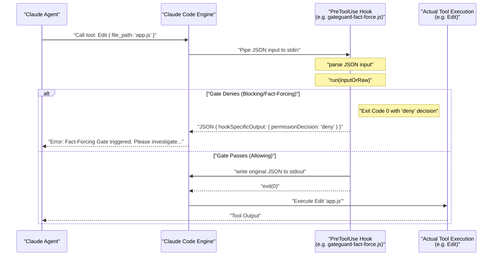
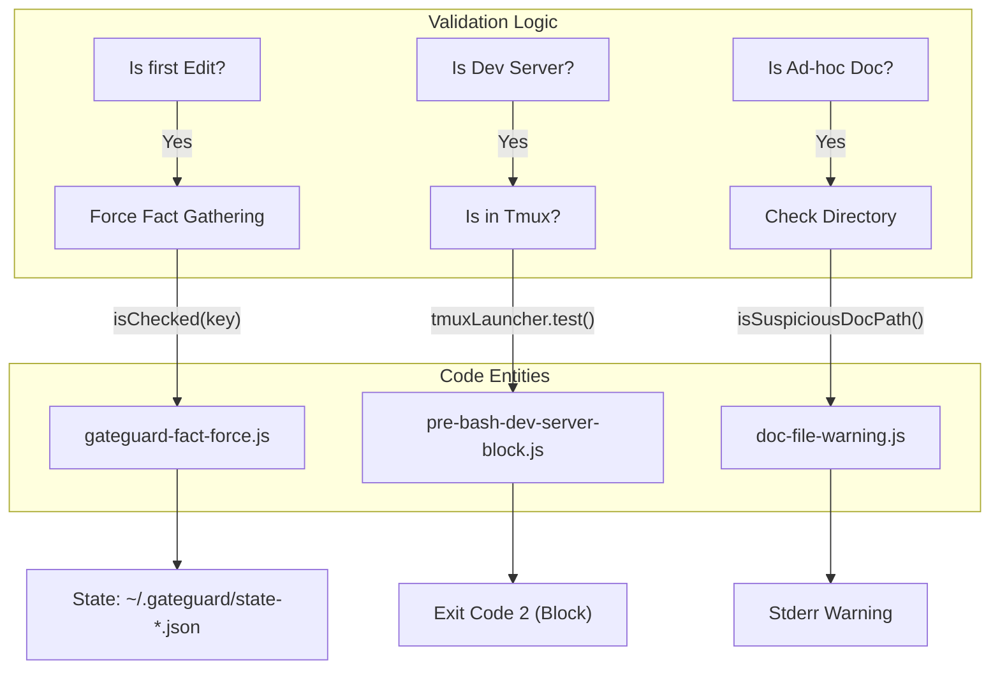

<!-- source: DeepWiki mcp.deepwiki.com · repo affaan-m/everything-claude-code · page 6.2 PreToolUse Hooks · fetched 2026-10-26 -->

# PreToolUse Hooks

Relevant source files

The following files were used as context for generating this wiki page:

- [.cursor/hooks/adapter.js](.cursor/hooks/adapter.js)
- [.cursor/hooks/after-shell-execution.js](.cursor/hooks/after-shell-execution.js)
- [.cursor/hooks/before-shell-execution.js](.cursor/hooks/before-shell-execution.js)
- [.cursor/hooks/session-end.js](.cursor/hooks/session-end.js)
- [.cursor/hooks/session-start.js](.cursor/hooks/session-start.js)
- [.cursor/hooks/stop.js](.cursor/hooks/stop.js)
- [.opencode/commands/harness-audit.md](.opencode/commands/harness-audit.md)
- [commands/harness-audit.md](commands/harness-audit.md)
- [commands/loop-start.md](commands/loop-start.md)
- [commands/model-route.md](commands/model-route.md)
- [commands/projects.md](commands/projects.md)
- [commands/promote.md](commands/promote.md)
- [commands/quality-gate.md](commands/quality-gate.md)
- [hooks/README.md](hooks/README.md)
- [hooks/hooks.json](hooks/hooks.json)
- [scripts/harness-audit.js](scripts/harness-audit.js)
- [scripts/hooks/desktop-notify.js](scripts/hooks/desktop-notify.js)
- [scripts/hooks/doc-file-warning.js](scripts/hooks/doc-file-warning.js)
- [scripts/hooks/gateguard-fact-force.js](scripts/hooks/gateguard-fact-force.js)
- [scripts/hooks/pre-bash-dev-server-block.js](scripts/hooks/pre-bash-dev-server-block.js)
- [scripts/hooks/run-with-flags-shell.sh](scripts/hooks/run-with-flags-shell.sh)
- [scripts/lib/project-detect.js](scripts/lib/project-detect.js)
- [scripts/lib/shell-split.js](scripts/lib/shell-split.js)
- [skills/continuous-learning-v2/agents/observer.md](skills/continuous-learning-v2/agents/observer.md)
- [skills/continuous-learning-v2/config.json](skills/continuous-learning-v2/config.json)
- [skills/continuous-learning-v2/scripts/instinct-cli.py](skills/continuous-learning-v2/scripts/instinct-cli.py)
- [skills/continuous-learning-v2/scripts/test_parse_instinct.py](skills/continuous-learning-v2/scripts/test_parse_instinct.py)
- [skills/gateguard/SKILL.md](skills/gateguard/SKILL.md)
- [tests/hooks/doc-file-warning.test.js](tests/hooks/doc-file-warning.test.js)
- [tests/hooks/gateguard-fact-force.test.js](tests/hooks/gateguard-fact-force.test.js)
- [tests/lib/project-detect.test.js](tests/lib/project-detect.test.js)
- [tests/lib/shell-split.test.js](tests/lib/shell-split.test.js)
- [tests/scripts/harness-audit.test.js](tests/scripts/harness-audit.test.js)

PreToolUse hooks are event-driven automations that execute **before** Claude invokes a tool (such as `Read`, `Write`, `Edit`, or `Bash`). These hooks provide validation, blocking, and reminder functionality to prevent errors, enforce best practices, and maintain workflow discipline by intercepting the tool call before it reaches the operating system.

For general hook concepts and the complete hook lifecycle, see [6.1 Hook Lifecycle & Event Flow](). For creating custom PreToolUse hooks, see [6.6 Creating Custom Hooks]().

## Overview

PreToolUse hooks intercept tool invocations, enabling four primary technical use cases:

1.  **Blocking**: Terminate the tool execution if specific safety or architectural constraints are violated (e.g., `pre-bash-dev-server-block.js` or `governance-capture.js`). [hooks/hooks.json:52-62](), [scripts/hooks/pre-bash-dev-server-block.js:175-181]()
2.  **Validation**: Inspect tool inputs (like file paths in `doc-file-warning.js`) to ensure they align with project standards. [scripts/hooks/doc-file-warning.js:27-41]()
3.  **Fact-Forcing**: Demand concrete investigation before allowing destructive or complex actions (e.g., `gateguard-fact-force.js`). [scripts/hooks/gateguard-fact-force.js:3-9]()
4.  **Reminders/Suggestions**: Inject warnings or advice into the `stderr` stream without stopping the tool (e.g., `suggest-compact.js`). [hooks/hooks.json:28-37]()

The hook receives the tool invocation details via `stdin` as a JSON object and must either pass that JSON to `stdout` to allow execution or exit with a status of `2` to block it.

Sources: [scripts/hooks/doc-file-warning.js:1-12](), [scripts/hooks/gateguard-fact-force.js:1-15](), [hooks/hooks.json:4-15]()

## Hook Execution Flow

The following diagram illustrates how a PreToolUse hook intercepts a tool call to validate inputs before execution.

### Tool Interception Architecture

Sources: [scripts/hooks/gateguard-fact-force.js:128-153](), [tests/hooks/gateguard-fact-force.test.js:129-144](), [hooks/hooks.json:1-15]()

## Core PreToolUse Hooks

### 1. GateGuard Fact-Force (`gateguard-fact-force.js`)
This is the most advanced PreToolUse hook in the system. It measurably improves output quality (+2.25 points) by forcing Claude to investigate before editing files or running destructive commands.

*   **Logic**: Instead of asking "Are you sure?", it demands concrete facts: importers, public APIs, and data schemas. [scripts/hooks/gateguard-fact-force.js:3-9]()
*   **State Management**: It maintains per-session state in `~/.gateguard` (or `GATEGUARD_STATE_DIR`) to track which files have been "cleared" for editing. [scripts/hooks/gateguard-fact-force.js:29-31]()
*   **Three-Stage Gate**:
    1.  **DENY**: Blocks the first `Edit`/`Write`/`Bash` attempt. [skills/gateguard/SKILL.md:27-27]()
    2.  **FORCE**: Instructs the model on exactly which facts to gather (e.g., "List ALL files that import this file"). [skills/gateguard/SKILL.md:55-55]()
    3.  **ALLOW**: Permits retry once the file is marked as `checked` in the state file. [scripts/hooks/gateguard-fact-force.js:202-209]()
*   **Destructive Bash**: Specifically triggers on commands like `rm -rf`, `git reset --hard`, or `drop table`. [scripts/hooks/gateguard-fact-force.js:45-45]()

Sources: [scripts/hooks/gateguard-fact-force.js:1-21](), [skills/gateguard/SKILL.md:1-89](), [tests/hooks/gateguard-fact-force.test.js:134-155]()

### 2. Documentation File Warning (`doc-file-warning.js`)
Prevents documentation fragmentation by warning when Claude creates ad-hoc files (like `NOTES.md`) outside of structured directories.

*   **Denylist**: Flags filenames like `NOTES`, `TODO`, `SCRATCH`, `TEMP`, `DRAFT`, `BRAINSTORM`, `SPIKE`, `DEBUG`, and `WIP`. [scripts/hooks/doc-file-warning.js:21-22]()
*   **Structured Directories**: Ad-hoc names are permitted if they reside in `docs/`, `.claude/`, `commands/`, `skills/`, etc. [scripts/hooks/doc-file-warning.js:25-25]()
*   **Behavior**: Non-blocking. It prints a warning to `stderr` but allows the tool to proceed by writing the original data to `stdout`. [scripts/hooks/doc-file-warning.js:85-90]()

Sources: [scripts/hooks/doc-file-warning.js:21-41](), [tests/hooks/doc-file-warning.test.js:126-146]()

### 3. Dev Server Tmux Block (`pre-bash-dev-server-block.js`)
Enforces that development servers (e.g., `npm run dev`) are executed within a `tmux` session to ensure logs are persistent and accessible.

*   **Command Detection**: Detects `npm`, `pnpm`, `yarn`, `bun`, and `npx` followed by the `dev` command. [scripts/hooks/pre-bash-dev-server-block.js:8-15]()
*   **Blocking Logic**: If a dev command is detected and is NOT wrapped in a `tmux` launcher, the hook exits with code `2`. [scripts/hooks/pre-bash-dev-server-block.js:175-180]()
*   **Platform Support**: This hook is skipped on Windows. [scripts/hooks/pre-bash-dev-server-block.js:162-162]()

Sources: [scripts/hooks/pre-bash-dev-server-block.js:160-181]()

### 4. Continuous Learning Observation (`observe-runner.js`)
Captures tool use observations to feed the Continuous Learning v2 pipeline.

*   **Implementation**: Executes for every tool call (`matcher: "*"`) to build a comprehensive log. [hooks/hooks.json:39-50]()
*   **Project Scoping**: Uses `detect-project.sh` logic (implemented in Python for the CLI) to isolate observations by project ID. [skills/continuous-learning-v2/scripts/instinct-cli.py:128-153]()

Sources: [hooks/hooks.json:39-50](), [skills/continuous-learning-v2/scripts/instinct-cli.py:41-50](), [scripts/lib/project-detect.js:17-83]()

## Implementation Details

### Hook Input Schema
PreToolUse hooks receive a structured JSON object representing the intended tool call.

| Field | Type | Description |
| :--- | :--- | :--- |
| `tool_name` | `string` | The tool being called (e.g., `Bash`, `Write`, `Edit`, `Read`) |
| `tool_input` | `object` | Tool-specific arguments (e.g., `command`, `file_path`, `content`) |

Sources: [scripts/hooks/doc-file-warning.js:56-56](), [scripts/hooks/gateguard-fact-force.js:79-87]()

### PreToolUse Logic Mapping
The following diagram maps validation logic to the specific code entities that handle them.

Sources: [scripts/hooks/gateguard-fact-force.js:98-104](), [scripts/hooks/pre-bash-dev-server-block.js:164-175](), [scripts/hooks/doc-file-warning.js:27-41]()

## Summary of PreToolUse Hooks

| Hook Name | Tool Matcher | Core Function | Blocking? |
| :--- | :--- | :--- | :--- |
| `gateguard-fact-force` | `Edit, Write, Bash` | Forces investigation before action | Yes (Deny decision) |
| `doc-file-warning` | `Write` | Warns against ad-hoc doc files | No (Exit 0) |
| `dev-server-block` | `Bash` | Forces dev servers into tmux | Yes (Exit 2) |
| `observe` | `*` | Logs tool usage for learning | No (Async) |
| `suggest-compact` | `Edit, Write` | Suggests session compaction | No (Exit 0) |
| `governance-capture` | `Bash, Write, Edit` | Captures secrets/policy violations | No (Exit 0) |

Sources: [scripts/hooks/doc-file-warning.js:1-12](), [scripts/hooks/gateguard-fact-force.js:1-15](), [hooks/hooks.json:27-37](), [hooks/hooks.json:51-62](), [skills/gateguard/SKILL.md:24-30]()

---

